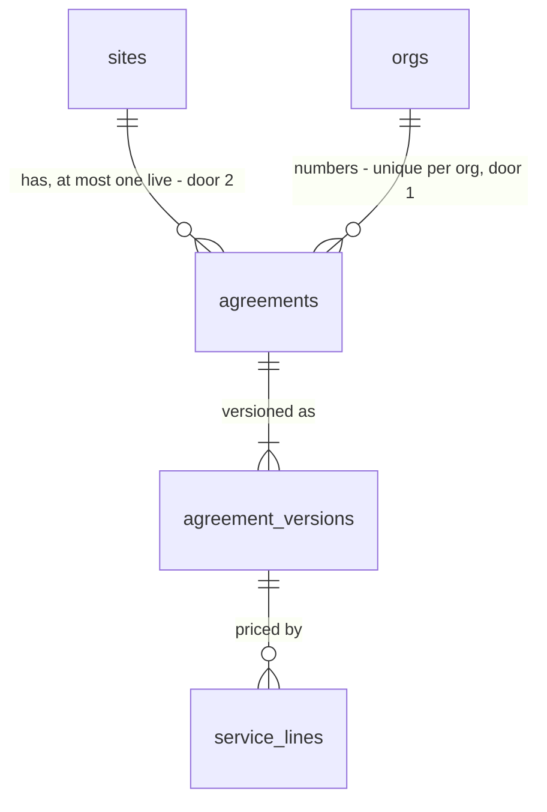

# Agreement builder: create an agreement for a site, price it with service lines, and keep its versions

## Problem

A writer cannot start a service agreement. The `agreements`, `agreement_versions` and
`service_lines` tables exist (supabase-init) and the pipeline shows the 12 seeded demo agreements,
but nothing in the app creates one, prices one or opens one: a card on `/pipeline` and a row on a
customer's page link nowhere. An estimator who has just imported 336 assets onto a site (Phase 2)
has no next step in the product, and prices the job in a spreadsheet the app never sees. An
agreement the customer asked to change (`changes_requested`, demo AG-1048) has no way back to a
draft, and if it had one, the existing revise RPC would start the new version with no price lines,
because it copies the snapshot and not the lines.

The source (ROADMAP.md Phase 3 item 1, M7, PRODUCT.md "Agreement anatomy") gives no user evidence
or date. It fixes the scope: visit frequency, service price lines (visits per year x cost per
visit), versions. "Service included", the equipment list, the PDF, sending and the portal are the
next four Phase 3 items.

When this ships, a writer presses "New agreement" on a site, lands on `/agreements/<id>` showing
`AG-1052 · Version 1 · In progress`, adds lines such as "Preventive maintenance visit, 4 visits a
year, $892.50 a visit" and sees each line's annual amount and the total per year. The card appears
in "In progress" on the pipeline with that total and opens the agreement. An agreement with changes
requested gets "Start version 2", which opens a draft carrying version 1's lines; version 1 stays
readable and unchanged.

## Flow

This reuses the agreement state machine and `transitionAgreement` (withdraw, revise) with its RPC,
`lineAnnualCents` / `sumCents` / `cents` and `formatCad` for money, `pipelineStage` and
`STAGE_META` for the status label, the `writer()` guard and `isUuid` from the import actions, the
AD-029 adapter error mapping, and `Button`, `TextInput`, `StatusPill`, `EmptyPanel` and the
`DiscardPrompt` confirm pattern.

1. `/sites/[siteId]` (exists) shows writers "New agreement", or the site's live agreement as a link; `SiteRegister.get` (exists) gains the live agreement (door 7).
2. `createAgreementAction` (new Server Action, placement) -> `writer()` (exists) -> `AgreementStore.create` (door 7) -> `public.create_agreement` (door 3): one transaction inserts the agreement `draft` with its number (door 1) and version 1; a second live agreement on the site is refused (door 2). Redirects to `/agreements/<id>` (door 6).
3. `/agreements/[agreementId]` reads `AgreementReader.get(id, versionNo?)` (door 7): number, status, site, customer, versions, and the shown version's lines with their annual amounts and total from `lineAnnualCents` / `sumCents` (exist).
4. Line writes: `addServiceLineAction`, `updateServiceLineAction`, `removeServiceLineAction` (new Server Actions) -> `writer()` -> `validateServiceLine` (new, pure, placement in `web/domain/agreement`) -> `ServiceLineStore` (door 7) as the member; the trigger `service_lines_frozen` (door 4) refuses a member's line write unless the agreement is `draft` and the line is on its latest version.
5. `reviseAgreementAction` / `withdrawAgreementAction` (new Server Actions) -> `transitionAgreement` (exists) -> `apply_agreement_transition` (exists, replaced so `agreement.revised` also copies the lines, door 5).
6. Out: the page re-renders; `PipelineReader.board` and `CustomerDirectory.detail` (exist, unchanged queries) show the new number, version and total; `KanbanCard` and the customer's agreement rows link to `/agreements/<id>`.

## Impact

| Front | What changes |
| --- | --- |
| domain | new term: **agreement number**, `AG-<n>`, given once at creation, unique in the org, never typed |
| domain | new term: **live agreement** of a site, one in `draft`, `sent` or `changes_requested`. A site has at most one; `accepted`, `refused`, `expired` and `withdrawn` free the site |
| domain | new term: **service line**, a priced line of a version: description, visits per year, cost per visit; annual amount = visits x cost. "Visit frequency" is the visits per year on each line |
| domain | existing term: `agreement.revised` meant "new version with the previous snapshot"; it now also copies the previous version's service lines. Callers: `transitionAgreement` (no caller in the app yet), `supabase/tests/transitions.sql` C5 (asserts the snapshot copy only, still true) |
| domain | existing term: a version was any row; now only the latest version of a `draft` agreement can change. Past versions are a record |
| stored data | `agreements` gains `unique (org_id, number)` and the partial unique index of door 2; both run against the 12 demo agreements (one per site, distinct numbers, checked before the migration). Nothing to backfill; `number` stays nullable and is always set from now on |
| stored data | `agreement_versions.snapshot` stays `{}`: "Service included" and the equipment list fill it in the next items |
| tests | SQL fixtures that insert several `draft` agreements on one site, or write `service_lines` as a member on a version that is not the latest of a `draft` agreement, must be arranged so (`fixture.sql`, `rls_roles.sql`, `rls_isolation.sql`, `domain_constraints.sql`); no assertion is weakened |
| seed | `supabase/seed.sql` re-runs insert lines on `sent` and `accepted` demo agreements with `on conflict do nothing`, which fires BEFORE INSERT triggers; door 4 leaves non-member writes alone so the seed stays re-runnable (AD-021) |
| screens | new `/agreements/[agreementId]`; `/sites/[siteId]` gains "New agreement" / the live agreement link; pipeline cards and customer agreement rows become links. The sidebar "Agreements" item stays disabled |
| composition | `getContainer()` gains the agreement reader, the agreement store and the line store |
| decisions | doors 1 to 7 reach past this feature (PDF, portal and contract print the number; renewals meet door 2) and get `AD-051`+ rows; door 6 extends AD-024 / AD-028 |
| types | `database.types.ts` regenerated after the migration |
| docs | `CONTEXT.md` "Service agreement (M7, M8)" and Build log; ROADMAP Phase 3 item 1 ticked |
| security advisors | the migration must leave `get_advisors` at the two accepted findings |

## Relations

One-way constraints: an agreement number is unique within its org (door 1); a site has at most one
agreement in `draft`, `sent` or `changes_requested` (door 2); a member can add, change or remove a
service line only on the latest version of a `draft` agreement (door 4). No columns and no types
here.

## Surface

| Route | In | Out | Status |
| --- | --- | --- | --- |
| page `GET /agreements/[agreementId]` | `agreementId`, `?version=<n>` | the agreement with the shown version's lines and totals | `200`, `404`, redirect to `/login` |
| `POST` Server Action `createAgreementAction` | `siteId` | redirect to `/agreements/<id>` · state `open_exists` with `agreementId`, `number` · `forbidden` · `not_found` · `unavailable` | `303`, `200` |
| `POST` Server Action `addServiceLineAction` | `agreementId`, form `description`, `visitsPerYear`, `costPerVisit` | state `saved` · `invalid` with field errors · `too_many` · `locked` · `forbidden` · `not_found` · `unavailable` | `200` |
| `POST` Server Action `updateServiceLineAction` | `lineId`, form `description`, `visitsPerYear`, `costPerVisit` | state `saved` · `invalid` with field errors · `locked` · `forbidden` · `not_found` · `unavailable` | `200` |
| `POST` Server Action `removeServiceLineAction` | `lineId` | state `removed` · `locked` · `forbidden` · `not_found` · `unavailable` | `200` |
| `POST` Server Action `reviseAgreementAction` | `agreementId` | redirect to `/agreements/<id>` · state `conflict` · `invalid_transition` · `forbidden` · `not_found` | `303`, `200` |
| `POST` Server Action `withdrawAgreementAction` | `agreementId` | state `withdrawn` · `conflict` · `invalid_transition` · `forbidden` · `not_found` | `200` |

## Landing

| One-way door | Literal shape | Alternative rejected |
| --- | --- | --- |
| 1. agreement number | `alter table public.agreements add constraint agreements_org_id_number_key unique (org_id, number)`; `create_agreement` takes `pg_advisory_xact_lock(hashtextextended('agreement_number:' \|\| v_org::text, 0))`, then sets `number = 'AG-' \|\| (coalesce(max(substring(number from '^AG-([0-9]+)$')::integer), 1000) + 1)` over the org's agreements | one Postgres sequence per org, because sequences are schema objects and onboarding would run DDL per tenant; a counter table, because it is a second source for the number and nothing deletes an agreement, so max + 1 never reuses one; numbering at send (user chose creation, 2026-10-27) |
| 2. one live agreement per site | `create unique index agreements_one_live_per_site on public.agreements (site_id) where status in ('draft', 'sent', 'changes_requested')`; `create_agreement` maps its `23505` to "open exists" | an app-side check before the insert, because two clicks race past it; including `accepted`, because an accepted agreement stays `accepted` after its contract completes, so the site could never get next year's agreement |
| 3. the create write | `public.create_agreement(p_site_id uuid) returns uuid`, security invoker, `search_path = ''`: site missing or outside the caller's orgs `P0002`, `private.has_org_role(org, array['owner','admin','estimator'])` else `42501`, then the number (door 1), `insert into public.agreements (org_id, site_id, number)` (status default `draft`) and `insert into public.agreement_versions (org_id, agreement_id, version_no) values (..., 1)`; returns the agreement id. No event: creation is not a transition (AD-011) | two PostgREST inserts, because there is no transaction across requests (AD-015) and a crash between them leaves an agreement with no version, which every reader treats as version 1 with nothing to edit |
| 4. lines frozen outside the draft | `private.service_lines_frozen()` (security definer, `search_path = ''`), `before insert or update or delete on public.service_lines for each row`: returns at once when `auth.uid() is null` (seed, migrations, service role); otherwise reads the line's agreement `for share` (no row passes, for an org cascade) and raises `55000` unless its status is `draft` and the line's `agreement_version_id` is its highest `version_no`. Adapters map `55000` to `locked` | an adapter check before the write, because a withdraw or a revise landing in between would change a version the customer may hold; guarding every role, because `seed.sql` re-runs insert lines on `sent` demo agreements and `on conflict do nothing` fires BEFORE INSERT triggers first |
| 5. revise copies the lines | `create or replace function public.apply_agreement_transition(...)`, same signature and grants; on `agreement.revised`, after inserting version n + 1, `insert into public.service_lines (org_id, agreement_version_id, position, description, visits_per_year, cost_per_visit_cents) select ... from public.service_lines where agreement_version_id = <version n>` | copying in the app after the transition, because it is a second request and a crash leaves version n + 1 with no price; leaving version n + 1 empty, because the estimator would retype every line to change one |
| 6. the agreement URL | `/agreements/[agreementId]`, flat by uuid, `?version=<n>` for a past version; created by a Server Action from the site page, so there is no `/sites/[siteId]/agreements/new` page | nesting under the site, because the portal, emails, the pipeline and the contract link to an agreement knowing only its id (AD-024, AD-028); a "new" form page, because creation has no field to fill |
| 7. the agreement ports | `AgreementReader.get(id, versionNo?): Promise<AgreementDetail \| null>` with `AgreementDetail = { id, number, status, stage, site: { id, name }, customer: { id, name }, versions: { versionNo, createdAt }[], shown: { versionNo, current: boolean, lines: ServiceLineView[], annualCents }, editable: boolean }` and `ServiceLineView = { id, position, description, visitsPerYear, costPerVisitCents, annualCents }`; `AgreementStore.create(siteId): Promise<{ ok: true; id } \| { ok: false; code: WriteFailure } \| { ok: false; code: "open_exists"; agreementId; number }>`; `ServiceLineStore.add(agreementId, value) -> { ok: true; id } \| { ok: false; code: WriteFailure \| "locked" \| "too_many" }`, `update(lineId, value)`, `remove(lineId) -> { ok: true } \| { ok: false; code: WriteFailure \| "locked" }`; `SiteView.liveAgreement: { id, number, status } \| null` | one wide agreement repository, because the page, the site register and the line form would depend on methods they never call (AGENTS.md ISP, AD-023, AD-029); extending `AgreementRepository`, because it is the transition port and stays that |

- Nothing else in this change is hard to reverse: the field limits, the 50-line cap, the copy, the layout and the line order are app-side.

## Criteria

"Writer" means owner, admin or estimator. A **live** agreement is one in `draft`, `sent` or
`changes_requested`. The **current** version is the agreement's highest `version_no`. Amounts are
shown with `formatCad`.

### S1: A writer starts an agreement for a site (P1)

**Acceptance Criteria**

1. WHILE a site has no live agreement the site page SHALL show writers a "New agreement" button
2. WHILE a site has a live agreement the site page SHALL show every member a link `<number> · <stage label>` to `/agreements/<id>` and no "New agreement" button
3. WHEN a writer presses "New agreement" THEN the system SHALL, in one transaction, create an agreement in `draft` on that site with version 1 and no service lines, and redirect to `/agreements/<id>`
4. The system SHALL number a new agreement `AG-<n>`, where `n` is one more than the highest `AG-<digits>` number in the org, or `AG-1001` when the org has none
5. IF two agreements are created in the same org at once THEN the system SHALL give them different numbers
6. IF "New agreement" is pressed for a site that has a live agreement (two tabs, two clicks) THEN the system SHALL create nothing and show "<number> is already in progress for this site." with a link to it
7. IF the site id is malformed, missing or of another org THEN the system SHALL create nothing and return `not_found`

**Independent test:** as the demo owner, on a demo site whose agreement is refused (no live agreement), press "New agreement" -> `/agreements/<id>` shows `AG-1052 · Version 1 · In progress`, and `/pipeline` has the card in "In progress".

### S2: A writer prices the draft with service lines (P1)

**Acceptance Criteria**

8. WHEN a member opens `/agreements/<id>` THEN the system SHALL show the number, the stage label, the customer and the site as links, `Version <n>`, and the shown version's lines in `position` order (then creation order), each with description, visits per year, cost per visit and annual amount, and below them `Total per year <amount>` with "Before tax"
9. WHEN the shown version has no lines THEN the system SHALL show "No service lines yet." and, to writers on an editable version, the add form pre-filled with description "Preventive maintenance visit" and 4 visits per year
10. WHILE the agreement is `draft` and the current version is shown, the system SHALL show writers "Add line", and "Edit" and "Remove" on each line
11. WHEN a writer adds or saves a line that passes `validateServiceLine` THEN the system SHALL store it on the current version (a new line after the last one) and re-render with its annual amount and the total recomputed
12. The system SHALL accept a description of 1 to 200 characters after trimming, visits per year as a whole number from 1 to 365, and a cost per visit in dollars from 0 to 999,999.99 with at most two decimals, an optional `$` and thousands commas, stored as integer cents
13. IF a line fails `validateServiceLine` THEN the system SHALL store nothing and show each field's message under that field
14. IF a writer adds a line to a version that already has 50 lines THEN the system SHALL store nothing and show "An agreement version can have at most 50 lines."
15. WHEN a writer presses "Remove" THEN the system SHALL ask "Remove <description>?" with "Remove" and "Cancel", and delete the line only on "Remove"
16. The system SHALL compute each line's annual amount as visits per year x cost per visit and the total as the sum of the shown version's lines, in integer cents

**Independent test:** add "Preventive maintenance visit, 4, $892.50" and "Filter changes, 2, $150" -> annual $3,570.00 and $300.00, `Total per year $3,870.00`; the pipeline card shows $3,870.

### S3: Versions are a record, and a requested change starts the next one (P1)

**Acceptance Criteria**

17. WHEN an agreement has more than one version THEN the page SHALL list every version newest first with its creation date, marking the current one, each linking to `?version=<n>`
18. WHEN a member opens `?version=<n>` for a version that is not the current one THEN the system SHALL show that version's lines and total read-only with "Version <n> of <latest>, read-only", and IF `<n>` is not a version of the agreement THEN the system SHALL show the current version
19. WHILE the agreement is `changes_requested` the page SHALL show writers "Start version <n + 1>"
20. WHEN a writer presses "Start version <n + 1>" THEN the system SHALL, in one transaction, move the agreement to `draft`, create version `n + 1` with a copy of version `n`'s lines (description, visits, cost, position) and leave version `n` and its lines unchanged, then show version `n + 1` editable
21. WHILE the agreement is `draft` or `sent` the page SHALL show writers "Withdraw", which asks "Withdraw <number>? It leaves the pipeline and frees the site for a new agreement." and moves it to `withdrawn` only on confirm
22. WHILE the agreement is not `draft` the page SHALL show no add, edit or remove control and the label "<stage label>, read-only"

**Independent test:** on demo AG-1048 (`changes_requested`, one line) press "Start version 2": version 2 shows the same line editable; `?version=1` shows it read-only; editing version 2 leaves version 1's total unchanged.

### S4: Only the latest draft changes, and only writers change it (P1)

**Acceptance Criteria**

23. IF a member's line add, edit or remove reaches a version that is not the current one of a `draft` agreement (sent, withdrawn or revised meanwhile) THEN the database SHALL refuse it and the system SHALL return `locked`, shown as "This version can no longer be changed."
24. IF a viewer opens an agreement THEN the system SHALL show it with no "New agreement", add, edit, remove, revise or withdraw control
25. IF a viewer's request reaches any of the six actions THEN the system SHALL write nothing and return `forbidden`
26. IF a page or action names a malformed, missing or other-org agreement, line or site id THEN the page SHALL respond 404 and the action SHALL change nothing and return `not_found`
27. IF a revise or withdraw finds the agreement no longer in the status it read THEN the system SHALL change nothing and return `conflict`, shown as "This agreement changed meanwhile. Reload to see it."
28. IF a store call fails unexpectedly THEN the system SHALL change nothing, return `unavailable`, show "We couldn't save this. Try again." and log the error with `console.error`
29. The system SHALL read and write agreements and lines with the signed-in member's client, never a service-role key, and take `org_id` from the member, never the request

**Independent test:** with version 2 open in a tab, withdraw in another tab; saving a line in the first returns "This version can no longer be changed."

### S5: The agreement is reachable from where it shows up (P2)

**Acceptance Criteria**

30. The pipeline SHALL link every card to `/agreements/<id>` of its agreement
31. The customer page SHALL link every row of its "Agreements" section to `/agreements/<id>` of its agreement

**Independent test:** click the AG-1048 card on `/pipeline`; the agreement page opens.

## Out of scope

| Excluded | Why |
| --- | --- |
| "Service included" and the equipment list in the version snapshot | Phase 3 item 2; `snapshot` stays `{}` |
| Sending to the customer, the portal, the PDF | Phase 3 items 3 to 5; no "Send" button until the portal exists |
| Showing the customer's change-request reason | the portal (item 4) is what records it; demo AG-1048 has no event |
| Reordering lines | lines keep their add order; drag or move controls are a later polish |
| An "Agreements" list page in the sidebar | the pipeline and customer pages list them; the item stays disabled |
| Line templates, per-equipment-type pricing, discounts, tax lines | user chose free-form lines (2026-10-27); tax stays the settings' tax note |
| Editing the agreement number, deleting an agreement | the number is the customer's reference; withdraw is the way out |
| Agreement-level dates (start, term, expiry) | contract terms come with the contract (Phase 4) |

## Assumptions

| Assumption | Chosen default | Rationale | Confirmed? |
| --- | --- | --- | --- |
| Agreement numbering | `AG-<n>` per org at creation, continuing from the highest existing number | user chose the recommendation, 2026-10-27 | y |
| What a price line is | free-form: description, visits per year, cost per visit; visit frequency is the line's visits per year | user chose the recommendation, 2026-10-27 | y |
| First number in a new org | `AG-1001` | matches the demo's four-digit style; a customer never sees `AG-1` | n |
| Live means `draft`, `sent`, `changes_requested` | one live agreement per site; accepted, refused, expired and withdrawn free the site | one deal per site on the pipeline; accepted must not block next year's renewal | n |
| Pre-filled first line | the empty add form, not a stored line, suggests "Preventive maintenance visit", 4 visits | a stored $0 line would look like a real price on the pipeline | n |
| Line limits | description 200, visits 1-365, cost up to $999,999.99, 50 lines a version (app-side, a race can reach 51) | a PM agreement has a handful of lines; the limits stop a typo, not an attacker | n |
| Line edits and pipeline age | adding or editing a line does not touch `agreements.updated_at`, so the card's age keeps counting from the last status change | the card's age is defined as days since the last status change | n |
| Concurrent edits of one line | last write wins | the convention of every form so far (record-forms, settings) | n |
| Withdraw from `sent` | offered, as the state machine allows it | an estimator must be able to pull a sent agreement; nothing reaches the customer yet | n |

**Open questions:** none - all resolved or logged above.

## Observable

| Surface | Decision | Landing |
| --- | --- | --- |
| screen `/agreements/<id>` | empty state | AC 9 |
| screen `/agreements/<id>` | loading state | n/a decision - a `loading.tsx` like the other `(app)` pages, and each action's button pending (existing pattern) |
| screen `/agreements/<id>` | error state | AC 13, 14, 23, 27, 28 |
| screen `/agreements/<id>` | unauthorised | AC 24, 25, 26 (other org is 404); signed out redirects to `/login` (existing `MemberGate`) |
| screen `/agreements/<id>` | density and ordering | AC 8 (position then creation order), AC 17 (versions newest first) |
| screen `/agreements/<id>` | destructive action confirms | AC 15 (remove line), AC 21 (withdraw); "Start version" is not destructive (AC 20 keeps version n) |
| screen `/sites/<id>` | states added | AC 1, 2, 6 |
| screens `/pipeline`, `/customers/<id>` | states added | AC 30, 31; their empty, loading and error states are unchanged |
| collection: service lines | grouping, naming, ordering, duplicates, the exception | AC 8 (order), AC 14 (cap); two identical lines are allowed (a contractor may list two visit types the same way); no grouping |
| collection: versions | ordering, the exception | AC 17, AC 18 (unknown version shows the current one) |
| Server Actions (all six) | error shape and codes | Surface statuses; AC 6, 7, 13, 14, 23, 25-28 |
| Server Actions (all six) | who may call them | AC 25, 29 |
| Server Actions (all six) | versioning, rate limits | n/a - same-origin Server Actions behind a staff session; a repeated create answers `open_exists` (AC 6) |
| copy: withdraw and revise | what the reader does next | AC 21 (says the site is freed), AC 20 (lands on the new editable version) |

## Sources

- ROADMAP.md Phase 3 item 1 and M7; PRODUCT.md "Agreement anatomy": visit frequency, service price lines (visits/yr x cost/visit), versions
- `supabase/migrations/20261019174738_init.sql` (`agreements`, `agreement_versions`, `service_lines`) and `20261023222239_transition_rpcs.sql` (revise copies the snapshot only)
- STATE.md AD-003, AD-005, AD-011, AD-012, AD-015, AD-021, AD-023, AD-024, AD-028, AD-029, AD-048
