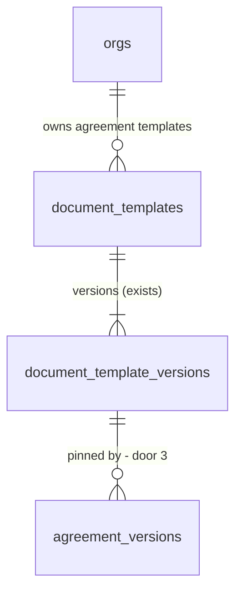

# Agreement templates

## Problem

Every agreement starts empty and prints the same fixed layout. The estimator rebuilds the same service lines (a quarterly HVAC visit, a monthly critical-systems visit) from nothing for each site, the tenant cannot add its own intro or closing text to the agreement a customer reads, and cannot hide a section that a given kind of customer does not need. Nothing records which wording or layout a sent agreement carried: the layout is code, so a later change to the code changes what an already sent agreement looks like. The ROADMAP records the wording half as open (Phase 5.5 item 1: "agreements and contracts record the template version used"; the contract half shipped on 2026-11-12), and the owner supplied a screenshot of a Templates screen of reusable agreement presets (name, description, default frequency, equipment types, standard clauses, a preview panel with Use template and Duplicate, and a New template button).

The source gives no volume or time-saved figure; the evidence is the roadmap text, the code and that screenshot.

When this ships, a tenant keeps several agreement templates on a Templates screen. A template holds an intro, a closing text, which optional sections show, and preset service lines (visit months, equipment types, optional price per visit). An estimator starts an agreement from a template and gets the preset lines; the agreement records the template version it was made from, freezes it when sent, and the PDF and the customer's review page draw from that frozen version.

## Flow

Reuses the contract-templates machinery (`document_templates`, immutable `document_template_versions`, `validateBlocks` and `renderBlocks` with the merge-variable whitelist, the `ContractReader` pattern of returning the joined body) instead of a second template store; the agreement document builder `buildAgreementDocument` stays the one seam for the PDF, the portal and the staff preview.

1. Owner or admin opens `/templates` -> `makeListAgreementTemplates` over `supabaseAgreementTemplateReader` (new, no door - placement; the reader returns every template RLS shows, the use case keeps the org's own and falls back to the system one) reads `document_templates` and the latest version of each through RLS (exists) -> cards and the preview panel.
2. New template, Edit, Duplicate -> `saveAgreementTemplateAction` (new) validates the body with `validateAgreementTemplate` (new, extends the exists `validateBlocks`) -> `public.save_agreement_template` (new, door 2) inserts the template row when new and always a new immutable version.
3. Estimator presses Use template on the preview (a link to `/agreements/new?template=<versionId>`) and picks a site -> `createAgreementAction(siteId, templateVersionId)` (exists, extended; the New agreement dialog's `startAgreementAction` still starts plain agreements and maps an `invalid_template` it cannot receive to unavailable) -> `public.create_agreement(p_site_id, p_template_version_id)` (exists, extended, door 3) creates the draft pinned to that version -> the preset lines are copied into version 1 by `private.apply_template_preset` (new, no door).
4. Staff send -> `public.send_agreement` (exists, extended) freezes the pin: a draft with no pin gets the system agreement template's latest version; the id never changes afterwards (door 3).
5. PDF route, review portal and staff preview (`app/(app)/agreements/[agreementId]/pdf/route.ts` is the staff preview: the agreement page itself draws no template text; `application/use-cases/portal.ts`, all exist) -> `AgreementReader` and `portal_view` (exist, extended) return the pinned body -> `buildAgreementDocument` (exists, extended) renders intro, shown sections and closing text -> `agreement-pdf.tsx` and the review page (`components/review/review-view.tsx`, through `portalTemplateText`; both exist) draw them.

## Impact

| Front | What changes |
| --- | --- |
| domain | new term: agreement template - a kind `agreement` template whose version body holds a name, a description, an intro, a closing text, the shown sections and a preset; one version is immutable and an edit makes the next |
| domain | new term: preset - draft service lines (description, visit months, equipment type codes, optional price per visit) and an optional term length copied into a new agreement; not a pricing model |
| domain | existing term: decision 13 "one default plus clone" - an org now keeps several agreement templates and a picker appears on Use template; the system template remains the default for an agreement started without one. Amended, recorded in STATE as a new AD |
| existing callers | `create_agreement(p_site_id)` gains an optional second argument; callers: `supabaseAgreementStore.create` (maps its errors, `22023` to `invalid_template`), `createAgreementAction` (passes the version), `startAgreementAction` (unchanged, plain), the New agreement form (shows the template name) and dialog (unchanged); the `plan_limits` guard and the site-inactive rule inside it stay as they are |
| existing callers | `send_agreement`, `portal_view` and the agreement reader read one more column; the PDF route, `portal.ts`, `buildAgreementDocument` and the agreement document tests (`domain/agreement/document.test.ts`, `infrastructure/documents/agreement-pdf.test.ts`) read the new `intro`, `footer` and `sections` on `AgreementDocument` |
| existing callers | the agreement PDF and review page for the system template must print exactly what they print today (AC 9) |
| stored data | existing `agreement_versions` rows keep a null pin: a sent one means the system layout it was drawn with (the pin is read as the system version 1 when null and the version was sent before this feature), nothing is backfilled |

## Relations

One-way constraints: an agreement version's pin is set once and never changed after send (door 3); template versions stay immutable (exists); several templates per org per kind for `agreement` (door 1 replaces the one-per-org-per-kind index).

## Surface

| Route | In | Out | Status |
| --- | --- | --- | --- |
| `GET /templates` | session | the template list and preview | 200, 302 to `/login` |
| `GET /templates/new` | session (owner, admin) | the editor, empty | 200, 302 to `/login`, 302 to `/templates` |
| `GET /templates/[templateId]` | session (owner, admin) | the editor with the latest version | 200, 302 to `/login`, 302 to `/templates`, 404 |
| `GET /templates?selected=<templateId>` | session | the same list with that card selected (the first when absent or unknown) | 200, 302 to `/login` |
| `GET /agreements/new?template=<versionId>` | session (owner, admin, estimator) | the New agreement form with "From template: <name>" above the site choice | 200, 302 to `/login` |
| `rpc save_agreement_template(p_template_id, p_body)` | template id or null, body | the template id and version number | 200, 403 `42501`, 404 `P0002`, 422 `22023` |
| `rpc archive_agreement_template(p_template_id)` | template id | nothing | 200, 403 `42501`, 404 `P0002` |
| `rpc create_agreement(p_site_id, p_template_version_id)` | site, optional version | agreement id | 200, 404 `P0002`, 403 `42501`, 409 `23505`, 409 `55000` (`site_inactive`, `plan_limit_agreements`), 422 `22023` for a version that is not an agreement template of the org or the system |

## Landing

| One-way door | Literal shape | Alternative rejected |
| --- | --- | --- |
| 1. Several agreement templates per org | the unique index becomes partial: `unique (coalesce(org_id, zero uuid), kind) where kind = 'contract'`, so contracts keep one per org and agreements are unlimited; a template row gains `archived_at timestamptz` so a retired one leaves the list without deleting its versions | Keep one per org and keep presets elsewhere: cannot express the screenshot's list, and a second store for presets would duplicate the versioning. Delete a template: a sent agreement still points at its version |
| 2. The agreement template body | `{ "schema": 1, "name": "Standard commercial HVAC PM", "description": "...", "intro": [Block], "footer": [Block], "sections": { "schedule": true, "scope": true }, "preset": { "termMonths": 12 or null, "lines": [ { "description": "...", "visitMonths": [3,6,9,12], "assetTypeCodes": ["RTU"], "costPerVisitCents": 45000 or null } ] } }`; a `Block` is the contract template's heading, paragraph or clause; at most 20 preset lines, 30 blocks per list, 2,000 characters a text, the same variable whitelist | One flat `blocks` list like the contract's: cannot say which text goes before the price table and which after. System blocks (price table, schedule) in a movable list: the roadmap keeps the price table and signatures fixed and this feature only shows or hides the schedule and the scope |
| 3. An agreement version pins its template version | `agreement_versions.template_version_id uuid null references document_template_versions (id)`; set by `create_agreement` when a template is used, copied by a revise to the new version, set by `send_agreement` to the system agreement version when still null, and never changed after the version is sent | A column on `agreements`: a revise after a change request would silently move every earlier version to the new layout, and versions are what the customer saw. Always re-pin to the latest at send: the draft the estimator previewed would change under them |
| 4. The save and archive path | `public.save_agreement_template(p_template_id uuid, p_body jsonb) returns table (template_id uuid, version_no integer)` and `public.archive_agreement_template(p_template_id uuid)`, both `security definer` (the second sets `archived_at` once and touches nothing else), owner and admin only, kind fixed to `agreement`, checks the body is `schema` 1 with the keys of door 2 and a size under 64 KB; a member has no insert on either table | Direct table writes with an RLS insert policy: a policy cannot check the version number or the body shape. Validation only in the app: a member could call the table with a body that cannot be drawn |
| 5. (found while building) What "sent" means for the pin, and when send writes it | `agreement_versions` trigger `private.agreement_version_pin_frozen` refuses (`55000`, hint `template_pin_frozen`) any change of `template_version_id` unless the version is the latest of an agreement whose status is `draft` (the rule `service_lines_frozen` uses; the snapshot cannot tell, because a revise copies it into a new draft). So `send_agreement` pins the system version through `private.pin_system_agreement_template` BEFORE `apply_agreement_transition`, while the version is still a draft | Test the snapshot as "frozen": a revised draft carries a copied snapshot, so its pin could not be set. Pin after the transition: the trigger would refuse the send's own write |
| 6. (found while building) System template uniqueness and the term bound | door 1 also adds `unique (kind) where org_id is null`, so the system keeps exactly one template per kind now that the contract-only index no longer covers `agreement`; the SQL body check limits `preset.termMonths` to 1-60, the range of `agreement_versions.term_months` (the TS rule of C5324 says 1-120: see the build report) | No second index: two system agreement templates become possible. Allow 120 in SQL: `create_agreement` would fail with a check violation for a stored template |

- A text's variables come from the contract template's whitelist; an unknown one counts as no value at render time and is rejected on save by `validateAgreementTemplate`
- Nothing else in this change is hard to reverse

## Criteria

### S1: A template is stored, versioned and frozen (P1)

Templates are immutable data; an agreement records which version it used and cannot change it once sent.

**Acceptance Criteria**

1. The system SHALL hold one system agreement template whose version 1 has an empty intro, an empty closing text, every optional section shown and no preset, readable by every member
2. WHEN an owner or admin saves a template THEN `save_agreement_template` SHALL insert a template row for a new one and a new version numbered one more than the latest, and SHALL change no earlier version
3. IF an estimator, a viewer or a non-member calls `save_agreement_template` THEN it SHALL raise `42501` and write nothing
4. IF the body is not schema 1, has an unknown key, is over 64 KB or fails the limits of door 2 THEN it SHALL raise `22023` and write nothing
5. WHEN `create_agreement` is called with a template version of the org or the system THEN the new `agreement_versions` row SHALL carry that id, and IF the version belongs to another org or is a contract template THEN it SHALL raise `22023` and create nothing
6. WHEN a draft agreement with no pin is sent THEN `send_agreement` SHALL set the system agreement template's latest version, and WHEN a pin exists it SHALL leave it as it is
7. WHEN a change request is revised into a new version THEN the new version SHALL carry the same pin as the version it copies
8. IF anyone changes the pin of a sent agreement version THEN the database SHALL refuse it
9. WHERE an agreement is created without a template THEN its sent PDF and review page SHALL print exactly what they print today for every existing agreement

**Independent test:** save a template, start an agreement from it, send it, then save a newer version and read the sent agreement's pin.

### S2: The agreement draws its pinned template (P1)

Intro, shown sections and closing text reach the PDF, the review page and the staff preview.

**Acceptance Criteria**

10. WHEN the document is built for a version with a pin THEN `buildAgreementDocument` SHALL render the intro after the title block and before the price table, and the closing text after the terms and before the page footer, with the merge variables filled from the version's frozen terms
11. WHEN a section is hidden in the pinned body THEN the document SHALL omit it, and the price table, the terms and the page footer SHALL always be drawn
12. WHERE a draft is previewed THEN the pinned (or system) body SHALL be used with today's settings, and WHERE a version was sent THEN only its frozen pin and frozen terms SHALL be used, never today's template version or settings
13. WHEN a variable in the intro or closing text has no value THEN a clause SHALL be omitted and a paragraph printed with an empty replacement, as in the contract
14. IF the pinned version cannot be read THEN the PDF route, the portal and the preview SHALL fail as other read failures do and SHALL NOT draw the agreement with other wording
15. WHEN the customer's review page is drawn THEN it SHALL show the same intro, shown sections and closing text as the PDF for that version

**Independent test:** send an agreement from a template with an intro and a hidden schedule, then open its PDF and review page.

### S3: The Templates screen (P1)

List, preview, create, edit, duplicate.

**Acceptance Criteria**

16. WHEN a member opens `/templates` THEN the page SHALL list the org's non-archived agreement templates as cards (name, description, derived frequency, updated time) and the selected card's preview with default frequency, equipment type names, the number of sections and clauses, the number of preset lines and the term length
17. WHEN an org has no template of its own THEN the page SHALL show the system template as the one choice and a New template button for an owner or admin
18. WHEN an owner or admin saves the editor THEN the page SHALL return to the list with the template shown and a new version recorded, and WHEN a field fails validation THEN the editor SHALL stay open with that field's message and keep what was typed
19. WHEN an owner or admin presses Duplicate THEN the page SHALL save a copy named `<name> (copy)` as a new template and open it in the editor
20. WHEN an owner or admin archives a template THEN it SHALL leave the list, its versions SHALL stay, and agreements pinned to it SHALL be unchanged
21. WHERE the member is an estimator or viewer THEN `/templates` SHALL show the list and preview without New, Edit, Duplicate or Archive, and `/templates/new` and `/templates/[templateId]` SHALL redirect to `/templates`
22. IF the list cannot be read THEN the page SHALL show "We couldn't load templates. Try again." with a retry link
23. WHILE the page loads THEN it SHALL show a loading screen that names the page

**Independent test:** as the demo owner create, edit, duplicate and archive a template; as the estimator open `/templates`.

### S4: Start an agreement from a template (P2)

Use template copies the preset.

**Acceptance Criteria**

24. WHEN an estimator presses Use template on the preview and picks a site THEN the system SHALL create the agreement pinned to that version with version 1's service lines copied from the preset (description, visit months, equipment types matched by code, price per visit or empty) and the term length when the preset has one, then open it
25. WHEN a preset equipment code matches no type of the org THEN that code SHALL be left off the line and the agreement page SHALL say which codes were skipped
26. WHEN the org is at its live-agreement limit THEN Use template SHALL show the plan-limit message of the New agreement flow and create nothing
27. WHEN a template is used THEN the agreement's lines SHALL be ordinary editable lines, and changing them SHALL NOT change the template

**Independent test:** use a template on a site with equipment and read the new agreement's lines.

## Out of scope

| Excluded | Why |
| --- | --- |
| A "per-asset plus base fee" pricing model (the screenshot's Pricing model row) | The builder prices a line as visits a year times a price per visit; another model changes totals, the PDF and the contract. Needs its own feature |
| Moving or hiding the price table, the terms or the signatures | The roadmap keeps them fixed |
| Per-trade, per-province starter templates, reviewed by a lawyer | Needs the lawyer (decision 14) and the pack machinery; this feature ships only the system template |
| Upload an existing proposal and let Claude split it | After the editor (decision 15) |
| Contract template editing on this screen | The contract wording keeps its own one-per-org template; it gets an editor later |
| Sharing templates between orgs, import, export | No demand yet |
| Restoring an archived template | Duplicate its latest version instead |
| A live PDF preview inside the editor | Phase 5.5 item 3 lists the live preview; this feature shows the structured preview panel only |

## Assumptions

| Assumption | Chosen default | Rationale | Confirmed? |
| --- | --- | --- | --- |
| Where the screenshot's rows come from | Name and description are stored in the body; default frequency is derived from the preset lines (all lines monthly, quarterly, semi-annual, annual or "Mixed"); "8 standard clauses" is the count of clause blocks in the intro and closing text | A derived label cannot disagree with the lines | n |
| Which template an agreement uses when none is chosen | The system template, not an org default | A default flag adds a column and a rule; Use template is one press when wanted | n |
| Who may use a template | Owner, admin and estimator, as for New agreement | Same as creating an agreement | n |
| Who may write a template | Owner and admin | Wording a customer reads is the tenant's to own (decision 14) | n |
| Price per visit in a preset | Optional; an empty price leaves the line empty for the estimator | A preset should not invent a price | n |
| Term length in a preset | Optional; when empty the org's default term applies | Same rule as a new agreement | n |
| Archived templates | Hidden from the list and the picker, never deleted | Sent agreements point at their versions | n |
| Template names | Unique per org ignoring case among the non-archived | Two cards with one name cannot be told apart | n |
| Existing sent agreements | Their null pin means the system layout | They were drawn from it; nothing is backfilled | n |
| Profile | `ui` (raised from `standard` in `AGENTS..md` on 2026-11-12) | The screen has a binding screenshot, kept at `.specs/features/agreement-templates/binding/templates-screen.png` | y |
| Deliberate differences from the screenshot | No eyebrow line above the title (the project's `PageHeader` has title, subtitle and action); the fourth preview row reads Preset lines, not Pricing model (out of scope); one icon-tile tint from the design tokens, not four; the screenshot's sidebar, workspace card, bell and Maintain branding are not part of this feature; the nav gets one Templates link after Agreements | Layout and fields follow the mock, values and components follow DESIGN.md | y |
| The editor's text format | An intro and a closing text are each one text area: a line starting `# ` is a heading, a line starting `- ` is a clause, any other non-empty line is a paragraph | Keeps the block model without a block editor; the live-preview block editor is a later feature | n |
| Duplicate naming | `<name> (copy)`, then `<name> (copy 2)` and so on until the name is free | Names are unique among non-archived templates | n |

**Open questions:**

| # | Kind | Question | Until answered |
| --- | --- | --- | --- |
| 1 | open | Is the screenshot a binding design (colours, icon tiles, "Maintain" branding)? Planned: layout and fields only, DESIGN.md tokens for the rest, no "Maintain" name | The card icon colours and the sidebar label ("Templates") follow DESIGN.md |
| 2 | blocks go-live | A lawyer's review of any intro and closing text we ship as examples | The system template ships with no text, so nothing is shipped unreviewed |

## Observable

| Surface | Decision | Landing |
| --- | --- | --- |
| screen `/templates` | empty state | AC 17 |
| screen `/templates` | loading state | AC 23 |
| screen `/templates` | error state | AC 22 |
| screen `/templates` | unauthorised | AC 21 |
| screen `/templates` | density and ordering | AC 16 (cards by name, selected card previewed) |
| screen `/templates` | destructive action confirms | AC 20 (archive asks to confirm, as the project's destructive actions do) |
| screen `/templates/new`, `/templates/[templateId]` | validation and error states | AC 18 |
| screen `/templates/new`, `/templates/[templateId]` | unauthorised | AC 21 |
| screen `/templates/new`, `/templates/[templateId]` | loading | AC 23 |
| screen the agreement page | empty state, error state | n/a - unchanged, except the skipped-codes note of AC 25 |
| screen the review page | empty and error states | AC 14, AC 15 |
| document the agreement PDF | structure, ordering, next step for the reader | AC 10, AC 11 (the reader's next step, Accept or Refuse, is the unchanged review page) |
| rpc `save_agreement_template` | response shape, error shape, who may call | Surface row; AC 3, AC 4 |
| rpc `create_agreement` | error shape and codes | Surface row; AC 5, AC 26 |
| all new routes and rpc | versioning, rate limits | n/a - internal to the app under a member session; no external consumer |

## Sources

- ROADMAP Phase 5.5 items 1 and 3, "Document templates", decisions 12, 13, 14, 15 - the template model, the editor and the freezing rule. Decision 13 (one default plus clone) is amended by the owner's choice of 2026-11-12 to several templates
- The owner's screenshot of the Templates screen (2026-11-12) - the list, the preview fields and the Use template, Duplicate and New template actions; layout and fields only
- `.specs/features/contract-templates/` - the tables, versions, block model and variable whitelist this builds on
