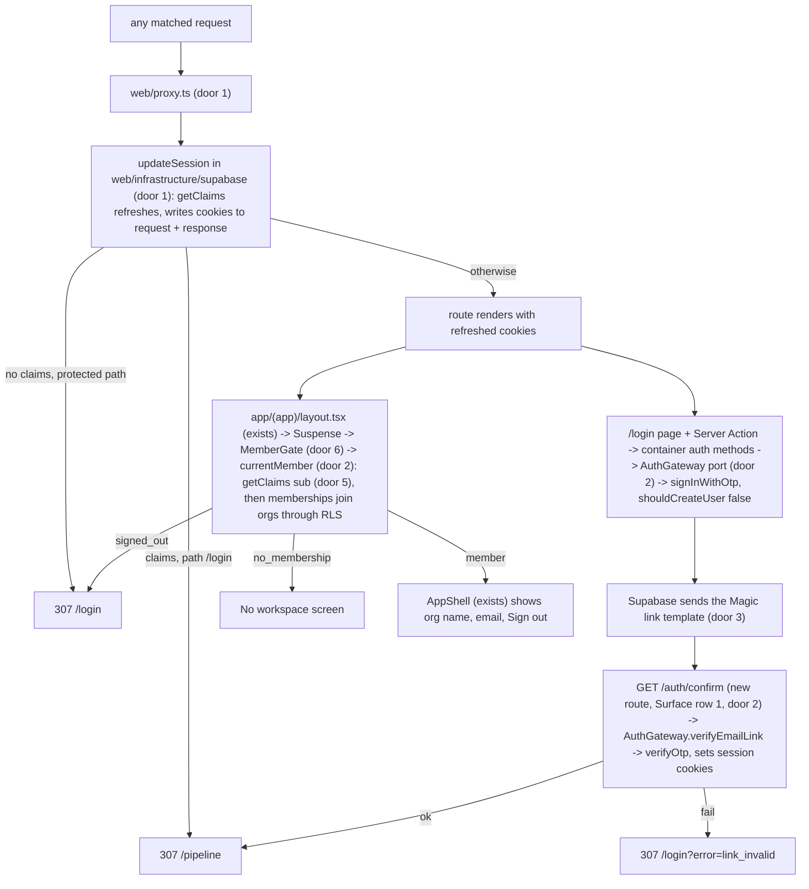

# Staff sign-in with a magic link, and the `proxy.ts` session refresh

## Problem

Nobody can sign in. `auth.users` and `memberships` are both empty on the live project (checked
2026-10-23: 0 users, 0 memberships, 1 org). Every RLS policy decides by `auth.uid()`, so every
request the app makes runs as `anon`. It reads no rows, and a transition returns `forbidden`
(CONTEXT.md, "Until the auth item lands nobody can sign in"). The ports-adapters write path has
only been proven with `tests.act_as` in SQL. It has never run behind a real session cookie
through PostgREST.

The next item (the screens) has to show an org's customers, sites and settings. It cannot show
any of them until a request carries a verified user. The source gives no user-facing evidence;
this is foundation work every remaining Phase 1 item depends on.

When this ships, an existing staff user enters their email on `/login`, follows the emailed link,
and lands on `/pipeline` signed in. The shell shows their company and their email. The session
stays fresh across requests, and signed-out visitors get sent to `/login`.

## Flow

Reuses the request-scoped cookie client in `getContainer()` (`web/composition`), the existing
`memberships` / `orgs` tables and their RLS (AD-004), and the installed `@supabase/ssr` 0.12.7.
There are no new dependencies and no migration.

Sign out is a Server Action from the shell. It runs `AuthGateway.signOut` (scope `local`), which
clears the cookies, then redirects with 303 to `/login`. The demo owner is provisioned by
`supabase/seed.sql` (exists), as door 4.

## Impact

| Front | What changes |
| --- | --- |
| domain | new term: `currentMember` result - `signed_out` / `no_membership` / `member` (user, email, org id, org name, role); every screen and Server Action branches on it (door 2) |
| domain | existing term: "magic link" today means the customer portal link (M9, no account, PRODUCT.md). Staff now get one too. Copy and CONTEXT.md call the staff one the **sign-in link** and keep **portal link** for customers. Nothing in code branches on either yet |
| stored data | nothing to migrate. The seed inserts one `memberships` row only when `app.demo_owner_email` is set (door 4). The demo org has 0 members today, so no existing row is touched |
| config outside the repo | the Supabase Auth Magic link template and the Site URL change in the dashboard (door 3). They are not versioned, so CONTEXT.md records the literal values |
| composition | `getContainer()` gains the auth methods. Its cookie `setAll` try/catch comment ("the proxy refreshes the session") becomes true |
| UI | `AppShell` (client component) gets `orgName`, `email` and a sign-out form from the server layout. `TextInput` with its field-error state is built now, because `/login` is its first caller. The ROADMAP line "Form controls `TextInput` and `Select`" is reworded so it only covers `Select` |
| decisions | doors 1, 2, 4 and 5 reach past this feature, so each gets an `AD-NNN` in `.specs/STATE.md` |

## Relations

None. The stored-data shape does not change. Door 4 writes a row into the existing `memberships` table.

## Surface

Only routes this adds or whose behaviour changes. Server Actions are POSTs that anyone can reach,
so the public one is listed here.

| Route | In | Out | Status |
| --- | --- | --- | --- |
| `GET /auth/confirm` | `token_hash`, `type` | session cookies on success · `Location` without `token_hash` | `307` -> `/pipeline`; `307` -> `/login?error=link_invalid` |
| every proxy-matched path (door 1) | auth cookies | refreshed `Set-Cookie` | pass-through; `307` -> `/login` (signed out, protected path); `307` -> `/pipeline` (signed in, `/login`) |
| `POST /login` (Server Action `requestMagicLink`) | `email` | form state `sent` · `invalid_email` · `rate_limited` · `unavailable` | `200` |

## Landing

| One-way door | Literal shape | Alternative rejected |
| --- | --- | --- |
| 1. session refresh in the proxy (every later route relies on it) | `web/proxy.ts` exports `proxy(request)` and returns `updateSession(request)` from `web/infrastructure/supabase/session.ts`. `config.matcher = ['/((?!_next/static\|_next/image\|favicon.ico\|.*\\.(?:svg\|png\|jpg\|jpeg\|gif\|webp\|ico)$).*)']`. The public paths are exactly `/login` and `/auth/confirm`. `updateSession` calls `supabase.auth.getClaims()` and copies cookies onto `request.cookies` and the returned `NextResponse` | refreshing in the `(app)` layout - Server Components cannot write cookies, so an expired token would never be replaced (Supabase SSR docs); `middleware.ts` - deprecated and renamed `proxy` in Next 16 (`node_modules/next/dist/docs/.../proxy.md`); the proxy as the only gate - the Next docs say to verify inside each Server Function too, so the layout re-checks (AC 13) |
| 2. the `AuthGateway` port and the `currentMember` result (every screen and Server Action branches on it) | `AuthGateway` in `web/application/ports`: `requestMagicLink(email) -> { ok: true } \| { ok: false; code: "rate_limited" \| "unavailable" }` (an unknown email is `ok: true`), `verifyEmailLink(tokenHash) -> { ok: true } \| { ok: false; code: "invalid_link" }`, `signOut() -> void`. `currentMember() -> { status: "signed_out" } \| { status: "no_membership"; email } \| { status: "member"; userId; email; orgId; orgName; role }` | pages calling `supabase.auth` - AD-014 forbids `@supabase/*` in `app/`; returning Supabase's `User` / `AuthError` - leaks adapter types into every caller, and a page could branch on an unknown-email error, which reveals whether an account exists |
| 3. the link shape in the Magic link email (lives in Supabase config, not the repo) | Magic link template href: `{{ .SiteURL }}/auth/confirm?token_hash={{ .TokenHash }}&type=email`. Site URL `http://localhost:3000` for dev. The confirm route calls `verifyOtp({ token_hash, type: "email" })` | the PKCE `code` + `exchangeCodeForSession` flow - fails when the link opens in a different browser or device than the one that asked for it (a phone mail app), which is how contractors read email (decided by the user) |
| 4. how a staff member exists before Phase 5 onboarding | a `seed.sql` block: `insert into public.memberships (org_id, user_id, role) select '00000000-0000-4000-8000-00000000de30', id, 'owner' from auth.users where email = lower(nullif(current_setting('app.demo_owner_email', true), '')) on conflict (org_id, user_id) do nothing`. The user is created first with the dashboard's "Invite user" | the email as a literal in the committed seed - puts a real person's address in git history; inserting into `auth.users` with SQL - skips GoTrue's identities and instance rows, so the magic link may not resolve the user |
| 5. how server code reads identity (the pattern every page copies) | identity is `(await supabase.auth.getClaims()).data?.claims.sub`, in the proxy and in `currentMember`. `getSession()` is never used for identity | `getSession().user` - read from a cookie anyone can forge, and the Supabase docs say not to trust it on the server; `getUser()` - an extra round trip to the Auth server on every request, for a freshness the role check in RLS already provides |
| 6. reading the session under Cache Components (added mid-build; every later `(app)` screen inherits it) | `app/(app)/layout.tsx` has no top-level `await`: it returns `<Suspense fallback={<ShellFallback />}><MemberGate>{children}</MemberGate></Suspense>`. `MemberGate` (async Server Component in `app/(app)/member-gate.tsx`) awaits `currentMember()`, then calls `redirect("/login")`, renders `NoWorkspace`, or renders `AppShell` around `children`. `/login` reads `searchParams` the same way, inside `<Suspense>` with the plain form as the fallback | `export const instant = false` on the `(app)` layout - `next build` accepts it, but it opts every app page out of static-shell validation, and every later screen would inherit the opt-out; `'use cache: private'` on `currentMember` - caches the member in the browser, so a role change or removal would not show until the entry expires |

- Nothing else in this change is hard to reverse

## Criteria

### S1: An existing user requests a sign-in link (P1)

**Acceptance Criteria**

1. WHEN a well-formed email is submitted on `/login` THEN the system SHALL call `signInWithOtp` with the email trimmed and lowercased and `shouldCreateUser: false`, and SHALL show "Check your email" with the text "We sent a sign-in link to <email>."
2. IF the submitted email has no account THEN the system SHALL show the same confirmation as AC 1 and SHALL create no `auth.users` row
3. IF the submitted value is empty, longer than 254 characters, or does not match `local@domain.tld` THEN the system SHALL show the field error "Enter a valid email address" and SHALL NOT call Supabase
4. IF Supabase answers with HTTP 429 THEN the system SHALL show "Too many sign-in emails. Wait a minute and try again."
5. IF Supabase answers with any other error, apart from the unknown-email error in AC 2 THEN the system SHALL show "We couldn't send the link. Try again." and log the Supabase error code on the server
6. WHILE the request is in flight the submit button SHALL be disabled and read "Sending…"

**Independent test:** submit the form with an invalid value, an unknown address, and a provisioned address.

### S2: The link signs the user in (P1)

**Acceptance Criteria**

7. WHEN `GET /auth/confirm` receives an unused `token_hash` with `type=email` THEN the system SHALL call `verifyOtp`, set the Supabase auth cookies, and respond `307` to `/pipeline`
8. IF `token_hash` is missing, `type` is not `email`, or `verifyOtp` fails THEN the system SHALL respond `307` to `/login?error=link_invalid` and set no auth cookie
9. WHEN `/login` is opened with `error=link_invalid` THEN the system SHALL show "That sign-in link has expired or was already used. Request a new one."
10. The `Location` of every `/auth/confirm` response SHALL contain no `token_hash` parameter

**Independent test:** open a real emailed link, then open it a second time.

### S3: The proxy keeps the session fresh and gates the app (P1)

**Acceptance Criteria**

11. WHILE a request has no valid session, WHEN it targets a matched path other than `/login` or `/auth/confirm`, THEN the proxy SHALL respond `307` to `/login`
12. WHILE a request has a valid session, WHEN it targets `/login`, THEN the proxy SHALL respond `307` to `/pipeline`
13. IF a page under `app/(app)` renders and `currentMember` returns `signed_out` THEN the layout SHALL redirect to `/login`
14. WHEN `getClaims` refreshes the session during a request THEN the proxy response SHALL carry every cookie the Supabase client set, with its options
15. The proxy SHALL NOT run for `/_next/static/*`, `/_next/image*`, `/favicon.ico` or paths ending in `.svg`, `.png`, `.jpg`, `.jpeg`, `.gif`, `.webp` or `.ico`

**Independent test:** open `/pipeline` signed out, then open `/login` signed in, and run the proxy unit tests.

### S4: The signed-in member sees their company (P1)

**Acceptance Criteria**

16. WHEN the demo owner is signed in THEN the shell SHALL show "Kettle Ridge Mechanical Ltd.", read from `orgs` through PostgREST under RLS with that user's session, and the user's email
17. IF a signed-in user has no membership THEN pages under `app/(app)` SHALL show "No workspace yet" with the text "Your account isn't part of a company workspace. Ask your company's owner to invite you." and a Sign out button, and no navigation
18. IF a user has more than one membership THEN `currentMember` SHALL return the one with the earliest `created_at`
19. The system SHALL make `currentMember` take the user id from the `getClaims` `sub` claim, and SHALL have no file under `web/` call `auth.getSession`

**Independent test:** sign in as the demo owner and read the sidebar. Then remove the membership in a rolled-back transaction, or use a second invited user, and reload.

### S5: Sign out (P1)

**Acceptance Criteria**

20. WHEN a member activates Sign out THEN the system SHALL call `signOut` with scope `local`, clear the auth cookies and redirect with `303` to `/login`, and opening `/pipeline` afterwards SHALL respond `307` to `/login`

**Independent test:** sign out and then open `/pipeline`.

### S6: The demo owner can be provisioned without committing an email (P1)

**Acceptance Criteria**

21. WHEN `supabase/seed.sql` runs with `app.demo_owner_email` set to an existing auth user's email THEN the system SHALL insert exactly one `owner` membership for that user in the demo org, and running it again SHALL insert nothing
22. WHEN `supabase/seed.sql` runs without `app.demo_owner_email` THEN the system SHALL insert no membership and complete without error
23. The system SHALL keep `supabase/seed.sql` free of any email address literal outside the reserved `example.com` domain (the demo contacts already use it)

**Independent test:** run the seed twice in a rolled-back transaction, once with the setting and once without, and count memberships.

### S7: Boundaries and build hold (P1)

**Acceptance Criteria**

24. WHEN `npm run build`, `npm run lint` and `npm test` run in `web/` THEN all three SHALL exit 0, and no file under `app/`, `components/` or `lib/` SHALL import `@supabase/*` or `@/infrastructure`
25. WHEN the `TextInput` has an error THEN it SHALL render the message under the field, set `aria-invalid="true"`, and link the message with `aria-describedby`

**Independent test:** run the three commands, and render `/login` with an invalid email.

## Out of scope

| Excluded | Why |
| --- | --- |
| Self sign-up and org creation | Phase 5 onboarding. Here `shouldCreateUser` is `false` (decided by the user) |
| Inviting members and a members screen | needs onboarding and roles UI. Phase 1 provisions through the dashboard plus the seed |
| Org switcher | `currentMember` picks the earliest membership. A switcher waits for a real multi-org user |
| Returning to the requested page after sign-in | a `next` parameter carried through the email template is an open-redirect surface. Sign-in always lands on `/pipeline` |
| Password, OAuth, SSO | the roadmap names magic link only |
| Custom SMTP and branded sign-in email | M13 (Phase 3) picks Resend or Postmark |
| Customer portal links | M9 (Phase 3) uses a different mechanism with no account |
| Gating pages by role | RLS already refuses writes by role. Each screen decides what a viewer sees, in the screens item |
| `Select` control | stays with the company settings form |

## Assumptions

| Assumption | Chosen default | Rationale | Confirmed? |
| --- | --- | --- | --- |
| Error Supabase returns for an unknown email under `shouldCreateUser: false` | the adapter folds that error into `ok: true`. Read from the live project on 2026-10-23: HTTP 422, `code` `otp_disabled`, "Signups not allowed for otp"; a bad `token_hash` returns 403 `otp_expired` | the installed type declarations do not name the code. Guessing it would make AC 2 prove nothing (knowledge chain) | n |
| Sign-out scope | `local` (this browser only) | signing out on the shared office PC should not end the estimator's phone session | n |
| `TextInput` timing | built now with the field-error state. `/login` is its first caller | a throwaway native input would be replaced one item later | n |
| `/login` design | built with `/impeccable` to DESIGN.md: centred white panel, product name, no tenant branding (the tenant is unknown before sign-in) | AGENTS..md requires impeccable for UI | n |
| Live proof of AC 7, 16 and 20 | needs one real emailed link. You click it, or paste it into the Playwright session | no service-role key in `web/.env.local`, and one should not be added just to mint links | n |
| Verification profile | `light` (AGENTS..md declares none) | skill default. `standard` would add fault injection on the proxy redirect logic and the unknown-email folding, the two places a wrong implementation still passes a happy-path test | n |

**Open questions:**

| # | Kind | Question | Until answered |
| --- | --- | --- | --- |
| 1 | blocks | Which email becomes the demo owner? You invite it in the Supabase dashboard; it is passed to the seed as `app.demo_owner_email` and never committed | AC 16, 20 and 21 cannot run live |
| 2 | blocks | You change the Magic link template href and confirm the Site URL in the Supabase dashboard (door 3). Only you can do this | AC 7 cannot run live; the default email links into Supabase's own verify page |
| 3 | blocks go-live | Supabase's built-in sender only delivers to the project team's addresses and has a low hourly limit. Real users need custom SMTP (M13) | nobody outside the team can sign in |

## Observable

| Surface | Decision | Landing |
| --- | --- | --- |
| screen `/login` | empty state | the blank form is the initial state, AC 1 |
| screen `/login` | loading state | AC 6 |
| screen `/login` | error state | AC 3, 4, 5, 9 |
| screen `/login` | unauthorised state | AC 12 (a signed-in user is sent on) |
| screen `/login` | density and ordering | n/a - one field and one button |
| screen `/login` | destructive action confirms | n/a - no destructive action |
| screen No workspace | empty, error, unauthorised states | AC 17; signed out is AC 13 |
| shell user area | destructive action confirms | n/a - sign out is undone by signing in again, so no confirm |
| route `GET /auth/confirm` | error shape and codes | AC 8, 9 |
| route `GET /auth/confirm` | response shape | AC 7, 10 |
| route `GET /auth/confirm` | who may call it | anyone; the `token_hash` is the credential, AC 8 |
| route `GET /auth/confirm`, Server Action `requestMagicLink` | rate limits | Supabase's per-project email and verify limits; AC 4 shows the 429 |
| route `GET /auth/confirm`, Server Action `requestMagicLink` | versioning | n/a - only this app's email template and form call them |
| sign-in email (copy) | structure, tone, next step | Supabase default copy with the door 3 href; branded copy is M13 |

## Sources

- ROADMAP.md, M1 ("magic-link auth, RLS") and Phase 1 item 5
- `.specs/STATE.md` AD-004, AD-009 (fixed demo org id, "let the auth item attach a member"), AD-014 (no `@supabase/*` in `app/`)
- Supabase "Server-side auth for Next.js" (via MCP `search_docs`): `getClaims` in the proxy, the `token_hash` template and the `/auth/confirm` route; `web/node_modules/next/dist/docs/01-app/03-api-reference/03-file-conventions/proxy.md`
