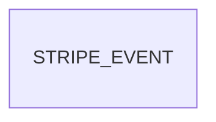

# Billing checkout

Roadmap Phase 5 item 2: "Stripe plans, Checkout with a 14-day trial (card collected up front, subscription cancelled if payment fails), Customer Portal, idempotent webhooks". This feature builds the first and last parts and the safe landing place for Stripe's events. The Customer Portal needs a Stripe customer attached to an org, which only workspace provisioning (item 3) creates, so it moves to that item's neighbour (see Out of scope). One feature at a time (decision 22).

## Problem

A visitor who reaches `/register`, picks a plan and ticks trades is told "Sign-up isn't open yet. Please check back soon." (`getBillingContainer` answers `not_configured` for every selection, pricing-page AC 20). Nobody can start a trial, so no paid tenant can exist, and the owner's own pilot contractors cannot be put on a plan except by hand-seeding (AD-021). Separately, nothing in the system can receive a message from Stripe: a payment that happened would leave no trace the next feature could act on, and a retried delivery would be indistinguishable from a new one. The roadmap gives no sign-up volume or conversion figures and there are no customers yet, so none are claimed here.

When this ships and the owner has put Stripe keys in the environment, a visitor presses a plan on `/register`, lands on Stripe's Checkout page for a 14-day trial with a card required, and returns to a plain thank-you page. Stripe's events reach a signed endpoint that records each one exactly once. Without the keys, everything still answers "not open yet", as today.

## Flow

Reuses `makeStartTrial`, the `CheckoutStarter` port and the register Server Action (pricing-page, AD-166), the signed-webhook shape of the DocuSeal route (`POST /api/webhooks/docuseal`, AD-148: raw body, header shape checked in the route, signature checked in the database against a Vault secret, `503` on failure so the sender retries), and the Resend adapter's `fetch`-without-SDK style (AD-078), instead of a second action, a Stripe SDK or an app-held webhook secret.

Checkout:

1. visitor submits `/register` -> `app/register/actions.ts` (exists) -> `makeStartTrial` (exists) - validates the selection, calls `CheckoutStarter.start`, redirects only to an `https:` url
2. `getBillingContainer()` in `composition/index.ts` (exists, changed) - reads `STRIPE_SECRET_KEY` and `APP_BASE_URL`; either missing builds the starter that answers `not_configured`
3. `infrastructure/stripe` (new, door 1) - builds the form body (door 2), `POST https://api.stripe.com/v1/checkout/sessions`, answers `{ ok: true, url }` or `unavailable`
4. out: redirect to Stripe; Stripe returns the visitor to `/register/success` (new page, door 4) or back to `/register?plan=<key>`

Webhook:

1. Stripe -> `POST /api/webhooks/stripe` (new route, door 3; the `/api/webhooks/` prefix is already public, AD-072) - rejects a missing or malformed `Stripe-Signature` header, reads the raw text body
2. `getWebhookContainer()` (exists) - the anon publishable-key client, no cookies, as for DocuSeal; a new use case beside it passes `{ body, signature }` on
3. `public.stripe_receive_event(p_body, p_signature)` (new, door 3) - verifies the signature against the Vault secret `stripe_webhook_secret`, then inserts the event into `private.stripe_events` once
4. out: `200 { outcome }` (recorded, duplicate or ignored), `401`, `400` or `503`. Nothing reads the ledger yet; workspace provisioning (item 3) will

## Impact

| Front | What changes |
| --- | --- |
| domain | new term: stripe event - one message from Stripe, kept by its `evt_` id; lives in `private.stripe_events` and the webhook use case |
| domain | existing term: `not_configured` meant "no Stripe adapter exists". It now means "`STRIPE_SECRET_KEY` or `APP_BASE_URL` is unset". Branches on it today: `makeStartTrial`, the register form state and `register-action.test.ts`. The register screen text is unchanged |
| domain | existing term: `unavailable` was unreachable in production; it is now reachable (Stripe refuses, times out or answers without a url). The register form already shows "We couldn't start sign-up. Try again in a minute." for it (pricing-page AC 17) |
| tests | `composition/billing-container.test.ts` C2422 builds the container with no environment and expects `not_configured`; that still holds. Its header comment and the pricing-page doc that says "reads no secret" go stale and are updated in the build commit. No approved check is rewritten |
| stored data | one new platform table and one function; nothing to migrate. No tenant table changes and no row is written by Checkout |
| secrets | `STRIPE_SECRET_KEY` joins the app env (only `web/composition` reads it). `stripe_webhook_secret` joins Vault and is never an env var. `web/.env.example` lists both |
| not changed | `/register` and `/pricing` markup, the plans and `PLANS`, every other route, the DocuSeal and automation webhooks, RLS on every tenant table |

## Relations

One stored kind, `stripe_events`, one row per Stripe event id, unique on that id (door 3). It has no relation to `orgs` yet: Stripe's customer and subscription ids sit inside the stored body, and provisioning will link an org to them in its own feature. Not a tenant table, so AD-003 does not apply (no org exists when an event arrives).

## Surface

| Route | In | Out | Status |
| --- | --- | --- | --- |
| `POST /api/webhooks/stripe` | header `Stripe-Signature: t=<unix seconds>,v1=<hex>[,v1=<hex>][,v0=<hex>]`, raw JSON event body | `{ outcome }` (recorded, duplicate or ignored) · `{ error }` (unauthorized, malformed or unavailable) | `200`, `401`, `400`, `503` |
| `GET /register/success` | none | the thank-you page | `200` |

`POST /register` (the Server Action) keeps its signature; a successful start is the existing `303` to the Checkout url.

## Landing

| One-way door | Literal shape | Alternative rejected |
| --- | --- | --- |
| 1. How the app talks to Stripe | `web/infrastructure/stripe`, `fetch` to `https://api.stripe.com/v1/checkout/sessions`, headers `Authorization: Bearer <STRIPE_SECRET_KEY>`, `Content-Type: application/x-www-form-urlencoded` and `Stripe-Version: <one dated version, pinned in the adapter, chosen while building from Stripe's changelog>`; a 10 s timeout; `STRIPE_SECRET_KEY` read only in `web/composition` | the `stripe` npm package: a new runtime dependency with its own types crossing the port (AD-014) for one POST, where the Resend adapter already set the no-SDK precedent (AD-078). A restricted-key scope is the owner's choice in the Stripe dashboard and needs no code |
| 2. What Checkout carries, and what later code reads back | `mode=subscription`, `line_items[0][quantity]=1`, `line_items[0][price_data][currency]=cad`, `[unit_amount]=<PLANS monthlyCents>`, `[recurring][interval]=month`, `[product_data][name]=<Plan name> plan`, `subscription_data[trial_period_days]=14`, `payment_method_collection=always`, `subscription_data[trial_settings][end_behavior][missing_payment_method]=cancel`, and the same `metadata[plan]=<PlanKey>` and `metadata[trades]=<codes joined by commas, in TRADE_CODES order>` on the session and under `subscription_data[metadata]`. Provisioning will read `plan` and `trades` from the stored `checkout.session.completed` body, so the two key names are a contract | a Price id per plan made in the dashboard and kept in env: a second source of the price that can drift from `PLANS` (the page, the limits and Stripe would disagree) and one more per-environment value to set. Reading the plan from the price instead of metadata: ties the plan key to a vendor object the owner can edit |
| 3. The ledger and who may write it | `private.stripe_events (id text primary key, type text not null, body jsonb not null, received_at timestamptz not null default now())` with `id` the Stripe `evt_` id, written only by `public.stripe_receive_event(p_body text, p_signature text) returns jsonb` (security definer, `search_path = ''`, `revoke from public`, `execute` to `anon, authenticated`) which verifies `Stripe-Signature` against the Vault secret `stripe_webhook_secret` (signed payload is `t`, a dot, then the body; HMAC-SHA256, any one `v1` may match, 300 s either side of now) and then `insert ... on conflict (id) do nothing`; `anon` and `authenticated` have no privilege on the table. Types stored: `checkout.session.completed`, `customer.subscription.created`, `customer.subscription.updated`, `customer.subscription.deleted`, `invoice.paid`, `invoice.payment_failed`; any other verified type answers `ignored` | verifying in the app with a `whsec_` env secret and then writing through an anon RPC: the RPC would accept any body from anyone. A service-role key in the app to write the table: one bug becomes a cross-tenant read, already refused for the import (AD-037) and the outbox (AD-073). A table keyed by a generated uuid with `event_id` non-unique: cannot make a redelivery harmless without a race |
| 4. The page Stripe returns to | `GET /register/success`, an exact entry in `PUBLIC_PATHS` (never a prefix), the cancel url being the existing `/register?plan=<key>` | a prefix `/register/` in `PUBLIC_PREFIXES`: it would open every later `/register/...` route to anonymous callers by accident (AD-166, AD-167) |

- Nothing else in this change is hard to reverse: the form encoding, the timeout, the page wording and layout, the event-type list's size and the use-case names are edits or placement.
- Door 2's metadata names and door 3's table reach past this feature: provisioning reads both. They belong in `STATE.md` as one or two ADs at the end of the build.

## Criteria

### S1: A visitor is sent to Stripe to start a trial (P1)

The register form's plan button opens a Stripe Checkout page for a 14-day, card-required trial of that plan.

**Acceptance Criteria**

1. WHEN `STRIPE_SECRET_KEY` and `APP_BASE_URL` are set and a valid selection is started THEN the system SHALL send exactly one `POST https://api.stripe.com/v1/checkout/sessions` with `Authorization: Bearer <the key>` and a form-encoded body
2. The request SHALL carry `mode=subscription`, one line item of quantity 1 priced in `cad` at the chosen plan's `monthlyCents` per `month`, named "<Plan name> plan"
3. The request SHALL carry `subscription_data[trial_period_days]=14`, `payment_method_collection=always` and `subscription_data[trial_settings][end_behavior][missing_payment_method]=cancel`
4. The request SHALL carry `metadata[plan]` and `metadata[trades]` and the same two under `subscription_data[metadata]`, the trades as codes joined by commas in `TRADE_CODES` order
5. The request SHALL carry `success_url` `<APP_BASE_URL>/register/success` and `cancel_url` `<APP_BASE_URL>/register?plan=<plan key>`
6. WHEN Stripe answers `200` with a `url` THEN the starter SHALL answer `{ ok: true, url }` and the visitor SHALL be redirected there
7. IF `STRIPE_SECRET_KEY` or `APP_BASE_URL` is unset or empty THEN the starter SHALL answer `not_configured` and SHALL make no request
8. IF Stripe answers with a status outside `200`, answers `200` with no `url`, does not answer within 10 s, or the network fails THEN the starter SHALL answer `unavailable`
9. IF a request fails THEN the system SHALL log once the HTTP status and Stripe's error `code` only, never the key, the selection, an email or a url
10. The system SHALL read `STRIPE_SECRET_KEY` only in `web/composition`, never under a `NEXT_PUBLIC_` name, and SHALL send it in no url and no log

**Independent test:** with a Stripe test key and `APP_BASE_URL=http://localhost:3000`, press Team on `/register` with two trades ticked and see Stripe's test Checkout page showing "Team plan", C$99 per month and a 14-day trial; unset the key and see "Sign-up isn't open yet."

### S2: Stripe's events are received once and only when genuine (P1)

Every Stripe event that matters is stored exactly once, and nothing unsigned is stored.

**Acceptance Criteria**

11. IF `POST /api/webhooks/stripe` has no `Stripe-Signature` header, or one without a `t=` and at least one `v1=` of 64 hex characters, THEN the system SHALL answer `401 { error: "unauthorized" }` and store nothing
12. WHEN the signature is valid and the type is one of the six stored types THEN the system SHALL insert the event keyed by its `id`, answer `200 { outcome: "recorded" }`, and store its `type`, full `body` and `received_at`
13. WHEN an event whose `id` is already stored arrives again THEN the system SHALL answer `200 { outcome: "duplicate" }` and the table SHALL still hold one row for that id
14. WHEN a valid event has a type outside the six THEN the system SHALL answer `200 { outcome: "ignored" }` and store nothing
15. IF the computed HMAC-SHA256 of `<t>.<raw body>` with the Vault secret matches none of the `v1` values THEN the system SHALL answer `401` and store nothing
16. IF `t` is more than 300 seconds before or after the database clock THEN the system SHALL answer `401` and store nothing
17. WHEN the header carries two `v1` values and either matches THEN the system SHALL accept the event
18. IF the Vault secret `stripe_webhook_secret` is not set THEN the system SHALL answer `503 { error: "unavailable" }` and store nothing
19. IF the signature is valid and the body is not a JSON object with a string `id` starting `evt_` and a string `type` THEN the system SHALL answer `400 { error: "malformed" }` and store nothing
20. IF the database call fails or throws THEN the system SHALL answer `503` so Stripe retries, and the log SHALL carry no body and no header
21. WHEN two deliveries of the same event id arrive at once THEN the table SHALL end with one row and both SHALL answer `200`
22. The route SHALL verify the exact raw text of the request body, not a re-serialised one
23. The system SHALL give `anon` and `authenticated` no privilege on `private.stripe_events`, with `stripe_receive_event` the only way in

**Independent test:** with the Stripe CLI (`stripe trigger checkout.session.completed`) or a signed `curl`, post an event, then the same event again, then one with a bad signature; the table holds one row.

### S3: The visitor returns to a clear page (P2)

**Acceptance Criteria**

24. WHEN a signed-out visitor requests `/register/success` THEN the system SHALL answer `200` with the page and no redirect to `/login`
25. IF a signed-out visitor requests `/register/success/x` or `/register/successx` THEN the system SHALL redirect to `/login`
26. The page SHALL say that the trial is registered and that a sign-in link will be emailed to the address given at checkout, SHALL contain a link labelled "Sign in" to `/login`, SHALL have the `<title>` "Thanks · Service Agreement", and SHALL show no "equipment" word and none of "trusted by", "most popular", "best value", "testimonial" or "save"
27. WHILE the page is shown at 375, 768 or 1440 px wide the system SHALL show no horizontal scroll, and at 375 and 768 px every link SHALL have a touch target of at least 44 by 44 px

**Independent test:** open `/register/success` signed out at the three sizes.

## Out of scope

| Excluded | Why |
| --- | --- |
| Customer Portal session and a "Manage billing" button | Needs a Stripe customer id on an org; provisioning (item 3) creates it. The roadmap line is split so this stays an open item |
| Reading the ledger: provisioning an org, seeding packs, the owner invitation, linking Stripe ids to an org | Phase 5 item 3 |
| Cancelling or pausing a tenant when `customer.subscription.deleted` or `invoice.payment_failed` arrives | The ledger only records them; acting on them needs the org link (item 3) and plan limits (item 8) |
| "Setting up your workspace" polling on the success page | Phase 5 item 6; this page is static and is replaced then |
| Refusing an email that already belongs to an org | Phase 5 item 7; Checkout collects the email on Stripe's page, so it needs the ledger and the org link first |
| Plan limits, AI-import allowance | Phase 5 item 8 |
| Automatic tax, an annual price, coupons, "two months free" | Roadmap: annual is "worth testing", not decided; tax is open (below) |
| Retrying or replaying stored events, an admin screen for the ledger | Nothing reads them yet |
| Quebec, other currencies | Decision 3; money is CAD |

## Assumptions

| Assumption | Chosen default | Rationale | Confirmed? |
| --- | --- | --- | --- |
| The Customer Portal moves out of this feature | Split from the roadmap line and left unchecked | It cannot be opened without an org's Stripe customer id; building it now would mean a portal with nobody to open it | n |
| Prices are inline `price_data`, not dashboard Prices | Door 2 | One price source (`PLANS`); decision 10's open price points stay an edit to one file. Cost: each session makes a Stripe price object, and Stripe's dashboard shows ad hoc prices rather than a tidy product list | n |
| A failed charge after the trial | Stripe's dashboard retry setting decides; the API cannot set it per session | Stripe's free-trials page covers only a missing payment method (what `missing_payment_method=cancel` does). With the card required up front that case rarely arises; the "cancel if payment fails" half is a dashboard setting the owner must set (open question 2) | n |
| No idempotency key on session creation | None sent | A session is not a charge; a double click or a retry makes a second unused session that expires. The duplicates that matter are webhook deliveries (S2) | n |
| `APP_BASE_URL` is required for Checkout | Unset means `not_configured` | The adapter has no request to take an origin from, and a wrong return address would strand a paying visitor | n |
| Event types stored | The six in door 3 | What provisioning, a failed-payment follow-up and a cancellation need; adding a type is one function edit and the Stripe endpoint must be subscribed to match | n |
| Webhook timestamp tolerance | 300 s either side of the database clock | Stripe's libraries default to five minutes; the n8n signing already uses 300 s (AD-074) | n |
| Success-page wording | Says an email will arrive | Honest only once provisioning exists; hence go-live question 3 | n |
| Design | Built with `/impeccable` to DESIGN.md and PRODUCT.md on existing tokens (AD-002) | AGENTS.md rule for UI work | n |

**Open questions:** six. Three block go-live and three are open; the build can start on the defaults below.

| # | Kind | Question | Until answered |
| --- | --- | --- | --- |
| 1 | blocks go-live | The owner creates the Stripe account and test keys, points a webhook endpoint at `<app>/api/webhooks/stripe` subscribed to the six types, puts its `whsec_` secret in Vault as `stripe_webhook_secret`, and sets `STRIPE_SECRET_KEY` and `APP_BASE_URL` | Everything is built and proven against fakes and the SQL tests; the live run waits for test keys |
| 2 | blocks go-live | The owner sets Stripe's dashboard rule that cancels a subscription once payment retries are exhausted | The roadmap's "subscription cancelled if payment fails" is only half met by the session settings |
| 3 | blocks go-live | Do not set `STRIPE_SECRET_KEY` in production until workspace provisioning ships | Otherwise a visitor pays and gets no workspace and no email |
| 4 | open | Which dated `Stripe-Version` to pin | Chosen while building from Stripe's own changelog and recorded in the AD; I have not looked it up |
| 5 | open | Does the price include tax, and does Stripe Tax apply | The session sends no tax settings (carries pricing-page question 3) |
| 6 | open | A limit on session creation by an anonymous caller | None exists in the app. Creating a session charges nothing and makes no Stripe customer, and Stripe rate-limits the key; accepted for now, to revisit with a real abuse signal |

## Observable

| Surface | Decision | Landing |
| --- | --- | --- |
| screen `/register/success` | empty state | n/a - static content with no data that can be missing |
| screen `/register/success` | loading state | n/a - prerendered, and it fetches nothing |
| screen `/register/success` | error state | n/a - it can fail only as any page can; no input is read |
| screen `/register/success` | unauthorised state | AC 24, AC 25 |
| screen `/register/success` | density, ordering, next step | AC 26 (what happened and a Sign in link), AC 27 |
| screen `/register/success` | destructive action confirms | n/a - nothing on the page changes anything |
| screen `/register` | error state with Stripe in play | existing - pricing-page AC 14 to 17 and 21 show every refusal; AC 7 and AC 8 above feed `not_configured` and `unavailable` into it |
| API `POST /api/webhooks/stripe` | response shape and error shape with codes | AC 11, 12, 13, 14, 18, 19, 20 |
| API `POST /api/webhooks/stripe` | who may call it | AC 11, 15, 16 (anyone, proving themselves by signature); AC 23 |
| API `POST /api/webhooks/stripe` | versioning | n/a - the contract is Stripe's, pinned by the `Stripe-Version` of door 1 and the endpoint's own version in the dashboard |
| API `POST /api/webhooks/stripe` | rate limit | n/a - an unsigned call stops at the signature check before any write; Stripe's own delivery rate is the only legitimate load |
| outbound call to Stripe | failure, timeout, secret handling | AC 8, AC 9, AC 10 |
| collection of stored events | duplicates, ordering | AC 13, AC 21 (one row per id); ordering n/a - Stripe does not guarantee it and nothing reads the ledger yet, so provisioning must not assume order |

## Sources

- `ROADMAP.md` Phase 5 item 2, Onboarding steps 1 and 2, Decisions 8 and 22 - the item, a 14-day trial with the card up front, one feature at a time
- `AGENTS..md` "Test that stay in the repo" - Stripe: idempotency, applying it twice gives the result of once
- Stripe docs, read 2026-11-09: https://docs.stripe.com/payments/checkout/free-trials (`trial_period_days`, `payment_method_collection`, `missing_payment_method=cancel`) and https://docs.stripe.com/webhooks#verify-manually (`Stripe-Signature` format, signed payload `t.body`, HMAC-SHA256, 5-minute tolerance, several `v1` values while a secret rolls). Not found on the pages read: the `Idempotency-Key` header, the `{CHECKOUT_SESSION_ID}` placeholder and the exact contents of `checkout.session.completed`; this plan relies on none of them
- `.specs/STATE.md` AD-166, AD-167 (the seam and exact public paths), AD-072, AD-078, AD-148 and AD-149 (the DocuSeal webhook pattern), AD-037 and AD-073 (no service-role key)
