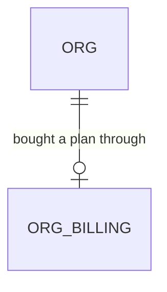

# In-app billing page

Roadmap Phase 5, follow-up to the Stripe Customer Portal item (`.specs/features/billing-portal/`). The owner dislikes being sent to Stripe's hosted portal and chose "status, invoices, card, cancel" inside the app. One feature at a time (decision 22).

## Problem

An owner or admin who wants to see what they pay, find an invoice, change the card or cancel is sent off to Stripe's hosted portal by "Manage billing" (built 2026-11-10). They leave the product, land on a page with Stripe's branding and a "Return to service-agreement sandbox" link, and come back to a Settings page that tells them nothing about their plan. The owner said they did not like it. The roadmap gives no support or churn figure, so none is claimed here.

When this ships, "Billing" in the Settings menu opens a page inside the app that shows the plan, its status and the next date that matters (trial end, renewal or end of service), the card on file and the invoices, and lets an owner or admin update the card and cancel or resume the subscription without leaving the product. Card numbers are typed into Stripe's own embedded field, never into a field of ours.

## Flow

Reuses `org_billing` and its owner/admin select policy (workspace-provisioning door 1), `OrgBilling` and `supabaseOrgBilling` (billing-portal door 1, extended with the subscription id), the Stripe adapter conventions in `infrastructure/stripe` (`fetch`, pinned `STRIPE_VERSION`, `encodeForm`, `errorCode`, 10 s timeout, one log line with status and code), `canManageBilling`, the `/settings` menu and the existing confirm-dialog pattern for destructive actions, instead of a Stripe SDK on the server, a copy of Stripe's data in our database or a second role check.

1. Owner or admin opens `GET /settings/billing` (new route under `(app)`) -> `currentMember` (exists) then the `OrgBilling` read (exists, changed) for the customer and subscription ids
2. `BillingGateway` (new, door 2; `stripeBillingGateway` over `fetch`) reads the subscription, its default card and the newest invoices from Stripe on every request and hands the page one overview value
3. `BillingPage` (new) renders plan, status label and date, the card, the invoice list and the actions that status allows
4. Update card -> Server Action `startCardUpdate` (new) asks the gateway for a SetupIntent for this org's customer and returns its `client_secret` -> the embedded Stripe field (new client component, door 1) confirms the card with Stripe -> Server Action `finishCardUpdate(setupIntentId)` (new) -> the gateway retrieves that SetupIntent itself, checks it belongs to this org's customer and succeeded (door 3), then makes its card the default on the customer and the subscription -> the page re-reads
5. Cancel -> confirm dialog -> Server Action `cancelSubscription` (new) -> the gateway sets the subscription to end at the period end; Resume -> `resumeSubscription` (new) undoes it -> the page re-reads
6. `/settings` (exists, changed): the Billing menu item becomes a link to `/settings/billing`; the Billing card and "Manage billing" are removed, and so are `BillingPortal`, `stripeBillingPortal` and `openBillingPortalAction` (Assumptions)

## Impact

| Front | What changes |
| --- | --- |
| domain | new term: billing overview - what the page shows about one subscription (status, trial end or period end, whether it ends, the card, the invoices), read live from Stripe and never stored |
| domain | existing term: `OrgBilling` meant "customer id and plan"; it now also returns the subscription id. Who branches on it today: `makeOpenBillingPortal`, `makeBillingSection` and the container, all removed or rewritten here |
| domain | existing term: Billing section on `/settings` (a card with "Manage billing") is replaced by a menu link; `/settings` shows no billing card |
| dependency | `jsdom` (dev only, added after verifier round 1 so the client islands can be proved in a DOM) and two client packages, `@stripe/stripe-js` and `@stripe/react-stripe-js`, supersede the "no stripe dependency" rule of AD-168 for the browser only; the server still calls Stripe over `fetch`. Approved tests C2510, C2511 and C2529 in `billing-boundaries.test.ts` pin the old rule and are amended under the new decision (door 1) |
| env | `STRIPE_PUBLISHABLE_KEY` (a `pk_test_` or `pk_live_` key, safe in the browser; the name was settled while building, see the Landing amendment). Unset, the card form says it is not set up and the rest of the page works |
| stored data | nothing to migrate: no table, column, policy or function |
| existing tests | `web/app/billing-docs.test.ts` C2536 pinned the Stripe Customer Portal roadmap line unticked; the item finished with this feature, so it now pins `[x]` (amended 2026-11-10). The billing-portal tests that pin the portal adapter, the action and the card (C2900 to C2914 in part) go with the code they test; the menu and C2916 tests are rewritten. The owner chose this replacement |
| not changed | Checkout, the webhook and its ledger, provisioning, `/setup`, RLS, the sign-in flow |

## Relations

One-way constraints: none new; `org_billing.stripe_customer_id` and `stripe_subscription_id` are already unique and not null.

## Surface

| Route | In | Out | Status |
| --- | --- | --- | --- |
| `GET /settings/billing` | session cookie | the billing page | `200`, `303` to `/login`, `303` to `/settings` for a member who is not an owner or admin |
| `startCardUpdate` (Server Action) | session cookie only | `{ clientSecret }` or a notice | `200` with the value or a notice, `303` to `/login` |
| `finishCardUpdate` (Server Action) | `setupIntentId` | the page re-read, or a notice | `200`, `303` to `/login` |
| `cancelSubscription`, `resumeSubscription` (Server Actions) | session cookie only | the page re-read, or a notice | `200`, `303` to `/login` |
| Stripe `GET /v1/subscriptions/{id}`, `GET /v1/customers/{id}`, `GET /v1/invoices`, `GET /v1/setup_intents/{id}` (outbound; corrected after verifier round 1: the card comes from the expanded subscription and customer reads, not a payment-method read) | ids from `org_billing` and the SetupIntent id | status, dates, card, invoices | `200`; anything else is `unavailable` |
| Stripe `POST /v1/setup_intents`, `POST /v1/customers/{id}`, `POST /v1/subscriptions/{id}` (outbound) | customer id, payment method id, cancel flag | the changed object | `200`; anything else is `unavailable` |

## Landing

| One-way door | Literal shape | Alternative rejected |
| --- | --- | --- |
| 1. A client-side Stripe dependency for card entry | `@stripe/stripe-js` and `@stripe/react-stripe-js` in `package.json`; `NEXT_PUBLIC_STRIPE_PUBLISHABLE_KEY` read only in the client component's module; the card is collected by Stripe's Payment Element confirming a SetupIntent (`stripe.confirmSetup` with `redirect: "if_required"`). A new AD supersedes AD-168's dependency rule for the browser | Stripe Checkout in `setup` mode: a redirect to Stripe again, the thing the owner rejected. Card inputs of our own posting to the server: puts card numbers through our servers (PCI scope), and Stripe forbids raw card data without an explicit account permission |
| 2. Subscription reads and writes go behind one gateway over `fetch` | `interface BillingGateway { overview(ids): Promise<Overview \| Unavailable>; startCardUpdate(customerId); finishCardUpdate(ids, setupIntentId); cancel(subscriptionId); resume(subscriptionId) }`, each answering `{ ok: true, ... } \| { ok: false, code: "not_configured" \| "unavailable" \| "mismatch" }`; the renewal date is `items.data[0].current_period_end`, because the pinned API version removed the subscription-level field | A copy of the subscription in our database kept by the webhook: nothing applies those events yet and a stale copy would misreport a cancelled plan. The `stripe` server package: the server rule of AD-168 stands |
| 3. The server decides which card becomes the default | `finishCardUpdate` takes only a SetupIntent id; the gateway retrieves it from Stripe, requires `status` `succeeded` and `customer` equal to the org's `stripe_customer_id`, and reads the payment method from it | Trusting a payment method id sent by the browser: a member could name any card. Setting the default on `confirmSetup`'s success alone in the browser: the browser would own a billing change |

- Amended while building (additive, owner's key name): the publishable key is the env var `STRIPE_PUBLISHABLE_KEY`, the name the owner saved, not `NEXT_PUBLIC_STRIPE_PUBLISHABLE_KEY`. It is read in `composition/` at runtime and passed to the card field as a prop, so no rebuild is needed per environment. Door 1's dependency and the SetupIntent flow are unchanged.
- Nothing else in this change is hard to reverse: the page layout, the invoice count, wording, and whether cancelling is `cancel_at_period_end` or `cancel_at` (settled against the Stripe sandbox while building).
- Door 1 reaches past this feature: seats and plan changes will reuse the same Stripe client and gateway. It belongs in `STATE.md` as an AD at the end of the build, superseding AD-168 in part.

## Criteria

### S1: The billing page shows the plan, the card and the invoices (P1)

The outcome: one in-app page that answers what the org pays and what comes next.

**Acceptance Criteria**

1. WHEN an owner or admin of an org with an `org_billing` row opens `/settings/billing` THEN the system SHALL show the plan name, the status label, and one date line: "Trial ends <date>" while `trialing`, "Renews <date>" while `active` and not ending, "Ends <date>" when set to end, from the Stripe subscription read on that request
2. The system SHALL label the Stripe statuses: `trialing` "Trial", `active` "Active", `past_due` "Payment overdue", `unpaid` "Unpaid", `canceled` "Canceled", `incomplete` "Incomplete", `incomplete_expired` "Expired", `paused` "Paused", any other value "Unknown"
3. WHEN the subscription has a default card THEN the system SHALL show its brand, last four digits and expiry (for example "Visa ending 4242, expires 04/2030"); WHEN it has none THEN the system SHALL show "No payment method"
4. WHEN the customer has invoices THEN the system SHALL list the newest 12 with number, date, amount in the invoice's currency, status, and a "View" link to Stripe's hosted invoice page that opens in a new tab with `rel="noopener noreferrer"`; WHEN none THEN "No invoices yet"
5. WHEN the subscription is `canceled` THEN the system SHALL show the page without the Update card, Cancel or Resume actions
6. WHEN a member who is not an owner or admin opens `/settings/billing` THEN the system SHALL answer `303` to `/settings`; a signed-out visitor SHALL get `303` to `/login`
7. WHEN the org has no `org_billing` row THEN the system SHALL show "This workspace has no subscription" and no actions
8. IF `STRIPE_SECRET_KEY` or `APP_BASE_URL` is unset THEN the system SHALL show "Billing isn't available yet" and SHALL NOT call Stripe
9. IF Stripe does not answer with a usable subscription within 10 s, or answers an error, THEN the system SHALL show "We couldn't load billing. Try again." with a retry control, log one line with the HTTP status and Stripe's error code only, and SHALL NOT log the customer id, the key or the body
10. IF the invoice read fails but the subscription read succeeds THEN the system SHALL show the page with "We couldn't load your invoices" in the invoice area

**Independent test:** with a sandbox customer that has a trialing subscription, open the page and see plan, "Trial", the trial end date, the card and its invoices.

### S2: An owner or admin updates the card inside the app (P1)

**Acceptance Criteria**

11. WHEN an owner or admin presses "Update card" THEN the system SHALL ask the server for a SetupIntent for this org's customer and show Stripe's embedded card field on the page, without leaving `/settings/billing`
12. WHEN the card is confirmed with Stripe THEN the system SHALL send only the SetupIntent id to `finishCardUpdate`, which SHALL set that card as the default on the customer and on the subscription and re-read the page showing the new last four digits
13. IF the SetupIntent is not `succeeded`, or belongs to another customer, THEN the system SHALL change no default, show "We couldn't update your card", and SHALL NOT call any write endpoint
14. IF Stripe declines or fails the card in the embedded field THEN the system SHALL show Stripe's message beside the field and leave the saved card unchanged
15. WHEN `finishCardUpdate` runs twice for the same SetupIntent THEN the system SHALL leave the same default card and show no error
16. IF the publishable key (`STRIPE_PUBLISHABLE_KEY`, see the Landing amendment) is unset THEN the system SHALL show "Card updates aren't set up yet" in place of the card field and SHALL NOT start a SetupIntent
17. WHILE the card is being confirmed or saved the system SHALL disable the submit control so one press makes one confirmation
18. The system SHALL take the customer id and org from the session and `org_billing`, never from the browser, and SHALL NOT send a card number, expiry or CVC to any route of the app

**Independent test:** with Stripe's test card 4242 4242 4242 4242, press Update card, enter it, save, and see "ending 4242"; use the declined test card 4000 0000 0000 0002 and see Stripe's message with the old card unchanged.

### S3: An owner or admin cancels and resumes (P1)

**Acceptance Criteria**

19. WHEN an owner or admin presses "Cancel subscription" on an active or trialing subscription THEN the system SHALL ask for confirmation naming the date service ends and that they keep access until then
20. WHEN they confirm THEN the system SHALL set the subscription to end at the end of the current period, not now, and re-read the page showing "Ends <date>" and a "Resume" button
21. WHEN they press Resume on a subscription set to end THEN the system SHALL clear that end date and re-read the page showing "Renews <date>" (or "Trial ends <date>" while trialing)
22. IF the subscription is already set to end and Cancel is submitted again THEN the system SHALL leave the end date unchanged and show no error
23. IF the cancel or resume call fails THEN the system SHALL show "We couldn't update your subscription. Try again." and leave what the page showed unchanged
24. IF a member who is not an owner or admin submits any of the four actions THEN the system SHALL show "You don't have permission to change this", call no Stripe write endpoint, and a signed-out or no-membership user SHALL get `303` to `/login`

**Independent test:** on a sandbox subscription press Cancel, confirm, see "Ends <date>", press Resume, see "Renews <date>".

### S4: The menu leads to the page and the old card is gone (P1)

**Acceptance Criteria**

25. WHEN the org has a billing record and the viewer is an owner or admin THEN the Settings menu SHALL list Billing below Members as a link to `/settings/billing`
26. The system SHALL NOT render a Billing card or a "Manage billing" button on `/settings`, and SHALL NOT contain the code that creates a Stripe portal session
27. WHILE on `/settings/billing` the page SHALL offer a link back to `/settings`

**Independent test:** open `/settings`, click Billing in the menu, land on the page, click back.

### S5: The page works on every size (P1)

**Acceptance Criteria**

28. WHILE the page is at 375, 768 or 1440 px wide the system SHALL show no horizontal scroll (the invoice list scrolls or stacks inside its own area), and every control SHALL be at least 44 by 44 px on mobile and tablet
29. WHILE the page is loading the system SHALL show a loading state

**Independent test:** the AGENTS.md Playwright pass on `/settings/billing` at the three sizes with touch emulation on the two smaller ones.

## Out of scope

| Excluded | Why |
| --- | --- |
| Changing plan or seats | Checkout sent prices inline, so there are no Stripe price objects to switch between; it touches plan limits and seat pricing and is its own item |
| Copying subscription data into our database from the webhook | Reading live from Stripe is simpler and never stale; syncing belongs with plan limits |
| Acting on `invoice.payment_failed` or `customer.subscription.deleted` (a banner, suspending the org) | Nothing applies those events yet; the page only shows the status label |
| Editing the billing name or email, tax ids or the billing address | Not asked for; the owner chose status, invoices, card and cancel |
| Downloading invoice PDFs inside the app | The hosted invoice link carries the PDF |
| Payment methods other than a card | Checkout collects cards; the page shows cards only. Which methods the card field offers is a Stripe Dashboard setting (see the Assumptions row), so the owner turns the others off |
| Proration previews, upcoming invoice amount and next charge amount | Needs the upcoming invoice read; the date is enough for now |
| Keeping the Stripe portal as a fallback | The owner rejected the redirect |
| A new "Other" or "past due" banner elsewhere in the app | Out of the chosen scope |

## Assumptions

| Assumption | Chosen default | Rationale | Confirmed? |
| --- | --- | --- | --- |
| Who may use it | Owner and admin | The roles `org_billing_select` admits; unchanged from the portal item | n |
| Where it lives | `/settings/billing`, linked as Billing under Members in the Settings menu | The user asked for Billing below Members; a separate route keeps `/settings` for the form | n |
| Freshness | Read from Stripe on every request, no caching | Billing must not show a stale cancel state; volume is one owner at a time | n |
| Invoice count | The newest 12 | Enough for a year of monthly invoices | n |
| How cancelling is sent | End at the period end, resumable; the exact field (`cancel_at_period_end` or `cancel_at` with `min_period_end`) is settled against the sandbox | Stripe's changelog calls `cancel_at_period_end` deprecated for mixed intervals; our items share one interval | n |
| Which price the card pays for | The default card is set on the customer and the subscription | Stripe's docs: the subscription's own default wins, so both are set | n |
| The old portal code | Removed: the adapter, port, action, card and their tests | Dead once the link is replaced; the Stripe portal stays configured in the dashboard, unused | n |
| Hosted invoice links | Opened in a new tab | They are Stripe pages; the app stays open behind | n |
| Card form styling | Stripe's default theme with the app's accent colour | A custom skin is not worth it for one form | n |
| Which payment methods the card field offers | Whatever the Stripe Dashboard has enabled; the owner turns off everything but Cards. The SetupIntent is created with `customer` and `usage` only | The live sandbox refused `payment_method_types` at the pinned API version; the owner chose this over hiding redirect methods in code | y |

**Open questions:** none block the build.

| # | Kind | Question | Until answered |
| --- | --- | --- | --- |
| 1 | blocks go-live | The publishable key (`pk_test_...`, later `pk_live_...`) must be set as `STRIPE_PUBLISHABLE_KEY` in each environment | The page works but the card form says it is not set up |
| 2 | open | May an admin cancel the subscription, or only the owner? | Admin can, matching the read policy; narrowing it is a one-line role check |
| 4 | blocks go-live | In the Stripe Dashboard (Settings, Payment methods) turn off every method except Cards, in test and in live mode. Until then the card field also offers Link, Klarna and others, and a non-card method shows as "No payment method" on the page | Card entry works but offers methods the page cannot display |
| 3 | open | Should a sandbox customer with a real trialing subscription be created for the live run? | The live run needs one; the build can create it with the test key and the owner's go-ahead |

## Observable

| Surface | Decision | Landing |
| --- | --- | --- |
| screen `/settings/billing` | empty state | AC 3 (no card), AC 4 (no invoices), AC 7 (no subscription) |
| screen `/settings/billing` | loading state | AC 29 |
| screen `/settings/billing` | error state | AC 9, AC 10, AC 23 |
| screen `/settings/billing` | unauthorised | AC 6, AC 24 |
| screen `/settings/billing` | density and ordering | existing - the Settings page's section cards; plan, card, invoices in that order, newest invoice first |
| screen `/settings/billing` | destructive action confirms | AC 19 (cancel confirms and names the date); card update and resume are reversible |
| actions `startCardUpdate`, `finishCardUpdate`, `cancelSubscription`, `resumeSubscription` | error shape and codes | AC 13, AC 14, AC 23, AC 24 (a notice on the page, the Settings pattern) |
| actions | who may call them | AC 18, AC 24 |
| actions | versioning, rate limits | n/a - authenticated Server Actions on one member's own org; Stripe rate-limits its side and a failure is AC 23 |
| outbound Stripe calls | error shape, timeout | AC 9, AC 10, AC 13 |
| a collection (invoices) | grouping, ordering, duplicates | AC 4 (newest first, 12, one row per invoice) |

## Sources

- `ROADMAP.md` Phase 5 "Stripe Customer Portal" item and the owner's decision of 2026-11-10 ("status, invoices, card, cancel")
- `.specs/features/billing-portal/plan.md` (doors 1 and 2) and `.specs/STATE.md` AD-168, AD-177 - the Stripe conventions and the port this extends
- Stripe changelog, subscription item-level periods: https://docs.stripe.com/changelog/basil/2025-03-31/deprecate-subscription-current-period-start-and-end
- Stripe docs, update payment details on a subscription (defaults on customer and subscription) and Setup Intents: https://docs.stripe.com/payments/checkout/subscriptions/update-payment-details, https://docs.stripe.com/api/setup_intents
