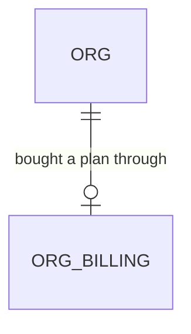

# Stripe Customer Portal

Roadmap Phase 5 item "Stripe Customer Portal, and the rule that cancels a subscription when payment fails after the trial". This feature builds the portal entry. The cancel-on-failed-payment rule is a Stripe dashboard setting the owner makes; it has no code here (Out of scope). One feature at a time (decision 22).

## Problem

A paid owner who wants to change their card, see an invoice, switch plan or cancel has nowhere in the app to do it. The only Stripe screen they ever met was Checkout, and `org_billing.stripe_customer_id` (stored by provisioning) is read by nothing. The only way to change a subscription today is to ask the product's builder to do it in the Stripe dashboard. The roadmap gives no support volume or churn figure, so none is claimed here.

When this ships, an owner or admin opens `/settings`, sees a Billing section for their plan and presses "Manage billing", and lands in Stripe's hosted portal for their own customer; closing it returns them to `/settings`. A workspace with no subscription (the demo org, a hand-seeded org) and a member who is not an owner or admin never see the button.

## Flow

Reuses `org_billing` and its owner/admin select policy (workspace-provisioning door 1), the `/settings` page and its `currentMember` role check, the Stripe adapter conventions in `infrastructure/stripe/checkout.ts` (`fetch`, no SDK, `STRIPE_VERSION`, form encoding, `errorCode`, 10 s timeout, one log line with status and code only), and the `APP_BASE_URL` already required by Checkout, instead of a Stripe SDK, a service-role read of the customer id, or a second settings table.

1. Owner or admin opens `GET /settings` (exists, changed) - the page asks the container whether the org has a subscription (`org_billing` readable under RLS) and renders a Billing section with the plan name and the "Manage billing" button, or no section
2. Presses the button -> Server Action `openBillingPortalAction` (new, beside `saveSettingsAction`) - `currentMember`, role check, then the container's `openBillingPortal`
3. `OrgBilling` port (new, door 1; `supabaseOrgBilling` reads `org_billing` as the member, under RLS) returns the Stripe customer id and plan, or null
4. `BillingPortal` port (new, door 2; `stripeBillingPortal` calls `POST https://api.stripe.com/v1/billing_portal/sessions`) returns Stripe's one-time `url`
5. out: the action redirects `303` to that `url`; Stripe's "Return to ..." link goes to `<APP_BASE_URL>/settings`; on any failure the settings page shows a notice and nothing leaves the app

## Impact

| Front | What changes |
| --- | --- |
| domain | new term: billing portal - Stripe's hosted page where a customer manages their own subscription; the app only creates the short-lived link. Lives in the two new ports |
| domain | existing term: `org_billing` - until now written by provisioning and read by no code; this is its first reader. Who branches on it today: nobody |
| stored data | nothing to migrate. No new table, column, policy or function; the owner/admin select policy already exists |
| env | `STRIPE_SECRET_KEY` and `APP_BASE_URL` (both exist) are now also needed by the Settings page. Unset, the Billing section shows "Billing isn't available yet" and the button is absent |
| Stripe account | the test-mode and live-mode portal configuration must be saved once in the Stripe dashboard (Settings > Billing > Customer portal) or Stripe answers `400` for every session. Owner action, a go-live blocker |
| tests | `billing-boundaries.test.ts` and `billing-docs.test.ts` pin the Stripe adapters; read them while building and extend, never rewrite an approved check |
| not changed | Checkout, the webhook, provisioning, `/setup`, RLS policies, the sign-in flow |

## Relations

One-way constraints: none new; `org_billing.stripe_customer_id` is already unique and not null.

## Surface

| Route | In | Out | Status |
| --- | --- | --- | --- |
| `GET /settings` | session cookie | the settings page, with a Billing section when the org has a subscription | `200`, `303` to `/login` (unchanged) |
| `openBillingPortalAction` (Server Action on `/settings`) | session cookie only; no customer id comes from the browser | `303` to Stripe's portal `url`, or the settings page with a billing notice | `303`, `200` with notice, `303` to `/login` |
| Stripe `POST /v1/billing_portal/sessions` (outbound) | `customer`, `return_url` | `url` | `200`; anything else is `unavailable` |

## Landing

| One-way door | Literal shape | Alternative rejected |
| --- | --- | --- |
| 1. The customer id is read as the member, never from the browser | `OrgBilling.get(orgId): Promise<{ customerId: string; plan: PlanKey } \| null>` over `select stripe_customer_id, plan from public.org_billing where org_id = $1` with the member's own client, so the existing `org_billing_select` policy (owner and admin) is the access rule | A hidden form field or query parameter carrying the customer id: any signed-in member could open another org's portal and cancel their subscription. A service-role or security-definer read: skips RLS and adds a privileged path for a value RLS already gates |
| 2. Portal sessions are made over raw `fetch`, behind a port | `interface BillingPortal { open(input: { customerId: string }): Promise<{ ok: true; url: string } \| { ok: false; code: "not_configured" \| "unavailable" }> }`; adapter posts `customer=<id>&return_url=<APP_BASE_URL>/settings` with `Stripe-Version: STRIPE_VERSION` | The `stripe` npm package: a new dependency, and billing-checkout door 1 chose `fetch` with a pinned API version. Stripe Payment Links or a static portal login URL: no per-customer link, the customer would have to log in with an emailed code |

- Nothing else in this change is hard to reverse: the section's wording and placement on `/settings`, which roles see it (a condition), and where the shared Stripe helpers live are edits.
- Door 2 sets the precedent for later Stripe calls (plan changes, seat counts, usage): they go behind a port and over `fetch`. It belongs in `STATE.md` as an AD at the end of the build.

## Criteria

### S1: An owner or admin reaches Stripe's portal from Settings (P1)

The outcome: a button on `/settings` that opens the org's own Stripe portal and returns to `/settings`.

**Acceptance Criteria**

1. WHEN an owner or admin of an org that has an `org_billing` row opens `/settings` THEN the system SHALL show a Billing section with the plan name ("Starter", "Team" or "Business") and a "Manage billing" button
2. WHEN an owner or admin presses "Manage billing" THEN the system SHALL create one Stripe portal session for that org's `stripe_customer_id` with `return_url` `<APP_BASE_URL>/settings` and answer `303` to the `url` Stripe returned
3. The system SHALL read the customer id from `org_billing` under the member's own session and SHALL NOT accept a customer id, org id or return URL from the browser
4. WHEN Stripe answers the session request with HTTP 200 and a non-empty string `url` THEN the system SHALL redirect to it, and SHALL treat any other answer as `unavailable`

**Independent test:** with Stripe test keys, a provisioned org and the portal configuration saved, sign in as its owner, press "Manage billing", land on `billing.stripe.com`, press the return link and land on `/settings`.

### S2: Everyone else is kept out and failures are visible (P1)

**Acceptance Criteria**

5. WHEN an estimator or viewer opens `/settings` THEN the system SHALL NOT show the Billing section
6. WHEN the org has no `org_billing` row (the demo org, a hand-seeded org) THEN the system SHALL NOT show the Billing section
7. IF a member who is not an owner or admin submits `openBillingPortalAction` THEN the system SHALL NOT call Stripe and SHALL show "You don't have permission to change this"
8. IF the signed-in user has no membership or is signed out and submits the action THEN the system SHALL answer `303` to `/login` and SHALL NOT call Stripe
9. IF `STRIPE_SECRET_KEY` or `APP_BASE_URL` is unset THEN the system SHALL show "Billing isn't available yet" in the Billing section, without the button, and SHALL NOT call Stripe
10. IF the Stripe request times out after 10 s, fails to connect, or answers anything but a usable `url` THEN the system SHALL show "We couldn't open billing. Try again in a moment." on `/settings`, log one line with the HTTP status and Stripe's `error.code` only, and SHALL NOT log the customer id, the secret key or the response body
11. IF reading `org_billing` fails with a database error THEN the system SHALL show the same "We couldn't open billing" notice and SHALL NOT call Stripe

**Independent test:** as an estimator the section is absent; as the demo owner (no `org_billing`) the section is absent; with `STRIPE_SECRET_KEY` unset an owner of a provisioned org sees the unavailable text.

### S3: The new screen works on every size (P1)

**Acceptance Criteria**

12. WHILE `/settings` is at 375, 768 or 1440 px wide the system SHALL show no horizontal scroll, and the "Manage billing" button SHALL be at least 44 by 44 px on mobile and tablet
13. WHILE the portal request is in flight the system SHALL disable the button and show it as pending, so a double press makes one Stripe request

**Independent test:** the AGENTS.md Playwright pass on `/settings` at the three sizes, with touch emulation on the two smaller ones.

## Out of scope

| Excluded | Why |
| --- | --- |
| Cancelling a subscription when payment fails after the trial | A Stripe dashboard setting (Settings > Billing > Subscriptions and emails) and `trial_settings.end_behavior` that Checkout already sends; the owner makes it, nothing to code. Stays open on the roadmap until they confirm |
| Reacting to `customer.subscription.deleted` or `invoice.payment_failed` (suspending the org, showing a banner) | The webhook records those events; nothing reads them yet. Its own item with plan limits |
| An in-app invoice list, plan switcher or seat editor | Stripe's portal does these; building them here duplicates it |
| Configuring the portal through the API (`billing_portal/configurations`) | The dashboard default is one click and is account-wide; managing configurations from code is a later choice |
| Showing the trial end date or next charge | Needs the subscription's dates, which are not stored (the first-login-setup open question) |
| Seat count enforcement at invite time | Own roadmap item (plan limits) |
| A "Billing" entry in the sidebar | The Billing section lives on `/settings`, the one place that already holds org-level changes |

## Assumptions

| Assumption | Chosen default | Rationale | Confirmed? |
| --- | --- | --- | --- |
| Who may open the portal | Owner and admin | They are the roles `org_billing_select` already admits (workspace-provisioning door 1), so the app rule and the database rule agree | n |
| Where the entry lives | A Billing section on `/settings`, below the existing form, outside the form's Save action | `/settings` is where org-level changes live and the page already knows the role; no new route or nav item | n |
| Return address | `<APP_BASE_URL>/settings` | Checkout's success and cancel URLs use the same base | n |
| Opening in the same tab | Same tab, by redirect | A Server Action redirect cannot open a new tab and a popup would be blocked on mobile | n |
| Portal language and branding | Stripe's defaults and the account branding set in the dashboard | Nothing in code controls them | n |
| Portal configuration | The dashboard default configuration, saved once per mode by the owner | Without it Stripe refuses every session; this is the go-live blocker below | n |
| Plan name on the section | From `org_billing.plan` through `PLANS` in `domain/billing` | The same catalog Checkout used | n |

**Open questions:** none block the build.

| # | Kind | Question | Until answered |
| --- | --- | --- | --- |
| 1 | blocks go-live | Save the Customer portal configuration in the Stripe dashboard (test mode first, then live): allow update payment method, view invoices, cancel subscription; decide whether plan switching is allowed | Every portal session answers `400` and the owner sees the "couldn't open billing" notice |
| 2 | blocks go-live | Set the Stripe rule that cancels a subscription whose first payment fails after the trial | Roadmap item stays half open; no code depends on it |
| 3 | open | Should an admin be able to cancel the subscription, or only the owner? | Admin can, matching the read policy; narrowing it is a one-line role check |

## Observable

| Surface | Decision | Landing |
| --- | --- | --- |
| screen `/settings` (Billing section) | empty state | AC 6 (no subscription: no section) and AC 9 (not configured) |
| screen `/settings` (Billing section) | loading state | AC 13 |
| screen `/settings` (Billing section) | error state | AC 10, AC 11 |
| screen `/settings` (Billing section) | unauthorised | AC 5, AC 7, AC 8 |
| screen `/settings` (Billing section) | density and ordering | existing - the Settings page's section cards; Billing sits below the form |
| screen `/settings` (Billing section) | destructive action confirms | n/a - the button only opens Stripe; cancelling is confirmed inside Stripe's portal |
| action `openBillingPortalAction` | error shape and codes | AC 7, AC 8, AC 10 (a form notice, the Settings pattern) |
| action `openBillingPortalAction` | who may call it | AC 3, AC 7, AC 8 |
| action `openBillingPortalAction` | versioning, rate limits | n/a - an authenticated Server Action on one member's own org; Stripe rate-limits its side and a failure is AC 10 |
| outbound Stripe call | error shape, timeout | AC 4, AC 10 |

## Sources

- `ROADMAP.md` Phase 5 item "Stripe Customer Portal ..." and Decision 8 - the item and the trial rule
- `.specs/features/workspace-provisioning/plan.md` (door 1) - `org_billing`, its columns and its select policy
- `.specs/STATE.md` AD-168 to AD-171 - Stripe over `fetch` with a pinned API version, and the public-path rules
- Stripe API: Create a portal session (`POST /v1/billing_portal/sessions`, parameters `customer` and `return_url`, response field `url`), https://docs.stripe.com/api/customer_portal/sessions/create
