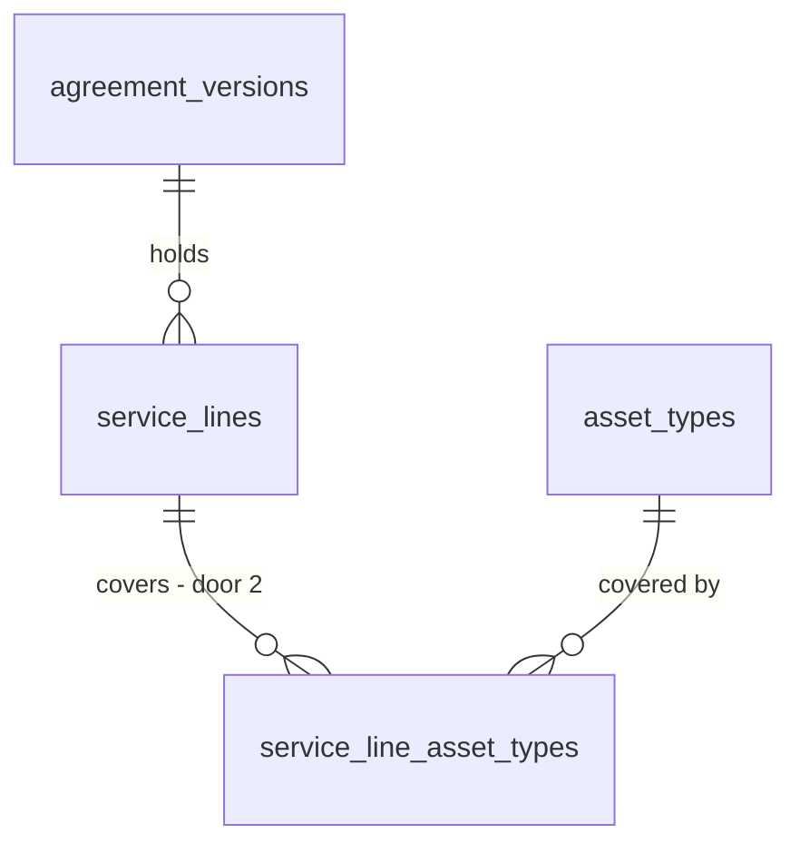

# Cadence

## Problem

A service line today is a description, a free visits-per-year number (1 to 365) and a cost per visit. Nothing says **when** the visits happen or **which equipment** they cover. A contractor who services the rooftop units quarterly and the boiler once in October can only write that into the description. The customer then reads "4 visits per year" without knowing the months, and a reviewer cannot tell which line pays for which equipment. ROADMAP's Cadence section sets the rule: visit months are chosen per line, a line covers one or more equipment types, and "the number of months is its visits per year". The source gives no usage figures.

When this ships:
- A line covers chosen equipment types and holds its visit months, picked on a 12-month grid with presets.
- The months prefill from each type's defaults.
- The PDF, the customer portal and the staff page show a month-by-month visit schedule.

## Flow

This plan reuses what exists instead of building a second version of it:
- the line form, `ServiceLineStore` (exists) and the `service_lines_frozen` trigger (AD-054)
- the revision copy in `apply_agreement_transition` (exists, AD-055)
- `buildAgreementDocument` (exists) and the one PDF layout, which feed both PDF routes
- `portal_view`, which feeds the customer page

The path:

1. A writer submits the line form in `LineForm` (exists). It gains the month grid, the presets and the equipment checkboxes.
2. `addServiceLineAction` / `updateServiceLineAction` (exist) pass the form to `validateServiceLine` (exists, `web/domain/agreement`). The validated value now carries `visitMonths` and `assetTypeIds`.
3. `ServiceLineStore` (exists) `add` / `update` call RPC `public.save_service_line` (door 4). In one transaction it writes the line and replaces its `service_line_asset_types` rows (door 2). The triggers `service_lines_frozen` (exists) and `service_line_asset_types_frozen` (door 2) guard both tables.
4. `AgreementReader.get` (exists) reads each line's `visit_months` and covered types. For the editable version it also reads the site's equipment types with `default_visit_months` (door 3).
5. The pure `visitSchedule(lines)` (new, no door - placement in `web/domain/agreement`) produces month rows. `buildAgreementDocument` (exists) carries them to `DocumentRenderer` (exists), and the staff page, `/agreements/[id]/pdf` and `/review/[token]/pdf` render them.
6. The `portal_view` RPC (exists, door 6) returns `visitMonths` and `equipment` on each line. `/review/[token]` (exists) renders the same schedule section.
7. Starting a revision: `apply_agreement_transition` (exists, redefined) copies each line with its months and coverage into version n + 1.

## Impact

| Front | What changes |
| --- | --- |
| domain | New term `visit months`: the set of calendar months (1-12) a line's visits fall in. It replaces the free "visits per year" input, and visits per year becomes the size of that set. Who branches on `visits_per_year` today: `lineAnnualCents` callers in `infrastructure/supabase/agreements.ts`, `portal_view` and its `annualCents` sum, the pipeline reader's annual total, the n8n W1 email (amount only), the PDF and portal line tables. All keep reading the same column, which door 1 ties to the months by a check. |
| UI | The repo's first checkbox control. The line form gains two fieldsets of checkboxes. DESIGN.md records the control. |
| tests | Fixture inserts into `service_lines` (`fixture.sql`, `rls_*`, `customer_portal.sql`, `outbox_dispatch.sql`, `agreement_builder.sql`) gain `visit_months`. That is setup, not an assertion; no existing assertion changes. `catalog_seed.sql` keeps comparing `(code, name)`. |
| domain | New term `equipment covered`: the asset types a line pays for. It is separate from "Service included" (AD-058), which stays "every type on site". |
| domain | Existing term "visit frequency" (CONTEXT.md, PRODUCT.md) now means the months, not a number. |
| ports | `ServiceLineValue` and `ServiceLineInput` gain `visitMonths` and `assetTypeIds` and lose the typed `visitsPerYear`. `ServiceLineView`, `DocumentLine` and `PortalView.lines` gain `visitMonths` and `equipment`. `AgreementDocument` gains `schedule`. |
| stored data | Backfill in the migration. Existing lines get months from their `visits_per_year` (AC 24). The migration aborts if any line has more than 12 (AC 25). Coverage comes from the version's snapshot or the site (AC 26). Existing `asset_types` rows get catalog defaults by code (AC 15). Only demo data exists in `service-agreement`. The sent AG-1046 and AG-1048 keep their annual amounts. |
| SQL functions | Each of these is redefined: `apply_agreement_transition` (copy), `portal_view` (lines), `private.seed_org_catalog` (defaults, amends AD-008), `site_service_scope` (unchanged). |
| docs | CONTEXT.md agreement section, DESIGN.md line form and schedule, ROADMAP tick, STATE.md AD rows for doors 1-4 |

## Relations

One-way constraints:
- `service_line_asset_types` has `(service_line_id, asset_type_id)` as its primary key, plus composite FKs on `(…, org_id)` per AD-003. Deleting a line cascades to its coverage rows (door 2).
- `visit_months` is never empty and holds only 1-12, ascending (door 1).
- `asset_types.default_visit_months` is not null (door 3).

## Surface

| Route | In | Out | Status |
| --- | --- | --- | --- |
| `rpc public.save_service_line` | `p_agreement_id`, `p_line_id` (null = add), `p_description`, `p_visit_months`, `p_cost_per_visit_cents`, `p_asset_type_ids` | line `uuid` | `200` ok, `422` invalid value or no type (`23514`), `404` type not in the org (`23503`), `409` locked (`55000`), `409` over 50 lines (`54000`), `404` agreement or line missing (`P0002`), `403` not a writer (`42501`) |
| `rpc public.portal_view` (signature unchanged, payload extended) | `p_token_hash` | `lines[]` gains `visitMonths: int[]` · `equipment: [{code, name}]` | `200` jsonb, or `200` null for an unknown link (unchanged) |

## Landing

| One-way door | Literal shape | Alternative rejected |
| --- | --- | --- |
| 1. months on the line | `service_lines.visit_months smallint[] not null check (private.is_visit_months(visit_months))`, where the function is immutable and true iff the array is non-empty, strictly ascending, and every value is in 1..12. Plus `service_lines_visits_match_months check (visits_per_year = cardinality(visit_months))`. `visits_per_year` stays a plain column with its `>= 1` check. | A 12-bit integer mask: n8n, PostgREST JSON and SQL tests would all have to decode it. `visits_per_year` as a generated column: an explicit insert would answer `428C9`, which breaks C21 (`domain_constraints.sql`, `visits_per_year = 0` -> `23514`) and every fixture insert. A writable count with no tie to the months: two sources of truth that can disagree, against ROADMAP's "the number of months is its visits per year". A child table of visits: Phase 6 generates real dated visits, and these months are only the template. |
| 2. coverage table | `public.service_line_asset_types (org_id, service_line_id, asset_type_id)`, PK `(service_line_id, asset_type_id)`, FK `(service_line_id, org_id) -> service_lines (id, org_id) on delete cascade`, FK `(asset_type_id, org_id) -> asset_types (id, org_id)`, RLS as `service_lines`. Trigger `private.service_line_asset_types_frozen` applies AD-054's rule and stands aside when `auth.uid()` is null. `service_lines` gains `unique (id, org_id)`. | `asset_type_ids uuid[]` on the line: no FK, so a reference could cross orgs, against AD-003. Storing type codes as text: an unknown code would be accepted silently. |
| 3. default months per type | `asset_types.default_visit_months smallint[] not null check (private.is_visit_months(...))` and the same column on `private.catalog_asset_types`. `seed_org_catalog` copies it (amends AD-008). | Nullable with "no default" meaning: every reader branches, and the grid would start empty for most types. |
| 4. one write for a line and its coverage | `public.save_service_line(p_agreement_id uuid, p_line_id uuid, p_description text, p_visit_months smallint[], p_cost_per_visit_cents bigint, p_asset_type_ids uuid[]) returns uuid`: security invoker, `search_path = ''`, `execute` to `authenticated` only. Writes the line, deletes and re-inserts its coverage, and counts lines (`54000` past 50), all in one transaction. | Insert the line, then the coverage, through PostgREST: a failure between the two leaves a line covering nothing, the same reason AD-053 made `create_agreement` an RPC. |
| 5. backfill rule for existing lines | n → months: 2 → `{4,10}`, 4 → `{3,6,9,12}`, 12 → `{1..12}`, any other 1 ≤ n ≤ 11 → `1 + floor(i*12/n)` for i = 0..n-1, n > 12 → `raise exception` | Rounding n > 12 down to 12: it silently changes the price of a sent agreement. |
| 6. `portal_view` line keys | `visitMonths` (ascending ints), `equipment` (`[{code, name}]` ordered by name), camelCase like the existing keys | Precomputing the schedule in SQL: the page and the portal PDF already share the domain `visitSchedule`, and a second implementation could disagree. |
| 7. (found while building) default for an org's type | `asset_types.default_visit_months ... default '{3,6,9,12}'`; `private.catalog_asset_types.default_visit_months` has no default, so a catalog type names its months on purpose. Test inserts into the catalog name them. | No default on `asset_types`: every existing and future insert of a type (ten test fixtures, an org creating its own type) would fail `23502`, and `{3,6,9,12}` is already the migration's value for a code outside the catalog. |

- Nothing else in this change is hard to reverse. Placement, the month labels and the grid markup are settled in the diff.

## Criteria

### S1: months on a line (P1)

A service line holds its visit months, and its visits per year follow from them.

**Acceptance Criteria**

1. IF a `service_lines` write carries `visit_months` that is empty, not strictly ascending, or holds a value outside 1-12, or a `visits_per_year` other than the number of its months, THEN the database SHALL refuse it with `23514`.
2. The system SHALL set a line's visits per year to the number of its visit months, and its annual amount to that number × cost per visit. Example: `{3,6,9,12}` at $250.00 gives 4 visits and $1,000.00.
3. WHEN a writer opens the line form on the current version of a draft THEN the form SHALL show a fieldset with the legend `Visit months`. It holds twelve checkboxes labelled `Jan` through `Dec` in two rows of six below `md` and one row of twelve from `md` up, plus the preset buttons `Quarterly`, `Semi-annual` and `Monthly`.
4. WHEN a preset is pressed THEN the grid SHALL check exactly the preset's months and uncheck the others: `Quarterly` = Mar, Jun, Sep, Dec; `Semi-annual` = Apr, Oct; `Monthly` = all twelve.
5. IF a line is saved with no month checked THEN the form SHALL show `Choose at least one visit month` under the grid and SHALL write nothing.
6. The line form SHALL have no `Visits per year` input.
7. The line row SHALL show, for each line, its months as three-letter names in calendar order (`Mar, Jun, Sep, Dec`) and `<n> visits/yr`.

**Independent test:** add a line, press Quarterly, enter $250.00 and save. The row reads `Mar, Jun, Sep, Dec · 4 visits/yr` and `$1,000.00/yr`.

### S2: equipment covered by a line (P1)

Each line names the equipment types it pays for.

**Acceptance Criteria**

8. WHEN a writer opens the line form THEN it SHALL show a fieldset with the legend `Equipment covered`. It holds one checkbox per equipment type with at least one asset on the agreement's site, plus any type the line already covers, ordered by name.
9. IF a line is saved with no equipment type checked THEN the form SHALL show `Choose at least one equipment type` and SHALL write nothing.
10. WHILE the month grid of a new line has not been changed by hand, WHEN equipment types are checked or unchecked THEN the grid SHALL show the union of the checked types' default months, or no month when none is checked.
11. WHEN a line is added or saved THEN its description, months, cost and covered types SHALL persist in one transaction: either all of them or none.
12. IF a covered asset type id is not a type of the agreement's org THEN `save_service_line` SHALL refuse it with `23503` and persist nothing.
13. IF the agreement's site has no equipment THEN the add-line area SHALL show `Add equipment to this site before adding a service line`, linked to `/sites/<siteId>`, in place of the form.
14. The line row SHALL list, for each line, the names of its covered types, ordered by name and comma-separated.

**Independent test:** on a site with RTUs and a boiler, add a line covering RTU only. The grid prefills Mar, Jun, Sep, Dec. Save, then reload: the row names RTU.

### S3: default months per equipment type (P2)

Every equipment type carries default visit months.

**Acceptance Criteria**

15. WHEN the migration runs THEN every catalog type SHALL carry the default months in the table below, and every existing `asset_types` row SHALL carry its catalog type's default by `code`, or `{3,6,9,12}` for a code not in the catalog.
16. WHEN `private.seed_org_catalog(org)` copies the catalog into an org THEN each inserted type SHALL carry the catalog's `default_visit_months`.
17. IF an `asset_types` write carries a `default_visit_months` that fails the door 1 rule THEN the database SHALL refuse it with `23514`.

| Default | Catalog codes |
| --- | --- |
| `{3,6,9,12}` quarterly (19) | AHU, CASE_COOLER, CASE_FREEZER, CHILLER, COOLING_TOWER, DUCTLESS_SPLIT, ERV, FAN_COIL, HRV, ICE_MACHINE, MINI_VRF, MUA, PTAC, RTU, UNITARY_SPLIT, VRF_OUTDOOR, WALK_IN_COOLER, WALK_IN_FREEZER, WSHP |
| `{4,10}` semi-annual (8) | AIR_SEPARATOR, CO_SENSOR, EXHAUST_FAN, HEAT_EXCHANGER, PUMP, SIDE_STREAM_FILTER, SUPPLY_FAN, WYE_STRAINER |
| `{10}` October (13) | ACID_NEUTRALIZER, BACKFLOW_PREVENTER, BOILER, EXPANSION_TANK, FIRE_DAMPER, FURNACE, HWT_HIGH_EFFICIENCY, HWT_MID_EFFICIENCY, INDIRECT_TANK, PRESSURE_REGULATING_VALVE, STORAGE_TANK, UNIT_HEATER_ELECTRIC, UNIT_HEATER_GAS |

**Independent test:** `select code, default_visit_months from asset_types` for the demo org: RTU `{3,6,9,12}`, BOILER `{10}`.

### S4: visit schedule (P1)

The customer and staff see which equipment is serviced in which month.

**Acceptance Criteria**

18. The system SHALL build a version's visit schedule as one row per month that has at least one visit, January to December. Each row lists the names of the equipment types covered by the lines visiting that month, without duplicates and ordered by name.
19. The agreement PDF SHALL print a `Visit schedule` section between `Service and price` and `Service included`, one line per row: the full month name, then the type names comma-separated.
20. The customer page `/review/[token]` SHALL show a `Visit schedule` section with the same rows, between the service lines and `Service included`.
21. The staff page `/agreements/[agreementId]` SHALL show the `Visit schedule` section for the shown version, between the lines and `Service included`.
22. IF the shown version has no service lines THEN the PDF, the customer page and the staff page SHALL show `No visits scheduled yet` in the `Visit schedule` section.
23. The PDF from `/review/[token]/pdf` SHALL print the same schedule rows as `/agreements/[agreementId]/pdf?version=<n>` for that version.

**Independent test:** take lines HVAC (RTU, AHU; Mar, Jun, Sep, Dec) and Boiler (BOILER; Oct). The schedule reads March AHU, RTU · June AHU, RTU · September AHU, RTU · October Boiler · December AHU, RTU.

### S5: versions, freeze and existing data (P1)

Cadence survives revisions, cannot change after send, and existing lines keep their prices.

**Acceptance Criteria**

24. WHEN version n + 1 is started THEN each copied line SHALL keep its visit months and covered types, and the lines of version n SHALL stay unchanged.
25. IF a member writes a `service_line_asset_types` row whose line is not on the current version of a `draft` THEN the database SHALL refuse it with `55000`, and the form SHALL show `This version can no longer be changed.`
26. WHEN the migration runs THEN each existing line SHALL get its months by the door 5 rule, and its `visits_per_year` and annual amount SHALL be unchanged.
27. IF any existing line has `visits_per_year > 12` THEN the migration SHALL raise and apply nothing.
28. WHEN the migration runs THEN each existing line SHALL cover the asset types of the org whose `code` appears in its version's frozen `snapshot.types`, or, for a version with no frozen snapshot, the types with at least one asset on the site.
29. WHEN `supabase/seed.sql` runs twice THEN every demo line SHALL have months and coverage, and the second run SHALL change no row.

**Independent test:** revise AG-1048 to v2. Both versions show the same months and equipment, and editing v2's months leaves v1's PDF unchanged.

## Out of scope

| Excluded | Why |
| --- | --- |
| Seasonal tasks (a checklist task on some visits only) | ROADMAP Phase 3.5 item 3 |
| Editing default months per type | ROADMAP "Task library page" item |
| Term dates, and a schedule starting from the term's first month | ROADMAP term-dates item; this schedule runs January to December |
| More than one visit in a month (bi-weekly, weekly lines) | ROADMAP fixes visits per year to the number of months |
| A warning for site types no line covers | not in the roadmap item; it can come with the Versioning or Agreements page items |
| Dated visits, the calendar and the workload forecast | ROADMAP Phase 6 |

## Assumptions

| Assumption | Chosen default | Rationale | Confirmed? |
| --- | --- | --- | --- |
| Prefill when several types are checked | union of their defaults (AC 10) | lines group similar types, so the union is usually one preset; it is easy to explain | n |
| Prefill on an existing line's edit form | none: the grid shows the saved months | changing a saved line's months by surprise loses work | n |
| Semi-annual means April and October | `{4,10}` | ROADMAP says "spring and fall" without months; the shoulder seasons fit cooling and heating start-ups | n |
| Catalog default months | the table under S3 | air-side and refrigeration quarterly, hydronic auxiliaries semi-annual, heating plant and annual tests October | n |
| Type names on a frozen version | read live from `asset_types.name` | no screen renames a type today; the snapshot keeps the Service included names | n |
| Schedule on the staff page | shown (AC 21) | the estimator should see what the customer will see before sending; it is the same component | n |
| Legacy lines with no coverage (site had no assets) | readable and sendable; the next save needs at least one type | blocking send on old demo data buys nothing | n |

**Open questions:** none. Everything is resolved or logged above.

## Observable

| Surface | Decision | Landing |
| --- | --- | --- |
| screen `/agreements/[id]` line form | empty state (site with no equipment) | AC 13 |
| screen `/agreements/[id]` line form | error states | AC 5, AC 9, AC 25, plus the existing `unavailable` message |
| screen `/agreements/[id]` line form | loading state | existing - `agreements/[agreementId]/loading.tsx` and the pending submit button |
| screen `/agreements/[id]` line form | unauthorised state | existing - viewers and non-draft versions get no form (agreement-builder) |
| screen `/agreements/[id]` line form | density at 375 px | AC 3 |
| screen `/agreements/[id]` line form | destructive action confirms | existing - removing a line asks first; a preset replaces unsaved checks only |
| screen `/agreements/[id]`, `/review/[token]` schedule | empty state | AC 22 |
| screen `/agreements/[id]`, `/review/[token]` schedule | ordering | AC 18 |
| screen `/review/[token]` | error, loading, unauthorised | existing - `portalState`, `review-loading.tsx`, the `portalGate` 404 |
| document agreement PDF | structure and section order | AC 19, AC 23 |
| collection schedule rows | grouping, duplicates | AC 18 - by month, a type covered by two lines in one month is listed once |
| API `rpc save_service_line` | error shape and codes | Surface statuses, mapped to the existing `WriteFailure` / `locked` / `too_many` codes |
| API `rpc save_service_line`, `portal_view` | versioning, rate limits | n/a - in-repo callers only; portal rate limiting is carried as an outbox-dispatch open question |

## Sources

- ROADMAP.md, Phase 3.5 item 2 and the `## Cadence` section: settle months per line, types per line, presets, defaults per type and the schedule on the PDF and portal
- `.specs/STATE.md` AD-003, AD-008, AD-053 to AD-055, AD-058, AD-064, AD-068: the constraints these doors conform to

