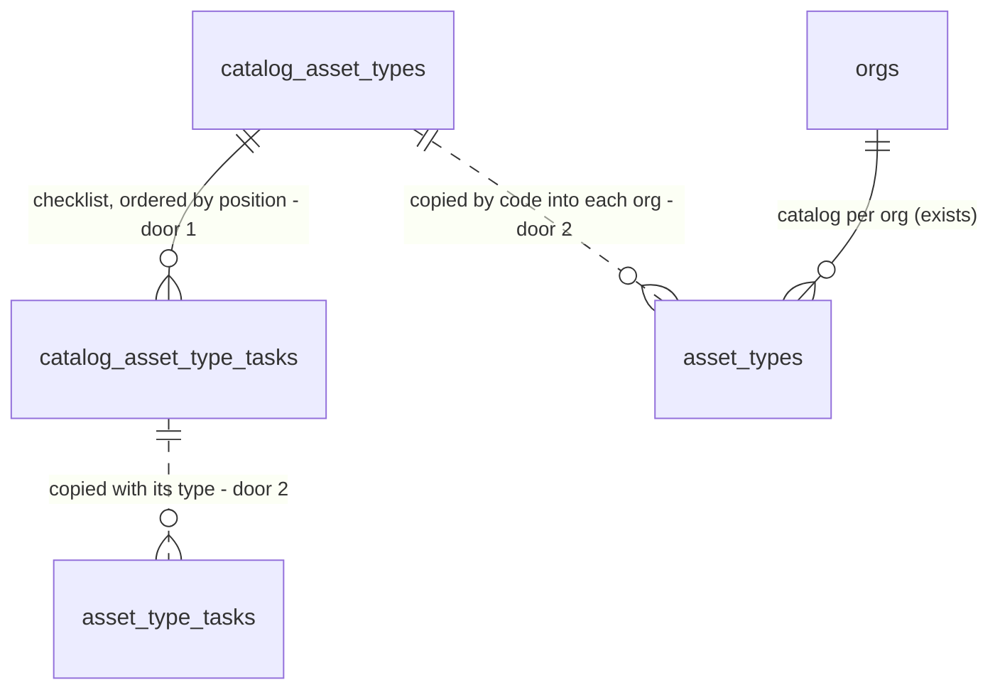

# Catalog seed: equipment catalog, task library and a fictitious demo org

## Problem

Every org's `asset_types` and `asset_type_tasks` are empty. An estimator cannot record a single asset, because `assets.asset_type_id` is required and there is nothing to point at. The roughly 40 equipment types and their checklists exist only as a contractor's Word/PDF proposal on someone's disk, mixed with that company's name and address. Phase 2 import normalizes extracted rows onto catalog codes, and Phase 3 builds "Service included" from those checklists, so both are blocked on a catalog that does not exist yet.

The Phase 1 screens (customers, customer detail, site asset register, company settings) have no real tenant data to render. The only data today is the client-side sample in `web/lib/sample-pipeline.ts`. The source gives no user evidence: this is foundation work.

When this ships, any org can be given the standard 40-type catalog with its 174 tasks in one call. A fictitious demo org exists on the `service-agreement` project with branding, default terms, that catalog, and 12 customers with contacts, sites and assets.

## Flow

This reuses the tenant tables, the composite same-org FKs (AD-003) and the rolled-back MCP test harness from supabase-init. It adds a template the per-org tables are copied from, not a second catalog that queries read.

1. `supabase/migrations/<version>_catalog_template.sql` (door 6), applied with MCP `apply_migration`. It creates `private.catalog_asset_types` and `private.catalog_asset_type_tasks` (door 1), fills them with the 40 types and 174 tasks from the proposal template, creates `private.seed_org_catalog(org)` (door 2) and adds the code format check to `public.asset_types` (door 3).
2. `private.seed_org_catalog(org)` (door 2). It copies template types into `public.asset_types` and their tasks into `public.asset_type_tasks` for one org, skipping any code the org already has, and returns the number of types inserted.
3. `supabase/seed.sql` (door 5), run once on the remote with MCP `execute_sql`, as one transaction. It upserts the demo org (door 4) and its `org_settings`, calls `private.seed_org_catalog`, and inserts the demo customers, contacts, sites and assets.
4. Postgres + RLS (exists). The demo org has no membership, so no `authenticated` user reads it until the auth item attaches one.
5. `supabase/tests/catalog_seed.sql` and `supabase/tests/demo_seed.sql` (new, no door, placement). Each runs after `fixture.sql` in one rolled-back `execute_sql` call, and `demo_seed.sql` inlines the text of `seed.sql`. `supabase/tests/fixture.sql` (exists) changes only to write upper-case codes.
6. Out: CONTEXT.md (M2, M3, M4, M6, build log), the ROADMAP Phase 1 item 2 tick, and STATE.md decisions for doors 1, 2 and 5.

## Impact

| Front | What changes |
| --- | --- |
| domain | new term: `Catalog template`. It is the product's standard equipment catalog, held in `private`. It is copied into an org, and from then on the org owns its copy. Tenant edits never flow back, and template changes never reach orgs that already have a copy |
| domain | existing term: `asset type code`. It was any text, unique per org. Now it must match `^[A-Z][A-Z0-9_]*$`. Today only the test fixture branches on it: `fixture.sql` writes `'T' \|\| <lower-case md5>` and `'RTU'`, and `domain_constraints.sql` writes `'RTU'` and `'ZZ1'` |
| stored data | the check is added over the existing rows of `public.asset_types`, and the remote has 0 of them (no seed has run). A row that already exists with a lower-case code would fail the migration, so the build reads the row count before applying it |
| stored data | the demo org and its rows persist on the only project, `service-agreement` (`gnxebrtcpbujhvcamtoe`). That is a remote data change, so it waits for your go-ahead at Build |
| tests | `fixture.sql` writes upper-case codes. No assertion in the four existing suites changes |
| docs | CONTEXT.md M2, M3, M4 and M6 *What we built*, plus a Build log line. ROADMAP Phase 1 item 2 is ticked. STATE.md gets decisions for doors 1, 2 and 5 |

## Relations

One-way constraints:
- A template type is unique by code (door 1).
- A template task is unique by (type code, position) (door 1).
- Codes match `^[A-Z][A-Z0-9_]*$` in the template and in `public.asset_types` (door 3).
- There is no foreign key from an org's copy back to the template. The dotted lines are a copy, not a reference.

## Surface

None. Nothing is consumed outside: the template and the function live in `private`, which the Data API does not expose, and the demo rows are ordinary tenant rows behind the existing RLS.

## Landing

| One-way door | Literal shape | Alternative rejected |
| --- | --- | --- |
| 1. where the template lives | `private.catalog_asset_types (code text primary key, name text not null)` and `private.catalog_asset_type_tasks (code text references private.catalog_asset_types, position integer, description text not null, primary key (code, position))`, filled by the migration, with `revoke all ... from public, anon, authenticated` | a JSON/TS file in the repo seeded by a Node script: no runtime with a service-role key exists yet, and Phase 5 onboarding in SQL could not read it. `org_id null` rows in `public.asset_types`: rejected by supabase-init door 11 |
| 2. how an org gets the catalog | `private.seed_org_catalog(p_org uuid) returns integer`, `language plpgsql security invoker set search_path = ''`. It inserts with `on conflict (org_id, code) do nothing` and copies tasks only for the types inserted in that call. `execute` is revoked from `public, anon, authenticated`. It closes one thing: Phase 5 onboarding must call it as the service role or through a wrapper it adds | an `after insert on public.orgs` trigger: `fixture.sql` inserts `RTU` for orgs A and B, so all four existing suites would fail with `23505`, and onboarding could no longer create an org with an empty catalog |
| 3. code format | `check (code ~ '^[A-Z][A-Z0-9_]*$')` on `public.asset_types.code` and `private.catalog_asset_types.code`. The 40 codes are listed under S1 | free-text codes ("Rooftop unit"): Phase 2 synonyms bind to the code, and case or space variants would get past `unique (org_id, code)` as duplicates |
| 4. demo org identity | `public.orgs.id = '00000000-0000-4000-8000-00000000de30'`, and every demo row's id is `md5('demo:<kind>:<n>')::uuid` | a random id looked up by name: org names are not unique, so a second run would create a second demo org, and the auth item could not reference it |
| 5. where demo data lives | `supabase/seed.sql` (the path the Supabase CLI runs on `db reset`), wrapped in `begin; ... commit;`, idempotent with `on conflict (id) do nothing` | demo rows inside a migration: every future environment, a production project included, would get a fictitious tenant that only a later migration could remove |
| 6. migration file | `supabase/migrations/<version>_catalog_template.sql`, where `<version>` is the timestamp `apply_migration` records (AD-006) | folding the template into `init`: that migration is already applied, and editing it would make the repo disagree with the remote history |

- Nothing else in this change is hard to reverse

## Criteria

Fixture vocabulary is the same as supabase-init: orgs A and B, users `uA`, `uE` and `uV`. "The source" means `Maintenance Proposal Template.pdf`, section "Service included".

### S1: Catalog template (P1)

The product holds the standard catalog, with no trace of the company it came from.

| Code | Name | Tasks | Code | Name | Tasks |
| --- | --- | --- | --- | --- | --- |
| `ACID_NEUTRALIZER` | Acid neutralizer | 1 | `HWT_HIGH_EFFICIENCY` | HWT (commercial high efficiency) | 5 |
| `AHU` | AHU | 6 | `ICE_MACHINE` | Ice machine | 4 |
| `AIR_SEPARATOR` | Air separator | 1 | `INDIRECT_TANK` | Indirect tank | 2 |
| `BACKFLOW_PREVENTER` | Backflow preventer | 1 | `MUA` | MUA | 4 |
| `BOILER` | Boiler | 11 | `PTAC` | Packaged terminal AC (PTAC) | 3 |
| `CASE_COOLER` | Case cooler | 6 | `PRESSURE_REGULATING_VALVE` | Pressure regulating valve | 4 |
| `CASE_FREEZER` | Case freezer | 6 | `PUMP` | Pump | 4 |
| `CHILLER` | Chiller | 6 | `RTU` | RTU | 10 |
| `CO_SENSOR` | CO sensor | 2 | `SIDE_STREAM_FILTER` | Side stream filter | 1 |
| `COOLING_TOWER` | Cooling tower | 7 | `STORAGE_TANK` | Storage tank | 4 |
| `DUCTLESS_SPLIT` | Ductless split | 6 | `SUPPLY_FAN` | Supply fan | 4 |
| `EXHAUST_FAN` | Exhaust fan | 4 | `UNITARY_SPLIT` | Unitary split system | 7 |
| `ERV` | ERV | 7 | `UNIT_HEATER_ELECTRIC` | Unit heater (electric) | 3 |
| `EXPANSION_TANK` | Expansion tank | 3 | `UNIT_HEATER_GAS` | Unit heater (gas) | 5 |
| `FAN_COIL` | Fan coil | 6 | `VRF_OUTDOOR` | VRF (outdoor unit) | 4 |
| `FIRE_DAMPER` | Fire damper | 1 | `MINI_VRF` | Mini VRF (entire system) | 6 |
| `FURNACE` | Furnace | 6 | `WSHP` | Water source heat pump | 4 |
| `HEAT_EXCHANGER` | Heat exchanger | 2 | `WALK_IN_COOLER` | Walk-in cooler | 5 |
| `HRV` | HRV | 3 | `WALK_IN_FREEZER` | Walk-in freezer | 5 |
| `HWT_MID_EFFICIENCY` | HWT (commercial mid efficiency) | 4 | `WYE_STRAINER` | Wye strainer | 1 |

**Acceptance Criteria**

1. The system SHALL hold exactly the 40 `(code, name)` pairs of the table above in `private.catalog_asset_types`
2. The system SHALL hold exactly 174 rows in `private.catalog_asset_type_tasks`, with each type's count equal to its `Tasks` column above
3. The system SHALL number each type's tasks `1..n` in the order the source lists them, with each `description` equal to the source bullet text, apart from the two corrections in Assumptions
4. The system SHALL contain 0 template names or descriptions matching `enviroware`, `byrne`, `metro tower` or `604 803` (case-insensitive)
5. IF an `anon` or `authenticated` request selects from either `private.catalog_*` table or executes `private.seed_org_catalog` THEN the system SHALL reject it with SQLSTATE `42501`
6. IF `public.asset_types.code` is written with a value that does not match `^[A-Z][A-Z0-9_]*$` (for example `rtu` or `Rooftop unit`) THEN the system SHALL reject it with SQLSTATE `23514`

**Independent test:** run `fixture.sql` + `supabase/tests/catalog_seed.sql` via `execute_sql`.

### S2: Copy the catalog into an org (P1)

One call gives an org its own editable copy, and calling it again changes nothing.

**Acceptance Criteria**

7. WHEN `private.seed_org_catalog(org)` is called for an org with no asset types THEN the system SHALL insert 40 `asset_types` rows and 174 `asset_type_tasks` rows for that org, each matching the template's code, name, position and description, and SHALL return `40`
8. WHEN `private.seed_org_catalog(org)` is called a second time for the same org THEN the system SHALL return `0` and the org's `asset_types` and `asset_type_tasks` counts SHALL be unchanged
9. IF the org already has a type with a template code, renamed and with its own tasks, THEN the system SHALL leave that row and its tasks unchanged, insert the other 39 types with their tasks, and return `39`
10. WHEN an org's copied task description is updated THEN the template row and another org's copy of the same task SHALL be unchanged
11. IF `private.seed_org_catalog` is called with an id that is not in `public.orgs` THEN the system SHALL fail with SQLSTATE `23503` and insert 0 rows

**Independent test:** run `fixture.sql` + `supabase/tests/catalog_seed.sql` via `execute_sql`. Org A gets a fresh copy, and org B exercises the existing `RTU` path.

### S3: Fictitious demo org (P1)

The remote project holds a fictitious tenant the Phase 1 screens can render.

**Acceptance Criteria**

12. WHEN `supabase/seed.sql` has run THEN the system SHALL hold exactly 1 org with id `00000000-0000-4000-8000-00000000de30`, named `Kettle Ridge Mechanical Ltd.`
13. WHEN `supabase/seed.sql` has run THEN the demo org's `org_settings` SHALL have `repair_discount_pct = 10`, `cpi_cap_pct = 5`, `cancellation_notice_days = 30`, `payment_days = 30` and `governing_province = 'BC'`, and non-empty `legal_name`, `address`, `phone`, `accent_color` and `tax_note`
14. WHEN `supabase/seed.sql` has run THEN the demo org SHALL have 40 `asset_types` and 174 `asset_type_tasks` equal to the template
15. WHEN `supabase/seed.sql` has run THEN the demo org SHALL have 12 customers whose names are exactly the `customer` values in `web/lib/sample-pipeline.ts`, each with exactly 1 contact and 1 site, and that contact as the site's `site_contact_id`
16. WHEN `supabase/seed.sql` has run THEN every demo site SHALL have between 2 and 8 assets, all with `source = 'manual'`, a non-empty `unit_no`, `type_model` and `location`, and an `asset_type_id` from the demo org's own catalog. At least 12 distinct asset types SHALL be used across the org
17. The demo org SHALL have 0 `memberships`, 0 `agreements` and 0 `events`
18. The seeded demo rows SHALL contain 0 values matching `enviroware`, `byrne` or `604 803` (case-insensitive). Every contact email SHALL end in `@example.com`, and every phone SHALL use the `555-01xx` range
19. WHEN `supabase/seed.sql` runs a second time THEN the row count of `orgs` and of every tenant table for the demo org SHALL be unchanged
20. IF a statement in `supabase/seed.sql` fails THEN the system SHALL persist 0 demo rows from that run

**Independent test:** S3 runs twice. First, `supabase/tests/demo_seed.sql` runs the seed text twice inside one rolled-back call and asserts AC 12–20. Second, after the go-ahead, the seed is run for real and read-only queries recheck AC 12–18 on the remote.

### S4: Applied and nothing regressed (P1)

The remote matches the repo, and supabase-init still holds.

**Acceptance Criteria**

21. WHEN the migration is applied THEN `list_migrations` SHALL return exactly `init` and `catalog_template`, and `supabase/migrations/` SHALL hold exactly the two matching `<version>_<name>.sql` files
22. WHEN the migration is applied THEN `rls_isolation.sql`, `rls_roles.sql`, `domain_constraints.sql` and `events_outbox.sql` SHALL each return `pass` with the updated fixture
23. WHEN the migration is applied THEN `get_advisors` (type `security`) SHALL return 0 lints at level `ERROR` or `WARN` whose metadata names schema `public` or `private`
24. The system SHALL still contain exactly the 15 `public` tables listed in supabase-init AC 35

**Independent test:** `list_migrations`, `get_advisors` and `list_tables`, then the four existing suites.

## Out of scope

| Excluded | Why |
| --- | --- |
| Type synonym table ("Rooftop unit" to `RTU`) | Phase 2 normalization owns it. This feature fixes the codes it will map onto |
| Service-line templates ("HVAC Maintenance", "Major/Minor Boiler maintenance", "Backflow preventer maintenance") | Phase 3 agreement builder. They are price lines, not equipment types |
| Per-task frequency (the source's "ERV (annually and quarterly)") | the visit schedule is Phase 3/6. Every task is per visit for now |
| A catalog editing screen | not in the Phase 1 screen list. Tenants edit their copy later |
| Pushing template changes to orgs that already have a copy | the copy is the org's own (M6). A later "add missing types" call is a second `seed_org_catalog` run, which already works |
| A demo login or membership | the auth item attaches the first member to the fixed demo org id |
| Demo agreements, versions, contracts and events | they would bypass the state machine and the event log. The domain layer and screens items write them through the transition path |
| A demo logo in Storage | there are no Storage buckets yet. `logo_path` stays null |
| Calling `seed_org_catalog` from onboarding | Phase 5 creates orgs |

## Assumptions

| Assumption | Chosen default | Rationale | Confirmed? |
| --- | --- | --- | --- |
| Demo org contents | settings, catalog, 12 customers with a contact, a site and assets each, and no agreements | user chose this option | y |
| "AHU (Metro Tower)" in the source | excluded, which leaves 40 types | its one task, "Change filters provided by building", is a note for one customer's site, not an equipment type | n |
| Names and text taken from the source | the source text, with headings in sentence case ("Exhaust Fan" becomes "Exhaust fan", "Walk in cooler" becomes "Walk-in cooler"). "(annually and quarterly)" is dropped from ERV. Two corrections: "Backflow preventor" becomes "Backflow preventer", and the electric unit heater's "hot spot" becomes "hot spots". Bullets otherwise verbatim | the names appear on customer-facing agreements. The PM agreement template already spells it "preventer" | n |
| Demo company identity | `Kettle Ridge Mechanical Ltd.`, `100 Sample Street, Burnaby, BC V5A 0A0`, phone `604-555-0100`, accent `#1f6f8b` | fictitious, and phone numbers in the `555-01xx` range are reserved for fiction | n |
| Demo default terms | repair discount 10 %, CPI cap 5 %, 30 days' notice, payment in 30 days, BC, tax note "Prices exclude applicable taxes (GST and PST)." | from `PM_Service_Agreement_Template.pdf` §3–6. The repair discount there is a blank `[XX]`, so 10 is a placeholder | n |
| Demo assets | 2–8 per site, with generic make/model strings and locations ("Roof, east side") | enough for the asset-register screen without pretending to be a real building | n |
| Verification profile | `light` (AGENTS..md declares none) | the skill default, as for supabase-init. `standard` would add fault injection, for example removing `on conflict` to check that AC 8 then fails | n |
| Remote writes | `apply_migration` and the real `seed.sql` run each wait for your go-ahead at Build | a blast-radius rule: this is the only project | y |

**Open questions:** none - all resolved or logged above.

## Observable

| Surface | Decision | Landing |
| --- | --- | --- |
| collection: catalog types | grouping criterion | AC 1: one type per source heading |
| collection: catalog types | naming | AC 1, AC 6, door 3: upper snake-case code plus a sentence-case name |
| collection: catalog types | ordering | AC 3: tasks by `position` in source order. Types have no stored order, and the UI sorts by name |
| collection: catalog types | duplicates | AC 8, AC 9: an existing code is skipped, never overwritten. Case cooler/freezer and walk-in cooler/freezer share task text and stay separate types |
| collection: catalog types | the exception that does not fit | Assumptions: the "Metro Tower" variant is excluded, and the ERV mixed-frequency note is out of scope |
| command `supabase/seed.sql` | output format | n/a - plain SQL through `execute_sql`, which returns no rows; AC 12–18 are checked by query |
| command `supabase/seed.sql` | failure halfway | AC 20 |
| command `supabase/seed.sql` | flags and exit codes | n/a - no flags; `execute_sql` reports an error or success |
| function `private.seed_org_catalog` | who may call it | AC 5 |
| function `private.seed_org_catalog` | error shape and codes | AC 11: Postgres SQLSTATE, not exposed through the Data API |

## Sources

- `Maintenance Proposal Template.pdf` (user's Downloads), "Service included": the types and tasks in S1
- `PM_Service_Agreement_Template.pdf` (user's Downloads), §3–6: the demo default terms
- ROADMAP.md Phase 1 item 2, and supabase-init plan door 11: the catalog is per org
