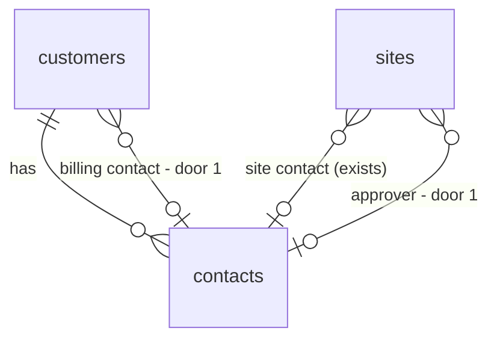

# Contact roles

## Problem

A customer has contacts, but the only role the system knows is "site contact", one per site (`sites.site_contact_id`). That one person gets every customer email (portal link, reminders, renewal notice) and is implicitly the one who approves. A property manager who approves agreements is often not the person at the building who lets the technician in, and neither is the accounts-payable person who will receive invoices in Phase 6. Staff cannot record who approves or who is billed, so they email the wrong person by hand or keep it in their heads. ROADMAP M3 and Phase 3.5 name three roles (site, billing, approver); the roadmap gives no incident or volume evidence.

When this ships, staff pick an **approver** per site and a **billing contact** per customer next to the existing site contact. Customer emails for a site go to its approver, falling back to the site contact when none is set. The customer page shows each contact's roles.

## Flow

Reuses the composite-FK pattern of `sites.site_contact_id` (AD-003), the record forms and `ContactStore`/`SiteStore` ports, and the three SQL spots that already resolve "the site contact's email".

1. `GET /sites/[siteId]/edit` and `GET /customers/[customerId]/edit` -> existing pages (exist) - the site form gains an Approver select beside Site contact; the customer form gains a Billing contact select.
2. Save actions in `app/(app)/record-actions.ts` (exists) -> `validateSite` / `validateCustomer` in `domain/records` (exist) - each id must be one of the customer's contacts, else refused.
3. `SiteStore` / `CustomerStore` adapters in `infrastructure/supabase/records.ts` (exist) write `sites.approver_contact_id` / `customers.billing_contact_id` (door 1).
4. Customer emails: `private.customer_recipient(site_id)` (new, door 2) returns the approver's email, else the site contact's. The two live inline joins call it instead: `automation_claim` (link and reminder, as last defined in `proposal_expiry`) and `private.claim_renewals` (`customer_renewal`, in `renewal`). The expiry notice (W8) goes to staff and is untouched.
5. `CustomerReader` (exists) returns each contact's roles; `customer-detail-view.tsx` (exists) shows them; the site register shows the approver.

## Impact

| Front | What changes |
| --- | --- |
| domain | new term: Approver - the contact who receives the agreement link and decides it; per site |
| domain | new term: Billing contact - the contact invoiced; per customer, no consumer until Phase 6 |
| domain | existing term: Site contact - still the on-site person; stops being the only email recipient. Callers that branch on it today: the link and reminder email in `automation_claim`, `customer_renewal` in `claim_renewals` (the 2 live inline joins; older copies are superseded), `SiteView.contactName` |
| stored data | two nullable columns; no backfill. Existing sites have no approver, so they keep emailing the site contact |
| grants | `authenticated` column `update` on `sites` and `customers` extended by the new columns (the deactivation migration revoked table-wide update) |
| docs | ROADMAP tick, CONTEXT.md (Contact / site contact, Customer), STATE.md AD row |

## Relations

One-way constraints: both new references are composite FKs to the same customer's contact (door 1); deleting a contact that holds a role is refused (existing `23503` handling).

## Surface

None - nothing consumed outside. Server actions keep their form-state contract (`ok`, `invalid`, `not_found`); the new fields are two more `invalid` causes.

## Landing

| One-way door | Literal shape | Alternative rejected |
| --- | --- | --- |
| 1. Roles as nullable composite FKs | `sites.approver_contact_id uuid`, FK `(approver_contact_id, customer_id) -> contacts (id, customer_id)`; `customers.billing_contact_id uuid`, FK `(billing_contact_id, id) -> contacts (id, customer_id)`; both `on delete` default (restrict) | a `contact_roles (contact_id, role, site_id)` join table - it allows several approvers per site and a per-site billing contact, which nothing here needs, and it cannot enforce "at most one" without a partial unique index per role |
| 2. One recipient resolver | `private.customer_recipient(p_site_id uuid) returns text`, `stable`, `security definer`, `search_path = ''`, `nullif(btrim(email), '')` of approver else site contact, null when neither has an email | patching the two inline joins separately - the next role change would need an edit in each and they would drift |

- A role with a blank email falls through to the next role, then to `no_recipient` (existing skip reason). No new skip reason.
- Nothing else is hard to reverse. Role labels and ordering in the UI are placement.

## Criteria

### S1: Staff assign roles (P1)

An estimator edits a site and a customer and picks the contacts.

**Acceptance Criteria**

1. WHEN an owner, admin or estimator saves a site with an approver chosen THEN the system SHALL store `sites.approver_contact_id` and show the approver's name on the site register row.
2. WHEN an owner, admin or estimator saves a customer with a billing contact chosen THEN the system SHALL store `customers.billing_contact_id`.
3. WHEN the "No approver" or "No billing contact" option is chosen THEN the system SHALL store null.
4. IF the chosen id is not a contact of that site's customer THEN the system SHALL refuse with `Choose a contact of this customer` and store nothing.
5. IF a contact holds a role and staff delete it THEN the system SHALL refuse with the existing delete-refused message and keep the contact.
6. WHERE the role is held by a contact, the system SHALL show on the customer page a label beside the contact name: `Billing`, and `Approver · <site>` or `Site · <site>` for each site it serves.
7. WHILE the signed-in role is viewer, the system SHALL show roles read-only with no select.

**Independent test:** edit a demo site, pick an approver, open the customer page and see the label.

### S2: Customer emails follow the approver (P1)

**Acceptance Criteria**

8. WHEN a site has an approver with an email THEN the system SHALL address the agreement link, the reminder and the renewal notice to the approver's email.
9. WHEN a site has no approver, or the approver has no email, THEN the system SHALL address them to the site contact's email, as today.
10. IF neither has an email THEN the system SHALL skip the notification with `no_recipient`, as today.
11. The system SHALL address a given notification to exactly one customer recipient, never both.

**Independent test:** send a demo agreement from a site with a distinct approver and read `notifications.recipients`.

## Out of scope

| Excluded | Why |
| --- | --- |
| Billing contact receiving anything | no invoice or billing flow exists until Phase 6; it is recorded only |
| Several approvers or CC recipients | one recipient per notification keeps the link single-use in practice; a later slice |
| Contact deactivation | not in the roadmap item; deletion is refused while a role is held |
| Role-specific portal permissions | the portal is a bearer link with no identity (AD-068) |
| Roles at customer level for approver or site | the roadmap asks for site-level assignment of the first two |

## Assumptions

| Assumption | Chosen default | Rationale | Confirmed? |
| --- | --- | --- | --- |
| Approver changes who gets email | yes, approver first, site contact fallback | a role that routes nothing is a label; fallback keeps every existing site working | n |
| Cardinality | one approver per site, one billing contact per customer | matches the existing one-site-contact model and the roadmap wording | n |
| Customer email recipient for contract (Phase 4) | will reuse `customer_recipient` | decided when Phase 4 is planned | n |
| Who may assign | owner, admin, estimator | same as the existing record forms (RLS write policy) | n |

**Open questions:** none - all resolved or logged above.

## Observable

| Surface | Decision | Landing |
| --- | --- | --- |
| screen `site edit` / `site new` | empty state (customer has no contacts) | existing - Select shows only "No approver" |
| screen `site edit` / `customer edit` | error state | AC 4 |
| screen `site edit` / `customer edit` | unauthorised (viewer) | AC 7 |
| screen `site edit` / `customer edit` | loading | n/a - server-rendered form, existing submit-pending pattern |
| screen `customer detail` | empty state (no roles held) | n/a - no label is shown, the contact row is unchanged |
| screen `customer detail` | destructive action confirms | existing - delete-contact confirm prompt, AC 5 |
| screen `customer detail`, `site register` | density and ordering | AC 6 - labels follow the existing contact order |
| notification email | structure, tone, next step | n/a - copy unchanged, only the address changes (AC 8-9) |

## Sources

- ROADMAP.md M3 and Phase 3.5 "Contact roles: site, billing and approver" - names the three roles.
- CONTEXT.md "Contact / site contact (M3)" - the email approval counts as written approval.
