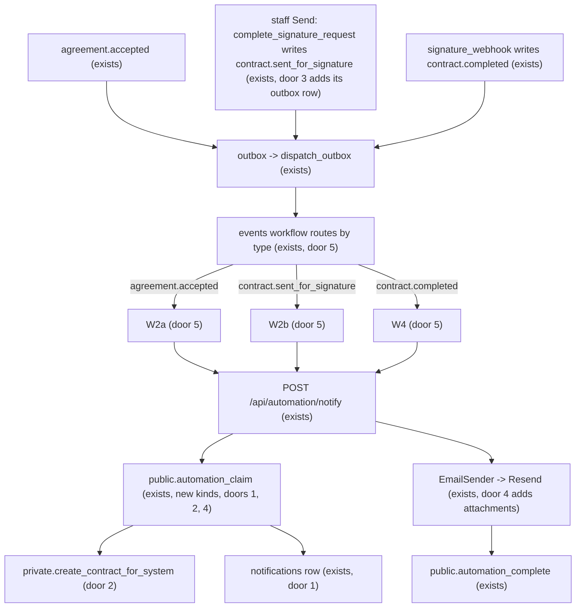

# Contract automation: n8n W2 and W4

## Problem

A customer can accept an agreement, and the app can generate, send and complete a contract, but nobody is told at any step. After `agreement.accepted` the office has to notice on the pipeline that a deal is waiting for a contract. After staff press Send, the customer's signing link is shown on the staff screen and the estimator has to paste it into their own email (signature-provider: "until then staff copy the link"). After both parties sign, the signed copy sits in the database and is only reachable by opening the contract page and downloading it. The customer, who has no account, never receives their copy.

The three events already exist and `contract.completed` and `contract.client_signed` already enqueue outbox rows (AD-149), but the events workflow ignores every type except the three agreement ones (outbox-dispatch AC 32), so the rows are dispatched and dropped. The source (ROADMAP Phase 4 item 4, W2, W4, M10, M12) gives no user evidence or date.

**When this ships:** accepting an agreement makes its contract and emails the owners and admins that it is ready to send, or why it could not be made. Pressing Send emails the customer's signer the signing link in the contractor's name. When both have signed, the customer's signer and the contractor's signer each get an email with the signed PDF and the audit log attached, and the owners and admins get a short internal note.

## Flow

This reuses the whole outbox-dispatch chain unchanged (`private.dispatch_outbox`, the events workflow, `POST /api/automation/notify`, `automation_claim`/`automation_complete`, `notifications` with its idempotency key, `EmailSender`), `create_contract`'s rules, `private.org_managers`, and the sealed signing link stored by item 2. It adds no second dispatcher and no second email path.

1. `agreement.accepted` reaches the events workflow (exists). W2a calls notify with kind `contract_ready` and key `w2:<eventId>:ready`.
2. `automation_claim` claims the notification, then calls `private.create_contract_for_system(agreement)` (door 2), which has `create_contract`'s rules and returns the existing contract if one is there. It returns the managers' email with the contract, or, when a rule refuses (`not_accepted`, `auto_renewal`, `site_inactive`, `no_term_start`, `no_signer`), the same email with the reason and a link to the agreement instead.
3. Staff open the contract and press Send as today (exists). `complete_signature_request` already writes `contract.sent_for_signature`; door 3 makes it enqueue an outbox row. W2b calls notify with kind `customer_signing_link`, key `w2:<eventId>:link`. The claim returns the customer signer's name and email, the tenant branding and the sealed link (`contract_signers.link_sealed`), only while the request is `open` and the contract `pending_signature`.
4. The app unseals the link with the existing signing key (exists) and builds the email (pure, placement). Sending follows outbox-dispatch hop 5.
5. `contract.completed` reaches W4 with kind `contract_signed_copy`, key `w4:<eventId>:copy` (to the customer signer and the contractor signer, the signed PDF and the audit log attached) and `staff_contract_signed`, key `w4:<eventId>:staff` (to `org_managers`, no attachment, link to the contract).
6. out: the contract page shows the delivery line for the signing link, as the agreement page does for `customer_link` (reads the latest notification of the kind through the existing contract reader).

## Impact

| Front | What changes |
| --- | --- |
| domain | new term: notification kinds `staff_contract_ready`, `customer_signing_link`, `contract_signed_copy`, `staff_contract_signed`; request kinds `contract_ready`, `customer_signing_link`, `contract_signed_copy` (the last also claims the staff note) |
| domain | existing term: `events` of type `contract.pending_signature` had `actor_id = auth.uid()` (AD-136). A contract made by W2 has `actor_id` null and payload `via: "w2"`. Who branches on it: nothing in the app reads the actor of this event |
| domain | existing term: `contract.sent_for_signature` had "no outbox row" (AD-147 door 8). It now has one. Who branches on it: the events workflow, which will route it; `outbox` SQL tests that count rows after a send |
| port | `EmailSender.send` gains an optional `attachments: [{filename, contentBase64}]`; the Resend adapter forwards it. Who branches on it: every caller keeps working (field optional) |
| auth | none: `/api/automation/` is already public (AD-072); `automation_claim` is the only door and checks the HMAC first |
| stored data | one `notifications.kind` check constraint is replaced, no rows change. **Contracts that already exist** (demo, live runs) are not retro-notified: `agreement.accepted` rows already `sent`/`failed` stay as they are, and only events created after the migration enqueue the new outbox row |
| infrastructure | the events workflow export gains three routes and three new workflow exports are added; the owner re-imports them into n8n. No new secret: `SIGNING_LINK_KEY` and `RESEND_API_KEY` exist |
| screens | `/contracts/[contractId]` gains the delivery line for the signing link. No other screen changes |

## Relations

None of the entities change shape. `notifications` gains kinds only (door 1); `contract_signers.link_sealed` and `contract_signed_documents` are read, not changed.

`None - no stored-data shape change`

## Surface

Only routes this adds or whose signature changes. `POST /api/automation/notify` and `public.automation_claim` keep their signature; they gain request kinds and message kinds.

| Route | In | Out | Status |
| --- | --- | --- | --- |
| `POST /api/automation/notify` (new kinds) | `kind` (contract_ready, customer_signing_link or contract_signed_copy), `idempotencyKey`, `eventId`, `n8nExecutionId` | `{outcome, reason?}` where outcome is sent, skipped or duplicate | `200`, `400`, `401`, `404`, `409`, `503` |

## Landing

| One-way door | Literal shape | Alternative rejected |
| --- | --- | --- |
| 1. New notification kinds and keys | `notifications.kind` check adds `'staff_contract_ready','customer_signing_link','contract_signed_copy','staff_contract_signed'`; keys `w2:<eventId>:ready`, `w2:<eventId>:link`, `w4:<eventId>:copy`, `w4:<eventId>:staff` (unique, so a replay is `duplicate`) | reusing `staff_decision` for the office note: its claim rules read agreement refusals and cannot say "contract ready" |
| 2. System contract creation | `private.create_contract_for_system(p_agreement_id uuid) returns uuid` (security definer, `search_path = ''`, `execute` revoked from `public, anon, authenticated`), called only by `automation_claim`; `create_contract` and it share one body in `private.make_contract(p_agreement_id, p_actor uuid)`; event `contract.pending_signature` with `actor_id` null and payload `{from: null, to: "pending_signature", versionNo, via: "w2"}` | a service-role key in the app (AD-037, AD-073 forbid it); granting `create_contract` to `anon` (any caller could make contracts) |
| 3. Send enqueues an outbox row | `complete_signature_request` calls `private.enqueue_outbox(event_id)` for the `contract.sent_for_signature` event it writes (amends AD-147 door 8) | polling `contract_signature_requests` from n8n: another read path and no idempotency key |
| 4. Attachments on `EmailSender` | `send({ ..., attachments?: { filename: string; contentBase64: string }[] })`, Resend `attachments: [{ filename, content }]`; the claim returns each document as base64 inside the message, at most the 10 MiB each cap of AD-149 | a signed download link for the customer: needs a new public token and route, and the roadmap says "email the signed PDF"; a second signed RPC to fetch bytes: another `anon` write-class door for no gain at this size |
| 5. Workflow exports | `automation/n8n/W2a-contract-ready.json`, `W2b-signing-link.json`, `W4-contract-signed.json` follow AD-079's shape (Set -> Crypto HMAC `__SA_HMAC_SECRET__` -> notify with the retry loop); `events.json` routes the three types; `web/n8n-workflows.test.ts` lists them | one workflow with a Switch: a failure in one branch would retry the other |
| 6. Skip reasons (added while building, additive to door 1) | `notifications.skip_reason` check adds `'not_signable','not_completed','no_documents'`; `NotEmailedReason` and the delivery line's words follow | storing them only in `error`: the delivery line and `automation_complete` read `skip_reason` |
| 7. Claim helpers (added while building, additive to door 2) | `private.claim_contract_ready(jsonb)`, `private.claim_signing_link(jsonb)`, `private.claim_signed_copy(jsonb)` (definer, `execute` revoked from everyone), called only by `automation_claim`, as `claim_renewals` and `claim_expiries` are | three more branches inside `automation_claim`: it already holds 330 lines |

- Nothing else in this change is hard to reverse. Placement (folders, email builder names) follows `web/domain/notifications`.

## Criteria

### S1: Accepting an agreement makes the contract and tells the office (W2a) (P1)

**Acceptance Criteria**

1. WHEN `agreement.accepted` is delivered THEN the events workflow SHALL start W2a, which calls `POST /api/automation/notify` with kind `contract_ready` and key `w2:<eventId>:ready`.
2. WHEN `automation_claim` receives `contract_ready` for an accepted agreement with a site contact THEN it SHALL create the contract once through `private.create_contract_for_system`, write one `contract.pending_signature` event with `actor_id` null and `via: "w2"`, and return one `staff_contract_ready` message for the owners and admins.
3. IF a contract already exists for the agreement's highest version THEN the claim SHALL create nothing and still return the message (a retry gets the same contract id).
4. IF a rule of `create_contract` refuses (`not_accepted`, `auto_renewal`, `site_inactive`, `no_term_start`, `no_signer`) THEN the claim SHALL create nothing and return a `staff_contract_ready` message whose subject says the contract could not be made, naming the reason in plain words and linking to the agreement.
5. IF the org has no owner or admin with an email THEN the claim SHALL skip with reason `no_recipient` (after the contract is made).
6. WHEN the same event is delivered twice THEN the second call SHALL answer `duplicate` and create no second contract, event or email.
7. The email SHALL carry the tenant's name, the agreement number, the site, and a link to `/contracts/<id>` (or `/agreements/<id>` in the refused case); it SHALL NOT contain the signing link.

**Independent test:** accept an agreement on the demo and see the contract appear with its owners' email in the log (reserved domain refuses the real send), then replay the delivery and see `duplicate`.

### S2: The customer's signer is emailed the signing link (W2b) (P1)

**Acceptance Criteria**

8. WHEN `contract.sent_for_signature` is written THEN the system SHALL enqueue exactly one outbox row for it, in the same transaction.
9. WHEN the events workflow receives `contract.sent_for_signature` THEN W2b SHALL call notify with kind `customer_signing_link` and key `w2:<eventId>:link`.
10. WHEN the claim runs while the request is `open` and the contract `pending_signature` THEN it SHALL return one `customer_signing_link` message for the customer signer's email carrying the tenant branding, the agreement number, the site and the sealed link, and the app SHALL send an email in the contractor's name whose button opens `/sign/<token>`.
11. IF the request is not `open` or the contract is not `pending_signature` (voided, declined, completed) THEN the claim SHALL skip with reason `not_signable`.
12. IF the sealed link cannot be opened (missing `SIGNING_LINK_KEY`, changed value) THEN the system SHALL mark the notification `failed` and answer `503`, so n8n retries, and SHALL log no token.
13. WHEN the contract page of a contract with such a notification renders THEN it SHALL show the delivery line (`Signing link emailed to <address>` / `Signing link email failed` / none), as the agreement page does for `customer_link`.
14. WHEN a repeat delivery arrives THEN the answer SHALL be `duplicate` and no second email SHALL go out.

**Independent test:** press Send on the demo contract and see the customer signer's email render with a working `/sign/<token>` link.

### S3: Both parties get the signed copy (W4) (P1)

**Acceptance Criteria**

15. WHEN `contract.completed` is delivered THEN the events workflow SHALL start W4, which calls notify with kind `contract_signed_copy` and key `w4:<eventId>:copy`.
16. WHEN the claim runs for a `completed` contract with both stored documents THEN it SHALL return one `contract_signed_copy` message for each of the customer signer and the contractor signer, each carrying `<number>-signed.pdf` and `<number>-audit-log.pdf` as the bytes stored (the attachment SHA-256 SHALL equal the stored `sha256`), and one `staff_contract_signed` message for the owners and admins with no attachment and a link to `/contracts/<id>`.
17. IF the contract is not `completed`, or either document is missing THEN the claim SHALL skip with reason `not_completed` / `no_documents` and send nothing.
18. IF the customer signer and the contractor signer have the same address THEN the system SHALL send that address one email, not two.
19. IF a recipient is on a reserved domain THEN the sender SHALL refuse that email (`reserved_domain`) and the others SHALL still go out; the refused one is recorded `failed`.
20. WHEN a repeat delivery arrives THEN the answer SHALL be `duplicate` and no second email SHALL go out.
21. The sender SHALL pass the attachments to Resend as base64 `content` with their file names, and SHALL send nothing when either exceeds 10,485,760 bytes.

**Independent test:** complete the demo contract through the sandbox webhook and see two emails with both PDFs attached, byte-identical to the downloads on the contract page.

### S4: Only the signed HMAC reaches any of it (P1)

**Acceptance Criteria**

22. IF a `contract_ready`, `customer_signing_link` or `contract_signed_copy` request carries a bad or stale signature THEN `automation_claim` SHALL raise `42501` and create, claim and read nothing (the route answers `401`).
23. IF the event named does not exist, or is not of the type the kind needs (`agreement.accepted`, `contract.sent_for_signature`, `contract.completed`), THEN the claim SHALL raise `P0002` (the route answers `404`) and write nothing.
24. The system SHALL expose `private.create_contract_for_system` to no role: `anon` and `authenticated` calling it SHALL get `42501`.

**Independent test:** replay a captured body with a changed byte and a stale timestamp; call the private function as `authenticated`.

## Out of scope

| Excluded | Why |
| --- | --- |
| Sending the contract for signature automatically on accept | needs a contractor signer who is a person (item 2 assumption: the owner or admin who presses Send, who also countersigns); see Assumptions 1 |
| Telling the owner that the customer signed and the contractor's countersignature is waiting | not in W2/W4 as the roadmap lists them; fits W5's contract reminders; `contract.client_signed` stays ignored by the router |
| Reminders for unsigned contracts after 5 days (W5 family), W6 | roadmap lists them separately and "Not yet" says so |
| Emailing a decline (`contract.declined`) to the staff | no workflow listed in the roadmap; the contract page already says it |
| A button to resend the signing link or the signed copy | no failure seen; the notification row shows `failed` and n8n retries meanwhile |
| Locale or language of the emails | one language, as the existing emails |
| Rate limiting of `/api/automation/*` | already listed under "Not yet" in `CONTEXT.md` |

## Assumptions

| Assumption | Chosen default | Rationale | Confirmed? |
| --- | --- | --- | --- |
| 1. Does W2 also send the contract for signature? The roadmap says "generate the contract and send it for signature" | No: W2 makes the contract and tells the owners; a person presses Send | Send needs a contractor signer (name and email of the person who then countersigns inside the app), sending calls DocuSeal and counts US$0.20, and the legal review of the clauses is still open. Auto-send is a later switch on the same events | n |
| Who gets "contract ready" | `private.org_managers` (owners and admins with an email) | same rule as W3/W5/W7/W8 | n |
| Contractor-side recipient of the signed copy | the contractor signer stored on the request (`contract_signers`, role `contractor`) | it is the person who signed | n |
| Attachment size | returned inline as base64 inside the claim's JSON | the cap is 10 MiB per file (AD-149) and a text contract renders well under 1 MiB; the live run measures it | n |
| Resend attachments | `attachments: [{ filename, content: <base64> }]`, total under 40 MB | to be read from Resend's docs when the checks are written (knowledge chain; not yet verified) | n |
| Existing contracts | not back-filled | a burst of emails about old demo events is worse than none | n |
| Reserved domain | the demo's `@example.com` recipients are refused as for every email today | `isReservedAddress` exists | n |

**Open questions** (three kept open, none blocks a criterion):

| # | Kind | Question | Until answered |
| --- | --- | --- | --- |
| 1 | open | Should W2 send the contract for signature on its own (Assumption 1)? | written as "make and tell"; a later slice adds the send without changing the events or keys |
| 2 | blocks go-live | Does counsel accept emailing the signing link and the signed PDF under the e-signature flow (carried from item 2)? | no real customer should be emailed |
| 3 | blocks go-live | The owner must re-import the three workflows into n8n and wire the DocuSeal webhook (item 3's go-live step) | the live halves of AC 9, 15 and 16 |

## Observable

| Surface | Decision | Landing |
| --- | --- | --- |
| API `POST /api/automation/notify` (new kinds) | error shape and codes | AC 22, 23, Surface |
| API `POST /api/automation/notify` (new kinds) | who may call | AC 22 |
| API `POST /api/automation/notify` (new kinds) | versioning, rate limit | n/a - same route and body as W1 to W8; the rate-limit gap is under Out of scope |
| API `rpc automation_claim` | error shape, who may call | AC 22, 23, 24 |
| scheduled task W2a, W2b, W4 | retries and failure | AC 12, 14, 20 (n8n's retry loop of AD-079; the key makes a retry safe) |
| scheduled task W2a, W2b, W4 | output on partial failure | AC 19 |
| document: contract-ready email | structure and next step for the reader | AC 4, 7 |
| document: signing-link email | structure and next step | AC 10 |
| document: signed-copy email | structure and next step | AC 16 |
| screen `/contracts/[contractId]` | delivery line states (none, sent, failed) | AC 13 |
| screen `/contracts/[contractId]` | loading, error, unauthorised, destructive action | existing - `loading.tsx`, not-found page, any member reads (item 3 Observable); n/a - nothing on the line deletes |

## Sources

- ROADMAP.md: M10, M12, Phase 4 item 4, W2, W4, decision 21.
- `.specs/features/outbox-dispatch/plan.md`: the dispatcher, notify route, AD-073 to AD-079; AC 32 (the router ignores other types).
- `.specs/features/signature-webhook/plan.md` and `signature-provider/plan.md`: the three events, AD-135 to AD-149.
