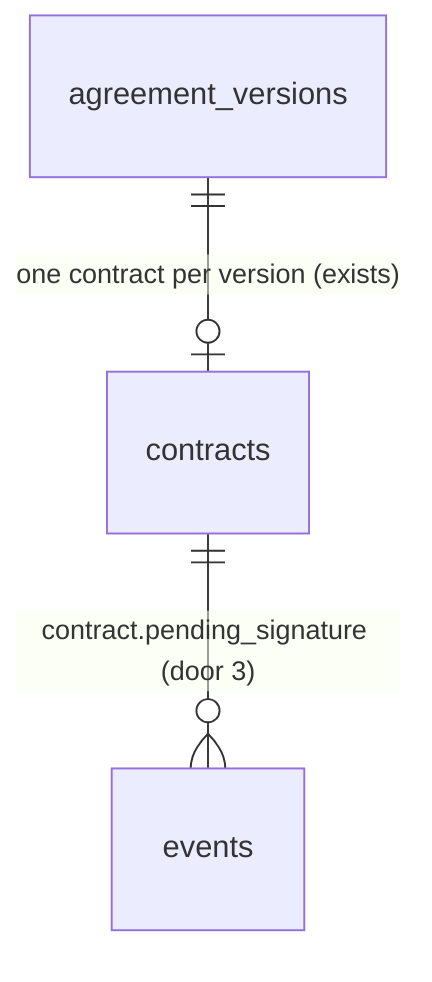

# Contract generation

## Problem

An agreement the customer accepted ends there. The pipeline shows it as "Accepted (awaiting signature)", but nothing exists to sign: the `contracts` table and the contract state machine have been in the schema since `0001_init` with no writer, no page and no document. Staff accept the customer's yes and then build the legal paper by hand outside the app, copying prices, term dates, the six terms and the signer from the agreement. That is slow and it can drift from what the customer accepted. ROADMAP M10: "Contract built from the accepted version, client signs then the tenant countersigns". The source gives no volume figures.

When this ships:
- An accepted agreement offers "Generate contract" to owners, admins and estimators.
- The contract freezes who is bound (the contractor's identity, the customer, the site and the signer) at that moment, on top of the accepted version, which is already frozen.
- Staff open the contract page and download a tenant-branded contract PDF, ready for the signature item that follows.

## Flow

This reuses the accepted version as it is already frozen (`AgreementReader.get`, `parseTerms`, `buildAgreementDocument`'s frozen path), the `DocumentRenderer` port and `infrastructure/documents` layout, the `contracts` table and `apply_contract_transition`, AD-126's way of picking the customer contact, and the staff-only definer RPC pattern (AD-090, AD-131) instead of adding a second way to write or draw any of them.

1. `/agreements/[agreementId]` (exists) shows "Generate contract" on an `accepted` agreement with no contract, with a confirm step that names the signer, read through `public.contract_signer` (door 6). It calls `generateContractAction` (new, placement per conventions) -> `ContractStore.create` (new, placement).
2. `public.create_contract` (door 2): locks the agreement `for update` (exists), checks role and guards, reads `org_settings`, the customer and the site (exist), picks the signer with `private.customer_signer` (door 5), inserts the `contracts` row with its `parties` (door 1) and writes the event `contract.pending_signature` (door 3). No outbox row.
3. The action redirects to `/contracts/[contractId]` (door 4). `ContractReader.get` (new, placement) reads the contract, then `AgreementReader.get(agreementId, versionNo)` (exists) for the frozen lines, scope and terms.
4. `GET /contracts/[contractId]/pdf` (door 4) reads the same two things, `buildContractDocument` (new, placement; calls `buildAgreementDocument`'s frozen path) builds plain data, `ContractRenderer.renderContract` (new port, placement) hands it to `infrastructure/documents` (exists, the same adapter as `DocumentRenderer`).

## Impact

| Front | What changes |
| --- | --- |
| domain | New term `parties`: who the contract binds, frozen when the contract is generated. Lives in `contracts.parties` and in `web/domain/contract`. |
| domain | Existing term `contract`: until now a status machine with no rows. Who branches on it today: `assert_site_deactivatable` (a contract `pending_signature`, `client_signed` or `completed` blocks deactivating the site, `in_term`), `pipelineStage(agreement, contract?)`, and `apply_contract_transition`. After this a generated contract blocks site deactivation even if the accepted agreement's term has ended, which is intended. |
| domain | Existing term `accepted`: an auto-renewed agreement is also `accepted`, but no customer accepted it (ROADMAP: "Nobody signs again"). Its mark is the `agreement.renewed` event that `private.run_renewals` writes on the new agreement. The guard refuses an agreement with that event. The guard cannot be "has an `agreement.accepted` event": `seed.sql` writes no events, so the demo's accepted AG-1035 would be refused. A renegotiated renewal that the customer accepts has no `agreement.renewed` event and qualifies. |
| stored data | `contracts` gains `parties`. `seed.sql` already inserts three demo contracts (AG-1031 `client_signed`, AG-1022 and AG-1019 `completed`), so the live project holds them too. The column defaults to `{}`, which means "not recorded" (AD-058's rule for `snapshot`); the migration backfills those three rows from the current Company settings (fictitious demo data, as AD-062 did) and `seed.sql` repeats it guarded by `parties = '{}'`. A non-demo project would have no rows; the build counts them first and a non-zero count outside the demo org stops and asks. The default also keeps every existing proof that inserts a contract with two columns compiling. |
| stored data | Grants on `contracts` tighten: members lose `insert` and `delete`, and keep `update` on `status` only, so `apply_contract_transition` (security invoker) still works. A member PATCH of `status` stays possible, as today; that hole is not closed here. Existing proofs: `rls_isolation.sql` C5 inserts as the table owner and is unaffected. `rls_roles.sql` C12 expects a viewer's `update contracts set org_id = org_id` and `delete from contracts` to affect 0 rows; with the narrower grants they answer `42501`, so `contracts` moves into the branch where `customers`, `sites` and `assets` already expect `42501` (deactivation C1314 did the same). `rls_isolation.sql` C3/C4/C43, `rls_roles.sql` C11 stay `42501`. `staff_screens.sql` C120 counts exactly 3 demo contracts. |
| application | A new port `ContractRenderer.renderContract(ContractDocument)`, not a second method on `DocumentRenderer`: `boundaries.test.ts` C874 pins that port's exact body, and AGENTS.md asks for small interfaces (ISP). Both are implemented by the one adapter in `infrastructure/documents`. `AgreementDetail` gains an optional `contract: {id, status} | null` for the agreement page; the pipeline and list readers already embed `contracts(status)` and are untouched. |
| application | `AgreementDetail` gains optional `contract` and `signer` (the signer only for an accepted agreement with no contract, from `contract_signer`). The page's `AgreementActions` gains an optional `generate`. |
| agreement PDF | The sections `agreement-pdf.tsx` drew (letterhead, price, schedule, scope, footer) moved unchanged into `infrastructure/documents/pdf-sections.tsx`, and `buildAgreementDocument` takes its lines, total, schedule, scope and term from the new `documentBody`; both documents use them. The 40 existing PDF tests are the proof that the agreement's output did not move. |
| renewal | `run_renewals` still reads the accepted version's term. The ROADMAP line "the term moves to the contract once there is one" is not done here; the contract only copies the term for display. |
| automation | `contract.pending_signature` is never enqueued, so n8n sees nothing new. |

## Relations

One-way constraints: a contract carries its own frozen `parties` and no reference to `org_settings`, `customers`, `sites` or `contacts` (door 1). The existing one-contract-per-version rule stays (door 2). No columns and no types here.

## Surface

| Route | In | Out | Status |
| --- | --- | --- | --- |
| `rpc create_contract` | `p_agreement_id` | the contract id (the existing one on a repeat) | `200`; SQLSTATE `P0002` (agreement missing or another org), `42501` (not owner, admin or estimator), `55000` with hint `not_accepted`, `auto_renewal`, `site_inactive`, `no_term_start` or `no_signer` |
| `rpc contract_signer` | `p_site_id` | `{"name", "email"}` of whoever would sign, or null | `200`; null for a site of another org or with no contact that has an email |
| `GET /contracts/[contractId]` | uuid | the contract page: number, status, parties, term, lines, total, terms, links | `200`, `404` (malformed, missing, other org), redirect to `/login` (proxy) |
| `GET /contracts/[contractId]/pdf` | uuid | `application/pdf`, `Content-Disposition: attachment; filename="<number>-contract.pdf"` | `200`, empty `404`, empty `503` (render failure or an org with no settings row, logged), redirect to `/login` |

## Landing

| One-way door | Literal shape | Alternative rejected |
| --- | --- | --- |
| 1. What the contract freezes | `contracts.parties jsonb not null default '{}' check (jsonb_typeof(parties) = 'object')` (`{}` = not recorded) and `create_contract` always writing schema 1, holding `{"schema": 1, "contractor": {"legalName", "address", "phone"}, "customer": {"name"}, "site": {"name", "address"}, "signer": {"name", "email"}}`, camelCase, every key present and null when unset. Lines, scope, term and terms are not copied: they are read from the accepted version, already frozen (AD-054, AD-058, AD-071). | Re-reading `org_settings` and the contact at render time: a branding or contact edit would change who a signed document binds (AD-071's reason). Copying the lines into the contract: a second source for what AD-054 already locks. |
| 2. The writer | `public.create_contract(p_agreement_id uuid) returns uuid` (security definer, `search_path = ''`, `execute` to `authenticated` only): `P0002` unless the caller is a member of the agreement's org, `42501` unless owner, admin or estimator, then the agreement `for update`, then the `55000` hints in the order `not_accepted`, `auto_renewal`, `site_inactive`, `no_term_start`, `no_signer`. Contract for the highest version; if one exists for it, its id is returned and nothing is written. `revoke insert, delete on public.contracts from authenticated`; `update` stays on `status` only. The existing `unique (agreement_version_id)` is the backstop. | Security invoker with the RLS insert policy: a member could PATCH-insert any `parties` (AD-060, AD-090, AD-113's reason). Creating it inside `portal_decide`: the user chose a staff step (2026-11-05). Raising `23505` on a repeat: W2 (item 4) will retry and needs the same id back. |
| 3. The creation event | `events` row, `entity_type = 'contract'`, `type = 'contract.pending_signature'`, payload `{"from": null, "to": "pending_signature", "versionNo": n}`, `actor_id = auth.uid()`, no `outbox` row | `contract.created`: breaks the `<entity>.<to-status>` rule n8n binds to (AD-011). Enqueueing it: W2 keys on `agreement.accepted`, and a row nothing consumes is still dispatched. |
| 4. URLs | `/contracts/[contractId]` and `/contracts/[contractId]/pdf`, flat by uuid, PDF filename `<agreement number>-contract.pdf` | Nested under the agreement: the signature webhook, emails and the signed copy link a contract knowing only its id (AD-024, AD-056). |
| 5. Picking the signer | `private.customer_signer(p_site_id uuid) returns jsonb` (sql, stable, security definer, `search_path = ''`, no grant to `anon` or `authenticated`) gives `{"name", "email"}` of the site's approver, else its site contact; `private.customer_recipient` is redefined to return its trimmed email. | Repeating the join inside `create_contract`: AD-126 exists so one function changes when a role is added. |
| 6. Previewing the signer (found while writing the checks, AC 2) | `public.contract_signer(p_site_id uuid) returns jsonb` (sql, stable, security definer, `search_path = ''`, `execute` to `authenticated` only): returns `private.customer_signer(p_site_id)` when the caller is a member of the site's org, else null. `AgreementReader` calls it only for an `accepted` agreement with no contract | Reading approver and site contact in TypeScript to pick the signer there: a second implementation of the rule AD-126 keeps in one place. Granting `authenticated` the private function: it is not exposed and stays unexposed. |

- Nothing else in this change is hard to reverse. Closed for later: a `voided` or `declined` contract still holds the version's unique slot, so regeneration needs the index relaxed to a partial one in the void/decline slice (see Out of scope).

## Criteria

### S1: Staff generate a contract from an accepted agreement (P1)

An accepted agreement becomes one contract with its parties frozen.

**Acceptance Criteria**

1. WHILE an agreement is `accepted` and has no contract, and the member is an owner, admin or estimator, the agreement page SHALL show a `Generate contract` button; viewers SHALL see none.
2. WHEN the button is pressed THEN the page SHALL show a confirm step naming the signer (`Name · email`), the term (`Jan 1, 2027 – Dec 31, 2027 · 12 months`) and `Total per year`, and SHALL create nothing until confirmed.
3. WHEN generation is confirmed THEN the system SHALL insert one contract for the agreement's highest version with status `pending_signature` and open `/contracts/<id>`.
4. WHEN the contract is created THEN `parties` SHALL hold the contractor's legal name, address and phone from Company settings, the customer's name, the site's name and address, and the signer, who is the site's approver contact, else its site contact, each taken at that moment.
5. WHEN the contract is created THEN the system SHALL write one event `contract.pending_signature` on the contract with payload `{from: null, to: "pending_signature", versionNo}` and `actor_id` the caller, and SHALL write no outbox row.
6. WHEN Company settings, the customer, the site or the signer's contact change after generation THEN the contract's `parties` and its PDF SHALL be unchanged.
7. WHEN `create_contract` runs for an agreement that already has a contract THEN it SHALL return that contract's id and write no second row and no second event.
8. IF two `create_contract` calls reach the same agreement at once THEN exactly one contract and one `contract.pending_signature` event SHALL exist and both calls SHALL return the same id.
9. WHILE an accepted agreement has a contract the agreement page SHALL show a `Contract` line with its status label and a link to the contract, and no `Generate contract` button.
10. IF the agreement is not `accepted` THEN `create_contract` SHALL raise `55000` with hint `not_accepted` and write nothing.
11. IF the agreement has an `agreement.renewed` event (it was accepted by the automatic renewal, not by the customer) THEN `create_contract` SHALL raise `55000` with hint `auto_renewal` and write nothing.
12. IF the agreement's site is inactive THEN `create_contract` SHALL raise `55000` with hint `site_inactive`.
13. IF the highest version has no `term_start` THEN `create_contract` SHALL raise `55000` with hint `no_term_start`.
14. IF neither the site's approver nor its site contact has an email THEN `create_contract` SHALL raise `55000` with hint `no_signer`.
15. IF a caller is a viewer THEN `create_contract` SHALL raise `42501`; IF the agreement is missing or in another org THEN it SHALL raise `P0002`.
16. IF a member inserts into or deletes from `contracts`, or updates a column other than `status`, through PostgREST THEN the system SHALL refuse it (`42501`).
17. IF generation is refused THEN the page SHALL show one message per hint and no contract: `not_accepted` "Only an accepted agreement can become a contract."; `auto_renewal` "This agreement was renewed automatically, so there is nothing to sign."; `site_inactive` "This site is inactive."; `no_term_start` "This agreement has no term start date, so it cannot become a contract."; `no_signer` "Add an email to the site's approver or site contact, then try again."

**Independent test:** open the accepted demo agreement, press `Generate contract`, confirm, and land on the new contract page; press it again from the agreement page and see the same contract.

### S2: Staff open the contract (P1)

**Acceptance Criteria**

18. The contract page SHALL show `Contract · AG-1004` with a status label (`Pending signature`, `Client signed`, `Completed`, `Declined`, `Voided`), the customer and site as links, the signer's name and email, the term line, `Total per year` before tax, a link back to the agreement and `Download PDF`.
19. The contract page SHALL list the accepted version's service lines with months and annual amounts, the visit schedule and the frozen terms that are set, read-only.
20. WHILE the member is a viewer the contract page SHALL be readable and offer no write control.
21. WHILE a contract's `parties` is `{}` the contract page SHALL show `Parties not recorded for this contract.` in place of the parties and signer, and its PDF route SHALL answer an empty `404`.
22. IF the id is malformed, missing or another org's THEN the page SHALL answer `404`.
23. The contract page SHALL not scroll horizontally at 375 px and its controls SHALL be at least 44 px tall on touch screens.

**Independent test:** open the generated contract at 1440 and 375 px.

### S3: The contract PDF (P1)

**Acceptance Criteria**

24. WHEN `GET /contracts/[contractId]/pdf` is called by any role THEN it SHALL answer `200` with `Content-Disposition: attachment; filename="AG-1004-contract.pdf"`.
25. IF the contract is missing, malformed or another org's THEN the route SHALL answer an empty `404`; IF rendering fails or the org has no settings row THEN an empty `503`, logged.
26. The PDF SHALL be Letter size, headed `Service Contract` with the agreement number, and SHALL print the contractor (legal name, address, phone, accent colour), the customer and site from `parties`, and the signer's name.
27. The PDF SHALL print the term line, the service lines with the total `before tax` and the tax note, the visit schedule, Service included and Equipment from the accepted version, in the order the agreement PDF uses.
28. For each term that is set the PDF SHALL print one clause, and none for a term that is null: payment `Invoices are payable within <n> days.`; cancellation `Either party may cancel this contract with <n> days' written notice.`; repair discount `Repair work is discounted by <n>%.`; CPI cap `The annual price may rise with CPI, capped at <n>%.`; governing law `This contract is governed by the laws of <province name>.`; renewal (both renewal values set) `This contract renews for successive <term> terms unless CPI is at or above <threshold>%, when the parties renegotiate; the customer is notified <n> days before the end date.`
29. The PDF SHALL end with two signature blocks, `For the Customer: <signer name>` and `For <contractor legal name>`, each with a `Signature` line and a `Date` line, kept together on one page.
30. The PDF SHALL carry `Page x of y` and the agreement number on every page, and SHALL carry no `DRAFT` mark.
31. The PDF SHALL read the contractor, customer, site and signer only from the contract's `parties`, and the terms only from the accepted version's frozen snapshot.

**Independent test:** download the generated contract's PDF and read the parties, term, total, clauses and signature blocks.

## Out of scope

| Excluded | Why |
| --- | --- |
| Sending the contract for signature, DocuSeal, embedded signing | ROADMAP Phase 4 item 2 |
| Webhook, signed PDF, audit log storage | ROADMAP Phase 4 item 3 |
| n8n W2 (call the app to generate and send on accept) and W4 | ROADMAP Phase 4 item 4. W2 will need a system-callable sibling of `create_contract`, since n8n has no member. |
| Void, decline and regenerate a contract | The domain transitions exist, but no screen drives them, and regenerating needs `unique (agreement_version_id)` relaxed to a partial index |
| A contract template editable by the tenant | The user chose clauses generated from frozen terms (2026-11-05) |
| Creating the contract automatically on accept | The user chose a staff step (2026-11-05) |
| A separate contract number | The agreement number identifies it, since a contract has exactly one agreement version |
| A Contracts list page and a sidebar item | The pipeline card and the agreement page reach a contract; a list has no item in ROADMAP |
| The contract in the agreement's Activity timeline | `buildTimeline` reads `agreement.*` events; contract events are another entity |
| Moving the term from the agreement to the contract for renewals | A renewal change of its own; `run_renewals` keeps reading the version |
| Tenant logo on the PDF | No logo bucket yet, as in the agreement PDF |

## Assumptions

| Assumption | Chosen default | Rationale | Confirmed? |
| --- | --- | --- | --- |
| Who generates | staff press Generate, behind a confirm step | user chose it 2026-11-05 | y |
| Where the wording comes from | clauses restated from the frozen terms; no other legal text | user chose it 2026-11-05 | y |
| Which version | the agreement's highest version, since nothing newer can exist once `accepted` | AD-118 marks the accepted version through events, but a terminal agreement has no later version | n |
| Contract identity | printed as the agreement number; no `CT-n` series | one contract per version, one version accepted | n |
| Signer | the site's approver, else its site contact, as the renewal and reminder emails pick | AD-126; ROADMAP says the site contact's approval counts as written approval | n |
| No generation date on the PDF | the signing dates come from the signature item | a generated-on date would be a second date to explain | n |
| A voided contract | cannot be regenerated in this slice | out of scope above | n |
| Live run | generates the contract on the demo's accepted AG-1035, then the owner deletes that row by SQL (an explicit go-ahead, since members cannot delete), so `staff_screens.sql` C120 keeps its 3 and the run can repeat | a production data change needs its own go-ahead; editing C120 to a looser count would weaken it (L-018) | n |
| Accent colour on the PDF | read from Company settings as it stands (a colour is branding, not who is bound); the identity comes from `parties` | `parties` carries no colour (door 1) | n |
| Singular days | `1 day` where AC 28 writes `<n> days` | `1 days` reads as an error; the agreement PDF already pluralises | n |
| Repair discount and CPI cap | always print a clause, even at 0% | both are never null in the frozen terms and the agreement PDF always prints them | n |
| Province name | a table of the 13 codes to names, an unknown code prints as stored | `governingProvince` stores a code | n |
| Confirm step with no signer | says `No signer with an email yet.`; the refusal `no_signer` still comes from the database | the page cannot know whether someone adds an email before the click | n |
| Event `from` is null | `contract.pending_signature` carries `from: null` | AD-053 wrote no event on creation; AD-017's `{from, to}` shape allows a null start | n |

**Open questions:** one, below. It blocks go-live only.

| # | Kind | Question | Until answered |
| --- | --- | --- | --- |
| 1 | blocks go-live | Has the tenant's counsel read the six generated clauses (payment, cancellation, repair discount, CPI cap, governing law, renewal) for enforceability in their province? | the PDF is built and tested, but no real customer should be asked to sign it; the wording stays as AC 28 says |

## Observable

| Surface | Decision | Landing |
| --- | --- | --- |
| screen `/agreements/[id]` Generate contract | unauthorised (viewer) | AC 1 |
| screen `/agreements/[id]` Generate contract | destructive action confirms | AC 2 |
| screen `/agreements/[id]` Generate contract | error state | AC 17 |
| screen `/agreements/[id]` Contract line | empty (no contract yet) | AC 1 |
| screen `/agreements/[id]` Contract line | density, ordering | AC 9 |
| screen `/agreements/[id]` Generate contract | loading | existing - the pending state of `link-controls.tsx` and the other confirm buttons |
| screen `/contracts/[id]` | empty | AC 21 (parties not recorded); a missing contract is the 404 of AC 22 |
| screen `/contracts/[id]` | loading | existing - `loading.tsx` beside the other `(app)` pages |
| screen `/contracts/[id]` | error and unauthorised | AC 22, AC 20 |
| screen `/contracts/[id]` | density and ordering | AC 18, AC 19, AC 23 |
| screen `/contracts/[id]` | destructive action confirms | n/a - the page has no write control in this slice |
| API `rpc create_contract` | error shape and codes | Surface, AC 10 to AC 15 |
| API `rpc create_contract` | who may call, versioning, rate limit | AC 15; versioning n/a - new function; rate limit n/a - one idempotent write behind a session |
| API `GET /contracts/[id]/pdf` | response shape, errors, who may call | AC 24, AC 25; rate limit n/a - session-bound render, as the agreement PDF |
| document contract PDF | structure, tone, what the reader does next | AC 26 to AC 30 (the reader signs and dates the last page) |
| collection clauses | grouping, ordering, a term that is unset | AC 28 |

## Sources

- ROADMAP.md: M10 "Contract built from the accepted version", Phase 4 item 1, the Term and renewal section ("Nobody signs again" on auto-renewal), the contract status model.
- `.specs/STATE.md`: AD-011, AD-015, AD-017, AD-024, AD-054, AD-056, AD-058, AD-063 to AD-066, AD-071, AD-090, AD-095, AD-097, AD-113, AD-114, AD-115, AD-118, AD-126, AD-131.
- User decisions, 2026-11-05: staff press Generate; clauses generated from the frozen terms.
