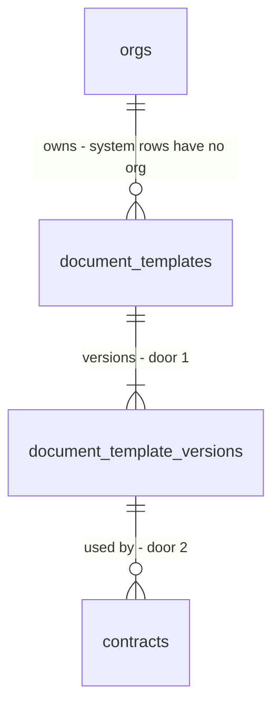

# Contract templates

## Problem

The wording of a contract is six sentences written into `contractClauses()` in `web/domain/contract/document.ts`. Every tenant gets the same words, a tenant cannot change one, and nothing records which words a signed contract carried: the sentences are rebuilt from the frozen terms every time the PDF or the signing page is drawn, so a later edit to the code would change what an already signed contract says. The ROADMAP records the cost: "the legal review of them blocks go-live" (decision 14), and Phase 5.5 exists so that wording becomes tenant-owned data (decision 12, 13).

The source gives no incident or volume figure; the evidence is the roadmap text and the code.

When this ships, a contract's wording is a stored, versioned, immutable template version that the contract points at, the PDF and the signing page draw from it, and the output for every existing and new contract is word for word what it is today. The editor, the agreement-side template and per-trade or per-province starter wording are later features; this one makes them possible without touching a signed contract.

## Flow

Reuses `contractClauses`' six sentences (they become the system template's first version), `buildContractDocument` as the one seam that feeds the contract PDF and the signing page, and `create_contract` as the one place a contract is made.

1. Staff accept an agreement -> `create_contract`, or the automation's `create_contract_for_system` (both exist, unchanged) -> `private.make_contract` (exists, redefined) picks the org's current contract template version, or the system one when the org has none, and writes its id on the new `contracts` row (door 2).
2. PDF route and the signing documents (`app/(app)/contracts/[contractId]/pdf/route.ts`, `makeContractDocuments` in `application/use-cases/signing.ts`, both exist; the signing page itself shows the provider's embedded form of that PDF) -> the existing `ContractReader` (exists, extended) returns the contract's template body from the joined version row -> `buildContractDocument` (exists, extended) -> `renderBlocks` (new, `domain/contract/template.ts`, no door) turns blocks and the frozen terms into `RenderedBlock[]`.
3. `contract-pdf.tsx` (exists) draws `RenderedBlock[]` where it drew `clauses: string[]`; the Signatures block stays fixed and after them.
4. out: the same PDF and signing page as today for the system template, and `contracts.template_version_id` answers "which words did this contract carry".

## Impact

| Front | What changes |
| --- | --- |
| domain | new term: template version - an immutable row holding an ordered list of blocks; a contract points at exactly one |
| domain | new term: block - a heading, paragraph or clause of text with merge variables; a clause is dropped when any variable it uses has no value, which is how today's optional sentences behave |
| domain | existing term: `ContractDocument.clauses: string[]` becomes `body: RenderedBlock[]`; who reads `clauses` today: `contract-pdf.tsx`, `application/use-cases/signing.ts`, the signing page view, `domain/contract/document.test.ts`, `infrastructure/documents/contract-pdf.test.ts`, `composition/contract-pdf.test.ts`, `composition/signing-wiring.test.ts` |
| existing callers | `create_contract` gains a column write; callers: `supabaseContractStore` (unchanged signature). `contractClauses` is replaced by the system template's blocks; its tests move to the renderer and keep their expected sentences |
| stored data | every existing `contracts` row is backfilled with the system template's version 1, which is truthful because those contracts were drawn from the same six sentences; then the column is made not null. No other table changes |

## Relations

One-way constraints: a template version is never updated or deleted (door 1); `contracts.template_version_id` is not null and references a version (door 2); one template per org per kind, and exactly one system template per kind (door 1).

## Surface

None - nothing consumed outside. `create_contract(p_agreement_id)` keeps its signature and statuses; the PDF route and signing page keep their routes and responses. The tables are read by members through RLS and written by no member (there is no editor yet).

## Landing

| One-way door | Literal shape | Alternative rejected |
| --- | --- | --- |
| 1. Immutable versioned templates, with system rows | `document_templates (id, org_id null, kind check in ('agreement','contract'), unique (coalesce(org_id, zero uuid), kind))` and `document_template_versions (id, template_id, org_id null, version_no, body jsonb, created_at, unique (template_id, version_no))`; no update or delete policy, plus a trigger that refuses both; the system template is `org_id null`, readable by every member | Seed a template per org at provisioning: redefines the large `provision_workspace` and needs a backfill of every org, and a code change to the wording would still not be frozen. Keep the words in code with a version constant: cannot be tenant-owned and cannot be shown in an editor |
| 2. A contract freezes the version it used | `contracts.template_version_id uuid not null references document_template_versions (id)`, written by `create_contract`, never updated | Store the blocks inside the contract row: duplicates text across every contract and cannot answer "who used this version". Leave it null for "system": a null that means a moving target is the failure this feature removes |
| 3. The block model | `body = { "schema": 1, "blocks": [ { "type": "heading", "text": "Terms" }, { "type": "clause", "text": "Invoices are payable within {{terms.paymentDays}}." }, { "type": "paragraph", "text": "..." } ] }`; types `heading`, `paragraph`, `clause`; text is a plain string, at most 2,000 characters; at most 60 blocks | HTML or markdown in text: needs sanitizing and a second renderer. System blocks (price table, schedule, signatures) in the list now: the editor feature owns moving and hiding them, and a contract template stays "clauses, then the fixed signature block" |
| 4. The merge-variable names | a fixed list in `web/domain/contract/template.ts`, written `{{group.name}}`: `terms.paymentDays`, `terms.cancellationNoticeDays`, `terms.repairDiscountPct`, `terms.cpiCapPct`, `terms.cpiRenegotiationThresholdPct`, `terms.renewalNoticeDays`, `province`, `term.label`, `tenant.legalName`, `customer.name`, `site.name`. A value is already formatted with its unit where it has one (`30 days`, `10%`) | Free-form variables: stored templates bind to names, so an open set can never be renamed. Per-variable format arguments (`{{x\|days}}`): a second mini-language for the editor to explain |

- A stored template names variables by door 4's list, so a rename is a migration of stored text from now on
- Door 2 as built: the column also has a default, the system version 1, so a direct insert that names no version (the shared test fixture, a future path) records the same wording instead of failing; `make_contract` always names the version explicitly
- Door 4 as built: a value carries its unit, and the cancellation notice is the possessive phrase (`60 days'`, `1 day's`) so today's sentence is reproduced word for word; a heading with no content under it before the next heading is dropped, which is how the Terms heading disappears for a contract with no frozen terms
- Nothing else in this change is hard to reverse

## Criteria

### S1: A contract freezes the template version it used (P1)

Contract creation records the wording; stored versions never change.

**Acceptance Criteria**

1. The system SHALL hold exactly one system contract template whose version 1 has the six current sentences as blocks, readable by every member of every org
2. WHEN `create_contract` runs for an org that has no contract template of its own THEN the new contract's `template_version_id` SHALL be the system contract template's latest version
3. WHEN `create_contract` runs for an org that has its own contract template THEN the new contract's `template_version_id` SHALL be that template's latest version
4. WHEN a template gains a newer version after a contract was created THEN that contract's `template_version_id` SHALL be unchanged
5. IF anyone, including an owner, updates or deletes a template version THEN the database SHALL refuse it
6. IF a member inserts into `document_templates` or `document_template_versions` directly THEN the database SHALL refuse it
7. WHEN the migration runs THEN every existing contract SHALL point at the system contract template's version 1 and none SHALL have a null `template_version_id`
8. WHILE an org has no template of its own, the system templates SHALL be visible to its members and another org's template SHALL NOT

**Independent test:** create a contract in the rolled-back recipe, read its `template_version_id`, insert a newer org version and a second contract, and compare.

### S2: Blocks and merge variables render into the contract's terms (P1)

The words a contract prints come from its template version and the frozen terms.

**Acceptance Criteria**

9. WHEN the system version 1 is rendered with the terms `paymentDays 30`, `cancellationNoticeDays 60`, `repairDiscountPct 10`, `cpiCapPct 5`, `governingProvince BC`, `renewalNoticeDays 30`, `cpiRenegotiationThresholdPct 5` and a 12 month term THEN `renderBlocks` SHALL produce the six sentences exactly as `contractClauses` produces them today
10. WHEN a variable a clause uses has no value (for example `paymentDays` is null) THEN `renderBlocks` SHALL omit that clause and keep the others in order
11. WHEN a heading or paragraph block uses a variable with no value THEN `renderBlocks` SHALL print the block with that variable replaced by an empty string
12. IF a block uses a variable outside the whitelist THEN `validateBlocks` SHALL reject the template with the variable named, and `renderBlocks` SHALL treat that variable as having no value
13. IF `body` has an unknown `schema`, an unknown block type, more than 60 blocks or text over 2,000 characters THEN `validateBlocks` SHALL reject it with the reason
14. WHERE a value is a count of days THEN the rendered text SHALL read `1 day` for one and `N days` otherwise, and `10%` for a percentage with no trailing zero
15. WHEN a variable's value contains `{{` THEN `renderBlocks` SHALL print it as plain text and SHALL NOT expand it again

**Independent test:** run `renderBlocks` over the system version with the frozen terms of a demo contract and compare with today's PDF text.

### S3: The contract PDF and the signing page draw from the stored version (P1)

Nothing a customer sees changes for the system wording.

**Acceptance Criteria**

16. WHEN the contract PDF is drawn THEN the Terms section SHALL print the rendered blocks of the contract's own template version, after the scope and before the fixed Signatures block
17. WHEN the signing page is drawn THEN it SHALL show the same rendered blocks as the PDF for that contract
18. WHEN the rendered blocks are empty THEN the Terms section SHALL NOT be drawn, as today
19. IF reading the contract's template version fails THEN the PDF route and the signing page SHALL answer as they answer other read failures today and SHALL NOT draw a contract with different wording
20. WHEN a heading block is drawn THEN it SHALL use the document's second-level heading style, and a clause or paragraph SHALL use the body style with 4 points below it

**Independent test:** open a demo contract's PDF and signing page; the Terms text is unchanged.

## Out of scope

| Excluded | Why |
| --- | --- |
| The block editor, live preview and clone | Next Phase 5.5 feature; this one has no UI |
| The agreement-side template (cover text, shown sections, footer terms) | Separate feature after this one; it freezes at send, not at contract creation |
| Moving or hiding system blocks (price table, schedule, signatures) | Belongs with the editor; a contract template is clauses then the fixed signature block |
| Starter templates per trade and province, legally reviewed | Needs the lawyer (decision 14) and the pack machinery |
| Upload an existing contract | After the editor (decision 15) |
| A save function or any way for a member to write a template | No editor yet; org templates are made by the editor feature |
| Re-rendering signed contracts after a wording change | Never: a contract keeps its version (AC 4) |

## Assumptions

| Assumption | Chosen default | Rationale | Confirmed? |
| --- | --- | --- | --- |
| Where the template is chosen | At contract creation | The contract is the signed object; the agreement template freezes at send in its own feature | n |
| Org has no template yet | The system template is used | Every org keeps today's wording with no backfill of org rows | n |
| Unknown variable at render time | Treated as no value | A stored version cannot fail to draw a signed contract | n |
| Variable formatting | The value carries its unit (`30 days`, `10%`) | A fixed set of formatted variables needs no format syntax | n |
| Province name | `{{province}}` prints the full name (`British Columbia`), as `provinceName` does today | Output stays identical | n |
| Existing contracts | Point at system version 1 | They were drawn from the same six sentences | n |

**Open questions:** none blocking. The wording itself still needs a lawyer before go-live (decision 14); this feature moves it into data and does not change a word.

| # | Kind | Question | Until answered |
| --- | --- | --- | --- |
| 1 | blocks go-live | A lawyer's review of the six sentences, per province (decision 14) | The system wording ships unreviewed |

## Observable

| Surface | Decision | Landing |
| --- | --- | --- |
| screen contract PDF | empty state (no rendered blocks) | AC 18 |
| screen contract PDF | error state | AC 19 |
| screen contract PDF | density and ordering | AC 16, AC 20 |
| screen signing page | empty state | AC 18 |
| screen signing page | error state | AC 19 |
| screen signing page | unauthorised | existing - the signing link and the staff session already gate it |
| screen contract PDF and signing page | loading | n/a - both are server rendered, as today |
| document the contract | structure, tone, next step | AC 9 and AC 16: the same words in the same order; the reader's next step (sign) is the unchanged Signatures block |
| tables `document_templates`, `document_template_versions` | who may read, who may write | AC 6, AC 8 |
| all new objects | versioning, rate limits | n/a - no endpoint is added; `create_contract` is internal to the app |

## Sources

- ROADMAP Phase 5.5 items 1 and 2, "Document templates" section, decisions 12, 13, 14 - the shape and the immutability rule
- `web/domain/contract/document.ts` `contractClauses` - the six sentences that become the system template, and the test that they stay identical
