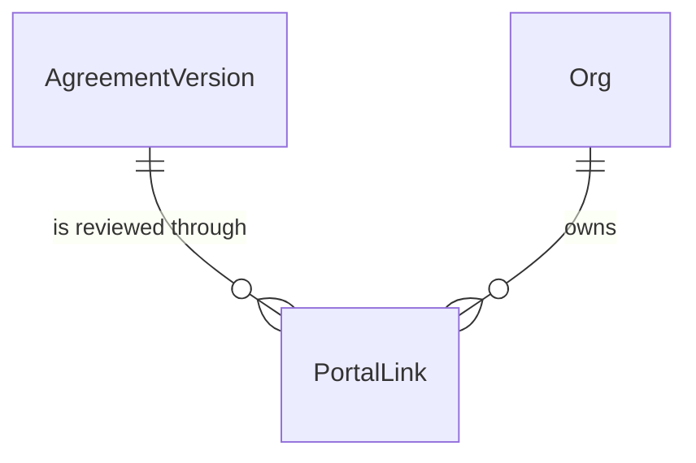

# Customer review portal: the site contact views an agreement and accepts, refuses or asks for changes

## Problem

An agreement can be priced, scoped and downloaded as a PDF, but it can never reach the customer, and the customer can never answer. Nothing in the app moves a draft to `sent`, so no agreement is ever in front of anyone outside the contractor. A property manager who receives the PDF by email has to reply by hand, and the app has no record of whether they opened it or what they decided. The pipeline cannot move a deal past "Sent to customer" because only a member can record an answer, and the member would be typing in what the customer said.

The source (ROADMAP.md Phase 3 item 4, M9, PRODUCT.md "External: the customer's site contact") gives no user evidence or date. It says the contact is non-technical, uses the portal rarely, has no account, and that the page must look like it comes from the contractor. Contract generation (Phase 4, W2) and the emailed link (item 5) both start from an `accepted` agreement or a minted link, so neither can start until this exists.

A second problem sits underneath it. The agreement PDF prints the tenant's current default terms (agreement-pdf open question 1). If the contractor edits Company settings after sending, a customer who is about to accept sees different terms from the ones they were sent.

When this ships, an estimator presses "Send to customer", the agreement becomes `sent` with its scope and terms frozen, and a link appears to copy. The customer opens the link with no sign-in, reads the agreement in the contractor's name and colour, downloads the PDF, and presses Accept, Refuse (with a reason) or Request changes. The agreement page shows whether the customer has opened it, and the pipeline moves on the customer's answer.

## Flow

This reuses `applyAgreementCommand` for every decision, `apply_agreement_transition` and `freeze_agreement_version` for the move and the freeze, `buildAgreementDocument` and `DocumentRenderer` for the PDF, and `parseServiceScope` and the scope components for the body of the page. It adds no second state machine, no second PDF layout and no service-role key.

Staff path, sending:

1. `AgreementView` (exists) -> a Server Action (placement) - `applyAgreementCommand` (exists) decides `send`; the action generates a random token and hashes it.
2. `public.send_agreement` (door 2, new) - in one transaction: `apply_agreement_transition` (exists) moves `draft` to `sent`, `freeze_agreement_version` (exists, door 3 adds the terms) freezes scope and terms, a `portal_links` row (door 1) is inserted for the version, and the refusal `no_lines` is raised when the version has no service line.
3. out: the Server Action returns the full link once; `AgreementView` shows it with "Copy link". "Get a new link" calls `public.reissue_portal_link` (door 2), which revokes the live link and inserts another.

Customer path, reading and deciding:

4. Browser `GET /review/[token]` (door 4, new; public in `proxy.ts` (exists)) -> the page hashes the token and calls `public.portal_view` (door 2). The tenant's branding and the version's frozen content come back as one document, or nothing for an unknown token.
5. A pure portal-state function (placement, per the domain layer's conventions) turns link, agreement status and version number into one of seven states; the page renders that state and nothing else.
6. On mount, a client component calls a Server Action that runs `public.portal_record_view` (door 2): the first call per link stamps it and writes `agreement.viewed` (no outbox row); later calls write nothing.
7. Decision: Server Action -> `applyAgreementCommand` (exists) validates the command and reason -> `public.portal_decide` (door 2): link live, link's version current, status still `sent`, then status update, event with no actor, and an outbox row through `private.enqueue_outbox_for_system` (door 5).
8. PDF: `GET /review/[token]/pdf` (door 4) -> `public.portal_view` -> `buildAgreementDocument` (exists, now reads frozen terms) -> `DocumentRenderer` (exists).

## Impact

| Front | What changes |
| --- | --- |
| domain | new term: `PortalLink` - the secret address of one agreement version for its customer; lives in `portal_links` and `web/domain/portal` |
| domain | new term: portal state - `open`, `decided`, `superseded`, `replaced`, `withdrawn`, `expired`, `unknown`; derived, never stored |
| domain | existing term: `terms` on an agreement meant "the org's current settings, read when rendering" (agreement-pdf assumption 1). It now means "frozen into the version when it leaves draft". Who branches on it today: `buildAgreementDocument` and `termsOf` only. The settings form and `OrgSettingsStore` still edit the live values |
| domain | existing term: `snapshot` meant the scope document alone (AD-058); it now holds `scope + terms`. Who reads it today: `parseServiceScope` (ignores unknown keys), the agreement reader, `freeze_agreement_version`, the `seed.sql` re-run guard `snapshot = '{}'` |
| domain | existing term: `agreement.sent`. Today only tests send; after this the staff Send action is the one way to send, and a `sent` agreement made any other way (seed, `transitionAgreement`) has no link until "Get a new link" |
| auth | `proxy.ts` `PUBLIC_PATHS` was exactly `/login` and `/auth/confirm` (AD-018); it gains the prefix `/review/`. Who branches on it: every route, since it decides the sign-in redirect |
| auth | the `anon` role could call nothing; it now executes three RPCs, which are the first `anon` grants in the project. A signed-in member opening a link is `authenticated`, so the RPCs are granted to both and behave identically |
| outbox | AD-016 said `private.enqueue_outbox` is the only outbox writer, with a member check. A customer is no member, so there is now a second private writer (door 5) |
| events | `events.payload` for a portal decision gains `via: "portal"` (AD-017); `agreement.viewed` is a new event type that never reaches the outbox |
| stored data | one new table, empty on creation. Existing frozen demo versions get today's terms in their snapshot (AD-062 pattern, demo data only). Existing `sent` demo agreements get no link |
| screens | `/agreements/[agreementId]` gains Send, "Get a new link", the link panel and the viewed line. `/review/[token]` is new and sits outside the `(app)` shell |
| PDF | `buildAgreementDocument` takes the terms from the version when it is frozen and from settings only for the current draft; a `sent` PDF no longer follows Company settings |

## Relations

One-way constraints: the token hash is unique across the whole table (door 1); a version has at most one link that is not revoked (door 1); a link's version belongs to the link's org by the composite reference (AD-003).

## Surface

Only routes this adds or whose signature changes.

| Route | In | Out | Status |
| --- | --- | --- | --- |
| `GET /review/[token]` | path `token` | the review page for one of seven states, tenant-branded | `200`, `404` |
| `GET /review/[token]/pdf` | path `token` | the PDF bytes, `application/pdf`, filename `<number>-v<n>.pdf` | `200`, `404`, `503` |
| Server Action `decideAction` (status codes name the result; a Server Action has no HTTP status) | `token`, `decision` (`accept`, `refuse`, `request_changes`), `reason` | the page's next state, or a field error | `200` ok, `422` reason_required, `422` reason_too_long, `409` not_open, `503` unavailable |
| Server Action `recordViewAction` | `token` | nothing the customer sees | `200` ok, `503` unavailable |
| Server Action `sendAgreementAction` | `agreementId` | the full link, once | `200` ok, `422` no_lines, `409` conflict, `403` forbidden, `404` not_found, `503` unavailable |
| Server Action `reissueLinkAction` | `agreementId` | the full link, once | `200` ok, `409` conflict, `403` forbidden, `404` not_found, `503` unavailable |

## Landing

| One-way door | Literal shape | Alternative rejected |
| --- | --- | --- |
| 1. `portal_links` table and the token | `public.portal_links`, tenant table per AD-003, composite FK `(agreement_version_id, org_id)`, `token_hash` unique, `create unique index portal_links_one_live_per_version on public.portal_links (agreement_version_id) where revoked_at is null`; first view and revocation are timestamps on the row. The token is 32 random bytes as 43 base64url characters, stored as lowercase hex SHA-256, URL `/review/<token>`. Members read the table; nobody writes it except the RPCs | Storing the raw token: every member, viewers included, could read it and act as the customer, and a read of the database would hold live links. A link per agreement rather than per version: it cannot say which version the customer was shown once a revision is sent |
| 2. Anonymous RPCs | `public.portal_view(p_token_hash text) returns jsonb`, `public.portal_record_view(p_token_hash text) returns void`, `public.portal_decide(p_token_hash text, p_to_status text, p_event_type text, p_payload jsonb) returns uuid`, each `security definer`, `set search_path = ''`, `revoke ... from public`, `grant execute ... to anon, authenticated`. `portal_decide` whitelists exactly three pairs (`accepted` / `agreement.accepted`, `refused` / `agreement.refused`, `changes_requested` / `agreement.changes_requested`) and checks the reason length itself. Staff side: `public.send_agreement(p_agreement_id uuid, p_token_hash text, p_event_type text, p_payload jsonb) returns uuid` and `public.reissue_portal_link(p_agreement_id uuid, p_token_hash text) returns uuid`, `security invoker`, `authenticated` only. SQLSTATE: `P0002` unknown link or agreement, `40001` not open for this move, `42501` not a writer, `23514` no service lines or a bad reason | A service-role key in the app: one bug in any Server Action reads every tenant, and the project has deliberately never held one (import AD-037). Anonymous RLS policies on six tables keyed by a header: the isolation rule would live in six places and PostgREST would expose the tables to anyone holding any token |
| 3. Frozen terms in the snapshot | `agreement_versions.snapshot` becomes `{"schema": 1, "takenAt": "...", "types": [...], "terms": {"repairDiscountPct": 10, "cpiCapPct": 5, "cancellationNoticeDays": 30, "paymentDays": 30, "governingProvince": "BC", "taxNote": null}}`, camelCase, a key for every term, `null` when unset, written by `freeze_agreement_version` in the same statement as the scope. The contract (Phase 4) reads the same document | A `terms` column on `agreement_versions`: a second thing to freeze, and `snapshot` is already the one document the PDF, portal and contract read (AD-058). Leaving terms live: the accepted version could change under the customer |
| 4. Public portal route | `/review/[token]` and `/review/[token]/pdf`, outside the `(app)` group; `PUBLIC_PATHS` stays the exact list and adds `PUBLIC_PREFIXES = ["/review/"]`; every response `Cache-Control: private, no-store`, `Referrer-Policy: no-referrer`, `X-Robots-Tag: noindex`; the page loads no third-party resource | Exact public paths only: the token is the path. A query-string token `/review?t=`: it lands in more logs and analytics by default, and the path form lets one prefix rule cover it |
| 5. Outbox writer for a customer | `private.enqueue_outbox_for_system(p_event_id uuid) returns void`, `security definer`, `search_path = ''`, no member check, `execute` revoked from `public, anon, authenticated`, called only from `portal_decide`; `private.enqueue_outbox` is unchanged | Relaxing the member check in `enqueue_outbox`: it is exposed to `authenticated`, so any member token could then enqueue any event. A trigger on `events`: AD-016 forbids it, because `agreement.viewed` must not reach n8n |
| 6. Event payload for a portal decision | `events.payload` is `{"from": "sent", "to": "accepted", "versionNo": 2, "via": "portal"}` plus `"reason"` for the other two, `actor_id` null; first view is `type = 'agreement.viewed'`, `entity_type = 'agreement'`, payload `{"versionNo": 2}`, no outbox row. n8n W1, W3 and W5 will bind to these keys | Putting the contact's name or email in the payload: the site contact can be empty or change, and the link already says whose it is |
| 7. Staff link writer and terms helper (found while building) | `private.issue_portal_link(p_agreement_id uuid, p_token_hash text) returns uuid`, `security definer`, `search_path = ''`, writer check, `execute` to `authenticated` only: revokes the current version's live link and inserts the new one; the only staff writer of `portal_links`, called by `send_agreement` and `reissue_portal_link`. `private.org_terms(p_org_id uuid) returns jsonb`, `security definer`, `execute` revoked from `public, anon, authenticated`: the six camelCase terms of door 3, called by `freeze_agreement_version`, the migration backfill and `seed.sql` | `send_agreement` and `reissue_portal_link` are `security invoker` (door 2) and `authenticated` has no write grant on `portal_links` (door 1), so they cannot insert themselves. Granting `insert`/`update` on the table to members: any member PATCH could then mint or revoke a link |
| 8. Shape of `portal_view` (read by batch 2) | `jsonb` `{"link": {"versionNo", "current", "revoked", "revokedAt", "firstViewedAt"}, "agreement": {"number", "status"}, "tenant": {"name", "address", "phone", "accent"} or null, "customer": {"name"}, "site": {"name"}, "lines": [{"description", "visitsPerYear", "costPerVisitCents", "annualCents"}], "annualCents", "scope": the snapshot without `terms` or null when `{}`, "terms": the snapshot's `terms` or null, "decision": {"status", "decidedAt", "reason"} or null}`; null for an unknown hash. The portal state is derived from it in the app (`portalState`), never in SQL | A `state` text computed in SQL: a second implementation of the seven states beside `portalState` (C908) |
| 9. Customer-side ports and container surface (found while building batch 2) | Ports `PortalDecider { decide(tokenHash, toStatus, eventType, payload) }` (`ok` or `not_open`) and `PortalViewRecorder { record(tokenHash) }` beside `PortalReader`, adapters in `infrastructure/supabase/portal.ts` over `portal_decide` / `portal_record_view` / `portal_view`; use cases `makeViewPortal`, `makeDecidePortal`, `makeRecordPortalView` hash the token (`PortalTokens.hash`) and answer without a database call for a token that is not 43 base64url characters; the container gains `viewPortal(token)`, `decidePortal(token, decision, reason)`, `recordPortalView(token)` on the same cookie client (anon-capable, never `currentMember`). `decidePortal` validates through `applyAgreementCommand("sent", ...)` before any RPC, and on `40001` re-reads the link: the same decision already recorded is `ok` (C924), anything else is `not_open` carrying the view | Calling `PortalReader` straight from the page: `app/` cannot import `infrastructure`, and the hash would be made in the page. A service-role client for the customer side: door 2 rejected it |
| 10. The review page answers a real `404` (found while building batch 2) | Under Cache Components a page is a static shell plus streamed content (`◐`, never `ƒ`), so `notFound()` in the page is a `200` with the not-found UI. `proxy.ts` therefore asks first: for `GET /review/<one segment>` a token that is not 43 base64url characters, or one `public.portal_view` (anon, through `fetch` to the REST rpc with the publishable key) says has no link, is answered by `proxy.ts` itself with a self-contained HTML page carrying the AC 9 copy, status `404` and the three door 4 headers (a rewrite cannot set a status: tried); any failure of that read lets the request through to the page. The page keeps `notFound()` for a race. `loading.tsx` stays | `export const instant = false` and no `loading.tsx`: tried, the production build still serves the shell with `200`. Accepting the soft `404` (`200` plus `noindex`): breaks AC 9 and C910 |

- Nothing else in this change is hard to reverse

## Criteria

### S1: A writer sends the agreement and gets the customer's link (P1)

An estimator presses "Send to customer" and receives the link to give the customer.

**Acceptance Criteria**

1. WHEN an owner, admin or estimator confirms "Send to customer" on the current version of a `draft` agreement that has at least one service line THEN the system SHALL move it to `sent`, create one portal link for that version, freeze its scope and terms, and show the full link once with a "Copy link" button
2. IF the current version has no service line THEN the system SHALL refuse with `no_lines`, leave the agreement `draft`, create no link, and show "Add at least one service line before sending."
3. IF the agreement is no longer a `draft` when the send is confirmed THEN the system SHALL answer `conflict`, create no link, and show "This agreement was changed by someone else. Reload the page."
4. WHEN a writer confirms "Get a new link" on a `sent` agreement THEN the system SHALL revoke the version's live link, create another, and show the full new link once; the old link SHALL then show the `replaced` state
5. WHILE the agreement is `sent` the agreement page SHALL show "Viewed by the customer on <date>" from the live link's first view, or "Not viewed yet" when it has none
6. WHERE the member is a viewer THEN the system SHALL show no Send and no "Get a new link" control, and the two actions SHALL answer `forbidden` without writing
7. The system SHALL store only the SHA-256 of a link's token and SHALL NOT be able to show a link again after the page that created it closes

### S2: The customer opens the link and reads the agreement (P1)

A property manager with no account sees the agreement the way the contractor sent it.

**Acceptance Criteria**

8. WHEN anyone opens `/review/<token>` for a known link THEN the system SHALL answer `200` and show the tenant's legal name, and address and phone when set, then the agreement number, version number, customer name, site name, every service line with visits per year, cost per visit and annual amount, `Total per year` with the words "before tax", "Service included", "Equipment", and the terms that are set
9. IF the token is malformed or matches no link THEN the system SHALL answer `404` with a page that says "This link doesn't work. Ask the company that sent it for a new one." and names no tenant and no agreement
10. The system SHALL show the terms the version had when it left draft, and SHALL NOT change them when Company settings change afterwards
11. The system SHALL show the tenant's name where a brand appears, SHALL apply the tenant's accent colour to the title rule and the primary button, and SHALL NOT show the product's name
12. The system SHALL choose white or near-black text for the accent-coloured button so the text has at least 4.5:1 contrast with the accent, for any accent colour
13. WHILE the state is `replaced` THEN the system SHALL show "This link has been replaced. Ask <tenant name> for the new one." with the tenant's phone when set, and SHALL show no agreement content, no download and no decision control
14. WHILE the state is `superseded` (a newer version exists) THEN the system SHALL show "A newer version of this agreement was sent. Ask <tenant name> for its link." above the version's content, read-only, with its download and no decision control
15. WHILE the state is `withdrawn` or `expired` THEN the system SHALL show "<tenant name> withdrawn this agreement." or "This agreement has expired." with the tenant's phone when set, and SHALL show no content, no download and no decision control
16. WHILE the state is `decided` THEN the system SHALL show "You accepted this agreement on <date>.", "You refused this agreement on <date>." or "You asked for changes on <date>." with the reason given, the content read-only with its download, and no decision control
17. WHILE the state is `open` THEN the system SHALL show "Accept", "Refuse" and "Request changes", each a control at least 44px tall below 1024px

### S3: The customer decides (P1)

**Acceptance Criteria**

18. WHEN the customer confirms "Accept" in the `open` state THEN the system SHALL set the agreement `accepted`, write `agreement.accepted` with `via: "portal"` and no actor, enqueue its outbox row, and show the `decided` view
19. WHEN the customer submits "Refuse" with a reason of 1 to 2000 characters after trimming THEN the system SHALL set the agreement `refused`, write `agreement.refused` with the trimmed reason and `via: "portal"`, enqueue its outbox row, and show the `decided` view
20. WHEN the customer submits "Request changes" with a reason of 1 to 2000 characters after trimming THEN the system SHALL set the agreement `changes_requested`, write `agreement.changes_requested` with the trimmed reason and `via: "portal"`, enqueue its outbox row, and show the `decided` view
21. IF the reason is empty or only spaces THEN the system SHALL answer `reason_required`, show "Tell us why so <tenant name> can respond." beside the field, and write nothing
22. IF the reason is longer than 2000 characters THEN the system SHALL answer `reason_too_long`, keep what the customer typed, show the character count, and write nothing
23. IF the link's version is not the current one, the agreement is not `sent`, or the link is revoked when a decision is submitted THEN the system SHALL answer `not_open`, write nothing, and show the state the link is now in
24. WHEN the same decision is submitted twice for one link (double click, retry, two tabs) THEN the system SHALL leave exactly one decision event and one outbox row, and the second submission SHALL show the `decided` view
25. The system SHALL NOT change an agreement, a link or an event in response to any `GET`, including a prefetch or a link scanner opening the address

### S4: The system records that the customer looked, and offers the PDF (P1)

**Acceptance Criteria**

26. WHEN the `open`, `decided` or `superseded` page is shown in a browser THEN the system SHALL record the link's first view once: stamp the link and write `agreement.viewed` with `{versionNo}` and no outbox row
27. WHEN the same link is opened again THEN the system SHALL write no further `agreement.viewed` and SHALL keep the first view's date
28. WHEN the customer presses "Download PDF" in the `open`, `decided` or `superseded` state THEN the system SHALL answer `200` with `Content-Type: application/pdf`, filename `<number>-v<n>.pdf`, the tenant's branding and the version's frozen terms
29. IF the link is unknown, `replaced`, `withdrawn` or `expired` THEN `GET /review/<token>/pdf` SHALL answer an empty `404`
30. IF the renderer fails or the tenant has no settings row THEN `GET /review/<token>/pdf` SHALL answer an empty `503`, log the cause, and return no partial PDF

### S5: A sent version keeps the terms it was sent with (P1)

**Acceptance Criteria**

31. WHEN an agreement leaves `draft` (sent or withdrawn) THEN the system SHALL write the org's six default terms into the version's snapshot under `terms`, in the same transaction as the scope
32. WHILE a version is frozen the staff PDF and the portal PDF SHALL print its frozen terms; WHILE the version is the current one of a `draft` the staff PDF SHALL print the org's current terms
33. IF a frozen version's snapshot has no `terms` key THEN the system SHALL print no terms for it and SHALL NOT fall back to the org's current terms
34. WHEN the migration runs THEN every frozen demo version that lacks `terms` SHALL get the org's terms as of that run, and a version that already has `terms` SHALL be left unchanged

### S6: The portal is private and works the same for anyone (P1)

**Acceptance Criteria**

35. The system SHALL answer every portal response with `Cache-Control: private, no-store`, `Referrer-Policy: no-referrer` and `X-Robots-Tag: noindex`
36. WHEN a signed-in member opens a portal link THEN the system SHALL show exactly what an anonymous visitor sees, with no staff navigation and no extra data
37. The system SHALL NOT let a link return, decide or record a view for any agreement of another org, nor any version other than the link's
38. IF a token or its hash is passed to a staff RPC (`send_agreement`, `reissue_portal_link`) by `anon` THEN the system SHALL refuse it with `42501`

**Independent test:** open a draft agreement with lines, press "Send to customer", copy the link, open it in a private window, press Accept, and watch the agreement move to "Accepted (awaiting signature)" on the pipeline.

## Out of scope

| Excluded | Why |
| --- | --- |
| Emailing the link and reminders (W1, W5) | Item 5: outbox dispatcher, n8n and email. This item produces the link and the events; nothing sends them |
| Notifying the estimator of a decision (W3) | Item 5, same dispatcher |
| Contract generation and signature on accept (W2) | Phase 4. Accept ends at `accepted` here |
| "Not viewed" pill on the pipeline card | A change to `PipelineReader` and the kanban; the agreement page already shows it |
| Expiring an agreement (`expire`) and link expiry dates | No scheduler exists until n8n; a link lives until it is replaced or the agreement is withdrawn |
| More than one recipient, or a link per contact | One link per version; the site contact is not stored on it |
| The customer typing their name or drawing a signature | Phase 4's contract is the signed document; the approval here is the link plus the confirm click |
| Tenant logo on the portal and the PDF | No bucket and no upload yet |
| Rate limiting in the app | Open question 1; a 256-bit token cannot be guessed and limits belong at the host |
| A history of every view | Only the first view is recorded |

## Assumptions

| Assumption | Chosen default | Rationale | Confirmed? |
| --- | --- | --- | --- |
| Terms freeze and tenant identity | Only the six default terms freeze; legal name, address, phone and accent stay live on the portal and the PDF | The terms are the promise; the letterhead is branding, and a phone number correction should reach customers | n |
| Link address origin | The link is built from `APP_BASE_URL` (server-only) when set, otherwise from the request's origin | The hosted domain is not decided; a missing variable must not break local use | n |
| Recording a view | A client component on the page calls `recordViewAction` once on mount; the server render writes nothing | Mail scanners and prefetchers `GET` links; they do not run the page's script, so they do not fake a view. A scanner that runs JavaScript still would | n |
| Send needs a site contact | No. Send works for any site; the contact is not stored on the link | Emailing is item 5; the writer copies the link and may give it to anyone, as they could the PDF | n |
| Link lifetime | A link has no expiry date; it stops being `open` when decided, replaced, superseded or withdrawn | No scheduler yet; every state after `open` is read-only, so a long-lived address does little harm | n |
| Re-sent versions | Requesting changes ends in a new version, which gets its own link when sent; the old link shows `superseded` | A link is bound to the version the customer saw (door 1) | n |
| Accept confirmation | One extra confirm step ("Accept this agreement?" with Accept and Cancel); no typed name | A single tap on a phone should not commit a yearly contract; the signed contract is Phase 4 | n |
| Reason bounds | 1 to 2000 characters after trimming, the domain machine's bounds | `applyAgreementCommand` already enforces them and the RPC repeats them | n |
| `sent` agreements with no link | "Get a new link" works on any `sent` agreement, including the seeded ones | The only way to a link for agreements sent before this item, and a recovery for a lost link | n |

**Open questions:**

| # | Kind | Question | Until answered |
| --- | --- | --- | --- |
| 1 | blocks go-live | Where does rate limiting for `/review/*` live (host or edge rule) and what is the limit? The token is unguessable, but unknown-token requests are unthrottled in the app | Written meanwhile: no app-level limit. Nothing technical is blocked; real customers should not be sent links before this is set |

## Observable

| Surface | Decision | Landing |
| --- | --- | --- |
| screen `/review/[token]` | empty state | n/a - the page always has content or a state message; an unknown token is AC 9 |
| screen `/review/[token]` | loading state | AC 8 - a `loading.tsx` under the route shows the tenant-neutral skeleton; the tenant is unknown until the read returns |
| screen `/review/[token]` | error state | AC 9, 13, 14, 15; an unexpected failure shows the route's `error.tsx` with "Something went wrong. Try again, or contact the company that sent this link." and no detail |
| screen `/review/[token]` | unauthorised state | n/a - the token is the credential; a wrong one is AC 9 |
| screen `/review/[token]` | density and ordering | AC 8, 17 - content first, decision controls after it, then the download |
| screen `/review/[token]` | destructive action confirms | AC 18 to 20 - each decision has a confirm step, Refuse and Request changes through the reason form |
| screen `/agreements/[agreementId]` | empty, loading, error, unauthorised | existing - `loading.tsx`, `error.tsx`, `not-found.tsx`; the new controls are AC 1 to 7 |
| screen `/agreements/[agreementId]` | destructive action confirms | AC 1, 4 - "Send to customer" and "Get a new link" ask first, the pattern Withdraw already uses |
| API `GET /review/[token]*` | error shape and codes | AC 9, 29, 30 |
| API `GET /review/[token]*` | who may call it | AC 36 - anyone holding the token; AC 37 |
| API `GET /review/[token]*` | versioning | n/a - the address is a secret link, not an API; the version is the link's |
| API `GET /review/[token]*` | rate limits | open question 1 |
| Server Actions `decideAction`, `recordViewAction` | error shape and codes | AC 21, 22, 23, 24 |
| Server Actions `sendAgreementAction`, `reissueLinkAction` | error shape and who may call them | AC 2, 3, 6, 38 |
| document `the review page` | structure, tone, depth | AC 8, 11, 16, 17 - plain sentences naming the tenant, no product name |
| document `the review page` | what the reader does next | AC 17 - one decision of three; after it, the decided message |
| document `the agreement PDF` | draft versus final | existing agreement-pdf AC 16 to 18; terms now AC 10, 32, 33 |

## Sources

- ROADMAP.md Phase 3 item 4 and M9 - a magic link with no customer account; view, download, Accept, Refuse with a reason, Request changes; records when it was viewed
- PRODUCT.md "External: the customer's site contact" and "Brand Commitments" - non-technical, uses it rarely, the page must look like the contractor's, with an arbitrary tenant accent
- STATE.md AD-016, AD-017, AD-018, AD-058, AD-066 and the agreement-pdf open question 1 - the outbox writer, the event payload, the public paths, the snapshot and the live terms this changes
- The user's answers on 2026-10-28: terms freeze at send, and a minimal staff Send action belongs to this item
