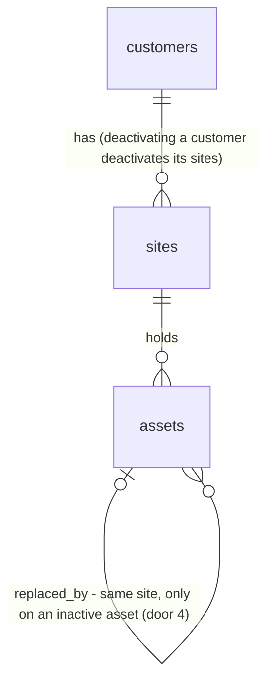

# Deactivation

## Problem

A customer who leaves, a building that is sold and a rooftop unit that is pulled out all stay on every list, with nothing to tell them apart from live ones. Staff choose between clutter and losing history. Customers and sites cannot be deleted at all (AD-030). Assets can be deleted, but a deleted unit drops out of the import job's record (`asset_id` set null, AD-045). When a unit is swapped, nothing links the new unit to the one it replaced. Nothing stops an estimator from starting an agreement on a site the contractor no longer serves. ROADMAP's Deactivation section sets the rules: "deactivated, never deleted"; hidden by default with "Show inactive"; an inactive site cannot start an agreement; deactivating a site withdraws its draft or sent agreement and is refused while it has a live contract; deactivating a customer deactivates all of their sites; a removed asset can be linked to the unit that replaces it. The source gives no usage figures.

When this ships:
- Writers can deactivate a customer or a site, and remove an asset from service, optionally naming the unit that replaced it. Each can be reactivated.
- Lists hide inactive records unless `Show inactive` is on. History and past agreements stay readable.
- A site whose agreement is still in term cannot be deactivated. The message names the agreement and its end date.

## Flow

This reuses `apply_agreement_transition` (exists) for the withdraw, so the withdrawn event and outbox row are the ones a manual Withdraw writes. It reuses the readers `CustomerDirectory` and `SiteRegister` (exist) with a filter, the record Server Actions and `canWriteRecords` (exist), and the two-step `DeletePrompt` pattern for confirmation.

1. Customer edit page, site edit page and asset edit page (exist) post to new Server Actions in `record-actions.ts` (exists). Each action refuses viewers before any write (AD-029).
2. The actions call `CustomerStore` / `SiteStore` / `AssetStore` (exist, extended) `setActive(...)`. These call `public.set_customer_active`, `public.set_site_active` and `public.set_asset_active` (door 3). `AssetStore.delete` and `deleteAssetAction` are removed (door 2).
3. `set_site_active(false)` locks the site and checks the live rule (door 5). It withdraws a `draft` or `sent` agreement through `apply_agreement_transition` (exists) with payload `{from, to, via: "deactivation"}`, then stamps `deactivated_at` / `deactivated_by` (door 1). `set_customer_active(false)` checks every active site first and then runs the same steps for each one, in one transaction.
4. `create_agreement` (exists, redefined) and `private.run_renewals` (exists, redefined) refuse or skip an inactive site (door 6). `site_service_scope` (exists, redefined) leaves out inactive assets (door 7).
5. Out: `CustomerDirectory.list/detail` and `SiteRegister.get` (exist, extended) return `active` and, for assets, `replacedBy`. The pages filter by `?show=inactive` (door 8).

## Impact

| Front | What changes |
| --- | --- |
| domain | New term `inactive`: a customer, site or asset with `deactivated_at` set. It is not deleted, and every read still finds it by id. |
| domain | New term `in term` (live contract, before Phase 4): an `accepted` agreement whose latest version's `term_end` is today or later in America/Vancouver, or has no `term_end`, or whose contract is `pending_signature`, `client_signed` or `completed`. Nothing branches on it today. Phase 6 cancellation will change this rule. |
| domain | AD-030 superseded for assets: they are no longer hard-deleted. Callers of `AssetStore.delete`: `deleteAssetAction` and the asset edit page's `DeleteControl`. Both are removed. Contacts stay deletable. |
| domain | `agreement.withdrawn` gains a second writer path (`via: "deactivation"`). Who reads it today: `events.json` ignores it (it routes three types), W1's reminder claim skips non-`sent` agreements, and the portal shows the withdrawn message. None of them changes. |
| stored data | New nullable columns, all null on existing rows, so every record is active. No backfill. `seed.sql` is untouched. |
| stored data | Grants: table-level `update` on `customers`, `sites` and `assets` becomes a column-level grant that excludes the deactivation columns, and `delete` on `assets` is revoked. `CustomerStore.update`, `SiteStore.update`, `AssetStore.update`, `commit_import` and the import review (`asset_id` link) write only columns that stay granted. That is the regression to guard. |
| stored data | `create_agreement`, `run_renewals` and `site_service_scope` are redefined from their latest versions (term-dates, renewal, seasonal-tasks). Dropping a branch from one of them is the regression to guard. |
| lists | Customer list counts (`siteCount`, `assetCount`) and the site register's asset list count active records only. |

## Relations

One-way constraints: `deactivated_at` and `deactivated_by` are both null or both set on each of the three tables (door 1). They are written only by the three `set_*_active` functions (door 2). `replaced_by_asset_id` points to an asset on the same site, never to itself, and is set only while the asset is inactive (door 4). No columns and no types here.

## Surface

| Route | In | Out | Status |
| --- | --- | --- | --- |
| `rpc set_site_active` | `p_site_id`, `p_active` | `uuid[]`: the agreements withdrawn | `200`; `P0002` unknown or other org; `42501` not owner/admin/estimator; `55000` hint `in_term` (detail: number, `term_end`), `changes_requested` (detail: number), `customer_inactive` (on reactivate) |
| `rpc set_customer_active` | `p_customer_id`, `p_active` | `uuid[]`: the agreements withdrawn across its sites | `200`; `P0002`; `42501`; `55000` hint `in_term` / `changes_requested` naming the first blocking site |
| `rpc set_asset_active` | `p_asset_id`, `p_active`, `p_replaced_by uuid default null` | void | `200`; `P0002`; `42501`; `23514` hint `replacement_invalid` (self, inactive, or another site); `55000` hint `site_inactive` (on reactivate) |
| `rpc create_agreement` | unchanged | unchanged | `200` (as today), `P0002`, `42501` (as today), and now `55000` hint `site_inactive` |

## Landing

| One-way door | Literal shape | Alternative rejected |
| --- | --- | --- |
| 1. The inactive marker | `deactivated_at timestamptz null`, `deactivated_by uuid null` on `customers`, `sites`, `assets`, with `check ((deactivated_at is null) = (deactivated_by is null))` | `active boolean`: cannot say when or by whom, and the history is the point of not deleting. A status text column: two states with no transitions to guard. |
| 2. Write lock | `revoke update on public.{customers,sites,assets} from authenticated`, then `grant update (name)` on customers, `(name, address, site_contact_id)` on sites, and `(asset_type_id, unit_no, type_model, location)` on assets. `revoke delete on public.assets from authenticated` (supersedes AD-030 for assets). | A trigger guard: it cannot tell the function from a member's PATCH (AD-060's reason). A plain column update: a PATCH would skip the withdraw and the in-term check. |
| 3. The writers | `public.set_customer_active(uuid, boolean) returns uuid[]`, `public.set_site_active(uuid, boolean) returns uuid[]` and `public.set_asset_active(uuid, boolean, uuid default null) returns void`: security definer, `search_path = ''`, `execute` to `authenticated` only. Each locks its row `for update`, returns `P0002` unless the caller is a member of its org and `42501` unless owner, admin or estimator (as AD-090 does), and sets `deactivated_by = auth.uid()`. Deactivating is a no-op on an inactive row, and reactivating is a no-op on an active one. | Store updates per AD-029: a site deactivation is a withdraw plus a stamp, two requests with no transaction (AD-015's reason). Security invoker: column grants would refuse it the columns door 2 locks. |
| 4. Replacement link | `assets.replaced_by_asset_id uuid null`, `assets unique (id, site_id)`, `foreign key (replaced_by_asset_id, site_id) references assets (id, site_id)`, `check (replaced_by_asset_id <> id)`, `check (replaced_by_asset_id is null or deactivated_at is not null)`. Reactivating clears it. | `replaces_asset_id` on the new unit: ROADMAP links from the removed unit, and one new unit can replace two old ones. An `(id, org_id)` FK only: a link could point to another site. |
| 5. The in-term rule | Inside `set_site_active(false)`: `55000` hint `in_term` while an `accepted` agreement on the site has latest-version `term_end >= (now() at time zone 'America/Vancouver')::date` or a null `term_end`, or a contract in `pending_signature`, `client_signed` or `completed`. `55000` hint `changes_requested` while an agreement is `changes_requested`. Otherwise it withdraws `draft` and `sent` agreements through `apply_agreement_transition` with payload `{from, to, via: "deactivation"}`. | Blocking on any `accepted`: a site whose term ended years ago could never be deactivated. Withdrawing `changes_requested`: the state machine has no `changes_requested → withdrawn`, and ROADMAP names only draft or sent. |
| 6. Agreement guard | `create_agreement` raises `55000` hint `site_inactive` after the role check. `private.run_renewals` leaves out agreements whose site is inactive. | A before-insert trigger on `agreements`: one inactive site would abort the W7 run for every org. |
| 7. Scope | `site_service_scope` leaves out assets with `deactivated_at` set. Frozen snapshots are never rewritten (AD-086). | Leaving them in the scope: a removed unit would be priced into the next draft. |
| 8. URL | `?show=inactive` on `/customers`, `/customers/[customerId]` and `/sites/[siteId]`. Any other value means hidden. | A separate `/customers/inactive` page: the filter belongs on the list it filters, and later Sites and Agreements lists copy it. |

- Nothing else in this change is hard to reverse

## Criteria

### S1: Remove an asset from service, and link its replacement (P1)

**Acceptance Criteria**

1. WHEN a writer presses `Remove from service` on the asset edit page and confirms THEN the system SHALL set the asset's `deactivated_at` and `deactivated_by` to the caller, and redirect to `/sites/<siteId>`.
2. WHERE the site has other active assets the confirmation SHALL offer `Replaced by` with `None` and each active asset on the same site (excluding this one), labelled `<type code> <unit no>`.
3. WHEN a replacement is chosen THEN the system SHALL store it in `replaced_by_asset_id`, and the register SHALL show the inactive asset as `Removed · replaced by RTU-2`.
4. IF the replacement is the asset itself, is inactive, or is on another site THEN `set_asset_active` SHALL raise `23514` and change nothing.
5. The asset edit page SHALL no longer offer `Delete asset`, and IF a member deletes from `assets` through PostgREST THEN the system SHALL refuse it (`42501`).
6. WHEN a draft's scope is built after an asset is removed THEN `site_service_scope` SHALL leave that asset out. WHEN the asset is removed from a site with a `sent` agreement THEN the frozen snapshot SHALL be unchanged.

**Independent test:** remove RTU-1 with `Replaced by` RTU-2 and see the register line. The draft's Service included no longer lists RTU-1.

### S2: Deactivate a site (P1)

**Acceptance Criteria**

7. WHEN a writer confirms `Deactivate site` on the site edit page THEN the system SHALL set the site inactive and redirect to `/sites/<siteId>`, which SHALL show an `Inactive` pill.
8. WHEN the site has a `draft` or `sent` agreement THEN the same transaction SHALL withdraw it, writing one `agreement.withdrawn` event with payload `{from, to: "withdrawn", via: "deactivation"}`, `actor_id` = the caller, and one outbox row.
9. The confirmation SHALL name what will be withdrawn: `This withdraws AG-1004.` when the site has a draft or sent agreement.
10. IF the site has an agreement in term (door 5) THEN the system SHALL refuse with `55000` / `in_term`, change nothing, and show `AG-1004 is in term until Dec 31, 2027, so this site can't be deactivated yet.`
11. IF the site has a `changes_requested` agreement THEN the system SHALL refuse with `55000` / `changes_requested` and show `AG-1004 has changes requested. Revise and withdraw it first.`
12. IF any step fails THEN the site SHALL stay active and no agreement SHALL change status.
13. WHILE a site is inactive its page SHALL not offer `New agreement`, `Add asset` or `Import`, and IF `create_agreement` is called for it THEN the system SHALL raise `55000` / `site_inactive`.
14. WHILE a site is inactive `run_renewals` SHALL create no renewal for its agreements.
15. IF a member updates `sites.deactivated_at` (or `customers.` / `assets.` deactivation columns) directly through PostgREST THEN the system SHALL refuse it (`42501`), while edits of name, address and site contact still save.

**Independent test:** deactivate a demo site with a sent agreement. The agreement is withdrawn, the review link shows the withdrawn message, and `New agreement` is gone. A site with an in-term accepted agreement refuses.

### S3: Deactivate a customer (P1)

**Acceptance Criteria**

16. WHEN a writer confirms `Deactivate customer` on the customer edit page THEN the system SHALL set the customer and every active site of theirs inactive, with the same `deactivated_at`, withdrawing each site's draft or sent agreement per AC 8.
17. IF any of the customer's sites would be refused per AC 10 or AC 11 THEN the system SHALL change nothing and show that site's message, prefixed with the site name.
18. WHILE a customer is inactive their detail page SHALL show an `Inactive` pill and SHALL not offer `Add site`.

**Independent test:** deactivate a customer with two sites. Both sites become inactive, and the customer leaves the default list.

### S4: Inactive records are hidden by default (P1)

**Acceptance Criteria**

19. The `/customers` list, the customer detail's Sites list and the site register's asset list SHALL show only active records unless `?show=inactive` is present.
20. The system SHALL show, on each of those lists, a `Show inactive` toggle that links to the same page with `?show=inactive` and back. With it on, inactive rows SHALL carry an `Inactive` pill (`Removed` for assets).
21. The customer list's site and asset counts SHALL count active records only.
22. WHEN a list has no active records but has inactive ones THEN it SHALL show `No active customers.` (`sites.`, `assets.`) with the `Show inactive` toggle.
23. A record's own page (`/customers/<id>`, `/sites/<id>`, `/assets/<id>/edit`) and every agreement on it SHALL stay readable while it is inactive.

**Independent test:** deactivate one customer, see them leave `/customers`, toggle `Show inactive` and see them with the pill.

### S5: Reactivate (P2)

**Acceptance Criteria**

24. WHEN a writer presses `Reactivate` on an inactive customer, site or asset THEN the system SHALL clear `deactivated_at`, `deactivated_by` and, for an asset, `replaced_by_asset_id`. It SHALL restore no withdrawn agreement.
25. WHEN a customer is reactivated THEN their sites SHALL stay inactive until each one is reactivated.
26. IF a site is reactivated while its customer is inactive THEN the system SHALL refuse with `55000` / `customer_inactive` and show `Reactivate <customer> first.` The same rule applies to an asset on an inactive site (`site_inactive`).
27. WHILE the member is a viewer none of the deactivate, remove or reactivate controls SHALL show, and the Server Actions SHALL refuse before any write.

**Independent test:** reactivate the customer from S3, then one of their sites, and see `New agreement` return on that site.

## Out of scope

| Excluded | Why |
| --- | --- |
| Cancelling a contract to free an in-term site | ROADMAP Phase 6 cancellation flow; until then the site frees itself when the term ends |
| Restoring the agreements a deactivation withdrew | `withdrawn` is terminal in the status model; staff start a new agreement |
| Deactivating contacts | ROADMAP names sites, customers and assets; contacts stay deletable (AD-030) |
| A Sites page across customers with the filter | ROADMAP Phase 3.5 item 10 |
| A reason field on deactivation | not in ROADMAP |

## Assumptions

| Assumption | Chosen default | Rationale | Confirmed? |
| --- | --- | --- | --- |
| What blocks site deactivation | in term: accepted with latest `term_end >= today` or null, or a contract pending, client-signed or completed | user chose it 2026-11-03 | y |
| Asset delete | removed; `Remove from service` replaces it, contacts stay deletable | user chose it 2026-11-03 | y |
| `changes_requested` on a deactivating site | refuse and tell staff to revise and withdraw | the machine has no `changes_requested → withdrawn`, and ROADMAP lists draft or sent only | n |
| Reactivating a customer | the customer only; sites one by one | a site deactivated earlier on its own must not come back by accident | n |
| Writes under an inactive parent | hidden in the UI (`Add site`, `Add asset`, `Import`); only `create_agreement` and `set_*_active` enforce it in SQL | ROADMAP binds only the agreement rule; other enforcement can be added without data change | n |
| Inactive asset's edit form | still editable (type, unit, model, location) | correcting history is harmless, and the edit page is where Reactivate lives | n |
| "Today" for the in-term rule | America/Vancouver, as AD-101 and AD-109 | there is no org time zone | n |

**Open questions:** none. Everything is resolved or logged above.

## Observable

| Surface | Decision | Landing |
| --- | --- | --- |
| screen `/customers`, customer detail Sites, site register assets | empty state | AC 22 |
| same lists | ordering, density | existing - name / created order unchanged; inactive rows sort with the rest when shown |
| screen site and customer edit pages | destructive action confirms | AC 9, existing - the two-step `DeletePrompt` pattern |
| screen asset edit page | destructive action confirms | AC 1, AC 2 |
| screen edit pages | error state | AC 10, AC 11, AC 17, AC 26 |
| screen edit pages | unauthorised | AC 27 |
| screen record pages | loading | existing - each route's `loading.tsx` |
| screen inactive site / customer | controls | AC 13, AC 18 |
| API `rpc set_*_active` | error shape and codes | Surface, AC 4, AC 10, AC 11, AC 26 |
| all new RPCs | versioning, rate limits | n/a - called only by the app's Server Actions under a member session; no external consumer |
| email | any | n/a - no email is sent; a withdrawn agreement already sends nothing |

## Sources

- ROADMAP.md: the Deactivation section, M3, M4, and Phase 3.5 item 7.
- `.specs/STATE.md`: AD-015, AD-029, AD-030, AD-052, AD-060, AD-086, AD-090, AD-101, AD-109.
- User decisions, 2026-11-03: the in-term block rule; asset Delete replaced by Remove from service.
