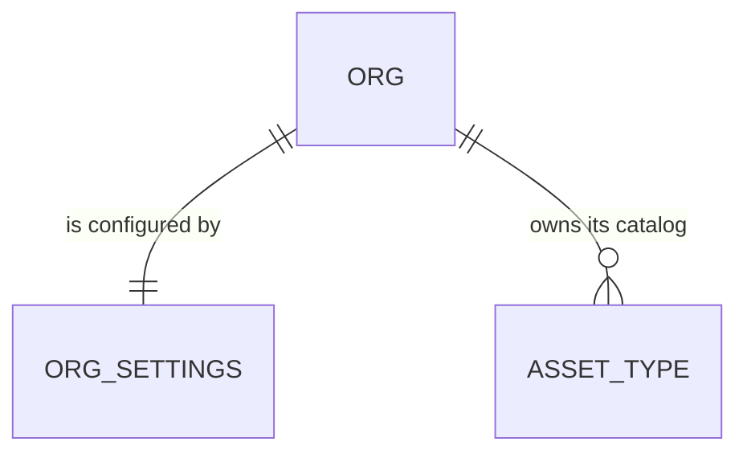

# First-login setup screen

Roadmap Phase 5 item "First-login setup screen (company profile, catalog review, template preview)". It is the first reader of what workspace-provisioning stored (`org_billing`, the seeded packs, the buyer's company and phone). One feature at a time (decision 22). The "Other" trade draft, the "Setting up your workspace" state, the Customer Portal and the duplicate-email refusal stay separate items. Logo upload and the template preview cannot ship yet (Out of scope).

## Problem

A paid owner who clicks the emailed sign-in link lands on an empty Pipeline in a workspace whose settings hold only what the buyer typed at `/register`: a company name and a phone. Province, address, accent colour and the word for the serviced item are blank or default, so the first agreement they build prints no governing province and no address and says "equipment" whatever trade they bought. Nothing tells them what the starter catalog gave them or that the one place to fix this is `/settings`. The roadmap gives no sign-up volume, activation figure or support count, so none is claimed here.

When this ships, an owner or admin who opens Pipeline in a freshly provisioned workspace is taken to one short screen: confirm the company profile, see what was seeded, and continue. An existing org, and a member who is not an owner or admin, is never taken there.

## Flow

Reuses `org_settings` and its row policy (owner and admin update, AD-025), the Settings form's validators (`domain/org-settings`), the `Select` and `TextInput` components, `AssetTypeCatalog` (AD-162's reader of the org's types), `currentMember`, and the `private.provision_workspace` function that creates the org, instead of a second settings table, an onboarding service or a new role check.

1. Owner opens the emailed link -> `/auth/confirm` (exists) -> `/pipeline` (exists, changed) - the page asks the container whether setup is pending; for an owner or admin with it pending it redirects to `/setup`
2. `GET /setup` (new route, outside the `(app)` group so it has no shell) - checks the session and role, redirects anyone it does not apply to, and renders the profile form prefilled from `getOrgSettings` plus the catalog review read from `AssetTypeCatalog`
3. Save and continue -> Server Action `POST /setup` (new) -> validates, then the new `OrgSetup` port (`supabaseOrgSetup`, a sibling of `OrgSettingsStore`) updates only the profile columns and stamps `setup_completed_at` (door 1), under RLS -> redirect `/pipeline`
4. Skip for now -> Server Action `POST /setup` (same route, other intent) -> stamps `setup_completed_at` only -> redirect `/pipeline`
5. `private.provision_workspace` (exists, changed, door 1) - inserts `org_settings` with `setup_completed_at` null, which is what makes step 1 fire

## Impact

| Front | What changes |
| --- | --- |
| domain | new term: setup pending - an org whose `org_settings.setup_completed_at` is null; only a provisioned org starts that way. Lives in `org_settings` and the container's read |
| domain | new term: `OrgSetup` - the port for first-login setup (pending read, catalog read, save profile, skip); `OrgSettingsStore` is unchanged, so `saveSettingsAction`, the settings page and the composition tests are untouched |
| stored data | one new nullable column on `org_settings`. The migration gives every existing row a value (the migration's `now()`), so no org that exists today is sent to `/setup`. The demo org and hand-seeded orgs get a value from the column default |
| stored data | `private.provision_workspace` is redefined to pass null for the new column. Orgs already provisioned before this ships (none in production: the migration of workspace-provisioning is applied, no live checkout has run) would count as done |
| tests | `supabase/tests/workspace_provisioning.sql` asserts the `org_settings` row; it keeps passing because it does not read the new column. No approved check is rewritten |
| not changed | `/settings` and its form, `/members`, the sign-in flow, RLS policies, `org_billing`, the Stripe webhook |

## Relations

One-way constraint: `setup_completed_at` on `org_settings`, nullable, with a default (door 1). Nothing new links to it.

## Surface

| Route | In | Out | Status |
| --- | --- | --- | --- |
| `GET /setup` | session cookie | the setup page: profile form, catalog review, Continue, Skip for now | `200`, `303` to `/login`, `303` to `/pipeline` |
| `POST /setup` (Server Action) | `intent` (`save` or `skip`); for `save`: `legalName`, `address`, `phone`, `accentColor`, `governingProvince`, `itemSingular`, `itemPlural` | `303` to `/pipeline`, or the page with field errors, or the page with "You don't have permission" | `200`, `303`, `403`-equivalent as the form notice (the existing Settings pattern) |

`GET /pipeline` keeps its response; it gains a `303` to `/setup` for an owner or admin with setup pending.

## Landing

| One-way door | Literal shape | Alternative rejected |
| --- | --- | --- |
| 1. Where "setup is done" lives | `alter table public.org_settings add column setup_completed_at timestamptz default now();` (nullable; the add backfills every existing row with the migration time). `private.provision_workspace` inserts `org_settings (org_id, legal_name, phone, setup_completed_at)` with an explicit `null`. Pending means `setup_completed_at is null`. An owner or admin stamps it through the existing `org_settings` update policy; no new function, grant or policy | a boolean `onboarded`: forgets when, and cannot tell a skipped setup from an old org later. A column on `org_billing`: the demo and hand-seeded orgs have no such row, so the gate would read a missing row as done, inverting the rule. Deriving it from `legal_name` equals the register company: fragile and unreadable. A `default null` column: every hand-seeded or future-inserted org would be sent to setup by accident |

- Nothing else in this change is hard to reverse: the route path, where the redirect lives, the form's field order and wording, and the placement of the narrower store method are edits.
- Door 1 reaches past this feature: "Other" trade drafting and the template preview will add steps to the same screen and read the same flag. It belongs in `STATE.md` as an AD at the end of the build.

## Criteria

### S1: A freshly provisioned owner is taken to setup once (P1)

**Acceptance Criteria**

1. WHEN an owner or admin of an org with `setup_completed_at` null opens `/pipeline` THEN the system SHALL answer `303` to `/setup`
2. WHEN an estimator or viewer of an org with setup pending opens `/pipeline` THEN the system SHALL render Pipeline as it does today
3. WHEN an owner or admin of an org with `setup_completed_at` set opens `/pipeline` THEN the system SHALL render Pipeline as it does today
4. WHEN `private.provision_workspace` creates an org THEN the new `org_settings.setup_completed_at` SHALL be null
5. WHEN the migration is applied THEN every `org_settings` row that already exists SHALL hold a non-null `setup_completed_at`, and an `org_settings` row inserted without the column SHALL get one too
6. WHILE setup is pending the system SHALL NOT redirect any page other than `/pipeline` to `/setup`
7. WHEN an owner or admin opens `/setup` and `setup_completed_at` is set THEN the system SHALL answer `303` to `/pipeline`
8. WHEN an estimator, a viewer or a user with no membership opens `/setup` THEN the system SHALL answer `303` to `/pipeline`; a signed-out visitor SHALL get `303` to `/login`

**Independent test:** provision an org (or reset `setup_completed_at` to null on a test org), sign in as its owner and open `/pipeline`; the browser lands on `/setup`. Open `/setup` as the demo owner; it lands on `/pipeline`.

### S2: The company profile is confirmed in one form (P1)

**Acceptance Criteria**

9. WHEN `/setup` opens THEN the system SHALL show the legal name and phone from `org_settings` prefilled, and address, accent colour, governing province, and the two item words with their stored values
10. WHEN the owner submits `save` with valid values THEN the system SHALL update `legal_name`, `address`, `phone`, `accent_color`, `governing_province`, `item_singular` and `item_plural`, set `setup_completed_at`, and answer `303` to `/pipeline`
11. WHEN the owner submits `save` THEN the system SHALL leave the default terms, renewal settings, CPI, proposal validity and `trade_context` unchanged
12. IF any field is invalid under the same rules as `/settings`, or the province is empty, THEN the system SHALL return every field error together, store nothing and leave `setup_completed_at` null
13. IF the row update is refused by RLS (the member's role changed since the page loaded) THEN the system SHALL show "You don't have permission to change this" and leave `setup_completed_at` null
14. WHEN the owner submits `skip` THEN the system SHALL set `setup_completed_at`, change no other column and answer `303` to `/pipeline`
15. WHEN a second stamp arrives for an org that is already stamped THEN the system SHALL keep the first `setup_completed_at` value

**Independent test:** open `/setup` on a pending org, enter a province and an accent colour, press Continue; open `/settings` and see them stored with the terms untouched. Repeat with Skip for now.

### S3: The owner sees what the catalog gave them (P2)

**Acceptance Criteria**

16. WHEN `/setup` opens on an org with seeded types THEN the system SHALL show, per pack, the count and the type names, with the count in the org's item words (for example "20 plumbing types"), read from the org's own `asset_types`
17. WHEN the org has no types (an "Other" only checkout) THEN the system SHALL show "No types yet" with the words that the owner adds them in the task library, and SHALL NOT offer a Claude draft
18. The system SHALL show the review as read-only text, with no control that edits a type from `/setup`

**Independent test:** a plumbing-seeded org shows its 20 type names; an "Other" org shows the empty text.

### S4: The screen works on every size and for everyone it applies to (P1)

**Acceptance Criteria**

19. WHILE the page is at 375, 768 or 1440 px wide the system SHALL show no horizontal scroll, and every control SHALL be at least 44 by 44 px on mobile and tablet
20. WHILE the settings read or the catalog read is loading the system SHALL show a loading state; IF either read fails THEN the system SHALL show an error state with a retry and SHALL NOT stamp setup

**Independent test:** the AGENTS.md Playwright pass on `/setup` at the three sizes, with touch emulation on the two smaller ones.

## Out of scope

| Excluded | Why |
| --- | --- |
| Logo upload | No Storage bucket for logos exists (`logo_path` is not shown or edited anywhere yet); its own item |
| Template preview | Document templates are Phase 5.5; there is nothing to preview. The roadmap item's third part stays open |
| "Other" trade: Claude drafts a catalog | Own roadmap item; here the empty catalog only points at the task library |
| Editing types, tasks or months from `/setup` | The task library owns that; the review is read-only |
| Reopening setup from a menu, a banner on other pages, or a progress checklist | The flag only decides the first landing; `/settings` stays the place to change anything later |
| Redirecting pages other than `/pipeline`, or blocking the app until setup is done | Skippable by design; a link to `/task-library` from the screen would otherwise bounce back |
| Changing the terms, renewal, CPI or validity defaults | They are in `/settings`; the screen asks only what a new owner must confirm |
| Setup for an existing org | Existing orgs are marked done by the migration (AC 5) |

## Assumptions

| Assumption | Chosen default | Rationale | Confirmed? |
| --- | --- | --- | --- |
| Who is sent to `/setup` | Owner and admin, from `/pipeline` only | They are the roles that may write settings (AD-025); `/auth/confirm` lands on `/pipeline` | n |
| Skip | "Skip for now" stamps the flag and never asks again | A skippable first run is lighter than a forced one; `/settings` has every field | n |
| Province is required here | Must be one of `PROVINCES`; empty is an error on this screen (it is optional on `/settings`) | The contract prints it, and a provisioned org has none | n |
| Which provinces | The same `PROVINCES` list as `/settings`, Quebec included | Decision 3 is a launch-marketing scope, not a database rule; narrowing it here would differ from `/settings` | n |
| Accent colour and address | Optional | `/settings` and the PDFs already treat them as optional | n |
| Item words on this screen | Shown with the stored default "equipment"; editable | The provisioning plan promised the setup screen lets the owner change it (workspace-provisioning Out of scope) | n |
| Pack display name in the review | The trade label from `TRADES` (`web/domain/billing`) for a pack code; a type with no pack is shown under "Added by you" | The labels the visitor saw at `/register` | n |
| Test of an org with `org_billing` missing | The screen never reads `org_billing` | Nothing may require it (workspace-provisioning AC 26); the empty catalog is the signal | n |

**Open questions:** none block the build.

| # | Kind | Question | Until answered |
| --- | --- | --- | --- |
| 1 | open | Should the screen carry a short welcome line for the trial ("14 days left")? | Not shown; it needs the Stripe trial end, which is not stored |
| 2 | blocks go-live | The migration needs applying and one live checkout end to end (the owner already holds both open from workspace-provisioning) | The flow is proven on rolled-back SQL and fakes first |

## Observable

| Surface | Decision | Landing |
| --- | --- | --- |
| screen `/setup` | empty state | AC 17 (no types) and AC 9 (blank province and address) |
| screen `/setup` | loading and error states | AC 20 |
| screen `/setup` | unauthorised | AC 8, AC 13 |
| screen `/setup` | density and ordering | existing - the Settings form's section cards and pinned Save bar; profile first, catalog review second, actions last |
| screen `/setup` | destructive action confirms | n/a - nothing is deleted; Skip only stamps a flag and `/settings` stays |
| API `POST /setup` | error shape and codes | AC 12, AC 13 (field errors and the permission notice, the Settings pattern) |
| API `POST /setup` | who may call it | AC 8, AC 13 |
| API `POST /setup`, `GET /setup` | versioning, rate limits | n/a - an authenticated Server Action on one member's own row; there is no unauthenticated write |
| collection of types on the review | grouping, naming, ordering, duplicates | AC 16 (grouped by pack, trade label, type names in the task library's order); a type made by hand sits under "Added by you" |

## Sources

- `ROADMAP.md` Phase 5 item "First-login setup screen", Onboarding step 4, Decision 9 and 22 - the item and its three parts
- `.specs/features/workspace-provisioning/plan.md` (Out of scope and AC 26) and `.specs/STATE.md` AD-173 - what provisioning stores and leaves for this screen
- `.specs/STATE.md` AD-025 (province codes, owner and admin write), AD-157 and AD-158 (item words)
