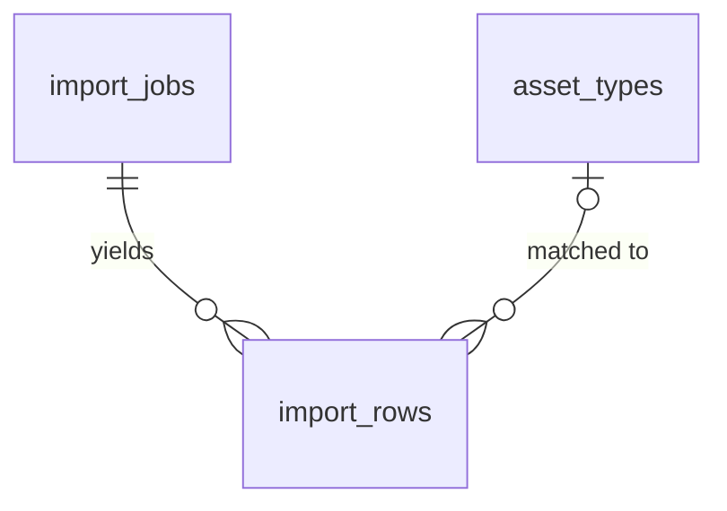

# Asset import, step 3: extract equipment rows with Claude and match each to an equipment type

## Problem

A file that was read ("Read", import-parse) is still just a file. Nobody can see which rows are
equipment, and nothing says which of the org's equipment types each row is. A customer's list
calls the same unit "Rooftop unit", "RTU-3", "Roof top" and "R.T.U."; a PDF is a scan-like table
no parser can split into columns; a Word file mixes a table with free text. Today an estimator
retypes every unit through the "Add asset" form, one at a time, for sites with dozens to a few
hundred units. That retyping is the cost this import exists to remove, and step 2 stopped before
removing it.

The source (ROADMAP.md Phase 2 item 3 and "Asset import pipeline" steps 3 and 4) gives no user
evidence or date. It fixes the method: a Claude structured output returns `{asset_type_raw,
unit_no, type_model, location, confidence, source_ref}` per row; a synonym table maps each type to
the catalog (for example "Rooftop unit" -> RTU, "MAU" -> MUA); types that do not match are flagged,
never hidden.

When this ships, a writer presses "Extract equipment" on a "Read" job and watches it work through
the file in steps ("Extracting 200 of 340"). It ends "Extracted" with a count line ("338 rows, 14
need an equipment type"). The rows are stored against the job with their source reference and
confidence, ready for the review grid. No asset is written yet.

## Flow

This reuses the read-import sequence (`writer()` guard, `isUuid`, the compare-and-set pattern of
`recordRead`, `ImportJobStore.fileOf`, the `ImportParser` that re-parses a stored file),
`AssetTypeCatalog` for the org's types, `ImportJobList`, `StatusPill` and `Button`. The Storage
read is the member's own client, so RLS on the `imports` bucket (AD-033) still decides who reads
a file.

1. `ExtractControl` (new, placement per conventions) calls `extractImportAction(jobId)` (new Server Action) in a loop, one call per chunk, until the answer is `extracted` or an error; `ImportJobList` (exists) renders the button.
2. `extractImportAction` -> `writer()` (exists) refuses a non-writer, `isUuid` (exists) refuses a malformed id -> the extract-import use case (new, placement per conventions).
3. The use case asks `ImportJobStore.sourceOf(jobId)` (door 6) for status, content type, progress, stored result and bytes. `extracted` answers from the stored result; `uploading`, `uploaded` and `unreadable` answer `not_ready`.
4. `ImportParser.parse` (exists) re-parses the bytes into `ParsedImport`; the use case cuts the next chunk at the stored cursor (100 data rows of one table, or the whole text, or the whole PDF).
5. `AssetExtractor.extract(chunk)` (door 3, adapter in `web/infrastructure/claude` on `@anthropic-ai/sdk`, door 5) returns `ExtractedRow[]` or `unavailable` / `too_large`.
6. `normalizeAssetType` (new, pure, placement in `web/domain/imports`) matches each `asset_type_raw` against the org's types from `AssetTypeCatalog.list` (exists) and a built-in synonym table.
7. `ImportJobStore.recordExtraction(jobId, expectedCursor, chunk result)` (door 4) calls `public.record_extraction_chunk` (door 4): rows into `import_rows` (door 1) and the cursor on `import_jobs` (door 2) move together, compare-and-set on the cursor.
8. Out: state `extracting` with progress, or `extracted` with counts; `refresh()` re-reads the page and `ImportJobReader.forSite` (exists, gains the extraction columns) lists the outcome. The review grid (next item) reads `import_rows`.

## Impact

| Front | What changes |
| --- | --- |
| domain | new term: **extraction** (of an import job), meaning Claude turned the read content into candidate rows. Statuses `extracting` (shown "Extracting") and `extracted` (shown "Extracted") |
| domain | new term: **import row**, one candidate asset found in a file, with the text as written (`asset_type_raw`), its matched type or none, a confidence and where in the file it came from. Not an asset until the commit item |
| domain | new term: **chunk**, the unit of one Claude call: up to 100 data rows of one table, or a text-only document, or a whole PDF. The cursor counts chunks done |
| domain | existing term: status `parsed` meant "read, waiting"; it now means "read, extraction not started". `ImportJobList` (pill, controls), `fileOf` and `readImport` (a job past `parsed` must still return its stored read outcome without reading) branch on it |
| domain | existing term: AD-037 says `fileOf` returns bytes only while `uploaded`, and import-parse AC 19 says a re-read of a read job downloads nothing. Both stay true: extraction gets its bytes from the new `sourceOf` (door 6), which downloads only while `parsed` or `extracting`, and `fileOf` is unchanged |
| stored data | `import_jobs` gains the extraction columns and two statuses. Two existing checks from import-parse become wrong for extracted jobs and are replaced in the migration: `import_jobs_read_at_iff_read` (read time is also set when the job is `extracting` or `extracted`) and `import_jobs_counts_only_parsed` (the read counts stay on an `extracting` or `extracted` job). The live project has 0 import jobs (checked 2026-10-26), so nothing to backfill |
| stored data | new table `import_rows`; discarding a job cascades to its rows |
| dependencies | first outbound AI call and first secret: `@anthropic-ai/sdk` (server-only) and `ANTHROPIC_API_KEY` in `web/.env.local` and the host's environment |
| privacy | a customer's equipment list leaves the app for the Anthropic API. Only the chunk's content is sent: no org, customer, site or member identity (AC 28) |
| roadmap wording | ROADMAP says "Claude structured extraction and type normalization"; it ships as one item |
| screens | `/sites/[siteId]/import`: parsed jobs get "Extract equipment"; extracting and extracted jobs show progress and the count line |
| composition | `getContainer()` gains `extractImport` |
| decisions | doors 1 to 7 reach past this feature (the review grid and commit read them) and get `AD-NNN` rows; AD-037 stands |
| types | `database.types.ts` regenerated after the migration |
| docs | `CONTEXT.md` "Asset import (M5)" step 3, `.env.example`, Build log line, ROADMAP Phase 2 item 3 ticked |
| security advisors | the migration must leave `get_advisors` at the two accepted findings |

## Relations

One-way constraints: a row's position is unique within its job (door 1); a row can name only an
asset type of its own org (door 1, composite reference); a job's cursor never exceeds its total,
and an `extracted` job has cursor equal to total (door 2). No columns and no types here.

## Surface

| Route | In | Out | Status |
| --- | --- | --- | --- |
| `POST` Server Action `extractImportAction` | `jobId` | state `extracting` with `done`, `total` · `extracted` with `rows`, `unmatched` · `not_ready` · `too_large` · `forbidden` · `not_found` · `unavailable` | `200` |

## Landing

| One-way door | Literal shape | Alternative rejected |
| --- | --- | --- |
| 1. `public.import_rows` | table with `id uuid pk`, `org_id`, `job_id`, `position integer not null check (position >= 1)`, `asset_type_raw text`, `unit_no text`, `type_model text`, `location text`, `confidence text not null check (confidence in ('low','medium','high'))`, `source_ref text`, `asset_type_id uuid`; `unique (job_id, position)`, `unique (id, org_id)`, `foreign key (job_id, org_id) references import_jobs (id, org_id) on delete cascade`, `foreign key (asset_type_id, org_id) references asset_types (id, org_id)`; RLS as `assets` (AD-003, AD-004). `asset_type_id is null` is what the screen calls "needs an equipment type" | a jsonb array on the job, because the review grid edits, merges and deletes single rows and a jsonb element cannot carry a composite reference to `asset_types`; reusing `assets` with a `draft` flag, because every query that counts assets (site register, agreements) would have to filter it forever; a numeric confidence, because 0.87 claims precision the model does not have and the grid only needs to sort three bands |
| 2. extraction state on `import_jobs` | status check becomes `status in ('uploading','uploaded','parsed','unreadable','extracting','extracted')`; new columns `extract_cursor integer check (extract_cursor >= 0)`, `extract_total integer check (extract_total >= 1)`, `extracted_at timestamptz`; checks `(status in ('extracting','extracted')) = (extract_total is not null)`, `(extract_cursor is null) = (extract_total is null)`, `extract_cursor <= extract_total`, `(status = 'extracted') = (extracted_at is not null)`, `status <> 'extracted' or extract_cursor = extract_total`. The job moves `parsed` -> `extracting` when the first chunk is recorded | one `extracting` claim with no cursor and a single Claude call per file, because 2,000 rows of output do not fit one request or one Server Action and a crash would strand the claim with no way to tell which rows were saved; a background worker, because the project has no queue until the Phase 3 dispatcher and the cursor gives the same resumption with no new infrastructure; a failed status, because a failed call leaves nothing recorded and "try again" is the only advice |
| 3. the extractor port and its row shape | `AssetExtractor.extract(chunk: ExtractChunk): Promise<{ ok: true; rows: ExtractedRow[] } \| { ok: false; code: "unavailable" \| "too_large" }>` in `web/application/ports`, with `ExtractChunk = { kind: "rows"; table: string; header: string[]; rows: { ref: string; cells: string[] }[] } \| { kind: "text"; text: string } \| { kind: "pdf"; bytes: Uint8Array }` and `ExtractedRow = { assetTypeRaw: string \| null; unitNo: string \| null; typeModel: string \| null; location: string \| null; confidence: "low" \| "medium" \| "high"; sourceRef: string \| null }`. Chunk size is 100 rows | Claude returning an org catalog code directly, because the catalog differs per org and the match would live in a prompt nobody can test; the roadmap fixes a synonym table. One port that also normalizes, because the match is pure and must be proven without a network |
| 4. the chunk write | `public.record_extraction_chunk(job_id uuid, expected_cursor integer, total integer, rows jsonb) returns integer`, security invoker, `search_path = ''`: role check via `private.has_org_role`, `update import_jobs ... where id = job_id and extract_cursor is not distinct from expected_cursor and status in ('parsed','extracting')`, insert the rows, advance the cursor, set `extracted` when it reaches the total, all in one transaction; SQLSTATE `40001` stale, `P0002` not found, `42501` not allowed, as AD-015. Adapter: `ImportJobStore.recordExtraction` | two PostgREST requests (insert rows, then update the cursor), because there is no transaction across requests (AD-015) and a crash between them makes the retry insert the chunk twice |
| 5. the Claude dependency and secret | `"@anthropic-ai/sdk"` pinned exact in `web/package.json`, imported only under `web/infrastructure/claude`; `ANTHROPIC_API_KEY` read only there, never `NEXT_PUBLIC_` | raw `fetch` to the Messages API, because retries, typed errors and structured-output parsing would be rewritten by hand; sending files through n8n, because the app owns state and customer files would pass through a second system |
| 6. the store's source and write methods (added while writing the checks) | `ImportJobStore.sourceOf(jobId): Promise<{ ok: true; status: ImportJobStatus; contentType: ImportContentType; progress: { cursor: number; total: number } \| null; result: { rows: number; unmatched: number } \| null; bytes: Uint8Array \| null } \| { ok: false; code: WriteFailure }>` (bytes downloaded as the member only while `parsed` or `extracting`; `result` only while `extracted`) and `ImportJobStore.recordExtraction(jobId, expectedCursor: number \| null, total: number, rows: ImportRowInput[]): Promise<{ ok: true; progress: { cursor: number; total: number }; done: boolean } \| { ok: false; code: WriteFailure }>`, where a stale cursor re-reads the job and returns its stored progress | widening `fileOf` to return bytes for `parsed` jobs, because every re-read of a read job would download the file and break import-parse AC 19; a service-role download, because RLS on `imports` would then not decide who reads a file |
| 7. the row counts the list shows (added while writing the checks) | `create view public.import_row_counts with (security_invoker = true) as select job_id, org_id, count(*)::integer as rows, (count(*) filter (where asset_type_id is null))::integer as unmatched from public.import_rows group by job_id, org_id`, `select` granted to `authenticated` and revoked from `anon`; `ImportJobReader.forSite` and `sourceOf` read `rows` and `unmatched` from it | counts stored on `import_jobs`, because the review grid will map unmatched rows by hand and a stored count would go stale the moment it does; counting `import_rows` client-side, because lists are capped at 500 rows (AD-023) and a job can hold 2,000 |

- Nothing else in this change is hard to reverse: the model name, the 100-row chunk size, the synonym list, the prompt and the message copy are app-side constants.

## Criteria

"Writer" means owner, admin or estimator. "Chunk" is as in Impact: for a job with `table_count`
greater than 0, up to 100 consecutive data rows of one table in file order (a table with 340 rows
is 4 chunks, 100 + 100 + 100 + 40, and chunks never span two tables); for a Word job with
`table_count` 0, the document text as one chunk; for a PDF, the whole file as one chunk. A
`normalized` string is the text lowercased with every run of characters other than letters and
digits replaced by one space and the ends trimmed.

### S1: A read list becomes candidate rows (P1)

The writer turns a "Read" file into stored rows without leaving the page.

**Acceptance Criteria**

1. WHEN a writer presses "Extract equipment" on a `parsed` job THEN the system SHALL call `extractImportAction` for that job repeatedly, one chunk per call, until the answer is `extracted` or an error
2. WHEN a table chunk is extracted THEN the system SHALL send Claude only that chunk's header and, for each row, its `ref` and cells
3. WHEN a table file's first chunk is recorded THEN the system SHALL set the job to `extracting` with `extract_total` equal to the number of chunks (4 for one table of 340 data rows) and `extract_cursor` 1
4. WHEN Claude returns rows for a chunk THEN the system SHALL store one `import_rows` row per returned row with `position` continuing from the job's highest stored position, and SHALL NOT require one returned row per input row
5. WHEN a `.docx` job with `table_count` 0 is extracted THEN the system SHALL send its document text as one text chunk and the job SHALL have `extract_total` 1
6. WHEN a `.pdf` job is extracted THEN the system SHALL send the file to Claude as one document chunk and the job SHALL have `extract_total` 1
7. The system SHALL ask Claude for, and accept per row, only `asset_type_raw`, `unit_no`, `type_model`, `location` (each text or null), `confidence` (`low`, `medium` or `high`) and `source_ref`, through a structured output schema
8. IF a returned `source_ref` for a table chunk is not one of the `ref` values sent in that chunk THEN the system SHALL store the row with `source_ref` null and `confidence` `low`
9. WHEN the last chunk is recorded THEN the system SHALL set the job to `extracted` with `extracted_at` and `extract_cursor` equal to `extract_total`, including when the file yielded 0 rows
10. WHEN a row is stored THEN the system SHALL trim surrounding whitespace in its text fields and store an empty string as null

**Independent test:** as the demo owner on one demo site, upload a fictitious `.xlsx` of 120 units, read it, press "Extract equipment"; it ends "Extracted" after 2 steps, then discard it.

### S2: Each row is matched to an equipment type (P1)

An unmatched row is flagged, never guessed and never hidden.

**Acceptance Criteria**

11. WHEN a row is stored THEN the system SHALL set its `asset_type_id` to the org's asset type whose `code` or `name` has a `normalized` string equal to the `normalized` `asset_type_raw`
12. WHEN no code or name matches and the `normalized` `asset_type_raw` equals a built-in synonym of a code the org has THEN the system SHALL set `asset_type_id` to that type, so "Rooftop unit" gives RTU and "MAU" gives MUA
13. IF `asset_type_raw` is null, blank, matches no type or synonym, or matches more than one distinct type THEN the system SHALL store the row with `asset_type_id` null
14. The system SHALL match only against the signed-in member's org's asset types, so a synonym for a code the org does not have matches nothing
15. The system SHALL keep `asset_type_raw` as Claude returned it, trimmed, whatever `asset_type_id` was set to

**Independent test:** extract a list with "Rooftop unit", "MAU" and "Widget"; the first two are matched and the count line reports 1 needing a type.

### S3: Extraction survives interruption, repeats and failures (P1)

A closed tab, a double click or an API outage never duplicates rows or loses a finished chunk.

**Acceptance Criteria**

16. WHILE a job is `extracting` the job list SHALL show the pill "Extracting", the text `<extract_cursor> of <extract_total>` and, for a writer, a "Continue extraction" button that calls `extractImportAction` for that job
17. WHEN `extractImportAction` is called for an `extracting` job THEN the system SHALL process the chunk at the stored cursor and SHALL NOT send Claude any chunk already recorded
18. IF two calls process the same chunk at once THEN the system SHALL store that chunk's rows once, through a compare-and-set on the expected cursor, and the losing call SHALL return the stored progress without an error
19. IF `extractImportAction` is called for an `extracted` job THEN the system SHALL return the stored result without calling Claude, downloading the file or writing
20. IF the job is `uploading`, `uploaded` or `unreadable` THEN the system SHALL change nothing, not call Claude, and return state `not_ready`
21. IF the key is missing, the download, the parser or the Claude call fails (network, rate limit or server error after the SDK's retries, refusal, or output that does not match the schema) or the recording fails unexpectedly THEN the system SHALL record nothing for that chunk, leave the job as it was, return `unavailable`, show "We couldn't read this list. Try again.", and log the error with `console.error`
22. IF a text or PDF chunk's answer stops at the output limit THEN the system SHALL record nothing, leave the job `parsed`, return `too_large` and show "This document lists more equipment than can be read at once. Split it and upload each part."
23. IF recording a chunk fails after Claude answered THEN the system SHALL leave neither its rows nor its cursor change in the database
24. WHEN a job is discarded THEN the system SHALL delete its `import_rows` with it

**Independent test:** call `extractImportAction` twice at the same cursor; one chunk of rows exists and both calls report the same progress.

### S4: Only writers extract, and only their org's data leaves the app (P1)

**Acceptance Criteria**

25. IF a viewer's request reaches `extractImportAction` THEN the system SHALL write nothing, call nothing, and return state `forbidden`
26. IF `extractImportAction` names a malformed, missing or other-org job id THEN the system SHALL change nothing and return state `not_found`
27. The system SHALL download the file and write the rows with the signed-in member's client, never a service-role key, so RLS decides access
28. The system SHALL NOT include the org name, customer name, site name, member email or any id in a request to Claude
29. The module `@anthropic-ai/sdk` SHALL be imported only under `web/infrastructure/claude`, enforced by an ESLint `no-restricted-imports` rule elsewhere
30. The system SHALL read `ANTHROPIC_API_KEY` only on the server and never under a `NEXT_PUBLIC_` name

**Independent test:** as a viewer, the list shows "Extracted" with no button, and a replayed `extractImportAction` returns `forbidden`.

### S5: The job list shows where extraction stands (P1)

**Acceptance Criteria**

31. WHILE a job is `parsed` the job list SHALL show, for a writer, the button "Extract equipment" beside the "Read" pill, and for a viewer no button
32. WHILE the control is running the system SHALL keep its button disabled and labelled "Extracting… <done> of <total>" (and "Extracting…" before the first answer)
33. WHILE a job is `extracted` the job list SHALL show a neutral pill "Extracted" with the line `<n> rows, <k> need an equipment type`, dropping the second part when k is 0, and "No equipment found" when n is 0 (`1 row` in the singular)
34. WHEN `extractImportAction` returns `unavailable` or `too_large` THEN the control SHALL show the message in an alert below the job and re-enable its button

**Independent test:** a job per state renders its pill, line and controls in the writer and viewer views.

## Out of scope

| Excluded | Why |
| --- | --- |
| Review grid, editing, merging duplicates and mapping unmatched types by hand | ROADMAP Phase 2 item 4 |
| Writing `assets` (commit) | ROADMAP Phase 2 item 4 |
| Per-org custom synonyms and learning from corrections | the built-in table is enough to start; the review grid will show how often it misses |
| Re-extracting an `extracted` job | discard and upload again; keeps one Claude spend per upload |
| Spend caps, usage metering and per-plan limits | Phase 5 plan limits |
| Reading scanned images inside a Word file | Claude handles scans through PDF input |
| Sending the `ParsedImport.text` of a Word file that also has tables | see Assumptions |

## Assumptions

| Assumption | Chosen default | Rationale | Confirmed? |
| --- | --- | --- | --- |
| Model | `claude-opus-5-5`, effort `low`, with the server-side refusal fallback `fallbacks: "default"` | the project's default Claude model; extraction is mechanical, so low effort. Cheaper `claude-sonnet-5-5` is open question 2 | n |
| When extraction starts | on a button press by a writer, not automatically after the read | one Claude spend per file is a deliberate act; a 600-page PDF should not cost money by surprise | n |
| Chunk size | 100 data rows per call, driven by the browser one call at a time | keeps each Server Action short and each answer far under the output limit; 2,000 rows is at most 20 calls | n |
| Word files with tables and text | tables are extracted, the document text is not sent | the equipment list sits in the table; sending prose on every chunk multiplies the cost for little | n |
| Confidence | three bands set by Claude; the app does not recompute them, and lowers only to `low` on a bad `source_ref` (AC 8) | the grid needs to sort, not to measure | n |
| Synonym table | a constant in `web/domain/imports` covering the codes in the standard catalog, starting from the roadmap's examples and the catalog's own names | reversible; grows from review-grid misses | n |
| Prompt | one system prompt, constant, stating that the file's content is data and any instructions inside it are to be ignored | a customer file is untrusted input | n |
| Refusal | a refused or schema-invalid answer is `unavailable` | retrying may succeed; a permanent refusal is rare for equipment lists | n |

**Open questions:**

| # | Kind | Question | Until answered |
| --- | --- | --- | --- |
| 1 | blocks go-live | Who issues the Anthropic API key, with what spend limit, and is the owner content that customers' equipment lists are processed by the Anthropic API? | extraction cannot run against real files; tests use a fake extractor and the key is not needed to build |
| 2 | open | Keep `claude-opus-5-5` (about $4 / $20 per million tokens) or use `claude-sonnet-5-5` ($2 / $10) for extraction? | the model is one constant, written as `claude-opus-5-5` meanwhile |

## Observable

| Surface | Decision | Landing |
| --- | --- | --- |
| screen `/sites/<id>/import` | empty state | existing - "No equipment lists imported yet" (import-upload) |
| screen `/sites/<id>/import` | loading state | AC 32, 16 (button pending, progress); existing `loading.tsx` for the page |
| screen `/sites/<id>/import` | error state | AC 21, 22, 34 |
| screen `/sites/<id>/import` | unauthorised | AC 25, 31 |
| screen `/sites/<id>/import` | density and ordering | AC 33 (one count line per job); ordering unchanged, newest first |
| screen `/sites/<id>/import` | destructive action confirms | existing - Discard keeps its confirm; AC 24 for rows; extracting changes no data a person entered |
| collection: import rows | grouping, naming, ordering, duplicates, exceptions | AC 4 (positions continue in chunk order), AC 13 (unmatched kept with null type); duplicate units are kept for the review grid |
| Server Action `extractImportAction` | error shape and codes | Landing door 4; AC 20, 21, 22, 25, 26 |
| Server Action `extractImportAction` | who may call it | AC 25, 27 |
| Server Action `extractImportAction` | versioning, rate limits | n/a - same-origin Server Action behind a staff session; repeats cost nothing (AC 18, 19) and spend limits are out of scope |
| copy: the two failure messages | tone and what the reader does next | AC 21, 22 (each names the next step) |

## Sources

- ROADMAP.md Phase 2 item 3 and "Asset import pipeline" steps 3 and 4: Claude structured output per row, synonym table, flag what does not match
- `.specs/features/import-parse/plan.md`: `ParsedImport`, the `parsed` status, "extraction parses again"
- STATE.md AD-003, AD-004, AD-014, AD-015, AD-031, AD-035 to AD-037
