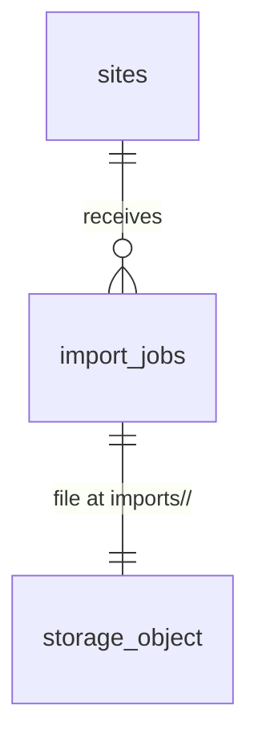

# Asset import, step 2: read each uploaded file and say what was found, or why it cannot be read

## Problem

An uploaded equipment list sits in the `imports` bucket as an opaque file. Nothing in the product
opens it, so a damaged spreadsheet, a password-protected Word file, a CSV saved from French Excel
with semicolons, or a sheet with no column headings all look exactly like a good file: "Uploaded".
The person who uploaded it only finds out it was useless once extraction runs, which is the step
that costs money (one Claude call per file), and by then they have moved on.

The source (ROADMAP.md Phase 2 item 2, "xlsx/csv, docx and pdf parsers behind `AssetExtractor`")
gives no user evidence or date. The pipeline in ROADMAP.md fixes the method per format: xlsx/csv
through SheetJS with a header heuristic, docx through `mammoth`, pdf sent straight to Claude.

When this ships, a writer uploads a file and, in the same action, sees the job become "Read" with
what was found ("48 rows in 1 table", "Text only, no table", "PDF, read at extraction") or
"Can't read" with the reason and what to do about it. A job whose read did not finish shows "Read
file" to try again. No asset is written and Claude is not called.

## Flow

This reuses the upload sequence `uploadFile` and the `writer()` guard in `import-actions.ts`, the
`ImportJobStore` adapter and its compare-and-set pattern from `confirmUploaded`, `getContainer()`,
`StatusPill` and `Button`. The Storage read is the member's own client, so RLS on the `imports`
bucket (AD-033) decides who may read a file.

1. `uploadFile` (exists, `web/components/imports/state.ts`) gets `uploaded` from `confirmImportAction` (exists) and then calls `readImportAction(jobId)` (new Server Action). A writer can also press "Read file" on a job still `uploaded` in `ImportJobList` (exists), which calls the same action.
2. `readImportAction` -> `writer()` (exists) refuses a non-writer, `isUuid` (exists) refuses a malformed id -> the read-import use case (new, placement per conventions).
3. The use case asks `ImportJobStore.fileOf(jobId)` (door 4) for the job's status, content type and bytes. A job already `parsed` or `unreadable` returns its stored outcome without downloading; a job still `uploading` returns `not_ready`.
4. `ImportParser.parse(contentType, bytes)` (door 3, adapter in `web/infrastructure/import-parsers` on `xlsx` and `mammoth`, door 2) returns `{ ok: true, parsed: ParsedImport }` or `{ ok: false, reason }`.
5. `ImportJobStore.recordRead(jobId, outcome)` (door 4) moves the job `uploaded` -> `parsed` with its table and row counts, or `uploaded` -> `unreadable` with the reason (door 1), compare-and-set on `uploaded`.
6. Out: state `parsed` or `unreadable`; `refresh()` re-reads the page and `ImportJobReader.forSite` (exists, gains the read columns) lists the outcome. The `ParsedImport` itself is not stored: step 3 (Claude extraction) parses again and hands it to `AssetExtractor`.

## Impact

| Front | What changes |
| --- | --- |
| domain | new term: **read** (of an import job), meaning the file was opened and its tables or text found, before any extraction. Status `parsed` (shown "Read") and `unreadable` (shown "Can't read") |
| domain | existing term: status `uploaded` meant "the file is stored"; now it also means "not read yet". `ImportJobList` (pill and controls) and `confirmUploaded` (treats `uploaded` as done) branch on it; `confirmUploaded` must also treat `parsed` and `unreadable` as already uploaded |
| domain | new term: **ParsedImport**, the format-neutral result of a read (tables with header and rows, plus document text, or the PDF bytes). Step 3's `AssetExtractor` consumes it |
| roadmap wording | ROADMAP says "parsers behind `AssetExtractor`"; they sit behind `ImportParser`, whose output `AssetExtractor` takes in step 3. The ROADMAP line is reworded when ticked |
| stored data | `import_jobs` gains the read columns and two statuses. The live project has 0 jobs and 0 objects (checked 2026-10-26), so nothing to backfill; the new checks hold on an empty table |
| dependencies | first file-parsing libraries: `xlsx` 0.20.3 (SheetJS CDN tarball) and `mammoth` 1.13.0, server-only |
| screens | `/sites/[siteId]/import`: job list shows the read outcome and "Read file"; the upload button reads "Reading…" while the read runs |
| composition | `getContainer()` gains `readImport` |
| decisions | doors 1, 3 and 4 reach past this feature (extraction and review read them) and get `AD-NNN` rows in `.specs/STATE.md` |
| types | `database.types.ts` regenerated after the migration |
| docs | `CONTEXT.md` "Asset import (M5)" step 2, Build log line, ROADMAP Phase 2 item 2 ticked |
| security advisors | the migration must leave `get_advisors` at the two accepted findings |

## Relations

One-way constraints: the read outcome lives on the job itself, one outcome per job (door 1); a
job is `unreadable` exactly when it has a reason, and has a read time exactly when it is `parsed`
or `unreadable`. No new entity. No columns and no types here.

## Surface

| Route | In | Out | Status |
| --- | --- | --- | --- |
| `POST` Server Action `readImportAction` | `jobId` | state `parsed` with `tables`, `rows` · `unreadable` with `reason` · `not_ready` · `forbidden` · `not_found` · `unavailable` | `200` |

## Landing

| One-way door | Literal shape | Alternative rejected |
| --- | --- | --- |
| 1. the read outcome on `import_jobs` | status check becomes `status in ('uploading','uploaded','parsed','unreadable')`; new columns `read_error text check (read_error in ('corrupt','password_protected','no_table','no_text','too_many_rows'))`, `table_count integer check (table_count >= 0)`, `row_count integer check (row_count >= 0)`, `read_at timestamptz`; checks `(status = 'unreadable') = (read_error is not null)`, `(status in ('parsed','unreadable')) = (read_at is not null)`, `status = 'parsed' or (table_count is null and row_count is null)` | a `parsing` status, because the read is one Server Action and the compare-and-set on `uploaded` already stops a double write, so it would be a state only a crash could leave; storing the parsed rows (jsonb or a rows table), because the review grid item owns per-row storage and extraction re-parses in milliseconds; a free-text error, because the screen maps each reason to its own advice |
| 2. the parsing dependencies | `"xlsx": "https://cdn.sheetjs.com/xlsx-0.20.3/xlsx-0.20.3.tgz"` and `"mammoth": "1.13.0"` in `web/package.json`, imported only under `web/infrastructure/import-parsers` | npm `xlsx@0.18.5`, the newest SheetJS on npm, because it carries GHSA-4r6h-8v6p-xvw6 (prototype pollution, <0.19.3) and GHSA-5pgg-2g8v-p4x9 (ReDoS, <0.20.2); `exceljs@4.4.0`, because it has no CSV reader without `fast-csv` streams and ships write-side dependencies (`archiver`, `tmp`) a reader never uses; unzipping `word/document.xml` by hand, because merged cells and nested tables are WordprocessingML that `mammoth` already handles |
| 3. the parser port and its output | `ImportParser.parse(contentType: ImportContentType, bytes: Uint8Array): Promise<{ ok: true; parsed: ParsedImport } \| { ok: false; reason: ReadError }>` in `web/application/ports`, with `ParsedImport = { format: "table"; tables: ParsedTable[]; text: string } \| { format: "pdf"; bytes: Uint8Array }` and `ParsedTable = { source: string; header: string[]; rows: { ref: string; cells: string[] }[] }`. `source` is the sheet name or `Table <n>`; `ref` is `<sheet>!<row number>` or `Table <n>, row <m>`, which step 3 copies into `source_ref` | one port `AssetExtractor` that parses and extracts, because the read must run and be proven before any Claude call exists, and step 3 swaps the extractor without touching the parsers (ISP); per-format types in the port, because the extractor would branch on four formats instead of two shapes |
| 4. the store methods | `ImportJobStore.fileOf(jobId): Promise<{ ok: true; status: ImportJobStatus; contentType: ImportContentType; outcome: ReadOutcome \| null; bytes: Uint8Array \| null } \| { ok: false; code: WriteFailure }>` (bytes downloaded only when status is `uploaded`) and `recordRead(jobId, outcome: ReadOutcome): Promise<{ ok: true; outcome: ReadOutcome } \| { ok: false; code: WriteFailure \| "not_ready" }>`, compare-and-set `.eq("status", "uploaded")`, the loser re-reads and returns the stored outcome | a separate `ImportFileReader` port, because the bytes and the status must come from one job lookup as the member; a service-role download, because RLS on `imports` would then not decide who reads a file |

- Nothing else in this change is hard to reverse: the reason copy, the 20-row header window and the 2,000-row cap are app-side constants.

## Criteria

"Writer" means owner, admin or estimator. "Data row" means a row after the header with at least
one cell that is not empty or whitespace. "Header row" (spreadsheets) means, within the first 20
rows of a visible sheet, the first row with at least 2 non-empty cells, every non-empty cell being
text (not a number, date or boolean), followed by at least one data row. "Table" (Word) means a
table with at least 2 columns and at least one data row below its first row, which is its header.

### S1: A good file is read right after upload (P1)

The writer sees what the file contains without leaving the page.

**Acceptance Criteria**

1. WHEN `confirmImportAction` returns `uploaded` THEN the system SHALL call `readImportAction` for that job before the upload form returns to idle
2. WHILE the read runs the system SHALL keep the upload button disabled and labelled "Reading…"
3. WHEN an `.xlsx` with a title row above its header row and 48 data rows on one visible sheet is read THEN the system SHALL set the job to `parsed` with `table_count` 1 and `row_count` 48
4. WHEN an `.xlsx` has a data table on two visible sheets THEN the system SHALL count one table per sheet and sum their data rows in `row_count`
5. The system SHALL skip hidden sheets and sheets with no header row when reading an `.xlsx`
6. WHEN a `.csv` is read THEN the system SHALL accept comma, semicolon and tab delimiters and SHALL return the same header and cells for the same table in each
7. WHEN a `.csv` is not valid UTF-8 THEN the system SHALL decode it as Windows-1252, so the bytes `4D 6F 6E 74 72 E9 61 6C` read as "Montréal"; a UTF-8 byte order mark SHALL be dropped from the first header cell
8. WHEN a `.docx` with 2 tables of 10 and 5 data rows is read THEN the system SHALL set the job to `parsed` with `table_count` 2 and `row_count` 15
9. WHEN a `.docx` has text but no table THEN the system SHALL set the job to `parsed` with `table_count` 0 and `row_count` 0
10. WHEN a `.pdf` whose first 1,024 bytes contain `%PDF-` is read THEN the system SHALL set the job to `parsed` with `table_count` and `row_count` both null
11. The system SHALL read every spreadsheet cell as its displayed text (`"2019-05-01"` as Excel shows it, `"0042"` keeping its zeros) and trim surrounding whitespace
12. The parser SHALL give every row a `ref`: `<sheet name>!<row number>` with the sheet's own 1-based row number for a spreadsheet, `Table <n>, row <m>` for a Word table, `<m>` counting data rows from 1

**Independent test:** as the demo owner on one demo site, upload a fictitious `.xlsx`, `.csv`, `.docx` and `.pdf`; each ends "Read" with its count line, then discard them.

### S2: A file that cannot be read says why (P1)

A bad file is marked once, with advice, and never reaches extraction.

**Acceptance Criteria**

13. IF an `.xlsx` or `.docx` does not start with the zip signature `50 4B 03 04` and does start with `D0 CF 11 E0` THEN the system SHALL set the job to `unreadable` with reason `password_protected`
14. IF a file cannot be opened by its format's reader, or a `.pdf` has no `%PDF-` in its first 1,024 bytes, or a `.csv` contains a NUL byte THEN the system SHALL set the job to `unreadable` with reason `corrupt`
15. IF an `.xlsx` or `.csv` has no sheet with a header row THEN the system SHALL set the job to `unreadable` with reason `no_table`
16. IF a `.docx` has no table and no text other than whitespace THEN the system SHALL set the job to `unreadable` with reason `no_text`
17. IF a file has more than 2,000 data rows across its tables THEN the system SHALL set the job to `unreadable` with reason `too_many_rows`
18. The job list SHALL show `unreadable` as an attention pill "Can't read" with the reason's message: `corrupt` "This file is damaged or isn't the format its name says.", `password_protected` "This file is password-protected or saved in an older Office format. Save it as .xlsx or .docx without a password and upload it again.", `no_table` "No table with column headings was found.", `no_text` "This document has no text.", `too_many_rows` "This list has more than 2,000 rows. Split it and upload each part."

**Independent test:** upload a renamed `.txt` as `.pdf`, an empty-headed `.csv` and a password-protected `.docx`; each ends "Can't read" with its message.

### S3: The read is safe to repeat and to interrupt (P1)

A retry, a double click or a lost connection never leaves two outcomes or a wrong one.

**Acceptance Criteria**

19. IF `readImportAction` is called for a job already `parsed` or `unreadable` THEN the system SHALL return the stored outcome without downloading the file or writing the row
20. IF two reads of the same `uploaded` job run at once THEN the system SHALL write the outcome once, through a compare-and-set on status `uploaded`, and both SHALL return the stored outcome
21. IF `readImportAction` is called for a job still `uploading` THEN the system SHALL change nothing and return state `not_ready`
22. IF the download, the parser or the row update fails unexpectedly THEN the system SHALL leave the job `uploaded`, return `unavailable`, show "We couldn't read the file. Try again.", and log the error with `console.error`
23. WHILE a job is `uploaded` the job list SHALL show the pill "Uploaded" and, for a writer, a "Read file" button that calls `readImportAction` for that job and is disabled and labelled "Reading…" while it runs
24. WHEN `confirmImportAction` is called for a job that is `parsed` or `unreadable` THEN the system SHALL change nothing and return state `uploaded`

**Independent test:** call `readImportAction` twice for one job; one row write, both return the same outcome.

### S4: Only writers read, and only their org's files (P1)

**Acceptance Criteria**

25. IF a viewer's request reaches `readImportAction` THEN the system SHALL write nothing and return state `forbidden`
26. IF `readImportAction` names a malformed, missing or other-org job id THEN the system SHALL change nothing and return state `not_found`
27. The system SHALL download the file with the signed-in member's client, never a service-role key, so the `imports` select policy decides access
28. WHILE the member's role is viewer the job list SHALL show the read outcome and no "Read file" button
29. The job list SHALL show `parsed` as a neutral pill "Read" with the count line: `<rows> rows in <tables> table(s)` (`1 row`, `1 table` in the singular) when `table_count` > 0, "Text only, no table" when it is 0, and "PDF, read at extraction" when it is null
30. The modules `xlsx` and `mammoth` SHALL be imported only under `web/infrastructure/import-parsers`, enforced by an ESLint `no-restricted-imports` rule elsewhere

**Independent test:** as a viewer, the list shows "Read" and "Can't read" outcomes with no button, and a replayed `readImportAction` returns `forbidden`.

## Out of scope

| Excluded | Why |
| --- | --- |
| Claude extraction, type normalization, asset candidates | ROADMAP Phase 2 item 3 |
| Storing parsed rows, the review grid and commit | ROADMAP Phase 2 item 4 owns per-row storage |
| Mapping well-labelled spreadsheet columns to assets without Claude | user chose read-only scope, 2026-10-26 |
| PDF page count, text detection and encryption | Claude reads the PDF in step 3 and its limits apply there |
| OCR or reading images in a Word file | Claude handles scans through PDF input; a Word file of pictures is `no_text` |
| Legacy `.xls` and `.doc` | refused at upload (step 1); a renamed one lands in `password_protected` with advice to save it in the new format |
| Choosing the header row by hand | the review grid is where a person corrects the reading |

## Assumptions

| Assumption | Chosen default | Rationale | Confirmed? |
| --- | --- | --- | --- |
| When the read runs | synchronously in a Server Action right after confirm, no queue | no queue exists; a 20 MB file reads in seconds and a failure leaves the job `uploaded` with "Read file" | y (user chose parse on upload) |
| Row cap | 2,000 data rows per file; SheetJS reads each sheet with `sheetRows` 2,022 so a huge sheet is never loaded whole | a site's equipment list runs from dozens to a few hundred units; bounds memory and step 3's Claude cost | n |
| Header window | the header must sit in the first 20 rows of a sheet | covers title blocks and logos above a table without scanning whole sheets | n |
| Merged cells | the value sits in the first cell of the merge; the others read empty | SheetJS's default; the review grid shows the row as read | n |
| Nested Word tables | the inner table's text joins its outer cell; only top-level tables count | an equipment list is rarely nested; counting inner tables would inflate the count | n |
| Word document text | `ParsedImport.text` is `mammoth.extractRawText`, kept for step 3 even when tables exist | a list can sit in paragraphs beside a table | n |
| Encrypted PDF | read as `parsed`; step 3 decides | a permissions-only encrypted PDF still opens, and telling it from a password one needs a PDF library this item does not add | n |
| Existing `uploaded` jobs | show "Read file"; no backfill | the live project has none | n |

**Open questions:** none - all resolved or logged above.

## Observable

| Surface | Decision | Landing |
| --- | --- | --- |
| screen `/sites/<id>/import` | empty state | existing - "No equipment lists imported yet" (import-upload AC 15) |
| screen `/sites/<id>/import` | loading state | AC 2, 23 (button pending); existing `loading.tsx` for the page |
| screen `/sites/<id>/import` | error state | AC 18 (unreadable), AC 22 (unexpected) |
| screen `/sites/<id>/import` | unauthorised | AC 25, 28 |
| screen `/sites/<id>/import` | density and ordering | AC 29 (one count line per job); ordering unchanged, newest first |
| screen `/sites/<id>/import` | destructive action confirms | n/a - reading changes no data a person entered; Discard keeps its confirm |
| collection: tables found in a file | grouping, naming, ordering, duplicates, exceptions | AC 4, 5, 12 (one table per sheet or Word table, in file order, named by sheet or `Table <n>`); duplicate rows are kept for the review grid |
| Server Action `readImportAction` | error shape and codes | Landing door 4; AC 21, 22, 25, 26 |
| Server Action `readImportAction` | who may call it | AC 25, 27 |
| Server Action `readImportAction` | versioning, rate limits | n/a - same-origin Server Action behind a staff session; a repeat on a read job returns without work (AC 19) |
| copy: the five reason messages | tone and what the reader does next | AC 18 (each names the fix) |

## Sources

- ROADMAP.md Phase 2 item 2 and "Asset import pipeline" step 2: SheetJS rows plus a header heuristic for xlsx/csv, `mammoth` for docx, pdf straight to Claude
- User decision, 2026-10-26: parse on upload, record the outcome on the job, no stored rows
- npm advisories for `xlsx@0.18.5` (GHSA-4r6h-8v6p-xvw6, GHSA-5pgg-2g8v-p4x9) and the SheetJS CDN tarball `xlsx-0.20.3`
