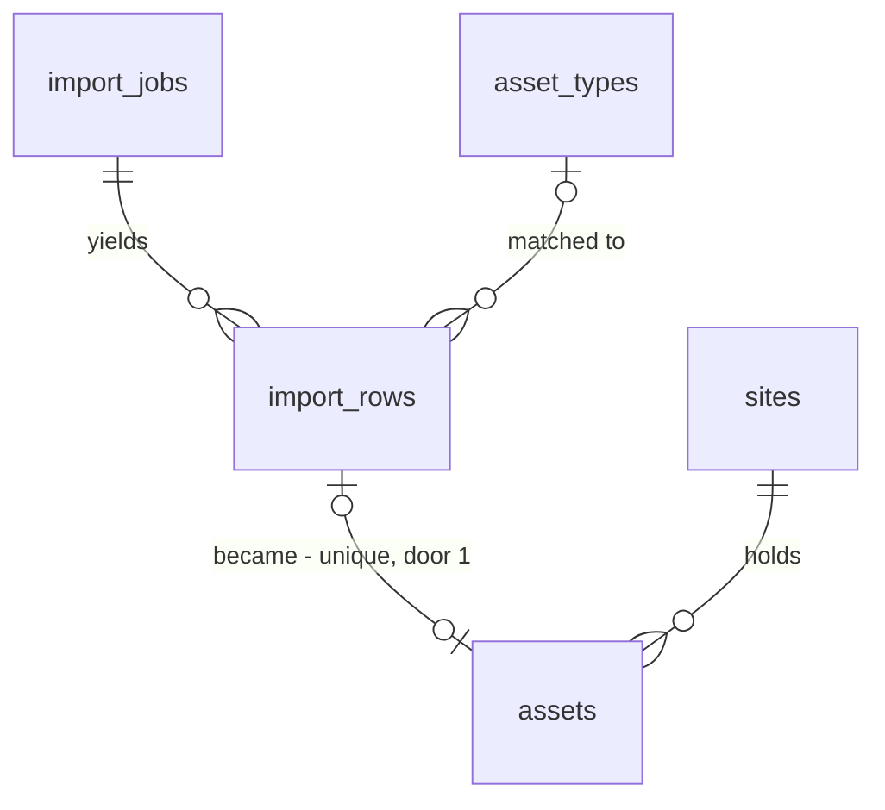

# Asset import, step 4: review the extracted rows and add them to the site as assets

## Problem

An "Extracted" job (import-extract) holds candidate rows nobody can see or change. The job list
says "338 rows, 14 need an equipment type" and stops there: the 14 cannot be given a type, a unit
read twice (a list repeated on two sheets, or a unit already on the site) cannot be dropped, a
mis-read unit # cannot be corrected, and nothing turns a row into an asset. The estimator who
wanted to skip retyping the list still retypes it through "Add asset", now with the extracted
rows as a reference they can only read in the database. Every step before this one has cost a
Claude spend and produced nothing the site register shows.

The source (ROADMAP.md Phase 2 item 4 and "Asset import pipeline" steps 5 and 6) gives no user
evidence or date. It fixes the scope: a review grid where rows are edited, duplicates merged and
unknown types mapped, then a commit that writes the rows to `assets` while the job keeps a record
of each row.

When this ships, a writer opens "Review rows" on an "Extracted" job, sees every row with what
the file said beside what it will become, gives the unrecognised types a type once per spelling,
skips duplicates, corrects what Claude mis-read, and presses "Add 336 assets". The site register
then lists them with source `import`, and the job reads "Added to site: 336 assets, 2 skipped".

## Flow

This reuses the import job plumbing (`writer()` guard, `isUuid`, `ImportJobStore`, `ImportJobList`,
the compare-and-set RPC pattern of AD-015 and AD-041), `validateAsset` and its field limits for
every row edit, `AssetTypeCatalog.list` for the type choices, `matchAssetType`'s `normalized` for
grouping spellings, `SiteRegister.get` for the site's existing assets, and `Select`, `TextInput`,
`StatusPill`, `Button` and the `DiscardPrompt` confirm pattern.

1. `ImportJobList` (exists) shows "Review rows" on an `extracted` or `committed` job, linking to `/imports/[jobId]` (door 5).
2. The review page reads `ImportReviewReader.forJob(jobId)` (door 6): the job (site, status, commit result) and all its rows in `position` order, fetched in pages of 1,000 so the PostgREST row cap never truncates it; `SiteRegister.get` (exists) gives the site's current assets.
3. `reviewRowsOf` (new, pure, placement in `web/domain/imports`) flags each row: needs a type, too long for the asset form, low confidence, duplicate within the job, already on the site. The page renders one page of 100 rows, all rows or only those needing attention.
4. Row edits: `updateImportRowAction`, `skipImportRowAction`, `mapImportTypeAction` (new Server Actions) -> `writer()` (exists) -> `validateAsset` (exists) -> `ImportRowStore` (door 6) as the member. The trigger `import_rows_frozen` (door 4) refuses any row change unless its job is `extracted`.
5. `commitImportAction` -> `writer()` -> `ImportJobStore.commit` (door 6) -> `public.commit_import` (door 3): one transaction inserts an `assets` row (`source = 'import'`) per included row, links each row to its asset (door 1) and moves the job `extracted` -> `committed` (door 2).
6. Out: the page re-reads as committed and read-only; `SiteRegister.get` (exists) lists the new assets; `ImportJobReader.forSite` (exists, gains the commit columns) shows "Added to site".

## Impact

| Front | What changes |
| --- | --- |
| domain | new term: **review** (of an import job), the step where a writer fixes the extracted rows before they become assets |
| domain | new term: **skipped row**, a row kept on the job for the record but never added as an asset. Skipping is how a duplicate is merged: keep one, skip the rest |
| domain | new term: **commit** (of an import job), adding every included row to the site as an asset, once. Status `committed` (shown "Added to site") |
| domain | existing term: status `extracted` meant "rows stored, nothing more possible"; it now means "rows stored and editable". `ImportJobList` (pill, controls), `extractImportAction` (answers from the stored result), `discard` and the new trigger branch on it |
| domain | existing term: `assets.source = 'import'` existed with no writer; this is its first. The site register already shows `source` (`AssetView.source`) |
| domain | existing term: AD-023 caps lists at 500 rows. The review reader is the first exception: a job can hold 2,000 rows (more from a PDF), and the grid, duplicate flags and commit count must see every row. It pages server-side instead |
| stored data | `import_rows` gains `skipped` and `asset_id`; `import_jobs` gains `committed`, `committed_at`, `committed_by`, `committed_count`; `assets` gains `unique (id, org_id)` (its `id` is already the primary key, so no existing pair can collide). The live project has 0 import jobs and 0 import rows (checked 2026-10-27): nothing to backfill |
| stored data | deleting an asset that came from an import now nulls `import_rows.asset_id` instead of being refused; the row still records that it was committed through the job's `committed_count` |
| screens | `/sites/[siteId]/import` gains "Review rows" and the `committed` state; new screen `/imports/[jobId]` |
| screens | Discard is no longer offered on a `committed` job |
| composition | `getContainer()` gains the review reader, the row store and `commitImport` |
| decisions | doors 1 to 6 reach past this feature (Phase 3 agreements count assets, and later imports copy the review shape) and get `AD-NNN` rows; AD-023 gets the exception noted in door 6; AD-028 is extended by door 5 |
| types | `database.types.ts` regenerated after the migration |
| docs | `CONTEXT.md` "Asset import (M5)" step 4, Build log line, ROADMAP Phase 2 item 4 ticked |
| security advisors | the migration must leave `get_advisors` at the two accepted findings |

## Relations

One-way constraints: a row becomes at most one asset and an asset comes from at most one row
(door 1); a skipped row never has an asset (door 1); a row can point only at an asset of its own
org (door 1, composite reference); a `committed` job has a commit time, a committer and a count of
at least 1, and no other status has them (door 2); while a job is not `extracted`, none of its rows
can be changed or deleted except by the cascade of the job itself (door 4). No columns and no types
here.

## Surface

| Route | In | Out | Status |
| --- | --- | --- | --- |
| page `GET /imports/[jobId]` | `jobId`, `?show=attention`, `?page=<n>` | the review grid, or the committed record | `200`, `404`, redirect to `/login` |
| `POST` Server Action `updateImportRowAction` | `rowId`, form `assetTypeId`, `unitNo`, `typeModel`, `location` | state `saved` · `invalid` with field errors · `locked` · `forbidden` · `not_found` · `unavailable` | `200` |
| `POST` Server Action `skipImportRowAction` | `rowId`, `skipped` | state `saved` · `locked` · `forbidden` · `not_found` · `unavailable` | `200` |
| `POST` Server Action `mapImportTypeAction` | `jobId`, `rawText`, `assetTypeId` | state `mapped` with `rows` · `invalid` · `locked` · `forbidden` · `not_found` · `unavailable` | `200` |
| `POST` Server Action `commitImportAction` | `jobId` | state `committed` with `added`, `skipped` · `incomplete` with `count` · `nothing_to_add` · `not_ready` · `forbidden` · `not_found` · `unavailable` | `200` |

## Landing

| One-way door | Literal shape | Alternative rejected |
| --- | --- | --- |
| 1. each row's fate on `import_rows` | `alter table public.assets add constraint assets_id_org_id_key unique (id, org_id)`; `alter table public.import_rows add column skipped boolean not null default false, add column asset_id uuid, add constraint import_rows_asset_id_key unique (asset_id), add constraint import_rows_asset_fkey foreign key (asset_id, org_id) references public.assets (id, org_id) on delete set null (asset_id), add constraint import_rows_skipped_never_committed check (not (skipped and asset_id is not null))` (Postgres 17 supports the column list on `set null`) | deleting a row to merge or drop it, because the roadmap says the job keeps a record of each row and a deleted row cannot show what was dropped; `assets.import_row_id`, because every asset query would carry an import column forever and AD-030 hard-deletes assets, which a link the other way survives; a plain `on delete set null` on the composite key, because it would null `org_id` too and break AD-003 |
| 2. commit state on `import_jobs` | status check becomes `status in ('uploading','uploaded','parsed','unreadable','extracting','extracted','committed')`; new columns `committed_at timestamptz`, `committed_by uuid`, `committed_count integer check (committed_count >= 1)`; check `import_jobs_committed_state` `(status = 'committed') = (committed_at is not null and committed_by is not null and committed_count is not null)`; the existing `import_jobs_read_at_iff_read`, `import_jobs_counts_only_read`, `import_jobs_extract_state` and `import_jobs_extracted_is_complete` checks are rewritten to treat `committed` as a read, extracted job | marking only the rows, because "has this job been added?" would need a scan and a job with every row skipped would look uncommitted; a separate `import_commits` table, because a job commits once and a second table adds a join with no second row ever |
| 3. the commit write | `public.commit_import(p_job_id uuid) returns integer`, security invoker, `search_path = ''`: role check via `private.has_org_role` (`42501`), job missing or outside the caller's orgs `P0002`, `select ... for update` on the job and `40001` unless `extracted`, `23514` when an included row has no type or a field over the asset form limits (40, 120, 300 characters) or there is no included row; then `insert into public.assets (org_id, site_id, asset_type_id, unit_no, type_model, location, source)` one per included row with `source = 'import'`, `update import_rows set asset_id`, and the job to `committed` with `committed_at = now()`, `committed_by = auth.uid()`, `committed_count`; returns the count. Adapter: `ImportJobStore.commit` maps `40001` on a `committed` job to the stored result | inserting assets through PostgREST and then updating the job, because there is no transaction across requests (AD-015) and a crash between them makes the retry add every asset twice; `AssetStore.create` per row, because it writes `source = 'manual'` and 2,000 requests cannot be one transaction |
| 4. rows frozen outside review | `private.import_rows_frozen()` trigger function (security definer, `search_path = ''`), `before update or delete on public.import_rows for each row`: reads the job `for share`; no job row (the cascade of a discard) passes; a job not `extracted` raises `55000` (object not in prerequisite state). `commit_import` updates the rows before it changes the job's status. Adapters map `55000` to `locked` | checking the job's status in the adapter before the update, because a commit landing between the check and the update would add the asset from the old values; routing every edit through an RPC, because a trigger also covers a direct PostgREST write and the cascade |
| 5. the review URL | `/imports/[jobId]`, flat by the job's uuid, with `?show=attention` and `?page=<n>` (1-based, 100 rows a page) | `/sites/[siteId]/import/[jobId]`, because a later "Imports" sidebar list and emails link to a job knowing only its id (AD-024, AD-028) |
| 6. the review ports | `ImportReviewReader.forJob(jobId): Promise<ImportReview \| null>` with `ImportReview = { job: { id, siteId, siteName, originalName, status, committed: { added: number; skipped: number; at: Date } \| null }; rows: ImportRowView[] }` and `ImportRowView = { id, position, assetTypeRaw, assetTypeId, unitNo, typeModel, location, confidence, sourceRef, skipped, assetId }`, all rows, read in `.range()` pages of 1,000; `ImportRowStore.update(rowId, value: AssetValue): Promise<WriteResult \| { ok: false; code: "locked" }>`, `setSkipped(rowId, skipped)`, `mapType(jobId, rawNormalized, assetTypeId): Promise<{ ok: true; rows: number } \| ...>` (only rows with `asset_type_id is null`); `ImportJobStore.commit(jobId): Promise<{ ok: true; added: number; skipped: number } \| { ok: false; code: WriteFailure \| "not_ready" \| "incomplete" }>` | one wide `ImportJobStore` for row writes too, because the page and the commit would depend on methods they never call (AGENTS.md ISP, AD-023); a 500-row cap like every other reader, because the duplicate flags and the "Add N assets" count would then be wrong for a job of 2,000 rows |

- Nothing else in this change is hard to reverse: the page size, the attention filter, the flag rules, the copy and the column order are app-side.

## Criteria

"Writer" means owner, admin or estimator. An **included** row is one not skipped. A row's
`normalized` text is as in import-extract. A row's **duplicate key** is its `asset_type_id` and
its `normalized` `unit_no`, and only exists when both are not null.

### S1: A writer sees every extracted row beside what it will become (P1)

**Acceptance Criteria**

1. WHILE a job is `extracted` or `committed` the job list SHALL show a "Review rows" link to `/imports/<jobId>` for every member
2. WHEN a member opens `/imports/<jobId>` for an `extracted` job THEN the system SHALL list its rows in `position` order, 100 per page, each with: equipment type (the type's `Name (CODE)`, or "Needs a type"), "In file" (`asset_type_raw`, or "-"), unit #, type/model, location/access, confidence and source reference
3. The system SHALL show above the rows the counts `<n> rows · <a> included · <k> need attention` and the controls "All rows" and "Needs attention", where "Needs attention" (`?show=attention`) lists only included rows carrying at least one flag
4. WHEN the job has more than 100 rows in the shown set THEN the system SHALL show "Previous" and "Next" links and `Rows <from>-<to> of <total>`, and IF `?page` is not a whole number from 1 to the last page THEN the system SHALL show page 1
5. WHEN "Needs attention" has no rows THEN the system SHALL show "Every row is ready to add."
6. WHEN the job has 0 rows THEN the system SHALL show "No equipment was found in this file." and no commit button
7. IF the job id is malformed, missing, of another org, or the job is not `extracted` or `committed` THEN the system SHALL respond 404
8. The system SHALL read every row of the job, whatever their number, so a job of 2,000 rows shows `2,000 rows`

**Independent test:** as the demo owner, open the review of an extracted job of 120 rows; page 2 shows rows 101-120.

### S2: Each row is flagged for what stops it becoming a good asset (P1)

**Acceptance Criteria**

9. WHEN an included row has `asset_type_id` null THEN the system SHALL flag it "Needs a type"
10. WHEN an included row's `unit_no`, `type_model` or `location` is longer than 40, 120 or 300 characters THEN the system SHALL flag it "Too long" naming the field
11. WHEN an included row has `confidence` `low` THEN the system SHALL flag it "Check this row"
12. WHEN two or more included rows share a duplicate key THEN the system SHALL flag every row after the first in position order "Same as row <position of the first>"
13. WHEN an included row's duplicate key equals that of an asset already on the job's site THEN the system SHALL flag it "Already on this site"
14. The system SHALL NOT flag a row whose `unit_no` is null as a duplicate of anything
15. The system SHALL NOT flag a skipped row, and SHALL show it with the label "Skipped" and its fields dimmed

**Independent test:** a job holding "RTU-1" twice and an RTU-2 that the site already has shows "Same as row 1" on the second RTU-1 and "Already on this site" on RTU-2.

### S3: A writer fixes rows (P1)

**Acceptance Criteria**

16. WHEN a writer presses "Edit" on a row of an `extracted` job THEN the system SHALL show that row's fields as a form (equipment type from the org's types, unit #, type/model, location/access) and "Save" and "Cancel"
17. WHEN a writer saves a row edit that passes `validateAsset` THEN the system SHALL store the four values on that row and re-render the grid with its flags recomputed
18. IF a row edit fails `validateAsset` THEN the system SHALL store nothing and show each field's message under that field
19. The system SHALL NOT change `asset_type_raw`, `confidence`, `source_ref` or `position` on any edit
20. WHEN unmatched included rows exist THEN the system SHALL list each distinct `normalized` `asset_type_raw` among them once, with its count and a type choice, and WHEN a writer applies a type to one THEN the system SHALL set that type on every row of the job with that `normalized` `asset_type_raw` and `asset_type_id` null, and report `Applied to <n> rows`
21. The system SHALL NOT change a row that already has a type when a mapping is applied
22. WHEN a writer presses "Skip" on an included row THEN the system SHALL mark it skipped, and "Include" on a skipped row SHALL unmark it
23. IF any row edit, mapping or skip names a type id that is not one of the org's types THEN the system SHALL store nothing and return `invalid`

**Independent test:** map "Widget" to a type once; all 14 rows saying "Widget" gain it and "Needs a type" drops by 14.

### S4: Included rows become assets once (P1)

**Acceptance Criteria**

24. WHILE a job is `extracted` and every included row has a type and no "Too long" flag, the review page SHALL show the button "Add <a> assets to <site name>" (`1 asset` in the singular)
25. WHILE an included row has no type or a "Too long" flag the system SHALL keep that button disabled and show `<k> rows need a fix before they can be added`
26. WHEN a writer presses the button THEN the system SHALL ask "Add <a> assets to <site name>? Skipped rows stay on the import." with "Add assets" and "Cancel", and write nothing until "Add assets"
27. WHEN a writer confirms THEN the system SHALL, in one transaction, insert one `assets` row per included row on the job's site with its `asset_type_id`, `unit_no`, `type_model`, `location` and `source` `import`, set each included row's `asset_id` to its asset, and set the job `committed` with `committed_at`, `committed_by` the member and `committed_count` the number added
28. IF the commit fails at any point THEN the system SHALL leave no new asset, no `asset_id` and the job `extracted`, return `unavailable`, show "We couldn't add these assets. Try again." and log the error with `console.error`
29. IF the commit is called when an included row has no type or a field over its limit THEN the system SHALL write nothing and return `incomplete` with the number of such rows
30. IF the commit is called with no included row THEN the system SHALL write nothing and return `nothing_to_add`
31. IF the commit is called twice for the same job, at once or one after the other, THEN the system SHALL add the assets once and both calls SHALL return `committed` with the same `added` and `skipped`
32. WHEN the commit succeeds THEN the system SHALL show the site register's link "View <site name>" and the line `Added to site: <added> assets, <skipped> skipped` (dropping `, <skipped> skipped` when 0)
33. WHEN an asset added by a commit is later deleted THEN the system SHALL delete it and set that row's `asset_id` to null, keeping the row and the job's `committed_count`

**Independent test:** commit a job with 2 included and 1 skipped row; the site register lists 2 more assets with source import, and pressing the button again in a second tab answers with the same result.

### S5: A committed import is a record, and only writers change anything (P1)

**Acceptance Criteria**

34. WHILE a job is `committed` the review page SHALL show every row read-only, with "Added" or "Skipped" on each, no edit, skip, mapping or commit control
35. WHILE a job is `committed` the job list SHALL show a neutral pill "Added to site", the line from AC 32 and no Discard control
36. IF a row change or a discard reaches a job that is not `extracted` (including one committed meanwhile) THEN the system SHALL change nothing and return `locked`, shown as "This import was already added to the site."
37. IF a change to a row of a job not `extracted` is written directly to the database THEN the database SHALL refuse it
38. IF a viewer opens the review page THEN the system SHALL show the rows and flags with no edit, skip, mapping or commit control
39. IF a viewer's request reaches any of the four actions THEN the system SHALL write nothing and return `forbidden`
40. IF an action names a malformed, missing or other-org row or job id THEN the system SHALL change nothing and return `not_found`
41. The system SHALL read and write rows and assets with the signed-in member's client, never a service-role key
42. The system SHALL take the site of every new asset from the job, never from the request

**Independent test:** after committing, an edit replayed against a row returns `locked`, and as a viewer the page shows no buttons.

## Out of scope

| Excluded | Why |
| --- | --- |
| Adding a row the file did not have, or splitting one | add the asset on the site after the commit, with "Add asset" |
| Undoing a commit as a whole | assets can be deleted one by one (AD-030); a bulk undo would have to know which were edited since |
| Updating an existing asset from an import row ("Already on this site" merged into it) | flagged and skipped instead; overwriting a record the estimator may have corrected is a later decision |
| Per-org synonyms learned from the mappings | named in import-extract's out-of-scope; the mappings this feature stores are the evidence for it |
| Re-extracting, or reviewing a job while it is `extracting` | rows are complete only at `extracted` |
| Keyboard grid navigation and inline cell editing | one row form at a time first; Linear-style density is a later polish |
| Sorting and column filters beyond "Needs attention" | position order is the order of the customer's file, which is what the estimator checks against |
| An "Imports" sidebar page listing jobs across sites | the sidebar item stays disabled until a later item |

## Assumptions

| Assumption | Chosen default | Rationale | Confirmed? |
| --- | --- | --- | --- |
| Duplicates within the file and against the site | flagged, never skipped automatically; the writer skips | a matching unit # can still be two units (two buildings); a silent skip loses equipment from the agreement. User chose the recommendation, 2026-10-27 | y |
| Mapping an unrecognised spelling | one choice applies to every untyped row with the same spelling (AC 20); single rows through "Edit" | a list of 300 units says "Roof top HVAC" the same way every time; 14 identical choices is the retyping this import removes | n |
| Merging duplicates | "merge" means keep one and skip the others; no field-by-field merge | the rows are the same unit read twice; a merge form is cost with no evidence it is needed. User chose the recommendation, 2026-10-27 | y |
| Low-confidence rows | flagged "Check this row", never blocking the commit | Claude's confidence is a band, not a measure (import-extract); blocking on it would make every PDF a chore | n |
| Grid on a phone | below 768px each row is a stacked card with the same fields and controls; 768px and up a table that scrolls inside its own container | DESIGN.md's kanban rule (scroll in the component, never the page); detail settled with `/impeccable` while building | n |
| Page size | 100 rows a page | one chunk's worth; a 2,000-row job is 20 pages and stays fast on a phone | n |
| Who committed | `committed_by` is the member's user id; the screen shows no name yet | audit (M15) needs it; showing it needs the email lookup the jobs already do, and nobody asked for it | n |

**Open questions:** none - all resolved or logged above.

## Observable

| Surface | Decision | Landing |
| --- | --- | --- |
| screen `/imports/<id>` | empty state | AC 5 (nothing needs attention), AC 6 (no rows) |
| screen `/imports/<id>` | loading state | n/a decision - a `loading.tsx` like the import page's, and each action's button pending (existing pattern of `ReadFileControl`) |
| screen `/imports/<id>` | error state | AC 18, 23, 28, 36 |
| screen `/imports/<id>` | unauthorised | AC 7 (other org is 404), AC 38, 39; signed out redirects to `/login` (existing `MemberGate`) |
| screen `/imports/<id>` | density and ordering | AC 2, 3, 4 (position order, 100 a page, attention filter) |
| screen `/imports/<id>` | destructive action confirms | AC 26 (commit confirms); Skip is reversible (AC 22) and needs none |
| screen `/sites/<id>/import` | states added | AC 1, 35 |
| collection: import rows | grouping, naming, ordering, duplicates, the exception that does not fit | AC 2 (position order), AC 12-14 (duplicates), AC 20 (grouped by spelling), AC 9 (a row matching no type) |
| collection: the mapping list | grouping and ordering | AC 20 (one entry per `normalized` spelling); a row with no `asset_type_raw` has no spelling and is fixed through Edit |
| Server Actions (all four) | error shape and codes | Surface statuses; AC 18, 23, 28-30, 36, 39, 40 |
| Server Actions (all four) | who may call them | AC 39, 41 |
| Server Actions (all four) | versioning, rate limits | n/a - same-origin Server Actions behind a staff session; a repeated commit is answered from the stored result (AC 31) |
| copy: commit confirm and result | what the reader does next | AC 26 (says skipped rows stay), AC 32 (link to the site) |

## Sources

- ROADMAP.md Phase 2 item 4 and "Asset import pipeline" steps 5 and 6: edit rows, merge duplicates, map unknown types, commit to `assets`, the job keeps a record of each row
- `.specs/features/import-extract/plan.md`: `import_rows`, `matchAssetType`, the `extracted` status
- STATE.md AD-003, AD-004, AD-015, AD-023, AD-028 to AD-030, AD-038 to AD-044
