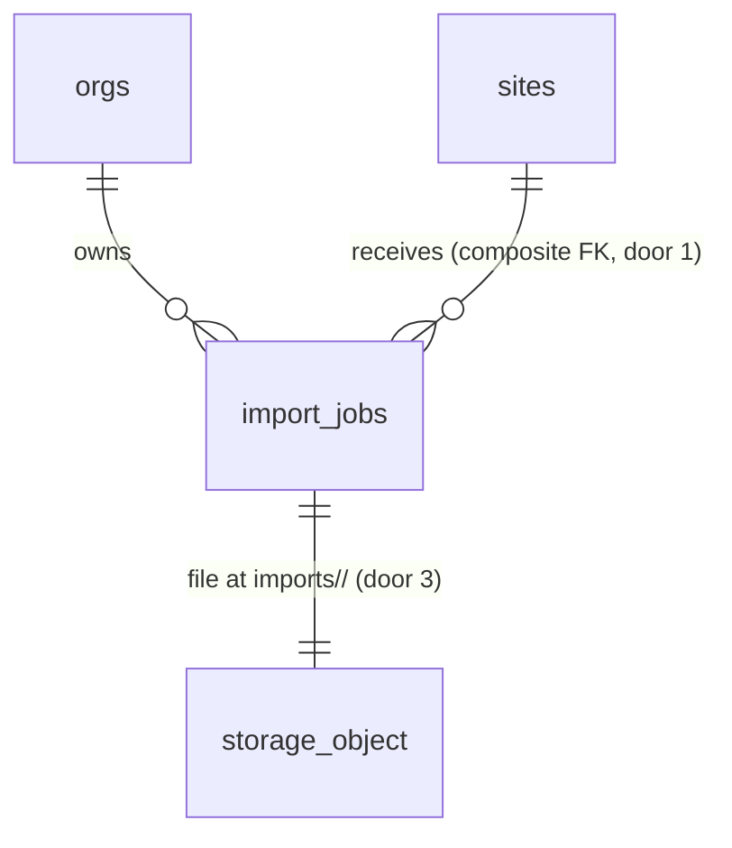

# Asset import, step 1: upload a customer's equipment list to a site and record an import job

## Problem

A customer's equipment list arrives as a spreadsheet, a Word table or a PDF, often with dozens of
units. Today the only way to get it into a site's register is the one-asset-at-a-time form on
`/sites/<id>/assets/new`, retyping every row. The file itself goes nowhere in the product. It stays
in someone's inbox, so nobody can later see which list a site's equipment came from. The project has
no Storage bucket and no storage policy (checked on the live project, 2026-10-26), so there is
nowhere to keep it.

The source (ROADMAP.md Phase 2, item 1: "Upload to Storage and import jobs") gives no user evidence
or date. It is the first step of the M5 pipeline: upload, parse, extract, normalize, review, commit.
Parsing, extraction, the review grid and commit are the next three roadmap items. They all start
from a stored file and a job row, which is what this item delivers.

When this ships, an owner, admin or estimator opens a site's equipment register, presses "Import
equipment list", picks one xlsx, csv, docx or pdf file up to 20 MB, and sees it listed on that site
as an import job in status "Uploaded", with its file name, size, who uploaded it and when. They can
discard a job they uploaded by mistake. Nothing is parsed yet, and no asset is written.

## Flow

This reuses the record-forms write shape (AD-029: a Server Action refuses non-writers via
`canWriteRecords`, then a pure `validate…`, then a store port as the member under RLS),
`SiteRegister` for the site read, `getContainer()`, `Button`, `EmptyPanel`, and the `(app)`
`not-found.tsx` and `error.tsx`. No new npm dependency. The browser upload is a plain `fetch` `PUT`,
so no Supabase client reaches the client bundle (AD-014).

1. `GET /sites/[siteId]/import` -> `web/proxy.ts` (exists) -> `MemberGate` (exists) -> the import page reads the site through `SiteRegister` (exists) and the site's jobs through the import job read (door 4). A malformed, missing or foreign site id calls `notFound()`.
2. The writer picks a file -> `startImport` (new Server Action) refuses a non-writer, then `validateImportFile` (new, pure) checks the extension, size and name -> `ImportJobStore.start` (door 4) inserts the `import_jobs` row as the member (status `uploading`, door 1), then asks Storage for a signed upload URL for `<org_id>/<job_id>` in bucket `imports` (doors 2 and 3). It returns `{ jobId, signedUrl, contentType }`.
3. The browser sends `PUT signedUrl` with the file bytes and `content-type` set to the value the server returned. Storage refuses a file over 20 MB or of another MIME type at the bucket (door 2).
4. On a 2xx -> `confirmImport(jobId)` (new Server Action) -> `ImportJobStore.confirmUploaded` (door 4) reads the object's info as the member. If it exists and its size equals the declared size, it moves the row `uploading` -> `uploaded` with a compare-and-set on status.
5. Out: the page re-reads and lists the job. A job left in `uploading` (tab closed, network lost) stays listed as "Upload not finished" with Discard.
6. Discard -> `discardImport(jobId)` (new Server Action) -> `ImportJobStore.discard` (door 4) deletes the row first, then the object. A failed object delete is logged and leaves an orphan object that nothing reads.

## Impact

| Front | What changes |
| --- | --- |
| domain | new term: **import job**, meaning one uploaded file destined for one site's register, with a status. It lives in `import_jobs` and `web/domain/imports`. The next three Phase 2 items extend its status and read its file |
| domain | existing term: asset `source = 'import'` is still written by nothing. The commit item writes it. This item does not touch `assets` |
| stored data | new table `import_jobs` and new bucket `imports`, both empty. Nothing to migrate or backfill. The first `storage.objects` policies in the project |
| screens | `/sites/[siteId]` gains an "Import equipment list" link for writers, next to "Add asset". `SiteRegisterView` already takes the role (record-forms) |
| composition | `getContainer()` gains `ImportJobStore` and the import job read |
| config | none. The upload goes browser -> Storage, so `serverActions.bodySizeLimit` stays at its 1 MB default |
| decisions | doors 1-4 reach past this feature (parse, extract, review and commit build on them) and get `AD-NNN` rows in `.specs/STATE.md` |
| types | `database.types.ts` is regenerated after the migration (CONTEXT.md rule) |
| docs | `CONTEXT.md` "Asset import (M5)" gets What we built; Build log line; ROADMAP Phase 2 item 1 ticked |
| security advisors | new table and policies must leave `get_advisors` at the two accepted findings |

## Relations

One-way constraints: `import_jobs (site_id, org_id)` references `sites (id, org_id)` (AD-003), and
the job carries `unique (id, org_id)` so later per-row tables can reference it the same way. The
status check allows only `uploading` and `uploaded` (door 1). A Storage object in `imports` exists
only under a folder pair `<org_id>/<job_id>` naming a job of that org in status `uploading` at
insert time (door 3). No columns and no types here.

## Surface

Every route is new. `GET` answers `307` to `/login` when signed out (AD-018). The Server Actions
post to the page route. The Storage `PUT` is Supabase's endpoint, listed because the browser
calls it directly.

| Route | In | Out | Status |
| --- | --- | --- | --- |
| `GET /sites/[siteId]/import` | `siteId` | upload form (writers), job list for the site | `200`, `404`, `307` |
| `POST` Server Action `startImport` | `siteId` (route), `fileName`, `size`, `extension` | state `started` with `jobId`, `signedUrl`, `contentType` (amended 2026-10-26, user) · state `invalid` · `forbidden` · `not_found` · `unavailable` | `200` |
| `PUT <signedUrl>` (Supabase Storage) | file bytes, `content-type`, `x-upsert: false` | `{ Key }` | `200`, `400`, `409`, `413`, `415` |
| `POST` Server Action `confirmImport` | `jobId` | state `uploaded` · `upload_missing` · `forbidden` · `not_found` · `unavailable` | `200` |
| `POST` Server Action `discardImport` | `jobId` | state `discarded` · `forbidden` · `not_found` · `unavailable` | `200` |

## Landing

| One-way door | Literal shape | Alternative rejected |
| --- | --- | --- |
| 1. the `import_jobs` table and its status | `public.import_jobs (id uuid default gen_random_uuid(), org_id ... on delete cascade, site_id, original_name text, content_type text, size_bytes bigint, status text not null default 'uploading' check (status in ('uploading','uploaded')), created_by uuid default auth.uid(), created_at, updated_at)`, `unique (id, org_id)`, FK `(site_id, org_id) -> sites (id, org_id)`. RLS: members read, owner/admin/estimator insert, update and delete (same policies as `assets`). Later items extend the check (AD-005) | listing every future status now (`extracting`, `review`, `committed`, `failed`), because states nothing can reach are unprovable and the next items own them; an `imported_from` column on `assets` alone, because the review grid needs per-job state before any asset exists; a job per customer (user chose one site per job, 2026-10-26) |
| 2. the `imports` bucket | private bucket `imports`, `file_size_limit = 20971520` (20 MB), `allowed_mime_types = { application/pdf, text/csv, application/vnd.openxmlformats-officedocument.spreadsheetml.sheet, application/vnd.openxmlformats-officedocument.wordprocessingml.document }`. Created in the migration with `insert into storage.buckets` | a public bucket, because customer equipment lists name buildings and access routes; one bucket for every file kind (logos, signed PDFs), because limits and MIME rules differ per kind and a policy mistake would expose all of them; trusting the browser's `File.type`, because Windows reports `.csv` as `application/vnd.ms-excel` (the server sends the canonical type for the extension instead) |
| 3. the object key and storage policies | key `<org_id>/<job_id>`, with no file name in the key (the name is in `original_name`). Policies on `storage.objects` for `bucket_id = 'imports'`: `select` for members of the org `(storage.foldername(name))[1]::uuid`; `insert` only for owner/admin/estimator AND only when `exists (import_jobs where id = (storage.foldername(name))[2]::uuid and org_id = (storage.foldername(name))[1]::uuid and status = 'uploading')`; `delete` for owner/admin/estimator of the org; no `update` (no overwrite). Helpers stay `private.is_org_member` / `has_org_role` (AD-004) | org folder alone for insert, because then any writer can drop arbitrary files into the org folder with no job row; the file name in the key, because names carry spaces, accents and slashes that need sanitising and leak into URLs; `upsert: true`, because a retried upload would silently replace a file a later step already read |
| 4. the upload protocol and the port | signed upload URL: `ImportJobStore` in `web/application/ports` with `start(orgId, siteId, file) -> { ok: true, jobId, signedUrl, contentType } \| { ok: false, code }`, `confirmUploaded(jobId) -> { ok: true } \| { ok: false, code: 'upload_missing' \| WriteFailure }` and `discard(jobId) -> WriteResult`. An import job read port returns a site's jobs newest first (capped at 500, AD-023). The browser `PUT`s with `fetch`; `createSignedUploadUrl` runs server-side as the member, so the insert policy (door 3) decides | one Server Action carrying the file (user chose the signed URL, 2026-10-26: it needs `bodySizeLimit` raised and a host such as Vercel caps function bodies at 4.5 MB, below a scanned PDF); `supabase-js` `uploadToSignedUrl` in the browser, because it puts `@supabase/*` in a client bundle, which AD-014 forbids |
| 5. (added while building, 2026-10-26) reading the key in the storage policies; corrects door 3's `foldername(name)[2]` | `storage.foldername('<org>/<job>')` returns only `{<org>}`, so the policies read the org as `private.uuid_or_null((storage.foldername(name))[1])` and the job as `private.uuid_or_null(storage.filename(name))`, and require `array_length(storage.foldername(name), 1) = 1`. `private.uuid_or_null(text)` is an immutable SQL function returning `null` for any non-uuid text | a plain `::uuid` cast, because a malformed key would raise `22P02` instead of the policy refusal `42501`; a key `<org>/<job>/<file name>`, because door 3 already rejected file names in keys |
| 6. (added after verification, 2026-10-26) the columns and checks door 1's literal left out | `import_jobs` also has `created_by_email text default (auth.jwt() ->> 'email')`, and the checks `char_length(original_name) between 1 and 255`, `content_type in` the four types of door 2, and `size_bytes between 1 and 20971520`, as in `supabase/migrations/20261026200326_import_upload.sql` | leaving the bounds to the app only, because a direct insert under RLS (the SQL proofs, a later service-role caller) would then accept a row the bucket can never hold; a membership join for the uploader's email, because no public table holds emails |

- Nothing else in this change is hard to reverse: file-name length, labels, copy and the 20 MB figure in the UI are app-side and change with the bucket limit.

## Criteria

"Writer" means owner, admin or estimator (`canWriteRecords`). "Accepted file" means extension
`.xlsx`, `.csv`, `.docx` or `.pdf` (case-insensitive), size 1 to 20,971,520 bytes, and a name of
1 to 255 characters.

### S1: Upload a file to a site (P1)

A writer stores a customer's equipment list against the site it describes.

**Acceptance Criteria**

1. WHEN a writer opens `/sites/<id>` THEN the system SHALL show an "Import equipment list" link to `/sites/<id>/import`
2. WHEN a writer opens `/sites/<id>/import` THEN the system SHALL show the site name, a link back to `/sites/<id>`, a file picker whose `accept` is `.xlsx,.csv,.docx,.pdf`, the text "Excel, CSV, Word or PDF, up to 20 MB", and an "Upload" button
3. WHEN a writer uploads an accepted file THEN the system SHALL insert one `import_jobs` row with that site, the member's `org_id`, the file's original name, its size in bytes, the canonical content type for its extension, `created_by` = the member and status `uploading`, and SHALL store the file at `imports/<org_id>/<job_id>`
4. WHEN the Storage upload returns 2xx and the stored object's size equals the job's `size_bytes` THEN the system SHALL set the job's status to `uploaded` and show it at the top of the site's job list
5. The system SHALL send the file with `content-type` from its extension: `.pdf` -> `application/pdf`, `.csv` -> `text/csv`, `.xlsx` -> `application/vnd.openxmlformats-officedocument.spreadsheetml.sheet`, `.docx` -> `application/vnd.openxmlformats-officedocument.wordprocessingml.document`, regardless of the browser's `File.type`
6. WHILE an upload is in progress the system SHALL disable the "Upload" button, label it "Uploading…", and keep the chosen file name visible

**Independent test:** as the demo owner, on one demo site, upload a small csv and a pdf. Both appear as "Uploaded", and both objects exist in bucket `imports` under the org's folder.

### S2: Refuse what cannot be imported (P1)

A wrong file is refused before or at Storage, with a message that says why, and no job is left
claiming it uploaded.

**Acceptance Criteria**

7. IF the chosen file's extension is not `.xlsx`, `.csv`, `.docx` or `.pdf` THEN the system SHALL create no job and show "Choose an Excel (.xlsx), CSV, Word (.docx) or PDF file"
8. IF the chosen file is 0 bytes THEN the system SHALL create no job and show "This file is empty"
9. IF the chosen file is larger than 20,971,520 bytes THEN the system SHALL create no job and show "Files can be up to 20 MB"
10. IF the file name is longer than 255 characters THEN the system SHALL create no job and show "File name must be 255 characters or fewer"
11. The bucket `imports` SHALL refuse an object larger than 20,971,520 bytes or with a content type outside the four in criterion 5, even when the request bypasses the page
12. IF the Storage `PUT` fails or `confirmImport` finds no object or a size mismatch THEN the system SHALL leave the job in `uploading`, never set `uploaded`, and show "The upload didn't finish. Try again." with the file still chosen
13. IF `confirmImport` is called for a job already `uploaded` THEN the system SHALL change nothing and return state `uploaded`

**Independent test:** pick a `.txt`, an empty `.csv` and a 21 MB `.pdf`; each shows its message and `import_jobs` gains no row. A direct `PUT` of `text/plain` to a signed URL is refused by Storage.

### S3: See and discard a site's import jobs (P1)

Anyone in the org can see which lists were imported to a site; a writer can remove one uploaded
by mistake.

**Acceptance Criteria**

14. WHEN a member opens `/sites/<id>/import` THEN the system SHALL list that site's jobs newest first, each with the original file name, size (KB under 1 MB, otherwise MB with one decimal), the uploader's email, the upload date and a status label: `uploaded` -> "Uploaded", `uploading` -> "Upload not finished"
15. WHILE the site has no jobs the system SHALL show "No equipment lists imported yet" in the list area
16. WHEN a writer presses "Discard" on a job THEN the system SHALL show "Discard <file name>? The file will be deleted." with "Discard" and "Cancel", and SHALL delete nothing until "Discard" is pressed
17. WHEN the writer confirms discarding THEN the system SHALL delete the `import_jobs` row and the object `imports/<org_id>/<job_id>`, and the job SHALL disappear from the list
18. IF deleting the Storage object fails after the row was deleted THEN the system SHALL still report the job discarded and SHALL log the object key with `console.error`

**Independent test:** discard the csv uploaded in S1; it leaves the list, its row is gone, and the object is gone from the bucket.

### S4: Who may upload, read and fetch files (P1)

Files and jobs stay inside the org, and only writers create or remove them.

**Acceptance Criteria**

19. WHILE the member's role is viewer the system SHALL show the job list on `/sites/<id>/import` with no file picker, no "Upload" and no "Discard", and no "Import equipment list" link on `/sites/<id>`
20. IF a viewer's request reaches `startImport`, `confirmImport` or `discardImport` THEN the system SHALL write nothing and return state `forbidden`, shown as "You don't have permission to import equipment lists."
21. IF `/sites/<id>/import` names a malformed, missing or other-org site id THEN the system SHALL respond `404` with the existing not-found page
22. IF `confirmImport` or `discardImport` names a job id that is malformed, missing or in another org THEN the system SHALL change nothing and return state `not_found`
23. The system SHALL refuse, under RLS, a member reading, inserting or deleting an `imports` object whose first folder is another org's id, and an `anon` caller reading or writing any `imports` object
24. The system SHALL refuse, under RLS, inserting an `imports` object whose `<job_id>` folder names no job of that org in status `uploading`
25. The system SHALL take `org_id` from the signed-in member and `site_id` from the route, and SHALL ignore any `orgId`, `siteId`, `status` or `contentType` field in the submitted form
26. IF a database or Storage call fails unexpectedly THEN the system SHALL show "We couldn't upload the file. Try again." and log the error with `console.error`

**Independent test:** as a viewer, the page lists jobs with no controls, and a replayed `startImport` returns `forbidden`. The SQL proof runs under RLS as a member of org B and fails to read or insert under org A's folder.

## Out of scope

| Excluded | Why |
| --- | --- |
| Parsing, extraction, normalization, the review grid and commit | the next three Phase 2 roadmap items |
| Legacy `.xls` and `.doc`, images, zip files | the roadmap lists xlsx, csv, docx and pdf; Claude reads PDFs, and the parsers chosen are SheetJS and mammoth |
| Several files in one upload | one file is one job; a second list is a second upload |
| An org-wide imports page | jobs live on their site (user chose one site per job, 2026-10-26) |
| Downloading or previewing the uploaded file | nothing needs it before the review grid shows the source rows |
| Automatic cleanup of jobs stuck in `uploading` or of orphan objects | needs a scheduled job; the Discard control covers the visible case |
| Virus scanning | files are never served back to other users or executed in this item; revisit when the portal serves files |

## Assumptions

| Assumption | Chosen default | Rationale | Confirmed? |
| --- | --- | --- | --- |
| Uploading the same file twice | allowed; two jobs | no content hash yet; the review step is where duplicate rows matter, and Discard removes the extra job | n |
| Double click on Upload | the disabled pending button (AC 6) is the only guard; a replayed `startImport` makes a second `uploading` job | same stance as record-forms; the extra job is visible and discardable | n |
| A job stuck in `uploading` | stays listed as "Upload not finished" with Discard, forever until discarded; no retry of the same job | the signed URL lasts 2 hours, so a retry is simplest as a new upload; one fewer state | n |
| Size display and units | 20 MB means 20 × 1024 × 1024 = 20,971,520 bytes, matching the bucket limit | one number in the UI, the validator and the bucket | n |
| Uploader shown by email | `import_jobs` records `created_by_email` from the JWT (`auth.jwt() ->> 'email'`) at insert; a job with no recorded email shows "Former member" | there is no display name on members, and no public table holds emails (corrected while building: a membership join cannot reach them) | n |
| Live validation writes to the live project | the Playwright journey uploads two small fictitious files to one demo site and discards both through the UI, leaving no rows and no objects | AGENTS..md requires a live journey; Discard makes it self-cleaning | n |

**Open questions:** none - all resolved or logged above.

## Observable

| Surface | Decision | Landing |
| --- | --- | --- |
| screen `/sites/<id>/import` | empty state | AC 15 |
| screen `/sites/<id>/import` | loading state | existing - a `loading.tsx` like the other `(app)` routes |
| screen `/sites/<id>/import` | error state | AC 12 (upload), AC 26 (unexpected); existing `(app)/error.tsx` for a failed read |
| screen `/sites/<id>/import` | unauthorised | AC 19, 20; signed out: existing proxy `307` (AD-018) |
| screen `/sites/<id>/import` | not found / foreign id | AC 21, 22 |
| screen `/sites/<id>/import` | density and ordering | AC 14 (newest first, five fields per job) |
| screen `/sites/<id>/import` | destructive action confirms | AC 16 |
| screen `/sites/<id>/import` | pending state | AC 6 |
| screen `/sites/<id>` | new entry point, viewer | AC 1, 19 |
| collection: a site's import jobs | grouping, naming, ordering, duplicates | AC 14; duplicates in Assumptions |
| collection: a site's import jobs | the exception that does not fit | AC 14 "Upload not finished"; Assumptions (stuck jobs) |
| Server Actions `startImport`, `confirmImport`, `discardImport` | error shape and codes | Landing door 4; AC 12, 13, 20, 22, 26 |
| Storage `PUT <signedUrl>` | error shape and codes | Supabase's own; the page maps any non-2xx to AC 12 |
| Storage `PUT <signedUrl>` | who may call it | Landing door 3; AC 23, 24 (the URL is minted only through the insert policy and lasts 2 hours) |
| all new routes | versioning, rate limits | n/a - same-origin Server Actions behind a staff session; Storage applies its own upload limits, and the bucket size cap bounds each request |

## Sources

- ROADMAP.md Phase 2, item 1 "Upload to Storage and import jobs", and "Asset import pipeline" step 1: "xlsx, csv, docx or pdf goes to Supabase Storage, and an `import_jobs` row is created"
- User decisions, 2026-10-26: signed upload URL; one import job targets one site
- `@supabase/storage-js` 2.x `createSignedUploadUrl` (needs `objects` insert permission, URL valid 2 hours) and Next.js `serverActions.bodySizeLimit` (1 MB default)
