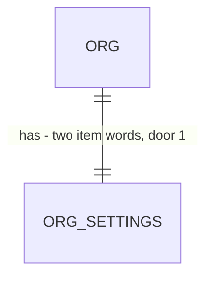

# Item vocabulary

Roadmap Phase 4.5 item 3: "Per-org vocabulary for the serviced item, used by the UI, PDFs and portal" (decision 4: one per-org label, no per-trade wording beyond it). Synonyms and the extraction prompt (item 4), packs (item 5) and the trade-neutral copy of `app/layout.tsx` and PRODUCT.md (item 6) are separate features.

## Problem

Every screen, PDF and portal page of every org calls the serviced item "equipment": "Sites & equipment", "Import equipment list", "Equipment type", "No equipment recorded yet", the "Equipment" panel and PDF section. A contractor who services stations, areas or zones reads the wrong noun on every page, and so does their customer on the review page and the PDF, which carry the contractor's name and not ours. The word is hard-coded in about 40 source strings with no setting behind it. The roadmap gives no figure or customer request; the pilot trade (decision 2) is still open.

When this ships, an owner or admin types the singular and plural of their word in Company settings ("Station" and "Stations"), and the staff screens, the agreement PDF and the customer review page say it. An org that sets nothing sees today's copy unchanged.

## Flow

Reuses `org_settings` and its form (`OrgSettingsStore`, `validateOrgSettings`, the settings screen), the row policy that already limits writes to owner and admin, and `portal_view`'s `tenant` object that already carries the branding to the anonymous page, so no second settings table and no second portal read appear.

1. Company settings form -> `validateOrgSettings` (exists) - checks the two words, hands the value to the store
2. `OrgSettingsStore` (exists) -> `org_settings` (exists) - persists `item_singular` and `item_plural` (door 1)
3. `single module - vocabulary` words helper (new, door 3) - turns the two stored words into the four forms copy needs (singular, plural, each lower and capitalised), the only place that changes case
4. out, staff: screens that name the item read the org's settings (exists, as for the accent colour) and call the helper
5. out, PDF: `AgreementDocument.words` (exists, a new top-level field; the existing tests assert `tenant` exactly) carries the words, and `pdf-sections.tsx` (exists) prints them
6. out, customer: `public.portal_view` (exists) returns `tenant.itemSingular` and `tenant.itemPlural` (door 2), and the portal page (exists) calls the helper

## Impact

| Front | What changes |
| --- | --- |
| domain | new term: `item words` - the org's singular and plural for the serviced item; lives in `org_settings`, helper in `domain/org-settings` |
| domain | existing term: "equipment" in copy meant the HVAC noun; it now means "the org's item words, defaulting to equipment". Identifiers (`equipment`, `canAddEquipment`, `equipmentLabel`, `/sites`) keep their names: nothing outside the repo reads them and renaming is refactor |
| copy | the strings listed in criterion 6 change from literals to the helper. Existing tests assert today's wording, so the default must reproduce it exactly (criterion 8) |
| screen | Company settings gains one two-field group |
| stored data | nothing to backfill: both columns are `not null` with a default, so every existing org reads "equipment" |
| function | `portal_view` is replaced (same signature) with two more keys inside `tenant`. Its only consumer is `web/infrastructure/supabase/portal.ts`; an older deploy ignores the extra keys |
| not changed | the extraction prompt still says "HVAC and mechanical" and "equipment units" (item 4); import row types, task-library checklists and email bodies (no item word in `domain/notifications`) |

## Relations

One-way constraint: the two words are `not null` with a check on their shape (door 1). No columns and no types here beyond the door.

## Surface

Only what is consumed outside the web app: the anonymous portal read.

| Route | In | Out | Status |
| --- | --- | --- | --- |
| `rpc portal_view` | `p_token_hash` | existing keys, plus `tenant.itemSingular` and `tenant.itemPlural` | 200 object, 200 `null` for an unknown token (unchanged) |

The settings form is a server action of the app, not a consumed route.

## Landing

| One-way door | Literal shape | Alternative rejected |
| --- | --- | --- |
| 1 The words are two columns of `org_settings` | `item_singular text not null default 'equipment'`, `item_plural text not null default 'equipment'`, each `check (item_singular ~ '^[a-z][a-z'' -]{0,29}$')`; stored lowercase, trimmed | one `item_label` column: cannot say "Station type" and "2 stations" from "Stations", and "equipment" has no distinct plural. A jsonb vocabulary blob: no check constraint, and it invites per-trade wording that decision 4 rejects. Nullable columns: every reader would branch on null |
| 2 The portal reads them from `tenant` | `portal_view`'s `tenant` object gains `'itemSingular', s.item_singular, 'itemPlural', s.item_plural`; the portal adapter parses them with the same defaults when absent | a second RPC for the vocabulary: two anonymous round trips per page, and a view could disagree with its words. A new top-level key: `tenant` already means "the org's wording and branding" |
| 3 Case is made in one helper | the helper takes the stored lowercase pair and returns `{ singular, plural, Singular, Plural }`; no screen calls `toUpperCase` on an item word | storing the capitalised form: a sentence ("the station list") would then need lowercasing at each call. Storing four forms: three of them are derived and can drift |

- Nothing else in this change is hard to reverse

## Criteria

### S1: An owner or admin sets the words (P1)

Company settings holds the singular and plural of the serviced item, and a value that cannot be printed is refused.

**Acceptance Criteria**

1. WHEN an owner or admin saves Company settings with "Station" and "Stations" THEN the system SHALL store `station` and `stations` in `org_settings`, trimmed and lowercased
2. IF either word is empty after trimming, longer than 30 characters, or has a character other than a letter, space, hyphen or apostrophe, or does not start with a letter THEN the system SHALL refuse the save, store nothing, and show a message on that field naming the rule
3. IF the member is not an owner or admin THEN the system SHALL refuse the write as it does for every other setting
4. WHEN an org has never set the words THEN the system SHALL read `equipment` for both

**Independent test:** save "Station" and "Stations" on the demo org and read `org_settings`; save "Station1" and see the field error.

### S2: Staff screens say the word (P1)

**Acceptance Criteria**

5. WHEN a member opens a screen that names the item THEN the system SHALL print the org's words in place of "equipment", capitalised at the start of a heading, label or sentence and lowercase elsewhere
6. The system SHALL apply 5 to these places and no others: the sidebar link and the Sites page (title, metadata, subtitle, stat note, column heading, empty and no-match states); the site register (panel heading, search label and placeholder, import button, empty states); the import flow (page and metadata title, dropzone, banners, progress words, review grid column and type label, "types not recognised" heading, row messages, error messages); the agreement builder (the "covered" fieldset legend, new-agreement launcher and its list-failed message); the agreement view (panel heading, "no equipment recorded" lines, diff field label); global search (heading, empty and no-match states); the task library (page, nav label, empty state, new-type field); the Pipeline subtitle and recent-imports block
7. WHEN a count is printed THEN the system SHALL use the singular for 1 and the plural otherwise
8. WHILE both words are `equipment` the system SHALL print every string of 6 exactly as it prints today

**Independent test:** set "Station"/"Stations" on the demo org, open `/sites`, a site, `/sites/<id>/import`, an agreement and `/task-library`, and see no "equipment"; reset to the default and see today's copy.

### S3: The agreement PDF says the word (P2)

**Acceptance Criteria**

9. WHEN an agreement PDF is rendered THEN the system SHALL print the org's plural as the heading of the covered-items section, the org's plural in the "not recorded" sentence, and the org's plural in the schedule column, in place of "Equipment"
10. The system SHALL read the words from `org_settings` at render time, so re-rendering a version sent earlier shows the current words

**Independent test:** download the PDF of a sent version before and after changing the words.

### S4: The customer's page says the word (P2)

**Acceptance Criteria**

11. WHEN `portal_view` is called with a known token THEN the system SHALL return the org's two words in `tenant.itemSingular` and `tenant.itemPlural`
12. WHEN a customer opens the review page THEN the system SHALL print the org's plural as the heading of the covered-items panel and in its "no equipment recorded" line
13. IF `portal_view` returns a `tenant` without the two keys THEN the review page SHALL print `equipment`

**Independent test:** open the review link of a sent agreement on an org that set "Stations".

## Out of scope

| Excluded | Why |
| --- | --- |
| Per-trade wording beyond the one noun ("Visit", "Unit #", "Type/model") | decision 4 |
| Freezing the words into a sent version | wording is not a term; Phase 5.5's template version is the right place to freeze wording |
| The extraction prompt and synonym table | item 4 |
| Choosing the words from the first pack at signup | Phase 5 provisioning; this feature only provides the columns and form |
| Renaming `equipment` identifiers, the `/sites` route, or the "Sites & equipment" nav key | refactor, nothing reads them from outside |
| Translating the words, or a gender/article agreement ("a station", "an area") | the product copy is English and avoids articles before the item |

## Assumptions

| Assumption | Chosen default | Rationale | Confirmed? |
| --- | --- | --- | --- |
| Two words (singular, plural) rather than one | two, as door 1 says | roadmap says "one label"; one noun cannot produce "Station type" next to "Stations" and the HVAC default is a mass noun | n |
| Stored lowercase and shown capitalised by the helper | lowercase, helper capitalises | an item word is a common noun; proper-noun words are not the use case | n |
| A re-rendered older PDF shows the current words (criterion 10) | live, not frozen | a changed noun is wording, and freezing it needs a template version that does not exist until Phase 5.5 | n |
| The contract PDF and signing page carry no item word | none to change | `contract-pdf.tsx` and `contract/document.ts` have no "equipment" string; checks confirm it by search | n |
| The words are allowed to be any letters, including "Equipment" in another language | letters, space, hyphen, apostrophe, ASCII only | the shape check is a floor against markup and punctuation, not a vocabulary | n |

**Open questions:** none - all resolved or logged above.

## Observable

| Surface | Decision | Landing |
| --- | --- | --- |
| screen Company settings | empty state | existing - the form always shows both fields, prefilled with `equipment` |
| screen Company settings | error state | AC 2 |
| screen Company settings | unauthorised | AC 3 |
| screen Company settings | loading | n/a - the form renders with the page, no separate load |
| screen Company settings | destructive action confirms | n/a - saving a word is not destructive and is editable again |
| screens in AC 6 | empty and no-match states | AC 5, AC 6 |
| screens in AC 6 | loading and error states | AC 6 (the `loading.tsx` titles are in the list) |
| screens in AC 6 | density and ordering | n/a - a word changes length, not structure; long words wrap as today (`break-words`) |
| document agreement PDF | structure, tone, next step | AC 9; structure and tone unchanged |
| document review page | structure, tone, next step | AC 12; unchanged otherwise |
| API `rpc portal_view` | response shape and error shape | AC 11, AC 13; error shape unchanged |
| API `rpc portal_view` | who may call, versioning, rate limit | n/a - unchanged: the token is the credential, the signature is replaced in place, rate limits are the portal's existing ones |
| all new commands | scheduled tasks | n/a - none added |

## Sources

- `ROADMAP.md` Phase 4.5 item 3, decision 4 - the one-label rule and the default
- `.specs/features/type-editor/plan.md` - the shape this plan follows for a per-org column and its door
