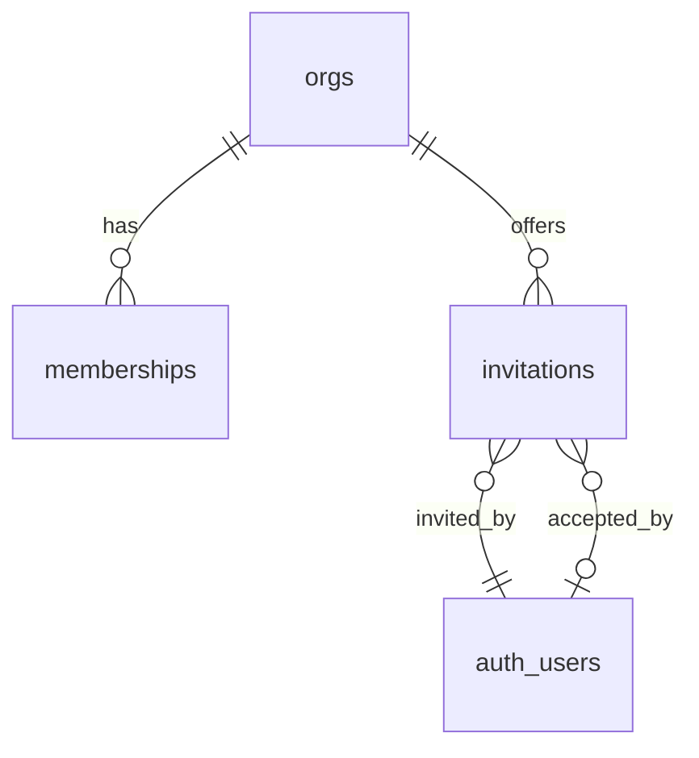

# Members page (ROADMAP Phase 3.5, item 15)

## Problem

Staff cannot be added to a tenant from the app. Today a member exists only because someone invited them in the Supabase dashboard and ran `supabase/seed.sql` with `app.demo_owner_email` (AD-021, CONTEXT.md "Not yet: no invite or members screen"). The sign-in page refuses to create accounts (`shouldCreateUser: false`, AD-019), so an unknown address can never log in. An owner who wants an estimator on the team has to be the developer. Roles can be changed only by SQL: the `memberships` table lets owners and admins write it through RLS, but no screen does, and RLS cannot stop an admin demoting the only owner. The roadmap gives no incident figure; the cost is that no second person can use a tenant without the developer's help.

When this ships, an owner or admin opens **Members**, sees who is in the org and who is invited, invites someone by email with a role, changes a role, revokes an invitation, or removes a member. The invitee gets a sign-in link and lands in the org on first sign-in.

## Flow

Reuses `/auth/confirm` + `AuthGateway` for the sign-in link, `MemberDirectory.currentMember()` for the caller, the invoker/definer RPC + Server Action pattern of AD-114 and AD-124, and `private.org_managers`' read of `auth.users` for emails. No service-role key (AD-037, AD-073).

1. `GET /members` -> `app/(app)/members/page.tsx` (new, placement) - reads the roster and pending invitations through two new narrow ports (`MemberRoster`, new, placement), renders `MembersView` (new, placement); nav item "Members" beside Settings in `FOOTER_NAV` (exists).
2. `public.list_members()` / `public.list_invitations()` (door 4) - definer reads `memberships` + `auth.users`, returns the caller's org only.
3. Server Actions on the page (new, placement): invite, revoke, set role, remove -> `MemberAdmin` port (new, placement) -> `public.create_invitation`, `revoke_invitation`, `set_member_role`, `remove_member` (door 4). Role and last-owner rules live in these functions.
4. After `create_invitation`, the action sends the link through `InvitationLinkSender` (new, placement), an anon publishable-key client with no cookies (as `getAutomationContainer`) calling `signInWithOtp({ shouldCreateUser: true })`.
5. Supabase Auth -> `private.hook_before_user_created` (door 2) allows the signup only when a live invitation exists for the address; Supabase emails the link through Resend SMTP.
6. Invitee opens the link -> `/auth/confirm` (exists) -> after `verifyEmailLink` succeeds, calls `public.accept_invitations()` (door 3) -> membership created, redirect to `/pipeline` (exists), where `MemberGate` (exists) finds the membership.

## Impact

| Front | What changes |
| --- | --- |
| domain | new term: `Invitation` - a pending offer of a role in an org to an email address, lives in `invitations` (door 1) |
| domain | existing term: membership writes. Today owners/admins write `memberships` directly through RLS; after this, only the four RPCs write it. Callers that branch on it: `supabase/tests/rls_roles.sql` C14/C15 (admin `memberships` insert/update/delete assert the old behaviour) and `fixture.sql`/`seed.sql` (run as table owner, unaffected). Those two tests are rewritten in the same change |
| domain | existing term: "an unknown email cannot sign in" stays true for `/login`; only an invited address can create a login, and only through the invite action (AD-019 unchanged) |
| stored data | new table `invitations`; no backfill. `memberships` unchanged in shape; its insert/update/delete privileges are revoked from `authenticated` (door 4) |
| dashboard config (outside the repo) | Auth: sign-ups enabled; hook `private.hook_before_user_created` registered; **Confirm signup** email template link set to `{{ .SiteURL }}/auth/confirm?token_hash={{ .TokenHash }}&type=email`, as the Magic link template already is (CONTEXT.md line 26). Not versioned; listed under Open questions (blocks go-live) |
| auth | `/auth/confirm` gains one call after a successful verify |
| nav | `FOOTER_NAV` gains Members; `nav-items.test.ts` gains its case |
| docs | ROADMAP tick, CONTEXT.md (Tenancy entry, "Not yet" line, build log), STATE.md decisions |

## Relations

One-way constraints: at most one live invitation per `(org, email)` (door 1); an org always keeps at least one owner (door 4). No columns or types here.

## Surface

| Route | In | Out | Status |
| --- | --- | --- | --- |
| `GET /members` | (none) | roster + pending invitations page | `200`, redirect `/login` (signed out, by the proxy), `404` never (it lists the caller's own org) |
| Server Action `inviteMember` | `email`, `role` | `state one of sent, invalid, already_member, owner_only, rate_limited, saved_not_sent, forbidden, unavailable` | `200` with the state in the body (a refusal is a state, never a thrown error) |
| Server Action `revokeInvitation` | `invitationId` | `state one of revoked, not_found, forbidden, unavailable` | `200` with the state in the body |
| Server Action `setMemberRole` | `userId`, `role` | `state one of saved, owner_only, last_owner, self, not_found, forbidden, unavailable` | `200` with the state in the body |
| Server Action `removeMember` | `userId` | `state one of removed, owner_only, last_owner, self, not_found, forbidden, unavailable` | `200` with the state in the body |

The page route is flat (AD-024); no query parameters.

## Landing

| One-way door | Literal shape | Alternative rejected |
| --- | --- | --- |
| 1. Invitation table | `public.invitations` tenant table (AD-003: `org_id`, `unique (id, org_id)`): `email text check (email = lower(btrim(email)) and length(email) <= 254)`, `role` text check in the four roles (AD-005), `invited_by uuid references auth.users`, `created_at`, `expires_at timestamptz not null`, `accepted_at`, `accepted_by` (set together by check); `create unique index invitations_one_live on invitations (org_id, email) where accepted_at is null`; RLS select for owner/admin, **no** insert/update/delete privilege for `authenticated` | A `memberships` row with null `user_id`: breaks `user_id not null`, `is_org_member`, `org_managers` and every reader of the table. Deleting the row on accept: loses who invited whom |
| 2. Signup gate | `private.hook_before_user_created(event jsonb) returns jsonb` (definer, `search_path = ''`, `execute` only to `supabase_auth_admin`): returns `{}` when an unaccepted, unexpired invitation exists for `lower(event->'user'->>'email')`, else `{"error": {"http_code": 403, "message": "Sign-ups are by invitation."}}`; registered as the Before User Created hook (Postgres function) | Open sign-ups: anyone can create auth users and burn the email quota. HTTP hook: needs a public endpoint and a secret, where a Postgres hook has neither (Supabase docs: auth-hooks/before-user-created-hook, available on Free/Pro) |
| 3. Accepting | `public.accept_invitations() returns integer` (definer, `search_path = ''`, `execute` to `authenticated`): reads the caller's email from `auth.users` by `auth.uid()`; when the caller has **no** membership, takes the earliest-created live invitation for it `for update`, inserts the membership, sets `accepted_at`/`accepted_by`, returns 1, else 0. Called by `/auth/confirm` only | A trigger on `auth.users` insert: misses an existing account, runs inside Supabase's signup transaction and on a managed table. Taking the email from the JWT claim: an unverified claim would be trusted |
| 4. Membership writers | definer functions, `search_path = ''`, `execute` to `authenticated`, caller must be owner/admin (`42501` else; `P0002` when the target is not in the caller's org): `list_members()`, `list_invitations()`, `create_invitation(p_email text, p_role text) returns uuid` (upsert: a live invitation for the address gets the new role and `expires_at = now() + 14 days`), `revoke_invitation(uuid)`, `set_member_role(uuid, text)`, `remove_member(uuid)`. Rules: only an owner may grant, change or remove an owner (`55000`, hint `owner_only`); a change that leaves no owner is `55000`, hint `last_owner`, serialised by `pg_advisory_xact_lock(hashtext('members:' \|\| org))`; acting on yourself is `55000`, hint `self`; an address already in the org is `23505`, hint `already_member`; a bad address is `23514`, hint `invalid_email`. `revoke insert, update, delete on public.memberships from authenticated` | Leaving `memberships` writable through RLS: RLS cannot express last-owner or admin-versus-owner (AD-060, AD-113's reason). One generic `update_member` function: one error shape for four different refusals |

- A 14-day invitation expiry and one org per user are defaults, not doors; both are in Assumptions.
- Nothing else in this change is hard to reverse

## Criteria

### S1: Read who is in the org (P1)

An owner, admin, estimator or viewer opens Members and sees the roster; managers also see pending invitations.

**Acceptance Criteria**

1. WHEN a member opens `/members` THEN the system SHALL list the org's members, one row each, with email, role label (Owner, Admin, Estimator, Viewer) and joined date, ordered owner, admin, estimator, viewer, then email.
2. The system SHALL mark the signed-in member's own row "You".
3. WHERE the viewer is an owner or admin the system SHALL show a Pending invitations list: email, role label, invited date, and "Expires <date>" or "Expired", newest first.
4. WHEN no invitation is pending THEN the system SHALL show "No pending invitations." in that list's place.
5. WHERE the viewer is an estimator or viewer the system SHALL show the roster only: no invitation list, no invite form, no row controls.
6. The system SHALL show a "Members" item in the footer navigation, current on `/members`.

**Independent test:** open `/members` as the demo owner, then as a viewer.

### S2: Invite someone (P1)

An owner or admin enters an email and a role; the person receives a sign-in link.

**Acceptance Criteria**

7. WHEN an owner or admin submits a valid email and a role THEN the system SHALL store the invitation lowercased with `expires_at` 14 days ahead, send the sign-in link, and show "Invitation sent to <email>".
8. IF the email is longer than 254 characters or is not `x@y.z` shaped THEN the system SHALL show "Enter a valid email address." and store and send nothing.
9. IF the address is already a member of the org THEN the system SHALL show "<email> is already a member." and store and send nothing.
10. WHEN a live invitation already exists for the address THEN the system SHALL update its role, extend `expires_at` to 14 days from now and send a new link, leaving one row.
11. IF an admin invites with role Owner THEN the system SHALL refuse with "Only an owner can invite an owner." and store nothing.
12. IF Supabase answers 429 to the link request THEN the system SHALL keep the invitation and show "Too many emails were sent. Try again in a minute."
13. IF the link request fails for any other reason THEN the system SHALL keep the invitation and show "The invitation was saved, but the email could not be sent. Use Resend."
14. WHEN an owner or admin presses Resend on a pending or expired invitation THEN the system SHALL do what AC 10 does for that address.
15. WHEN an owner or admin revokes a pending invitation THEN the system SHALL delete it and remove it from the list.
16. IF an estimator or viewer calls any invitation action THEN the system SHALL refuse with `forbidden` and change nothing.
17. The invite form SHALL offer the four roles, defaulting to Viewer.

**Independent test:** invite a new address, revoke it, invite it again, resend it.

### S3: Accept by signing in (P1)

**Acceptance Criteria**

18. WHEN a person signs in through `/auth/confirm`, has no membership, and a live invitation exists for their address THEN the system SHALL create a membership with the invited role, set `accepted_at` and `accepted_by`, and land them in the org's app.
19. IF several live invitations exist for the address THEN the system SHALL accept only the earliest-created and leave the others pending.
20. IF the person already has a membership THEN the system SHALL accept nothing and leave the invitation pending.
21. IF the invitation has expired or was revoked THEN the system SHALL create no membership and the person SHALL see "No workspace".
22. WHEN `accept_invitations` is called again for an accepted invitation THEN the system SHALL create no second membership and return 0.
23. WHEN Supabase Auth is about to create a user THEN the hook SHALL allow it only if a live invitation exists for the address, compared lowercase, and otherwise reject it with HTTP 403 "Sign-ups are by invitation."
24. The sign-in page SHALL keep answering "link sent" for any address and SHALL create no account (AD-019).

**Independent test:** invite a fresh address, open the emailed link, and land in the org with the invited role; try an uninvited address through the Auth API.

### S4: Change roles and remove members (P1)

**Acceptance Criteria**

25. WHEN an owner or admin picks a new role for another member THEN the system SHALL store it and show it in the roster; choosing the current role is a success with no change.
26. IF an admin sets a member to Owner, or changes or removes an Owner, THEN the system SHALL refuse with `owner_only` and change nothing.
27. IF a change or removal would leave the org with no owner THEN the system SHALL refuse with `last_owner` and change nothing.
28. IF two such changes run at the same time THEN the org SHALL still keep at least one owner.
29. IF the target is the caller THEN the system SHALL refuse with `self`.
30. WHEN an owner or admin confirms Remove for a member THEN the system SHALL delete the membership, and that person's next request to org data SHALL return no rows (RLS reads memberships live, AD-004).
31. WHEN a member is removed THEN the system SHALL keep every record they created or acted on (versions' `created_by`, events' `actor_id`).
32. The system SHALL ask for confirmation before Remove, naming the member and saying they lose access immediately, with the same Confirm/Cancel pattern as Deactivate (`DeactivatePrompt`).
33. IF the target is no longer a member THEN the system SHALL show "That member was already removed." and refresh the roster.

**Independent test:** promote a viewer to estimator, try to demote the only owner, remove the viewer.

### S5: States and access (P2)

**Acceptance Criteria**

34. WHILE the roster is loading the system SHALL show the page skeleton (`loading.tsx`).
35. IF a read or write fails unexpectedly THEN the system SHALL show "Could not save. Try again." for an action, or the existing error boundary for the page, and make no partial change.
36. IF the caller is signed out THEN the system SHALL redirect to `/login`.
37. WHILE the viewport is 375 px the page SHALL add no horizontal scroll, stack each row's controls under its email, and keep every touch target at least 44 px.

**Independent test:** open `/members` at 375, 768 and 1440 px, touch-emulated.

## Out of scope

| Excluded | Why |
| --- | --- |
| Org switcher and one person in several orgs | `currentMember` picks the oldest membership (CONTEXT.md "no org switcher"); an invitee who already belongs to another org stays pending (AC 20) |
| Audit log of role changes | `events` is agreement/contract only; a members audit trail is its own item under M15 |
| Custom invitation email text | The Supabase Confirm signup template is used; branding it is a dashboard task |
| Member display names, avatars | No table holds names (AD-118); the roster shows email and role |
| Self-service leave, ownership-transfer wizard | An owner transfers by promoting another to Owner and having them demote the first |
| Bulk invite, SSO, domain auto-join | Not asked |
| Org creation and plan seat limits | Phase 5 |

## Assumptions

| Assumption | Chosen default | Rationale | Confirmed? |
| --- | --- | --- | --- |
| How to create a login | invitations table + Before User Created hook, no service-role key | AD-037/AD-073; user chose it | y |
| Who sees `/members` | every member sees the roster read-only; owner/admin also see invitations and controls | colleagues of one company; matches `canEditTaskLibrary` role-aware views | n |
| Invitation lifetime | 14 days, extended by resend | the link itself lasts an hour; the row is the offer | n |
| Default invited role | Viewer | least privilege | n |
| Invitee already has an account in another org | invitation stays pending, no membership | one org per user until an org switcher exists | n |
| Admin powers over owners | none: only an owner grants, changes or removes an owner | an admin could otherwise take over the org | n |
| Changing or removing yourself | refused | prevents self-lockout; the last-owner rule also covers it | n |
| A signed-in non-member invited later | sees "No workspace" until they sign in again through a link | accept runs at `/auth/confirm` only | n |
| Row cap | 500 members and 500 invitations per read (AD-023) | far above a tenant's staff | n |
| Check ids | next free after the activity-timeline range | ids stay unique across features | n |

**Open questions:**

| # | Kind | Question | Until answered |
| --- | --- | --- | --- |
| 1 | blocks go-live | Dashboard config: are sign-ups enabled, is the hook registered, is the **Confirm signup** template link set to `/auth/confirm?token_hash=...&type=email`? A new user created by `signInWithOtp` gets the Confirm signup email, not the Magic link one (to confirm in the live run) | invitations cannot be accepted by a new address in the real project; local tests and SQL checks are unaffected |
| 2 | open | Does the Before User Created hook also fire for a dashboard invite (AD-021 path)? The docs read do not say | the demo owner already exists, so nothing blocks; verified in the live run |

## Observable

| Surface | Decision | Landing |
| --- | --- | --- |
| screen `/members` | empty state | AC 4 (invitations); the roster is never empty |
| screen `/members` | loading state | AC 34 |
| screen `/members` | error state | AC 35 |
| screen `/members` | unauthorised states | AC 5 (read-only), AC 36 (signed out) |
| screen `/members` | density and ordering | AC 1, 3 |
| screen `/members` | destructive action confirms | AC 32; revoke is reversible by inviting again, so no prompt |
| screen `/members` | mobile | AC 37 |
| Server Actions (4) | error shape and codes | AC 8, 9, 11, 12, 13, 16, 26, 27, 29, 33 |
| Server Actions (4) | who may call | AC 16; viewers and estimators get `forbidden` |
| Server Actions (4) | versioning, rate limits | n/a - same-origin form actions; the only throttle is Supabase's email limit, AC 12 |
| `/auth/confirm` | accept step | AC 18-22 |
| Auth hook | rejection shape | AC 23 |

## Sources

- `ROADMAP.md:161` - "Members page: invite and set roles (owner, admin, estimator, viewer)".
- `.specs/STATE.md` AD-003/004/019/037/060/073/113/114/118 - tenancy and RLS, no service-role key, the RPC-only-writer pattern, roles shown as roles.
- Supabase docs, Auth Hooks > Before User Created (Postgres function, Free/Pro) - the signup gate.
