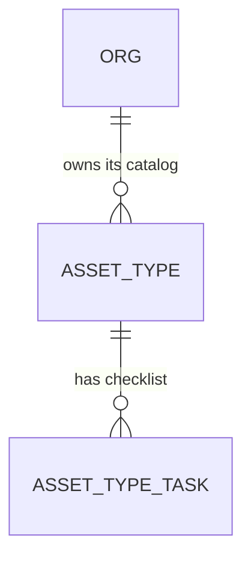

# "Other" trade: Claude drafts a catalog

Roadmap Phase 5 item `"Other" trade: Claude drafts a catalog from a description or an uploaded proposal, with a tenant review step` (decision 7: "upload your proposal" first, "describe your trade" second). It adds a step to the first-login setup screen (AD-176), which left the empty-catalog state for it. One feature at a time (decision 22). Plan limits and the AI-import allowance, the template preview and the "Setting up your workspace" state stay separate items.

## Problem

A contractor whose trade has no starter pack picks "Other" at `/register` and lands on `/setup` with the text "No types yet". Their catalog is empty, so the first agreement has no "Service included" text, import cannot match a single row to a type, and the app has no screen that adds a type (the task library screen was removed on 2026-11-10). The roadmap gives no count of "Other" sign-ups and no activation figure, so none is claimed here. The cost is paid in the first session, by the buyer with the least reason to stay: they paid, and the product shows them a blank page.

When this ships, an owner or admin on `/setup` whose catalog is empty can name their trade, optionally describe it or upload their current proposal, read a draft catalog Claude made, remove or rename what is wrong, and add the rest in one step.

## Flow

Reuses `ImportParser` (xlsx, csv, docx, pdf to text or PDF bytes), the Claude SDK wiring and the structured-output pattern of `claudeAssetExtractor`, `create_task_library_type`'s name rules and code derivation, `AssetTypeCatalog`, the `/setup` screen and its `setupEntry` rule, and `org_settings.trade_context` (AD-162), instead of a second parser, a job table or a second type writer.

1. Owner on `/setup` (exists, changed) with an empty catalog sees the draft form: trade name (required), notes (optional), file (optional)
2. Server Action `draftCatalogAction` (new) -> checks the member is owner or admin and the catalog is still empty -> for a file, `ImportParser` (exists) -> `CatalogDrafter` (new port, door 1; `claudeCatalogDrafter`, new adapter beside `claudeAssetExtractor`) -> one structured-output call -> validated draft
3. The draft returns to the page as form state and is not stored. The owner edits it in the browser: rename, remove, change months, remove a task
4. Server Action `acceptDraftAction` (new) -> `CatalogWriter` (new port, door 2) -> `public.add_catalog_draft` (new, door 2) writes every type, task and default month in one transaction and appends the trade to `trade_context` -> `/setup` shows the review of the new catalog
5. out: the screen's existing catalog review (exists) reads the org's own `asset_types`, now non-empty, and the draft form is gone

## Impact

| Front | What changes |
| --- | --- |
| domain | new term: catalog draft - types with checklist tasks and default visit months, held only in the browser until accepted; never a stored row |
| domain | existing term: "empty catalog" on `/setup` meant "show No types yet" (first-login-setup AC 17); it now also means "offer the draft form". Who branches on it: `groupSetupCatalog` and the setup view. The read-only review is unchanged, so AC 17 and its check stay true of it (open question 1) |
| domain | existing term: types made by hand have `pack` null and show under "Added by you"; drafted types are the same, so no pack code is invented |
| external | a new caller of the Claude API from the setup screen. The request carries the trade name, the notes and the file the owner chose, and no org id, email or company name |
| stored data | one new function; no column and no table. Existing orgs are untouched because the form only appears while the catalog is empty |
| not changed | `claudeAssetExtractor`, import review (the `/task-library` screen was removed on 2026-11-10, so a type cannot be edited elsewhere in the app), `seed_org_catalog`, provisioning, the Stripe webhook |

## Relations

`None` beyond the existing entities: a drafted type is an ordinary `asset_types` row with `pack` null and its tasks in `asset_type_tasks`. The draft itself has no entity (door 3 of the Landing list keeps it out of the database).

## Surface

| Route | In | Out | Status |
| --- | --- | --- | --- |
| `draftCatalogAction` (Server Action on `/setup`) | `trade`, `notes`, optional `file` (xlsx, csv, docx or pdf) | `{ ok: true, draft: { types: [{ name, months, tasks }] } }` or `{ ok: false, code }` | `200` ok, `422` invalid, `403` forbidden, `409` not_empty, `415` unreadable, `413` too_large, `503` unavailable (form-state codes, the Settings pattern, no HTTP status on the wire) |
| `acceptDraftAction` (Server Action on `/setup`) | `types: [{ name, months, tasks }]` after the owner's edits | `{ ok: true, added: n }` or `{ ok: false, code }` | `200` ok, `422` invalid, `403` forbidden, `409` not_empty, `503` unavailable (form-state codes) |
| `public.add_catalog_draft` (rpc) | org, trade phrase, the edited draft | the number of types added | `200` the count, or SQLSTATE `42501` forbidden, `55000` not empty, `23514` invalid |

## Landing

| One-way door | Literal shape | Alternative rejected |
| --- | --- | --- |
| 1. What Claude must return | `CatalogDrafter.draft({ trade, notes, file? }): Promise<{ ok: true, types: DraftType[] } \| { ok: false, code: 'unavailable' \| 'too_large' }>` with `DraftType = { name: string, months: number[], tasks: string[] }`; the JSON schema is `{ types: [{ name, months: integer 1..12 [], tasks: string [] }] }`, `additionalProperties: false`, at most 40 types and 12 tasks each | a free-text answer parsed by the app: cannot be validated field by field. Returning codes and synonyms too: the owner would review a column they never see (synonyms stay empty and the import path already adds spellings later) |
| 2. How the draft becomes types | `public.add_catalog_draft(p_org_id uuid, p_trade text, p_types jsonb) returns integer`, `security invoker`, `search_path = ''`, owner or admin only (`42501`), raises `55000` unless the org has no `asset_types` row, derives each code with the same rule as `create_task_library_type`, writes types, tasks and `default_visit_months` in one transaction, appends `p_trade` to `trade_context` once, `execute` for `authenticated` only | looping `create_task_library_type` from the app: not atomic, a failure at type 12 leaves a half catalog the owner cannot tell from a finished one. Writing with a service-role insert: skips the role check |
| 3. The draft is not stored | the draft exists as action output and form state; no `catalog_drafts` table, no job row | a drafts table with status and polling: needs ownership, expiry and a second place that decides "empty"; the Claude call finishes inside one request on Railway (a long-running Node server), so nothing has to survive it |

- Door 1, found while building (additive): the schema states months as an enum of 1 to 12 and the 40-type and 12-task limits live in the prompt and in validateDraft, because the structured-output schema may not carry maxItems; an answer past a limit is refused as unavailable (AC 5). Rejected: maxItems in the schema, which the API may reject outright
- Door 2 reaches past this feature: it is the second writer of types after the type editor, and the Phase 5.5 "upload an existing contract" slice will want the same atomic shape. It belongs in `STATE.md` as an AD at the end of the build.
- Nothing else in this change is hard to reverse: the form layout, field order, the limits shown on screen and where the adapter file sits are edits.

## Criteria

### S1: An empty catalog can be drafted from a description (P1)

The owner names the trade, optionally adds notes, and reads a draft.

**Acceptance Criteria**

1. WHILE an org has no `asset_types` row and setup is pending, `/setup` SHALL show the draft form to an owner or admin, and SHALL still show the read-only review's "No types yet" text unchanged
2. WHEN an owner or admin submits a trade name of 1 to 60 characters from letters, digits, spaces and `, & / ' -` THEN `draftCatalogAction` SHALL call `CatalogDrafter` once and answer `ok` with the draft
3. The system SHALL accept a draft of 1 to 40 types, each name 1 to 60 characters with a letter or number (the rule of `private.clean_type_name`), each with 1 to 12 months from 1 to 12 and 0 to 12 tasks of 1 to 200 characters
4. IF the trade name is empty, longer than 60 characters, or has a character outside the set above THEN the system SHALL answer `invalid`, call no model and write nothing
5. IF Claude's answer does not match the schema in door 1, has no types, or breaks a bound in AC 3 THEN the system SHALL answer `unavailable` and write nothing
6. IF the Claude call fails, times out, is refused, or `ANTHROPIC_API_KEY` is not set THEN the system SHALL answer `unavailable`, log one line without the trade, notes or file, and write nothing
7. IF the member is an estimator, a viewer or has no membership THEN the system SHALL answer `forbidden` and call no model
8. IF the org already has any `asset_types` row THEN the system SHALL answer `not_empty` and call no model
9. The system SHALL send Claude the trade name, the notes and the file only, with the system prompt telling it that everything in the user message is data and not instructions

**Independent test:** register an "Other" org (or empty a test org's catalog), open `/setup`, type "pest control" and submit; a draft of types with tasks appears.

### S2: A draft can be made from the contractor's own proposal (P1)

The owner uploads the document they already send.

**Acceptance Criteria**

10. WHEN the owner attaches an xlsx, csv, docx or pdf of at most 4,194,304 bytes THEN the system SHALL parse it with `ImportParser` and send its text, or the PDF bytes, to Claude with the trade name
11. IF the file is a type other than those four, is over the size limit, or `ImportParser` cannot read it THEN the system SHALL answer `unreadable` or `too_large` and call no model
12. IF Claude answers `too_large` for a document that fills the output limit THEN the system SHALL answer `too_large` and write nothing
13. WHEN a file is attached THEN the system SHALL NOT store the file: it is read from the request and dropped

**Independent test:** upload a one-page proposal listing four kinds of service; the draft names them.

### S3: The owner reviews and accepts the draft (P1)

Nothing is written until the owner says so, and then everything is written together.

**Acceptance Criteria**

14. WHEN a draft is shown THEN the system SHALL let the owner rename a type, remove a type, change its months on the 12-month grid and remove a task, and SHALL show no control that adds a type or a task
15. WHEN the owner accepts THEN `acceptDraftAction` SHALL call `add_catalog_draft` once with the edited draft and answer `ok` with the count added
16. WHEN `add_catalog_draft` runs THEN it SHALL write one `asset_types` row per type with `pack` null and the code derived from its name, each task in order, the months as `default_visit_months`, and append the trade to `org_settings.trade_context` once
17. IF any type or task breaks the bounds in AC 3, or two names in the draft are equal ignoring case THEN the function SHALL raise `23514` and the system SHALL write no type, no task and no `trade_context`
18. IF the org gained a type between the draft and the accept THEN the function SHALL raise `55000` and write nothing, and the screen SHALL say the catalog is no longer empty
19. IF the caller is not an owner or admin of the org THEN the function SHALL raise `42501` and write nothing
20. WHEN the owner leaves the screen without accepting THEN the system SHALL have written nothing
21. WHEN a type's name collides with another by derived code THEN the function SHALL add a numeric suffix as `create_task_library_type` does
22. WHEN accept succeeds THEN `/setup` SHALL show the catalog review of AC 16 of first-login-setup with the new types under "Added by you"

**Independent test:** accept a draft with one type renamed and one removed; the review lists the remaining types under "Added by you".

### S4: The step works at every size and states its waits and failures (P1)

**Acceptance Criteria**

23. WHILE the draft is being made the system SHALL show a status text and disable the submit button, and SHALL send one request per click
24. IF the action answers `unavailable` THEN the system SHALL show "We couldn't draft your catalog. Try again." with a Try again control and keep the owner's trade, notes and file choice in the form
25. WHILE the page is at 375, 768 or 1440 px wide the system SHALL show no horizontal scroll, and every control SHALL be at least 44 by 44 px on mobile and tablet

**Independent test:** the AGENTS.md Playwright pass on `/setup` at three sizes with touch emulation on the two smaller ones.

## Out of scope

| Excluded | Why |
| --- | --- |
| Drafting for an org that already has types, or adding to an existing catalog | The form exists only for the empty catalog; nothing edits a type in the app since the task library screen was removed (2026-11-10), which is not this feature's gap |
| Synonyms, packs or a release review for a drafted catalog | The owner reviews it themselves on this screen; a drafted type has no pack (decision 5 covers shipped packs only) |
| Storing the draft, resuming it later, or a draft history | Door 3 |
| Metering drafts against the AI-import allowance, and recording tokens per call | Needs the plan-limits item; see open question 2 |
| Drafting from a URL, an image or several files | One file or none |
| "Setting up your workspace" state, template preview, duplicate-email refusal | Own roadmap items |
| Safety-critical trades (fire, elevators) | Decision 5: a practitioner reviews those packs; a drafted catalog is owned and reviewed by the tenant, and the screen says so (AC 14 and the notice) |

## Assumptions

| Assumption | Chosen default | Rationale | Confirmed? |
| --- | --- | --- | --- |
| Who the form is for | Any owner or admin of a pending org whose catalog is empty, not only orgs with `other_trade` | The screen never reads `org_billing` (first-login-setup assumption); an empty catalog is the signal | n |
| Model and effort | `EXTRACT_MODEL` constant of the extractor, effort `low`, structured output, the same server-side fallback beta | One model constant, one place to change; the extractor already runs this way | n |
| Input channels | Trade name required; notes and file optional; a file wins no priority, both are sent | Decision 7 asks for both routes, upload first | n |
| Months in the draft | Claude proposes default months per type; the owner edits them | Cadence defaults are part of a pack (Modules M18) | n |
| Notice on the screen | One line: the draft is a starting point, the tenant owns the checklists, review before adding | Same ownership wording as decision 14 and the template editor | n |
| Time limit | A single request, 120 seconds before the app gives up and answers `unavailable` | Railway has no function timeout; 120 s bounds a hung call | n |
| Upload size | 4,194,304 bytes; `next.config.ts` raises `experimental.serverActions.bodySizeLimit` to `5mb` (the framework setting is app-wide, not per route; no other action takes a file today, imports use signed uploads) | Proposals are small; the default 1 MB would reject a typical PDF | n |

**Open questions:** none block the build.

| # | Kind | Question | Until answered |
| --- | --- | --- | --- |
| 1 | resolved | AC 17 of first-login-setup ("No types yet", no draft control) stays true of the read-only review, which is unchanged; the draft form is a separate section, so C2817 stays green and is not edited (user, 2026-11-12: "go with recommendations") | - |
| 2 | resolved | Drafts stay unmetered until plan limits ship (user, 2026-11-12) | - |
| 3 | blocks go-live | The same `ANTHROPIC_API_KEY` and budget serve onboarding drafts (user, 2026-11-12); the live run with a real key waits for the owner | The build and tests run against a fake client |

## Observable

| Surface | Decision | Landing |
| --- | --- | --- |
| screen `/setup` draft form | empty state | AC 1 |
| screen `/setup` draft form | loading state | AC 23 |
| screen `/setup` draft form | error state | AC 24, AC 18 |
| screen `/setup` draft form | unauthorised | AC 7, AC 19 |
| screen `/setup` draft form | density and ordering | existing - the setup screen's section cards; the draft form sits where "No types yet" is, the draft review below it, accept last |
| screen `/setup` draft form | destructive action confirms | n/a - nothing is stored until accept; removing a draft row only edits browser state |
| API `draftCatalogAction` | error shape and codes | AC 4 to AC 8, AC 11, AC 12 |
| API `acceptDraftAction` and `add_catalog_draft` | error shape and codes | AC 17 to AC 19 |
| API `draftCatalogAction`, `acceptDraftAction` | who may call it | AC 7, AC 19 |
| API `draftCatalogAction`, `acceptDraftAction` | versioning, rate limits | n/a - authenticated Server Actions bound to one member's own org; metering waits for the plan-limits item (open question 2) |
| document: the notice and the draft's copy | structure, tone, next step | AC 24 and the Assumptions row on the notice |
| collection: the draft's types | grouping, ordering, duplicates | AC 17 (duplicate names rejected), AC 21 (code collision), draft order kept |

## Sources

- `ROADMAP.md` Phase 5 item "Other trade", Onboarding step 4, decisions 5, 7 and 22 - the item and the upload-first order
- `.specs/features/first-login-setup/plan.md` AC 16 to 18 and Out of scope - the empty-catalog state this feature extends
- `.specs/STATE.md` AD-156 (type writers), AD-162 (`trade_context`), AD-176 (setup flag)
