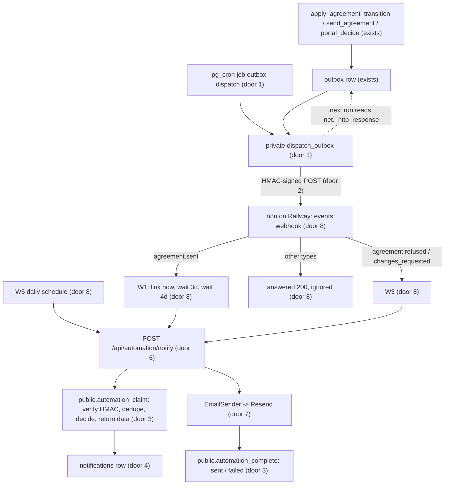
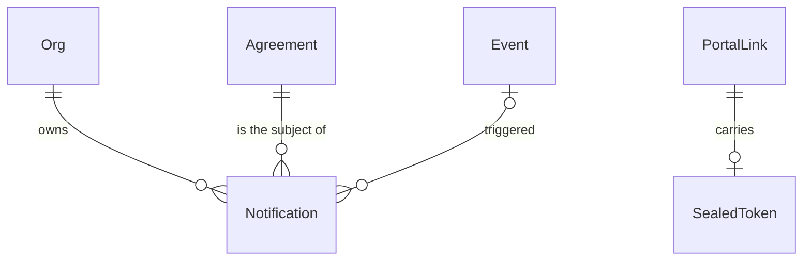

# Outbox dispatch, n8n W1/W3/W5 and transactional email

## Problem

An agreement can be sent, and the customer can accept, refuse or ask for changes, but nobody is told. The send ends with a link on the estimator's screen. The estimator has to copy it into their own email, and nothing reminds the customer who never opens it. When the customer refuses or asks for changes, the estimator only finds out by opening the agreement page. A deal that sits unviewed for a week stays invisible until someone scans the pipeline.

Every transition already writes an `outbox` row (AD-015, AD-069), but nothing reads that table. `CONTEXT.md` says "the dispatcher … is Phase 3 with W1". The pending rows only pile up.

The source (ROADMAP Phase 3 item 5, M12, M13, W1/W3/W5) gives no user evidence or date. Contract delivery (W2, W4) in Phase 4 depends on the same dispatcher.

**When this ships:** sending an agreement emails the site contact a link in the contractor's name. The contact is reminded on day 3 and day 7 unless they have opened it or decided. A refusal or change request emails the estimator who sent it, with the reason. Once a day, each org's owners and admins get one email listing agreements that are still unviewed after 7 days. The agreement page shows whether the link email went out.

## Flow

This reuses `outbox` and both of its writers (`private.enqueue_outbox`, `enqueue_outbox_for_system`), `PortalTokens` and `portalLinkUrl` for the link, `private.issue_portal_link` for every link write, and the anon-RPC pattern of AD-068 for access without a user session. It adds no second event log and no service-role key.

1. A transition commits its event and `outbox` row as today (exists).
2. Every minute `private.dispatch_outbox` first settles in-flight rows from `net._http_response`: a 2xx response makes the row `sent`; anything else, or no answer within 10 minutes, puts it back to `pending` with backoff, or `failed` after 8 attempts. It then claims up to 50 due `pending` rows with `for update skip locked`, signs each body with the Vault secret, and `net.http_post`s it to n8n (door 1, door 2).
3. n8n answers `200` on receipt and routes by `type`. The W1 and W3 branches and the W5 schedule call `POST /api/automation/notify` with a signed body that carries an idempotency key and the n8n execution id (doors 6 and 8).
4. The route checks the header format and forwards the raw body and headers to `automation_claim`. The database checks the signature and age, upserts the `notifications` row by key, writes `events.n8n_execution_id`, decides send or skip, and returns the email data (recipient, tenant branding, agreement facts, sealed token). The app never receives the shared secret (door 3).
5. The app unseals the token (door 5) and builds the email (pure, placement). `EmailSender` sends it with the idempotency key (door 7), and `automation_complete` records `sent` with the provider id, or `failed`. Failure answers `503`, so n8n retries.
6. out: the agreement page reads the latest `customer_link` notification through `AgreementReader` (exists) and shows the delivery line.

## Impact

| Front | What changes |
| --- | --- |
| domain | new term: `Notification` - one email the system decided to send or skip, keyed by an idempotency key; lives in `notifications` and `web/domain/notifications` |
| domain | new term: notification kinds `customer_link`, `customer_reminder`, `staff_decision`, `staff_stale` |
| domain | existing term: `outbox.status` meant `pending` / `sent` / `failed` with nothing reading it. It gains `sending`, and `sent` now means "n8n answered 2xx". Who reads it today: nothing in the app, plus the `events_outbox` and `customer_portal` SQL tests that assert `pending` after an enqueue (those stay true) |
| domain | existing term: a portal link "can never be shown again" (AD-070, customer-portal AC 7). It now also stores the token sealed with an app-only key. A database read still cannot act as the customer, but the app can rebuild the URL. Who branches on it: `issue_portal_link`, `send_agreement`, `reissue_portal_link`, `makeSendAgreement`, `makeReissueLink`, and C907 of customer-portal, whose "no column can hold a token" half becomes false. This supersedes part of AD-070 |
| events | `events.n8n_execution_id` (exists, unused) is written by `automation_claim` the first time a callback names the event |
| auth | `PUBLIC_PREFIXES` (AD-072) gains `/api/automation/`. Who branches on it: `proxy.ts`, for every route |
| auth | `anon` gains `execute` on two more definer RPCs. The advisors' expected list grows from 8 to 12 lints (both `*_security_definer_function_executable` for each) |
| stored data | **existing pending outbox rows** (demo and live-run events, addressed to `@example.com` contacts) are set to `failed` with `last_error = 'enqueued before dispatch existed'` in the migration, so turning dispatch on does not send a burst of old events. Existing links get `token_sealed` null, and reminders for them skip with `no_link_secret` until "Get a new link". One new table, empty |
| infrastructure | two new Postgres extensions (`pg_cron`, `pg_net`) and two Vault secrets. Two app secrets (`PORTAL_LINK_KEY`, `RESEND_API_KEY`) and one setting (`EMAIL_FROM`), all server-only |
| screens | `/agreements/[agreementId]` gains the delivery line. No other screen changes |

## Relations

One-way constraints: the notification idempotency key is unique across the table (door 4). A notification's agreement and event belong to its org through composite references (AD-003); `staff_stale` has an org and no agreement. A link carries at most one sealed token, written only with the link (door 5). Outbox status gains `sending` (door 1).

## Surface

Only routes this adds or whose signature changes.

| Route | In | Out | Status |
| --- | --- | --- | --- |
| outbound `POST <n8n events webhook>` (Vault `n8n_events_url`) | headers `X-SA-Timestamp`, `X-SA-Signature`; body `deliveryId`, `eventId`, `type`, `entityType`, `entityId`, `orgId`, `payload`, `occurredAt` | n8n's answer, read only for its status | `200` to `299` delivered; any other status (for example `404`, `500`) or a timeout is retried |
| `POST /api/automation/notify` | headers `X-SA-Timestamp`, `X-SA-Signature`; body `idempotencyKey`, `kind`, `eventId` (W1, W3), `agreementId` (W1, W3), `executionId` | `{ outcome, reason? }` with outcome `sent`, `skipped` or `duplicate` | `200`, `400` malformed body, `401` bad or stale signature, `404` unknown event or agreement, `409` in flight, `503` provider or database failure |
| `public.automation_claim(p_body text, p_timestamp text, p_signature text) returns jsonb` | the raw body and both headers | `{ decision, reason?, messages }` with decision `send`, `skip`, `duplicate` or `in_flight` | `200` returned, `401` from `42501` bad or stale signature, `400` from `22023` malformed body, `404` from `P0002` unknown event or agreement (the route's mapping) |
| `public.automation_complete(p_body text, p_timestamp text, p_signature text, p_results jsonb) returns void` | the same signed body, plus per-notification `{ id, outcome, providerMessageId?, error? }` | nothing | `200` recorded, `401` from `42501`, `400` from `22023`, `404` from `P0002` |
| `send_agreement`, `reissue_portal_link` | gain `p_token_sealed text` | unchanged | unchanged: `200` ok, `404` from `P0002`, `409` from `40001`, `403` from `42501`, `422` from `23514` (send only) |

## Landing

| One-way door | Literal shape | Alternative rejected |
| --- | --- | --- |
| 1. Dispatch in the database | `create extension pg_cron; create extension pg_net;` `cron.schedule('outbox-dispatch', '* * * * *', 'select private.dispatch_outbox()')`. `private.dispatch_outbox()` is security definer with `search_path = ''`, `execute` revoked from `public, anon, authenticated`, and runs under `pg_try_advisory_xact_lock(hashtext('outbox-dispatch'))`. `outbox.status` check becomes `pending, sending, sent, failed`, and `outbox.request_id bigint` is added. Batch 50. Backoff after attempt n: 1, 5, 15, 60, 240, 720, 1440 minutes, then `failed` at attempt 8. A missing Vault secret makes the run a no-op | An app cron route with a Supabase secret key: rejected by the user, because one bug reads every tenant. Supabase Database Webhooks on `outbox` insert: one shot per insert, with no backoff, no retry and no record of the attempt |
| 2. Signature format, both directions | `X-SA-Timestamp: <unix seconds>`, `X-SA-Signature: sha256=<lowercase hex HMAC-SHA256(secret, timestamp + "." + raw body)>`. Accepted within 300 s either side of now. One secret, Vault `automation_hmac_secret`, also held as an n8n credential | Signing the body alone: a captured request replays forever. Two secrets per direction: twice the rotation work for one trust boundary |
| 3. Callback verification in the database | `automation_claim` and `automation_complete` (Surface), security definer with `search_path = ''`, `revoke from public`, `grant execute to anon, authenticated`. Each verifies door 2 with `extensions.hmac` against the Vault secret before reading anything. The app calls them with the publishable key and never holds the secret | The app verifying with its own copy of the secret: it would still need a database identity to read across orgs, meaning a service-role key (door 1's rejection) |
| 4. `notifications` table | A tenant table per AD-003. `idempotency_key text not null unique`, `kind` checked against the four kinds, `status` in `claimed, sent, skipped, failed`, `skip_reason` text set only when `skipped`, composite FKs to `agreements` and `events` (nullable). Members `select` their org's rows; no privilege to write for `anon` or `authenticated`. Key formats: `w1:<eventId>:link`, `w1:<eventId>:day3`, `w1:<eventId>:day7`, `w3:<eventId>`, `w5:<yyyy-mm-dd>:<orgId>` (one W5 call creates a row per org). A `claimed` row older than 10 minutes, or a `failed` row, may be claimed again | Dedupe in n8n only: n8n retries and the dispatcher's at-least-once delivery would both send twice. A key unique per org: W1 and W3 keys already carry a global event uuid, so per-org adds nothing |
| 5. Sealed portal token | `portal_links.token_sealed text check (token_sealed ~ '^v1\.[A-Za-z0-9_-]{16}\.[A-Za-z0-9_-]+$')`, nullable, written only through `private.issue_portal_link(p_agreement_id, p_token_hash, p_token_sealed)`. AES-256-GCM, a 12-byte IV, the 16-byte tag appended to the ciphertext, and key `PORTAL_LINK_KEY` (32 bytes, base64) read only in `composition/`. `PortalTokens` gains `seal`/`unseal` | Hash only: no reminder can carry a working link (option 3 of the user's question). Plain token in Vault, or `pgsodium`: anyone running SQL as the owner could act as the customer, which AD-070 exists to prevent |
| 6. Callback route | `POST /api/automation/notify` (`runtime` nodejs, `Cache-Control: no-store`). Missing or malformed `X-SA-*` headers get `401` with no database call. `PUBLIC_PREFIXES = ["/review/", "/api/automation/"]` | A route per kind: four copies of the signature plumbing. Server Actions: n8n cannot call them |
| 7. `EmailSender` port, Resend over `fetch` | `EmailSender.send({ to, fromName, replyTo?, subject, html, text, idempotencyKey })` returning `{ ok: true, providerMessageId }` or `{ ok: false, code }` with code `rejected` or `unavailable`. Adapter `web/infrastructure/email` uses `POST https://api.resend.com/emails` with `Idempotency-Key` (header behaviour to be confirmed in Resend docs at build). `from` is `"<tenant legal name>" <EMAIL_FROM>`, on the Resend domain `felipeviana.com`. The adapter refuses `@example.com/.org/.net`, `.test` and `.invalid` recipients as `skipped: reserved_domain` before any request. No SDK dependency | The `resend` SDK: a dependency for one POST. SMTP through nodemailer: a dependency, and no idempotency key |
| 8. n8n workflows in the repo | `automation/n8n/events.json` (Webhook, Crypto HMAC check, Switch on `type`, answer 200 on receipt), `W1-agreement-sent.json` (notify `customer_link`, Wait 3 days, notify `customer_reminder` day3, Wait 4 days, notify day7), `W3-agreement-decided.json`, `W5-stale-daily.json` (Schedule 08:00 America/Vancouver). Exported JSON with no credentials inside, imported into the self-hosted n8n on Railway. That instance keeps executions in Postgres (`DB_TYPE=postgresdb`) and runs with `GENERIC_TIMEZONE=America/Vancouver`, because a Wait longer than about 65 s is saved to its database and resumed from there | Workflows only in the n8n instance: no review, no history and no test can read them (AGENTS.md asks for audit-ready evidence). n8n Cloud: replaced by the user's choice of Railway (2026-10-29). SQLite on an ephemeral Railway disk: a redeploy would drop every waiting W1 execution, and with it the day-3 and day-7 reminders |

- Nothing else in this change is hard to reverse

## Criteria

### S1: Outbox rows reach n8n, signed, at least once (P1)

**Acceptance Criteria**

1. WHEN a `pending` outbox row's `available_at` has passed and the dispatch job runs THEN the system SHALL POST its event to the Vault `n8n_events_url` with the body keys of Surface and both `X-SA-*` headers, and set the row `sending` with its `request_id`
2. The system SHALL sign the outbound body as `sha256=` plus the lowercase hex HMAC-SHA256 of `<timestamp>.<body>` with `automation_hmac_secret`
3. WHEN the response for a `sending` row has a 2xx status THEN the system SHALL set the row `sent` with `sent_at`
4. IF the response is not 2xx, or there is no response 10 minutes after sending, THEN the system SHALL increment `attempts`, store `last_error`, and set `pending` with `available_at` pushed back by the door 1 schedule
5. IF a row fails its 8th attempt THEN the system SHALL set it `failed` and never send it again
6. WHEN two dispatch runs overlap THEN the system SHALL send each due row at most once per attempt
7. IF either Vault secret is missing THEN the dispatch run SHALL send nothing and change no row
8. WHEN the migration runs THEN every outbox row that was `pending` SHALL become `failed` with `last_error = 'enqueued before dispatch existed'`
9. The system SHALL NOT let `anon` or `authenticated` execute `private.dispatch_outbox` or read `outbox`

### S2: Signed callbacks are verified once, in the database (P1)

**Acceptance Criteria**

10. IF `X-SA-Timestamp` or `X-SA-Signature` is missing or malformed THEN `POST /api/automation/notify` SHALL answer `401` without calling the database
11. IF the signature does not match, or the timestamp is more than 300 s from now, THEN `automation_claim` SHALL raise `42501` and write nothing, and the route SHALL answer `401`
12. IF the body is not JSON with a known `kind` and the keys that kind needs THEN the system SHALL answer `400` and write nothing
13. WHEN a verified callback names an event whose `n8n_execution_id` is null THEN the system SHALL store `executionId` there and SHALL keep a value that is already set
14. WHEN the same idempotency key is claimed again after it reached `sent` or `skipped` THEN the system SHALL answer `200` `duplicate` and send no email
15. WHEN two callbacks with one key arrive together THEN the system SHALL send at most one email, and the other SHALL answer `409` while the first is `claimed`
16. IF the email provider fails THEN the system SHALL mark the notification `failed`, answer `503`, and send the email when the same key is claimed again

### S3: The customer gets the link and two reminders (P1)

**Acceptance Criteria**

17. WHEN W1 calls `customer_link` for an `agreement.sent` event THEN the system SHALL email the site contact from `"<tenant legal name>"`, with subject `Service agreement <number> from <tenant legal name>`, a button "Review the agreement" pointing at the live link's URL, the site name, the yearly total before tax and the tenant's phone when set, and no product name
18. WHEN W1 calls `customer_reminder` (day3 or day7) THEN the system SHALL send the same content with subject `Reminder: service agreement <number> from <tenant legal name>`, using the version's live link at that moment
19. IF the agreement is no longer `sent`, the event's version is not current, or the live link has a first view, THEN a `customer_reminder` SHALL be `skipped` with reason `decided`, `superseded` or `viewed`
20. IF the site has no contact, or the contact has no email, THEN the notification SHALL be `skipped` with `no_recipient`
21. IF the version has no live link, or the live link has no sealed token, THEN the notification SHALL be `skipped` with `no_link_secret`
22. IF the recipient's domain is `example.com`, `example.org`, `example.net`, or ends in `.test` or `.invalid`, THEN the notification SHALL be `skipped` with `reserved_domain` and no provider request
23. The customer email's Reply-To SHALL be the email of the member who sent the agreement, when known
24. WHEN a link is created by Send or "Get a new link" THEN the system SHALL store its token sealed with `PORTAL_LINK_KEY`, and unsealing it SHALL give back a token whose SHA-256 equals the stored hash

### S4: The estimator hears about a refusal or a change request (P1)

**Acceptance Criteria**

25. WHEN W3 calls `staff_decision` for `agreement.refused` or `agreement.changes_requested` THEN the system SHALL email the member who sent that version (the actor of its `agreement.sent` event), with subject `<customer name> refused <number>` or `<customer name> asked for changes to <number>`, the customer's reason, and a link to `/agreements/<id>`
26. IF that sender is unknown or no longer a member THEN the system SHALL email the org's owners and admins instead

### S5: Owners see stale agreements once a day (P2)

**Acceptance Criteria**

27. WHEN W5 calls `staff_stale` THEN the system SHALL send each org that has `sent` agreements whose live link is unviewed 7 days after its `agreement.sent` event one email to its owners and admins, subject `<n> agreements not viewed after 7 days`, listing each number, customer and send date with a link to it
28. IF an org has no such agreement THEN the system SHALL send it nothing and store no notification
29. WHEN W5 runs twice on one day THEN each org SHALL receive at most one email for that date

### S6: Staff can see whether the link went out (P2)

**Acceptance Criteria**

30. WHILE the agreement is `sent` the agreement page SHALL show "Emailed to <email> on <date>" from the version's `customer_link` notification when it is `sent`, "Not emailed: <reason in words>" when it is `skipped` or `failed`, and "Email pending" when there is none

### S7: The workflows are reviewable (P1)

**Acceptance Criteria**

31. The repository SHALL hold the four n8n exports of door 8 with no credential value inside. W1 SHALL wait 3 days then 4 days, and each notify node SHALL send the idempotency key formats of door 4 and `executionId` from `$execution.id`
32. WHEN the n8n events webhook receives a type other than the three it routes THEN it SHALL answer `200` and start nothing

**Independent test:** with the dispatcher, n8n and Resend configured against a verified domain, send a draft whose site contact has a real address: the email arrives within 2 minutes, the agreement page shows "Emailed to …", `events.n8n_execution_id` is set, and refusing in the portal emails the sender.

## Out of scope

| Excluded | Why |
| --- | --- |
| W2, W4 and contract reminders ("unsigned after 5 days") | Phase 4; the router ignores those types (AC 32) |
| Expiring agreements automatically | No `expire` rule or date exists yet |
| Emailing a new link on "Get a new link" | Reissue is not a transition and writes no event; the estimator copies the link, and later reminders use it (AC 18) |
| Showing the link again on the staff page | Possible now (door 5) but not asked for |
| Resend bounce and complaint webhooks, open tracking | Another public route and state; delivery = provider accepted |
| Tenant logo in emails, per-tenant sending domains, editable templates | No logo storage; one domain (`felipeviana.com`) for all tenants |
| A notification centre or in-app alerts | Email only, per ROADMAP M13 |

## Assumptions

| Assumption | Chosen default | Rationale | Confirmed? |
| --- | --- | --- | --- |
| Email ownership | The app writes and sends; n8n handles timing | user's answer 2026-10-29 | y |
| System access | Database dispatch with pg_cron and pg_net; callbacks verified in the database | user's answer 2026-10-29 | y |
| W5 audience | The org's owners and admins, one digest a day | "stale items" are a staff concern; W1 already reminds the customer | n |
| n8n hosting | Self-hosted n8n on Railway, Postgres-backed (door 8) | user's answer 2026-10-29 | y |
| Sending domain | Resend domain `felipeviana.com` | user's answer 2026-10-29 | y |
| Sender identity | `EMAIL_FROM=agreements@felipeviana.com`, sent as `From: "<legal name>" <agreements@felipeviana.com>`; Reply-To is the sending member | `org_settings` has no email; a reply should reach a person; the mailbox name is a guess | n |
| Member emails | `automation_claim` reads `auth.users.email` (definer) for the sender and owners/admins | no public table holds member emails (AD-031) | n |
| Old pending outbox rows | Marked `failed`, never sent | they are demo and live-run events; sending them would email fictitious contacts | n |
| Delivery cadence | Dispatch every minute, batch 50 | pg_cron's minute granularity; volume is tiny | n |
| Reply-To when the sender is unknown | No Reply-To | seeded or system-sent agreements have no actor | n |
| Dev without `RESEND_API_KEY` | The route answers `503` and logs `email not configured` | fail visibly; never pretend to send | n |

**Open questions:**

| # | Kind | Question | Until answered |
| --- | --- | --- | --- |
| 1 | blocks go-live | Deploy n8n on Railway with Postgres, then store its events webhook URL and the HMAC secret in Vault and in the n8n credential. The deploy needs your explicit go-ahead when the build reaches it | AC 1-7 are proven against a local echo receiver; no workflow runs for real |
| 2 | blocks go-live | `RESEND_API_KEY` for the account that holds `felipeviana.com`, set in the host environment | AC 17-29 are proven with a fake `EmailSender`; the live send runs once the key is set |
| 3 | blocks go-live | `PORTAL_LINK_KEY` generated and set in the host environment | Without it, Send fails with `503`. Written meanwhile: `.env.example` documents it |
| 4 | open | Rate limiting for `/api/automation/*` (inherits customer-portal open question 1) | No app-level limit; unsigned requests cost one header check |

## Observable

| Surface | Decision | Landing |
| --- | --- | --- |
| API `POST /api/automation/notify` | response shape, error shape and codes | AC 10-16 |
| API `POST /api/automation/notify` | who may call it | AC 10, 11 - holders of the HMAC secret |
| API `POST /api/automation/notify` | versioning | n/a - one private caller (our n8n); the body has `kind` and breaking changes ship with the workflow export |
| API `POST /api/automation/notify` | rate limits | open question 4 |
| outbound webhook to n8n | response shape and error codes | AC 3, 4 - only the status is read |
| outbound webhook to n8n | who may call it | AC 2 - n8n verifies the signature (AC 31) |
| outbound webhook to n8n | versioning, rate limits | n/a - our own workflow; at most 50 a minute by door 1 |
| scheduled task `outbox-dispatch` | output and failure halfway | AC 4, 5 - `last_error` and `attempts` per row; a crash leaves rows `sending` and the 10-minute rule recovers them |
| scheduled task `outbox-dispatch` | flags, exit codes | n/a - no flags; pg_cron records each run in `cron.job_run_details` |
| document customer emails | structure, tone, what the reader does next | AC 17, 18 - one button, tenant voice, no product name |
| document staff emails | structure, what the reader does next | AC 25, 27 - a link to each agreement |
| screen `/agreements/[agreementId]` | empty, loading, error, unauthorised | existing - `loading.tsx`, `error.tsx`, `not-found.tsx`; new line AC 30 |
| screen `/agreements/[agreementId]` | destructive action confirms | n/a - nothing new to confirm |

## Sources

- ROADMAP.md Phase 3 item 5, M12, M13 and the n8n workflow table (W1, W3, W5)
- The user's answers on 2026-10-29: n8n is self-hosted on Railway, not n8n Cloud, and the Resend domain is `felipeviana.com`
- STATE.md AD-015, AD-016, AD-068, AD-069, AD-070, AD-072, which this extends or supersedes in part
- The user's answers on 2026-10-29: the app owns email with the token sealed, and the database owns dispatch
