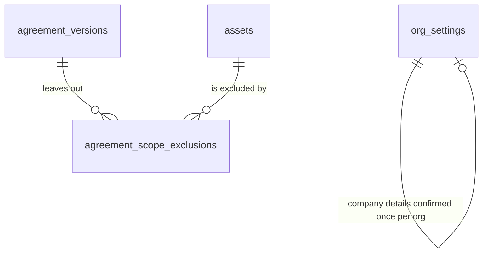

# P0 launch fixes: scope follows the priced lines, no placeholder company details, public legal pages

## Problem

A live test of the production app (2026-11-16, fictitious data) found three things that must not reach a real customer.

1. **The agreement promises service nobody priced.** AG-1002 had two service lines, AHU and RTU, at $4,800 a year. Its review page, PDF and signed contract still listed boilers, chillers, backflow assemblies and exhaust fans as "Service included". `site_service_scope` (exists) lists every active asset type on the site, whatever the lines cover. A contractor cannot take "remove the chillers" out of the promise without deleting the assets from the site register.
2. **Sample company details go to customers.** The review page, emails and PDFs showed "Service Pacts, 100 Sample Street, Burnaby, BC V5A 0A0, 604-555-0100". Nothing makes the contractor confirm their own legal name, address and phone before the first send.
3. **No public legal pages.** `/terms`, `/privacy` and `/security` redirect to `/login`, so a customer cannot read what they accept at checkout or sign under.

Evidence is the QA report's P0 list; it gives no volume or date beyond that single test run. When this ships, an agreement promises only what a priced line covers, a contractor can exclude one asset in two clicks, Send refuses until the company details are the contractor's own, and the three legal pages are public and linked.

## Flow

This reuses `site_service_scope`'s document shape (schema 2, exists), `private.freeze_agreement_version` and `apply_agreement_transition` (exist), the `service_line_asset_types` coverage table (exists), `sendAgreementAction` (exists), the settings form and `org_settings` row (exist), and `SiteShell`, `FOOTER_LINKS` and `PUBLIC_PATHS` (exist).

Scope:

1. `/agreements/[agreementId]` (exists) calls `AgreementReader.get` (exists). For an editable version it now calls `public.agreement_service_scope(agreement_id)` (door 1) instead of `site_service_scope`. The document keeps the same shape.
2. `agreement_service_scope` (door 1) keeps an asset only if its type is covered by a line of the shown version and the asset has no row in `agreement_scope_exclusions` (door 2). It also returns `uncovered`: the site's active types no line covers.
3. The new "Scope" control on the agreement page calls Server Actions in `agreement-actions.ts` (exists) that insert or delete exclusion rows through RPCs (door 2). Excluding a whole type is the existing line coverage checkbox.
4. Send: `sendAgreementAction` (exists) first reads the scope's `uncovered` list. A non-empty list without `confirmUncovered` returns `needs_confirmation`. The send dialog (exists) shows the list and resends with the flag.
5. Freeze: `private.freeze_agreement_version` (exists, redefined) writes `agreement_service_scope` into the snapshot. The PDF, portal and contract keep reading the snapshot, unchanged.

Company details:

6. Settings form (exists) saves the details through `settings/actions.ts` (exists), which now stamps `company_confirmed_at` (door 3).
7. `sendAgreementAction` (exists) asks `companyDetailsReady` (new, pure, in `web/domain`; placement decided while building) whether legal name, address and phone are present, confirmed, and not placeholder-shaped. If not it returns `company_unconfirmed` and writes nothing.

Legal pages:

8. `/terms`, `/privacy`, `/security` (new pages, no door) render inside `SiteShell` (exists). `PUBLIC_PATHS` in `session.ts` (exists) gains the three paths. `FOOTER_LINKS` (exists) and the register page (exists) link to them.

## Impact

| Front | What changes |
| --- | --- |
| domain | Existing term: **service scope** meant "every active type on the site". It now means "the assets whose type a line of this version covers, minus exclusions". Who reads it today: `AgreementReader`, `freeze_agreement_version`, the backfill, the PDF, `/review/[token]`, the contract document and the signed PDF. All read the snapshot or the live document, so they change by output only. |
| domain | New term: **scope exclusion**: one asset an agreement version leaves out. It is not a deactivation (AD-030): the asset stays live for every other agreement and the site register. |
| domain | New term: **placeholder company details**: a legal name, address or phone that matches a known demo shape. Nothing branches on it today. |
| domain | Existing term: `agreement.sent`. A send can now be refused for two new reasons, `company_unconfirmed` and `needs_confirmation`. Callers: `sendAgreementAction`, the send dialog and `sendAgreement.test.ts`. |
| stored data | Sent, accepted and completed agreements keep their frozen snapshot. AG-1002 and every other frozen version still list the old scope. This change never rewrites one, because it is what the customer was sent. |
| stored data | `org_settings` gains a nullable timestamp. Backfill: set it to now for every org whose three details are not placeholder-shaped; leave it null for the demo org. |
| stored data | Revising a sent agreement copies the old version's exclusions to the new version (assumption A2). |
| screens | `/agreements/[id]` gains the Scope control and a send confirmation; `/settings` gains a confirmation banner; the footer and `/register` gain three links. |
| tests | `sendAgreement.test.ts`, the agreement page tests and `service_included.sql` assume today's scope and change with it. |
| decisions | Doors 1 to 3 reach past this feature: rows `AD-NNN` in STATE.md. |
| docs | CONTEXT.md (agreement scope, org settings, public pages, Build log) and the ROADMAP Phase 5.9 owner-actions list. |

## Relations

One-way constraints: one exclusion per (version, asset), and deleting the version or the asset deletes it (door 2).

## Surface

| Route | In | Out | Status |
| --- | --- | --- | --- |
| `GET /terms` | none | public HTML page with the starter-text notice | `200` |
| `GET /privacy` | none | public HTML page with the starter-text notice | `200` |
| `GET /security` | none | public HTML page with the starter-text notice | `200` |
| `POST /rest/v1/rpc/agreement_service_scope` (PostgREST, members only) | `p_agreement_id` | scope document plus `uncovered` (door 1) | `200`, `401` anon |
| `POST /rest/v1/rpc/set_scope_exclusion` (PostgREST, writers only) | `p_version_id`, `p_asset_id`, `p_excluded` | none | `204`, `401` anon, `42501` for a viewer or another org, `P0001` for a frozen version |

## Landing

| One-way door | Literal shape | Alternative rejected |
| --- | --- | --- |
| 1. scope is derived from the lines | `public.agreement_service_scope(p_agreement_id uuid) returns jsonb`, `security invoker`, `search_path = ''`: `{"schema": 2, "types": [...same as site_service_scope...], "uncovered": [{"code": "BLR", "name": "Boiler", "assetCount": 3}]}`. `uncovered` is read at draft time and never stored in the snapshot. `freeze_agreement_version` writes `types` only, so frozen snapshots keep schema 2. | **Keep `site_service_scope` and filter in TypeScript:** two builders, and the draft preview could differ from what freezes (the reason service-included door 2 exists). **A boolean "in scope" on each asset:** it is per asset, so excluding the chiller for one customer would exclude it for every agreement. |
| 2. exclusions per version | `public.agreement_scope_exclusions (agreement_version_id, asset_id)`, primary key on that pair, `org_id` per AD-003 with composite FKs, `on delete cascade` both ways, written only by `public.set_scope_exclusion`, refused (`P0001`) unless the version is the current version of a draft. | **Exclusions keyed on the agreement, not the version:** a revision after send could not reflect a changed promise. **Writing the exclusion into the snapshot only:** a draft has no snapshot yet. |
| 3. confirmation marker | `org_settings.company_confirmed_at timestamptz null`, set by the settings save action only, null means unconfirmed. | **A boolean:** it cannot say when, and the audit question "since when" has no answer. **Enforcing only on the client dialog:** a direct RPC call bypasses it (the gate is in the send use case, see A3). |

- Nothing else in this change is hard to reverse. The placeholder patterns, the copy of the legal pages and the dialog layout are app-side.

## Criteria

### S1: A draft promises only what a priced line covers (P1)

The scope on the draft page, the PDF, the review page and the frozen snapshot list only equipment whose type a line covers and the contractor has not excluded.

**Acceptance Criteria**

1. The system SHALL include in an editable version's service scope only assets whose type is covered by at least one line of that version and that have no exclusion row for that version.
2. WHEN a draft has two lines covering AHU and RTU on a site that also has boiler, chiller and backflow assets THEN its scope SHALL list the AHU and RTU assets only.
3. WHEN a writer turns off the covering line's checkbox for a type THEN that type SHALL leave the draft's scope without deleting any asset.
4. WHEN a writer excludes one asset from the Scope control THEN the draft's scope SHALL omit that asset in at most two clicks and the asset SHALL stay active on the site register and in other agreements.
5. WHEN a writer includes an excluded asset again THEN the draft's scope SHALL list it again.
6. WHEN an agreement leaves draft THEN `freeze_agreement_version` SHALL write the same types the draft showed, and the PDF, the review page and the contract SHALL list those types only.
7. IF a version is not the current version of a draft THEN `set_scope_exclusion` SHALL refuse the change with `P0001` and write nothing.
8. IF the caller is a viewer or belongs to another org THEN `set_scope_exclusion` SHALL refuse it with `42501`.
9. WHEN a sent agreement is revised THEN the new version SHALL carry the old version's exclusions.
10. WHILE a draft has no line THEN its Scope section SHALL read `No equipment is covered until you add a service line` and list no type.
11. WHEN a writer sends a draft whose site has active types that no line covers and the request lacks `confirmUncovered` THEN `sendAgreementAction` SHALL return `needs_confirmation` with the type names and counts and SHALL not send.
12. WHEN the send dialog shows `needs_confirmation` and the writer confirms THEN the send SHALL proceed with `confirmUncovered` set.
13. The system SHALL NOT change the snapshot of any version that was already frozen.

**Independent test:** on a site with six asset types, add two lines, open the Scope control, exclude one RTU, open the PDF: only the other AHU and RTU assets appear, and Send names the four uncovered types.

### S2: Send refuses placeholder or unconfirmed company details (P1)

**Acceptance Criteria**

14. IF the org's legal name, address or phone is empty THEN `sendAgreementAction` SHALL return `company_unconfirmed` and SHALL not send.
15. IF `company_confirmed_at` is null THEN `sendAgreementAction` SHALL return `company_unconfirmed` and SHALL not send.
16. IF the legal name contains `Kettle Ridge`, the address contains `Sample Street` or its postal code ends `0A0`, or the phone matches `555-01\d\d`, THEN `sendAgreementAction` SHALL return `company_unconfirmed` even when `company_confirmed_at` is set.
17. WHEN a writer with the owner or admin role saves the settings form with all three details present and not placeholder-shaped THEN the system SHALL set `company_confirmed_at` to the save time.
18. WHEN a send returns `company_unconfirmed` THEN the dialog SHALL say which of the three details is the problem and link to `/settings`.
19. WHILE `company_confirmed_at` is null or a detail is placeholder-shaped the settings page SHALL show a banner `Confirm your company details before you send agreements`.
20. WHEN the migration runs THEN it SHALL set `company_confirmed_at` for every org whose three details are all present and not placeholder-shaped, and leave the rest null.

**Independent test:** in the demo org press Send: refused with the settings link. Replace the three details, save, press Send: the send proceeds.

### S3: Public legal pages (P1)

**Acceptance Criteria**

21. WHEN a signed-out visitor requests `/terms`, `/privacy` or `/security` THEN the system SHALL answer `200` with that page and not redirect to `/login`.
22. The system SHALL show on each of the three pages the notice `Starter text, pending review by a lawyer` and SHALL NOT claim that a lawyer has reviewed it.
23. The system SHALL link to all three pages from the public site footer.
24. The system SHALL link to `/terms` and `/privacy` beside the submit button on `/register`.
25. The `/security` page SHALL state only facts that are verified in the repo or the project settings, and SHALL name the hosting region only after it is verified (open question 1).
26. WHEN a visitor opens any of the three pages on a 375px wide screen THEN there SHALL be no horizontal scroll.

**Independent test:** in a signed-out window open each of the three URLs from the footer.

## Out of scope

| Excluded | Why |
| --- | --- |
| Lawyer review and extra contract wording (liability, insurance, response times, late payment, force majeure) | needs a lawyer; this change ships labelled starter text only |
| The blank embedded signing form | not reproduced in code; needs real-device testing |
| Rewriting frozen snapshots of already sent agreements | they record what the customer was sent |
| Excluding a type with one control separate from line coverage | unchecking the line's type already does it (AC 3) |
| An "unpriced equipment" amount-based rule (lines at $0) | lines require a cost; the unit is coverage, not amount |

## Assumptions

| Assumption | Chosen default | Rationale | Confirmed? |
| --- | --- | --- | --- |
| A1. Scope by coverage, with a warning for the rest | Derive scope from line coverage and warn at Send, instead of listing everything and warning | the report offers either; deriving makes the wrong promise impossible by default | n |
| A2. Exclusions carry over on revise | Copy them to the new version | a revision should not silently re-promise a type the contractor removed | n |
| A3. Where the company gate lives | In `sendAgreementAction` and its use case, not in `apply_agreement_transition` | n8n renewal sends are a separate path and are not changed here; the gate is not bypass-proof against a direct RPC call | n |
| A4. Who confirms company details | Owner or admin saving settings | those roles already own the settings page | n |
| A5. Placeholder patterns | The four patterns in AC 16 | they match the demo seed and reserved fictitious phone numbers; a real contractor will not match | n |
| A6. Legal page copy | Short starter text in English, plain language, written from what the product actually does | the product has no lawyer-approved text yet | n |

**Open questions:**

| # | Kind | Question | Until answered |
| --- | --- | --- | --- |
| 1 | blocks go-live | What is the verified hosting region of the Supabase project and of the app host? | AC 25 names no region |
| 2 | blocks go-live | Who reviews the starter legal text? | the notice in AC 22 stays |
| 3 | open | Does `private.run_renewals` or the n8n renewal flow send agreements on its own, and should the company gate apply there? | A3 stands; the renewal path is unchanged |

## Observable

| Surface | Decision | Landing |
| --- | --- | --- |
| screen `/agreements/[id]` Scope | empty state | AC 10 |
| screen `/agreements/[id]` Scope | loading state | existing - the page is server rendered, the Server Actions use the pending state the line form already shows |
| screen `/agreements/[id]` Scope | error and unauthorised states | AC 7, AC 8 |
| screen `/agreements/[id]` Scope | destructive action confirms | n/a - exclusion is reversible by AC 5 and deletes nothing |
| screen send dialog | error states | AC 11, AC 18 |
| screen `/settings` | empty and error states | AC 14, AC 19 |
| screen `/settings` | destructive action confirms | n/a - saving the form is not destructive |
| screen `/terms`, `/privacy`, `/security` | empty, loading, error and unauthorised states | n/a - static public pages, no data and no sign-in |
| document legal pages | structure, tone and next step | AC 22, A6 |
| API `POST /rest/v1/rpc/set_scope_exclusion` | error shape and codes | AC 7, AC 8 |
| API `POST /rest/v1/rpc/agreement_service_scope` | error shape and codes | existing - PostgREST errors as for `site_service_scope` |
| all new RPCs | versioning, rate limits | n/a - internal PostgREST functions consumed only by this app |
| all new pages | density and ordering | existing - the `SiteShell` page pattern |

## Sources

- QA report "live test of the production app", 2026-11-16, P0 items 2, 3 and 4 - the findings this settles
- `.specs/features/service-included/plan.md` doors 1 to 5 - the scope document and freeze this change redefines
