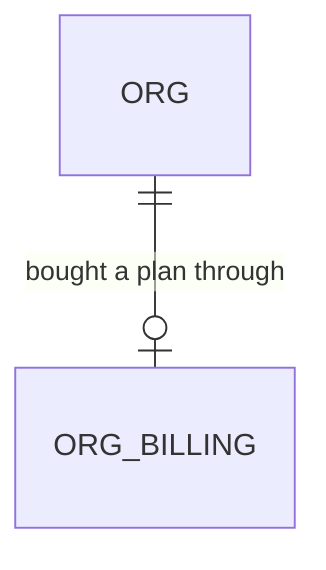

# Change plan from the billing page

Roadmap Phase 5, follow-up to the in-app billing page (`.specs/features/billing-page/`, which listed plan and seat changes as out of scope). The owner asked on 2026-11-10 that a customer be able to change their type of plan. One feature at a time (decision 22).

## Problem

An owner or admin on the Starter plan who needs the Team plan (or the other way round) has no way to change it. The billing page shows the plan and lets them update the card and cancel, but the plan itself is fixed at whatever they picked at sign-up, so the only route is asking the product's builder to edit the subscription in the Stripe dashboard. The owner called the missing control a gap. The roadmap gives no upgrade or support figure, so none is claimed here.

When this ships, the billing page lists Starter, Team and Business with their monthly price and included seats, marks the current one, and lets an owner or admin switch to another after a confirming step that says what will be charged and when. The seat count carries over by the same rule sign-up already uses, and the app's own record of the plan follows the change.

## Flow

Reuses the billing page and its `BillingGateway` port and `stripeBillingGateway` adapter, `makeBilling` and its role and `org_billing` read, `PLANS`, `seatsAfterPlanChange` and `monthlyTotalCents` in `domain/billing`, the two-step confirm pattern of `CancelPrompt`, and the role-gated security-definer function pattern of `save_agreement_term`, instead of a second Stripe client, a copy of the subscription in our database or a new role check.

1. Owner or admin opens `GET /settings/billing` (exists, changed): the overview now also reads which of the plan and seat items are on the subscription, and the page renders a plan list under "Plan" with the current plan marked
2. Presses "Switch to Team" -> `PlanChangePrompt` (new) shows the new plan, its monthly price, the seat effect from `seatsAfterPlanChange`, and when it is charged (nothing until the trial ends, or prorated now) -> "Confirm"
3. `changePlanAction(planKey)` (new Server Action) -> `makeBilling().changePlan` (exists, changed) checks the role, reads `org_billing`, refuses the plan the org is already on, and works out the new seat count
4. `BillingGateway.changePlan` (exists, changed; door 1) makes sure Stripe has a product for the new plan, then updates the subscription's plan item to a price on it and its seat item to the new quantity, with proration
5. `public.set_org_plan` (new, door 2) records the new plan and seat count on `org_billing` as the signed-in member; the page re-reads Stripe and shows the new plan

## Impact

| Front | What changes |
| --- | --- |
| domain | new term: plan change - moving a live subscription to another of the three plans, effective at once and prorated; the seat count follows `seatsAfterPlanChange` |
| domain | existing term: `org_billing.plan` meant "the plan bought at sign-up"; it now follows changes. Who branches on it today: the billing page's plan name only (plan limits are not built yet), so nothing else moves |
| domain | existing term: `BillingOverview` gains the subscription's plan and seat items so the page can show the current plan from Stripe and the change can target the right item |
| Stripe | Checkout (`stripeCheckoutStarter`) tags its two line-item products with `metadata[sa_kind]` = `plan` or `seat`, so a subscription's items can be told apart. No live subscription exists yet (no live checkout has run), so there is nothing to migrate; approved Checkout tests that pin the exact line-item keys are amended under this plan |
| stored data | one new function, no table or column. `org_billing` is updated through it; today nothing but provisioning writes that table |
| tests | billing-page checks that name the overview shape and the page's Plan section gain cases; none is rewritten. Checkout checks that pin product keys are amended |
| not changed | the webhook and its ledger, provisioning, the card and cancel flows, RLS policies, the Settings menu |

## Relations

One-way constraints: none new on stored tables; `org_billing.plan` keeps its check `in ('starter', 'team', 'business')` and `seats` its check `between 1 and 50`. The function of door 2 relies on both.

## Surface

| Route | In | Out | Status |
| --- | --- | --- | --- |
| `GET /settings/billing` | session cookie | the page, now with a plan list | `200`, `303` to `/login`, `303` to `/settings` (unchanged) |
| `changePlanAction` (Server Action) | `planKey` (`starter`, `team` or `business`) | the page re-read, or a notice | `200`, `303` to `/login` |
| Stripe `GET /v1/products/{id}` and `POST /v1/products` (outbound) | a deterministic product id and its name | the product | `200`, `404` on the read (then created); anything else `unavailable` |
| Stripe `POST /v1/subscriptions/{id}` (outbound) | the plan item's new price, the seat item's quantity, `proration_behavior` | the subscription | `200`; anything else `unavailable` |
| `rpc set_org_plan(p_plan text, p_seats integer)` | plan key and seat count | nothing | `200` success, `42501` not an owner or admin, `P0002` no billing record, `22023` invalid plan or seats |

## Landing

| One-way door | Literal shape | Alternative rejected |
| --- | --- | --- |
| 1. Stripe objects a plan change relies on | Products with deterministic ids `sa_plan_starter`, `sa_plan_team`, `sa_plan_business` and `sa_extra_seat`, each carrying `metadata[sa_kind]` (`plan` or `seat`), created on first use by `POST /v1/products` with that `id`. A plan change updates the subscription with `items[0][id]=<plan item>`, `items[0][price_data][product]=sa_plan_<key>`, `currency=cad`, `unit_amount`, `recurring[interval]=month`, and the seat item's `quantity`, with `proration_behavior=create_prorations`. Checkout tags its products the same way | Stripe Prices with lookup keys: a second object to create, find and keep in step with `PLANS`. Reusing the plan item's existing product: its name would still say the old plan after a switch. Identifying items by product name: breaks when a name changes |
| 2. How the app's record of the plan changes | `create function public.set_org_plan(p_plan text, p_seats integer) returns void language plpgsql security definer set search_path = ''`: finds the caller's org through `memberships`, requires `private.has_org_role(org, array['owner','admin'])`, validates the plan and `seats between 1 and 50`, updates `public.org_billing` where `org_id` is that org; `revoke ... from public, anon`, `grant execute ... to authenticated` | An update policy on `org_billing`: the table is deliberately select-only and a policy would let a member write any column, including the Stripe ids. Updating from the Stripe webhook: nothing applies those events yet, and the page must be right at once; the webhook can also write this later through the same function's effect |
| 3. When the change takes effect | Immediately, with Stripe's proration (`create_prorations`); during a trial it only changes what is charged when the trial ends | Waiting for the period end through a subscription schedule: a second Stripe object and a "pending change" state to show, for a first version |

- Nothing else in this change is hard to reverse: the plan list's layout and wording, which statuses allow a switch, and the confirm text are edits.
- Door 2 needs the owner's go-ahead to apply to the hosted project (a migration, as `20261110100000` did); the build proves it on a rolled-back SQL recipe first.
- Door 1 reaches past this feature: seat changes will reuse the products and the item identification. It belongs in `STATE.md` as an AD at the end of the build.

## Criteria

### S1: The page lists the plans and marks the current one (P1)

**Acceptance Criteria**

1. WHEN an owner or admin opens `/settings/billing` for a subscription that is not `canceled` THEN the system SHALL list Starter, Team and Business, each with its monthly price in CAD and its included seats, from `PLANS`
2. The system SHALL mark the plan on the subscription's plan item as "Current plan" and show no switch control on it; the current plan comes from the Stripe plan item's product, not from `org_billing`
3. WHEN the subscription is set to end THEN the system SHALL show the list without switch controls and the line "Resume your subscription to change plan"
4. WHEN the subscription is `canceled` THEN the system SHALL NOT show the plan list
5. IF the subscription's plan item cannot be told apart (no product with `sa_kind` `plan`) THEN the system SHALL show the list without switch controls and say "This plan can't be changed here" rather than guess an item

**Independent test:** with a sandbox subscription made through Checkout, open the page and see three plans with the current one marked.

### S2: A confirming step says what will happen (P1)

**Acceptance Criteria**

6. WHEN an owner or admin presses "Switch to <plan>" THEN the system SHALL show a prompt naming the new plan and its monthly price, the new seat line ("Included seats: 5. Extra seats: 0" from `seatsAfterPlanChange` and `monthlyTotalCents`), and the new monthly total
7. WHILE the subscription is `trialing` the prompt SHALL say nothing is charged until the trial ends on <date>; otherwise it SHALL say the change takes effect now and the difference is prorated
8. WHEN the member presses "Keep my plan" THEN the system SHALL close the prompt and call nothing; only "Confirm switch" SHALL call the action, once

**Independent test:** press Switch to Team on Starter and read the prompt; press Keep my plan and see no change.

### S3: Confirming changes the plan in Stripe and in the app (P1)

**Acceptance Criteria**

9. WHEN `changePlanAction` runs for an owner or admin with a valid plan different from the current one THEN the system SHALL make sure Stripe has the product `sa_plan_<key>` (creating it when the read answers `404`), update the subscription's plan item to a monthly CAD price from `PLANS` on that product and its seat item to the extra seats the new plan needs, with `proration_behavior` `create_prorations`
10. WHEN the new plan needs no extra seats THEN the system SHALL set the seat item's quantity to 0 or remove it, and WHEN it needs some and no seat item exists THEN the system SHALL add one on `sa_extra_seat` at `EXTRA_SEAT_CENTS`
11. WHEN the Stripe update succeeds THEN the system SHALL call `set_org_plan` with the new plan and seat count as the signed-in member and re-read the page showing the new plan
12. IF Stripe already holds the requested plan and the app's record agrees THEN the system SHALL answer "You're already on this plan" and make no write at Stripe (it reads the subscription once to know; amended 2026-11-10 with the owner's approval so a failed save cannot strand the owner)
13. IF `set_org_plan` fails after Stripe was updated THEN the system SHALL still show the new plan (read from Stripe), log one line with the error code only, and a repeat of the same change SHALL succeed and change nothing at Stripe
14. WHEN the same plan change is submitted twice THEN the system SHALL leave the subscription and `org_billing` in the same state as after one
15. The system SHALL take the org, role and Stripe ids from the session and `org_billing`, and from the browser only the plan key, which SHALL be one of `starter`, `team`, `business`; any other value SHALL answer "We couldn't change your plan" and call nothing
16. WHEN Checkout creates a subscription THEN its plan line's product SHALL carry `metadata[sa_kind]` `plan` and its extra-seat line's product `seat`

**Independent test:** on a sandbox subscription switch from Starter to Team, confirm, and see Team marked, the Stripe subscription on the new price, and `org_billing.plan` equal to `team`.

### S4: Refusals and failures are visible (P1)

**Acceptance Criteria**

17. IF a member who is not an owner or admin submits `changePlanAction` THEN the system SHALL show "You don't have permission to change this", call no Stripe write and no function; a signed-out or no-membership user SHALL get `303` to `/login`
18. IF Stripe refuses or does not answer the product read, the product create or the subscription update within 10 s THEN the system SHALL show "We couldn't change your plan. Try again.", change nothing in `org_billing`, and log one line with the HTTP status and Stripe's error code only, never an id, the key or the body
19. IF `STRIPE_SECRET_KEY` or `APP_BASE_URL` is unset THEN the system SHALL answer `not_configured`, show "Billing isn't available yet" and call nothing
20. WHILE the change is being made the system SHALL disable the confirm control so one press makes one change

### S5: The database function is safe (P1)

**Acceptance Criteria**

21. WHEN an owner or admin calls `set_org_plan` with a valid plan and `seats` between 1 and 50 THEN the system SHALL update that org's `org_billing.plan` and `seats` and nothing else
22. IF the caller is an estimator, a viewer or not a member THEN `set_org_plan` SHALL raise `42501` and change nothing; IF the org has no `org_billing` row THEN it SHALL raise `P0002`; IF the plan is not one of the three or seats is outside 1 to 50 THEN it SHALL raise `22023`
23. The system SHALL NOT let a member change any `org_billing` column other than `plan` and `seats`, nor any other org's row, through any path; `anon` SHALL have no execute privilege on `set_org_plan`

**Independent test:** the SQL recipe as an owner, an estimator and a member of another org.

### S6: The plan list works on every size (P1)

**Acceptance Criteria**

24. WHILE the page is at 375, 768 or 1440 px wide the system SHALL show no horizontal scroll and every plan control SHALL be at least 44 by 44 px on mobile and tablet

**Independent test:** the AGENTS.md Playwright pass on `/settings/billing` at the three sizes with touch emulation.

## Out of scope

| Excluded | Why |
| --- | --- |
| Changing the seat count by itself | Its own item; here seats only follow the plan rule |
| Scheduling the change for the period end, or a proration preview with the exact amount | Needs a subscription schedule or an upcoming-invoice read; the prompt states the rule, not the figure |
| Annual billing or other currencies | Checkout is monthly CAD |
| Enforcing plan limits (live agreements, AI imports) when moving to a smaller plan | The limits item is not built; a downgrade is allowed |
| Applying `customer.subscription.updated` from the webhook to `org_billing` | Nothing applies those events yet; the page reads Stripe live and the function covers the in-app change |
| Legacy subscriptions made before Checkout tagged its products | None exist: no live checkout has run |
| Changing the plan prices | Price points are still drafts (decision 10); this reads `PLANS` |

## Assumptions

| Assumption | Chosen default | Rationale | Confirmed? |
| --- | --- | --- | --- |
| Who may change the plan | Owner and admin | Same as the rest of billing | n |
| When it takes effect | Immediately, prorated; during a trial no charge until it ends | Simplest correct behaviour with Stripe; door 3 | n |
| Downgrades | Allowed, with the same prompt | Limits are not enforced yet | n |
| Where the current plan is read | From Stripe's plan item on every page view, not from `org_billing.plan` | Stripe is the truth; the column may lag after a failed write | n |
| Seat rule | `seatsAfterPlanChange(from, to, seats)`: seats equal to the old included count move to the new included count, otherwise they stay unless below the new minimum | The rule sign-up already uses (register-seats AC 11) | n |
| Item identification | By `metadata[sa_kind]` on each item's product, read with `expand[]=items.data.price.product` | A product name is not a contract | n |
| Product creation | On first use, with a deterministic id; a `404` on the read means create | Idempotent and needs no setup step | n |
| Prices shown | From `PLANS`, in CAD, draft | Decision 10: price points are the owner's | n |
| Where the plan list sits | Inside the existing Plan card of the billing page | The page already groups plan, card and invoices | n |

**Open questions:** none block the build.

| # | Kind | Question | Until answered |
| --- | --- | --- | --- |
| 1 | blocks go-live | Apply the `set_org_plan` migration to the hosted project | The in-app plan change cannot record the plan; Stripe would change and `org_billing.plan` would lag (the page still reads Stripe) |
| 2 | open | Should a downgrade wait for the period end instead of applying now? | Applies now; moving to a schedule is a later change |
| 3 | open | The price points are drafts (decision 10); the page shows whatever `PLANS` holds | Draft prices are shown and charged in the sandbox only |

## Observable

| Surface | Decision | Landing |
| --- | --- | --- |
| screen `/settings/billing` (plan list) | empty state | AC 4 (canceled: no list) and AC 5 (cannot tell the items apart) |
| screen `/settings/billing` (plan list) | loading state | existing - the page's loading screen (billing-page AC 29) |
| screen `/settings/billing` (plan list) | error state | AC 18, AC 19 |
| screen `/settings/billing` (plan list) | unauthorised | AC 17 |
| screen `/settings/billing` (plan list) | density and ordering | existing - the page's section cards; Starter, Team, Business in price order inside the Plan card |
| screen `/settings/billing` (plan list) | destructive action confirms | AC 6, AC 7, AC 8 (a switch confirms and states the charge) |
| action `changePlanAction` | error shape and codes | AC 12, AC 15, AC 17, AC 18 (a notice on the page) |
| action `changePlanAction` | who may call it | AC 15, AC 17 |
| action `changePlanAction` | versioning, rate limits | n/a - an authenticated Server Action on one member's own org; Stripe rate-limits its side and a failure is AC 18 |
| rpc `set_org_plan` | error shape and codes | AC 22 |
| rpc `set_org_plan` | who may call it | AC 22, AC 23 |
| outbound Stripe calls | error shape, timeout | AC 18 |

## Sources

- The owner's request of 2026-11-10 ("customer cannot change types of plans")
- `.specs/features/billing-page/plan.md` (Out of scope: plan and seat changes) and `.specs/STATE.md` AD-178 - the gateway and the page this extends
- `.specs/features/register-seats/plan.md` AC 11 and `web/domain/billing/index.ts` (`seatsAfterPlanChange`, `monthlyTotalCents`) - the seat rule
- `supabase/migrations/20261110100000_workspace_provisioning.sql` - `org_billing`, its checks and its select-only policy
- Stripe docs, update a subscription and prorations: https://docs.stripe.com/billing/subscriptions/change, https://docs.stripe.com/billing/subscriptions/prorations
