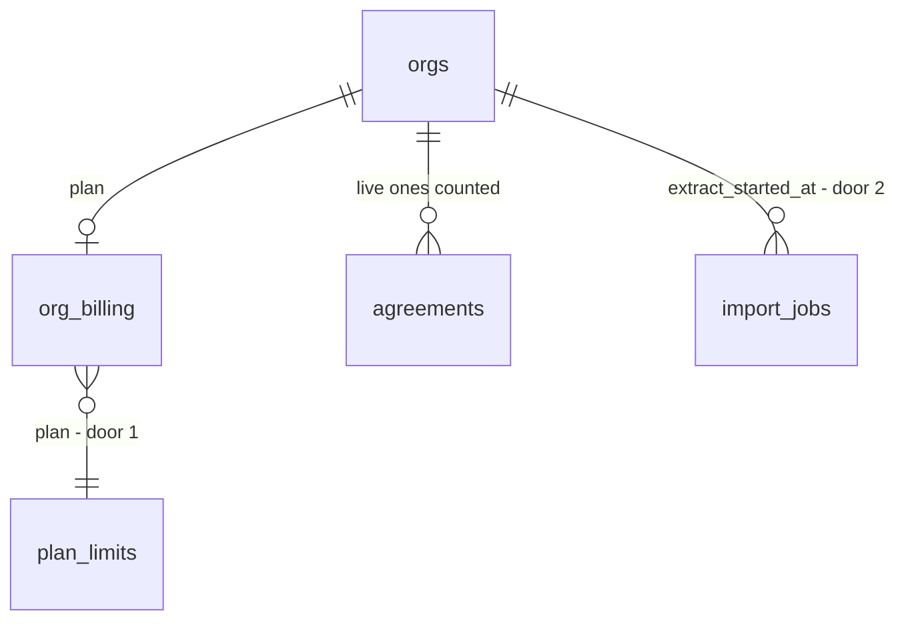

# Plan limits

## Problem

Every plan on `/pricing` promises a number of live agreements and a number of AI imports a month (Starter 15 and 10, Team 60 and 40, Business 200 and 120), and nothing in the product enforces either. A Starter tenant can hold 300 live agreements and run 500 imports, and each import calls Claude, so the contractor pays for work the plan never charged for. The ROADMAP records the gap itself: "drafts are unmetered until plan limits ship". The owner of a tenant also has no way to see how close they are to a limit; the first they would hear of it is a refusal with no explanation.

Evidence the sources give: the numbers above (ROADMAP "Pricing (draft)", `PLANS` in `web/domain/billing/index.ts`), and decision 10 ("limit by live agreements and an AI-import allowance"). The price points and therefore the limits are still drafts, so they must be easy to change. No usage data exists yet.

When this ships, a member who reaches a limit is told which limit, what they have used and what to do (change plan), and an owner or admin sees usage against the plan on the billing page.

## Flow

Reuses `PLANS` in `web/domain/billing` as the one place the numbers are written, `create_agreement` and `record_extraction_chunk` as the places work starts, and the billing page use case for the usage readout.

1. Staff press New agreement -> `createAgreement` server action (exists) -> `agreementStore.create` (exists) -> `public.create_agreement` (exists, extended): counts the org's live agreements, compares with the plan's limit, refuses with a named hint, otherwise inserts as today.
2. A member starts extracting an import -> `makeExtractImport` (exists) -> on the first chunk only, asks `public.import_allowance` (door 2) before `AssetExtractor.extract` (exists) is called; refused means Claude is never called.
3. First chunk recorded -> `public.record_extraction_chunk` (exists, extended) stamps the job's `extract_started_at` (door 2), which is what the allowance counts.
4. An owner or admin opens `/settings/billing` -> `makeBilling.load` (exists) reads Stripe as before, and `makeBilling.usage` (exists) reads `public.org_usage` (door 3) apart from it; the page hands the result to the view as its own `usage` prop -> usage rows next to the plan name.
5. A plan change (`set_org_plan`, exists) changes the limits read by hops 1 and 2 on the next call; nothing is re-evaluated or removed.

## Impact

| Front | What changes |
| --- | --- |
| domain | new term: live agreement - an agreement in `draft`, `sent` or `changes_requested`, the same set the `agreements_one_live_per_site` index already uses; lives in SQL and in `LIVE_STATUSES` (`web/domain/agreement/index.ts`) |
| domain | new term: AI import - an import job whose first extraction chunk was recorded in the calendar month (America/Vancouver); re-running the same job never counts twice |
| domain | existing term: `Plan.liveAgreements` and `Plan.aiImports` were display copy; they become enforced numbers, and the SQL table of limits must equal them |
| existing callers | `create_agreement` gains a new refusal; callers that branch on its errors: `supabaseAgreementStore.create` (maps 23505, P0002, 42501) and the New agreement launcher. The renewal job (`20261102180706_renewal.sql`) inserts agreements itself and is not routed through it |
| existing callers | `makeExtractImport` gains a refusal code; the imports screen maps its codes to copy |
| stored data | orgs with no `org_billing` row (the demo org, any org created before provisioning) have no plan and stay unlimited; import jobs that already exist keep `extract_started_at` null and so do not count toward any month (no tenant has pilot usage yet, so nothing is hidden); nothing else to migrate |

## Relations

One-way constraints: `plan_limits` has one row per plan key and `org_billing.plan` references it (door 1); `import_jobs.extract_started_at` is null until the first chunk is recorded (door 2).

## Surface

| Route | In | Out | Status |
| --- | --- | --- | --- |
| `rpc create_agreement(p_site_id)` | `p_site_id` | agreement id | 200 id, 404 `P0002` not found, 403 `42501` forbidden, 409 `23505` site has a live agreement, 409 `55000` hint `site_inactive`, 409 `55000` hint `plan_limit_agreements` (new) |
| `rpc import_allowance(p_job_id)` | `p_job_id` | used, limit, allowed | 200 used, limit, allowed, 404 `P0002` job not found, 403 `42501` forbidden |
| `rpc org_usage()` | none | plan, live agreements used and limit, AI imports used and limit, month start | 200 usage, 403 `42501` not an owner or admin |

## Landing

| One-way door | Literal shape | Alternative rejected |
| --- | --- | --- |
| 1. Limits live in the database | `create table private.plan_limits (plan text primary key check (plan in ('starter','team','business')), live_agreements integer not null check (live_agreements > 0), ai_imports integer not null check (ai_imports > 0))`, seeded from the draft table; `org_billing.plan` references it; a parity test asserts the rows equal `PLANS` | Pass the limit from the app into `create_agreement`: a member can call the RPC directly with any number. Read `PLANS` only in TypeScript: the guard in SQL then has nothing to compare with |
| 2. What an AI import is | `alter table public.import_jobs add column extract_started_at timestamptz`, set once by `record_extraction_chunk` when `p_expected_cursor is null`; allowance = count of org jobs with it set in the current Vancouver month | Count `extracted_at`: a job abandoned halfway has already cost Claude calls and would be free. Count at upload: an upload that never extracts is not an AI import. A separate usage ledger table: a second source of truth for what `import_jobs` already says |
| 3. Usage is read, never stored | `org_usage()` is a `security definer` function that computes both counts from `agreements` and `import_jobs` on each call | A counter column on `org_billing`: drifts when an agreement is withdrawn or a job deleted |

- A limit refusal is a hint on `55000`, the pattern `site_inactive` already sets; no new error channel
- Nothing else in this change is hard to reverse

## Criteria

### S1: A plan's live-agreement limit stops a new agreement (P1)

A Starter org with 15 live agreements cannot create a 16th until one is no longer live.

**Acceptance Criteria**

1. WHEN a member creates an agreement and the org's live agreements (status `draft`, `sent` or `changes_requested`) are fewer than its plan's `live_agreements` THEN the system SHALL create it as today
2. IF the org's live agreements equal or exceed its plan's `live_agreements` THEN `create_agreement` SHALL raise `55000` with hint `plan_limit_agreements` and insert no agreement and no version
3. WHEN an agreement leaves `draft`, `sent` and `changes_requested` (accepted, refused, expired, withdrawn) THEN it SHALL stop counting toward the limit on the next create
4. WHEN the org has no `org_billing` row THEN `create_agreement` SHALL apply no limit
5. WHEN the New agreement action is refused for the limit THEN the screen SHALL say "Your Starter plan allows 15 live agreements and you have 15" with the plan's own name and numbers and a link to `/settings/billing`, and no agreement SHALL appear
6. WHEN a member who is not an owner or admin sees the refusal THEN it SHALL say to ask an owner or admin to change the plan and SHALL NOT link to billing
7. WHEN the renewal job creates a renewal draft for a contract near its end THEN it SHALL create it even if the org is at its limit
8. WHILE an org is over its limit after a downgrade, the system SHALL keep every existing agreement readable and editable and SHALL refuse only new creates

**Independent test:** set an org to Starter, create 15 agreements on 15 sites, press New agreement on a 16th site and read the message; withdraw one and create succeeds.

### S2: A plan's AI-import allowance stops a new extraction (P1)

A Starter org that has started 10 imports this month cannot start an 11th until next month.

**Acceptance Criteria**

9. WHEN a job's first extraction chunk is recorded THEN the system SHALL set that job's `extract_started_at` to the database time, once, and a later chunk or a retry SHALL NOT change it
10. WHEN a member starts extraction on a job and the org's jobs with `extract_started_at` in the current America/Vancouver month are fewer than the plan's `ai_imports` THEN the system SHALL call the extractor as today
11. IF that count equals or exceeds the plan's `ai_imports` THEN `makeExtractImport` SHALL return `plan_limit` and SHALL NOT call `AssetExtractor.extract`
12. WHILE a job already has `extract_started_at` set, the system SHALL let it finish its remaining chunks even when the allowance is used up
13. WHEN a new Vancouver calendar month begins THEN the previous month's jobs SHALL stop counting
14. WHEN the org has no `org_billing` row THEN extraction SHALL apply no allowance
15. WHEN extraction is refused for the allowance THEN the imports screen SHALL say "Your Starter plan allows 10 AI imports a month and you have used 10. The count resets on <month start of next month>" and the uploaded job SHALL stay `parsed` so it can be extracted later
16. IF reading the allowance fails THEN `makeExtractImport` SHALL return `unavailable` and SHALL NOT call the extractor

**Independent test:** with a fake extractor, run 10 jobs to their first chunk on a Starter org, start an 11th and see `plan_limit` with the extractor call count unchanged; set the clock to the next month and it starts.

### S3: Owners and admins see usage on the billing page (P2)

`/settings/billing` shows both numbers against the plan.

**Acceptance Criteria**

17. WHEN an owner or admin opens `/settings/billing` THEN the page SHALL show "Live agreements 7 of 15" and "AI imports this month 3 of 10" for the org's plan, and the month's reset date
18. WHEN usage is at or over a limit THEN that row SHALL be marked as full in words, not by colour alone
19. IF the usage read fails THEN the page SHALL show the rest of the billing page and a "Usage unavailable" line in that section
20. WHEN a member who is not an owner or admin calls `org_usage()` THEN it SHALL raise `42501`

**Independent test:** open the billing page for the demo owner after setting the demo org to a plan; the two rows match the database.

## Out of scope

| Excluded | Why |
| --- | --- |
| Metering the "Other trade" catalog draft | It runs once on an empty catalog during setup; a limit there would block onboarding. Revisit with real usage numbers |
| Enforcing the paid seat count at invite time | Already a separate later item in the ROADMAP |
| Warnings before the limit (80% email), overage purchase, auto-upgrade | New capabilities; the refusal names the plan change |
| Changing the draft price points or limits | Decision 10, needs the owner; the numbers live in one seeded table so changing them is one migration |
| Limits for signatures, storage or contracts | Not in the plan table |
| Hiding or archiving agreements when a tenant downgrades | AC 8 keeps them; removing a customer's records on a plan change is a product call |

## Assumptions

| Assumption | Chosen default | Rationale | Confirmed? |
| --- | --- | --- | --- |
| Does the trial have limits? | Yes, the chosen plan's | The trial is the plan on a card, and an unlimited trial is a free path around the allowance | n |
| Concurrent first chunks may overshoot the allowance | Accept: no lock around the count and the stamp, so two simultaneous first chunks can both pass at limit minus one | The harm is one extra import; a lock would hold a database row open across a Claude call | n |
| A failed first Claude call | Not counted: `extract_started_at` is set only when the chunk is recorded | The tenant is not charged for our failure; Claude cost of a retry is ours | n |
| Renewal drafts count as live | Yes, but are never refused (AC 7) | Refusing a renewal loses revenue the product exists to keep | n |
| Where is the month boundary | Calendar month in America/Vancouver, the reporting rule | One timezone for every date rule; Canada outside Quebec at launch | n |
| Wording "Your Starter plan allows…" | As in AC 5 and 15, with the vocabulary word for the item unchanged (these are agreements and imports, not items) | Plain statement of the limit and the number used | n |

**Open questions:** none blocking.

| # | Kind | Question | Until answered |
| --- | --- | --- | --- |
| 1 | open | Resolved 2026-11-12: the owner confirmed the draft limits (15/60/200 and 10/40/120) as the numbers to enforce. Re-size them with the `ai-pricing` skill from the first pilot's tokens per import | One migration changes them |

## Observable

| Surface | Decision | Landing |
| --- | --- | --- |
| screen New agreement (existing launcher) | error state | AC 5, AC 6 |
| screen New agreement | unauthorised (viewer) | existing - `42501` already maps to `forbidden` |
| screen New agreement | loading, empty | n/a - the launcher is unchanged; only a new refusal copy is added |
| screen Imports (extract step) | error state | AC 15, AC 16 |
| screen Imports | destructive action confirms | n/a - nothing is deleted; the job stays `parsed` (AC 15) |
| screen `/settings/billing` | empty state | existing - no subscription already renders "no_subscription"; usage is shown only with a plan |
| screen `/settings/billing` | error state | AC 19 |
| screen `/settings/billing` | unauthorised | AC 20 and existing - the page already sends other members back to Settings |
| screen `/settings/billing` | loading | n/a - server rendered, as the page is today |
| rpc `create_agreement` | error shape and codes | Surface row: `55000` with hint `plan_limit_agreements`, the `site_inactive` pattern |
| rpc `import_allowance`, `org_usage` | error shape, who may call | Surface rows; `authenticated` only, `anon` and `public` revoked |
| all new rpc | versioning, rate limits | n/a - internal to the app, called under a member session, no external consumer |

## Sources

- ROADMAP Phase 5 "Plan limits by live agreements and an AI-import allowance", decision 10 and 20 - the unit and the draft numbers
- `web/domain/billing/index.ts` `PLANS` - the numbers and the comment "the plan-limits item defines the unit"
- ROADMAP Phase 5 "Other trade" item - drafts unmetered until plan limits ship
