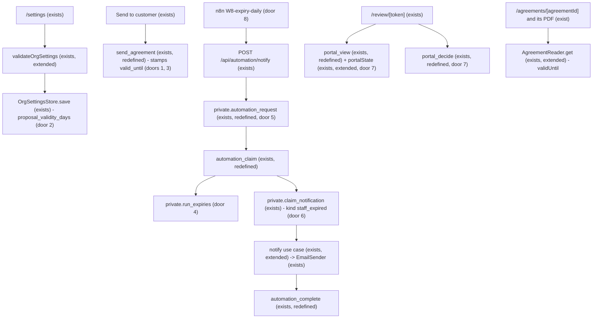
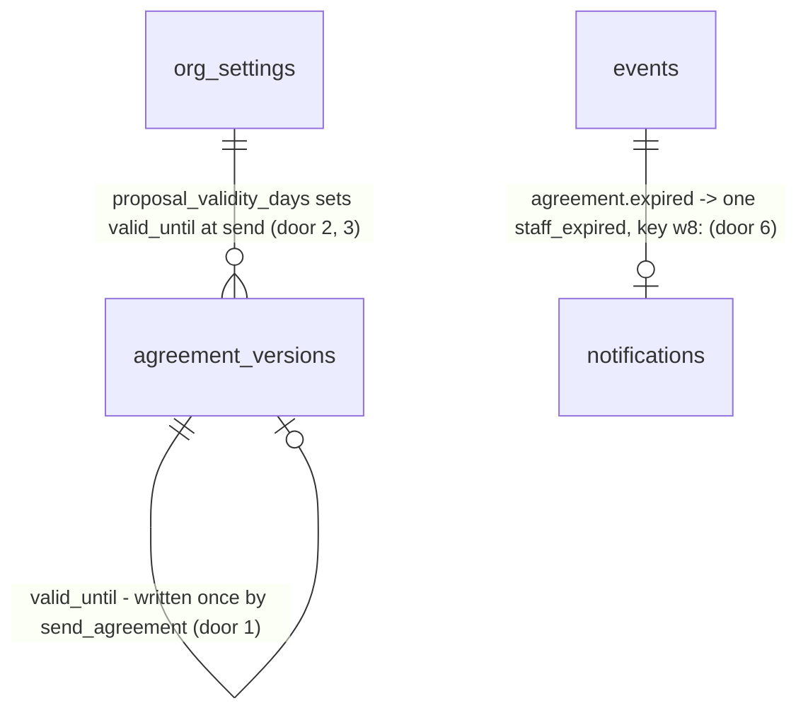

# Proposal expiry

## Problem

A sent agreement stays open for as long as nobody acts on it. Nothing tells the customer how long the offer holds, so a customer can accept prices months after the estimator quoted them, at a cost the contractor no longer carries. The estimator has to remember which proposals went quiet. ROADMAP's status model already has `sent` → `expired`, the domain machine already allows `expire`, and the portal and the board can already show an expired agreement. But nothing ever moves an agreement there, and no agreement carries a date to move it on. ROADMAP's W8 row: "Daily cron. Expire sent agreements past their validity date (`sent` → `expired`) and notify the estimator." The source gives no usage figures.

When this ships:
- Company settings holds how many days a proposal is valid (30 by default).
- Send stamps the version with its validity date. The staff page, the review page and the PDF print it.
- From the day after that date, the customer can no longer accept, refuse or request changes.
- W8 runs daily. It expires each sent agreement past its date and emails the estimator who sent it.

## Flow

This reuses what exists instead of adding a second version of it:
- the settings form, `validateOrgSettings` (exists) and `OrgSettingsStore` (exists)
- `send_agreement` (exists) as the one writer at send time
- the W7 path: n8n Schedule → signed `POST /api/automation/notify` → `automation_request` → `automation_claim` → `EmailSender` → `automation_complete` (AD-075, AD-076, AD-099, AD-102)
- W3's recipient rule (the member who sent the version, else `private.org_managers`), `private.claim_notification` and `private.enqueue_outbox_for_system` (AD-069)
- `portalState` (exists) and the review page's existing `expired` message, and `pipelineStage` (exists), which already puts `expired` in Refused

1. `/settings` posts to `saveSettingsAction` (exists). `validateOrgSettings` (exists, extended) passes the validity days to `OrgSettingsStore.save` (exists), which writes `org_settings.proposal_validity_days` (door 2).
2. "Send to customer" calls `send_agreement` (exists, redefined). After the transition, it stamps the latest version's `valid_until` (door 1): the send date in America/Vancouver plus the org's days (door 3).
3. `AgreementReader.get` (exists, extended) returns the shown version's `validUntil`. The agreement page and its PDF print it. `portal_view` (exists, redefined) returns it to `/review/[token]`.
4. `portalState` (exists, extended) answers `expired` for a sent agreement whose date is past. `portal_decide` (exists, redefined) refuses a decision in that case (door 7).
5. n8n `W8-expiry-daily.json` (door 8) runs at 08:00 America/Vancouver. It calls `POST /api/automation/notify` (exists) with `kind: expiry_daily` and `idempotencyKey: w8:<yyyy-mm-dd>`, signed per AD-074.
6. `private.automation_request` (exists, redefined) accepts the kind and checks the key's date (door 5). `automation_claim` (exists, redefined) calls `private.run_expiries(<key date>)` (door 4), which expires each due agreement with one event and one outbox row.
7. In the same call, `automation_claim` claims one `staff_expired` notification per expiry not yet sent, through `private.claim_notification` (exists), keyed `w8:<eventId>` (door 6). The notify use case (exists, extended) renders and sends the emails, and `automation_complete` (exists, redefined) records each outcome.

## Impact

| Front | What changes |
| --- | --- |
| domain | New term `validity date` (`valid_until`): the last day a sent version can be decided, inclusive. It is stamped once, at send. It is not a contract term, so it is not in `snapshot.terms`. |
| domain | Existing status `expired`: in the model since `0001_init`, reachable by nothing until now. Who branches on it today: `portalState` (→ `expired`, "This agreement has expired."), `pipelineStage` (→ Refused), `agreements_one_live_per_site` (not live, so the site is freed), W1's reminder claim (`status <> 'sent'` → skipped `decided`) and W5's digest (reads only `sent`). Each one behaves correctly as is, and none of them is in this diff except `portalState`. |
| domain | `portalState` gains two inputs (`validUntil`, `today`). Its callers are the review page and the review PDF route. |
| stored data | Migration backfill: the latest version of every agreement now `sent` gets `valid_until` = its latest `agreement.sent` date (America/Vancouver) + 30 days. Every other version stays null and never expires. The live project holds only demo data. The demo agreements were sent between 2026-10-27 and 2026-11-02, so nothing expires before 2026-11-26. |
| stored data | `send_agreement`, `portal_view`, `portal_decide`, `automation_request`, `automation_claim` and `automation_complete` are redefined from their latest versions (term-dates, renewal). Dropping one of the W7 branches is the regression to guard. |
| automation | `agreement.expired` now reaches n8n through the outbox. `events.json` routes only three types and ignores it. |

## Relations

One-way constraints: `agreement_versions.valid_until` is written only by `send_agreement` and the migration backfill (door 1). `org_settings.proposal_validity_days` is not null, from 1 to 365, default 30 (door 2). `notifications.kind` gains `staff_expired` (door 6). No columns and no types here.

## Surface

| Route | In | Out | Status |
| --- | --- | --- | --- |
| `rpc automation_claim` / `POST /api/automation/notify` | body `kind: expiry_daily`, `idempotencyKey: w8:<yyyy-mm-dd>` | `{decision, messages: [{notificationId, kind: staff_expired, to, tenant, agreement {id, number}, customer {name}, site {name}, validUntil}]}`, decision one of send, skip, duplicate, in_flight | `200`, `400` (`22023` bad kind, key or date), `401` (`42501` signature), `409` (in flight), `503` |
| `rpc automation_complete` | results naming `staff_expired` notifications for an `expiry_daily` body | void | `200`, `400` (`22023` a result naming another body's notification), `401` |
| `rpc portal_view` | token hash | adds `version.validUntil` (`YYYY-MM-DD` or null) and `today: "YYYY-MM-DD"` (America/Vancouver) | `200` (null for an unknown hash, as today) |
| `rpc portal_decide` | unchanged | unchanged | `200` (decision recorded, as today), SQLSTATE `40001` (as today, and now also when the version's `valid_until` is before today in America/Vancouver) |

Correction (build, 2026-11-02): `automation_complete` answers a result naming another body's notification with `P0002` (`404`), as it does for every kind, not `22023`. `22023` stays for a malformed result.

## Landing

| One-way door | Literal shape | Alternative rejected |
| --- | --- | --- |
| 1. Where the date lives | `agreement_versions.valid_until date null check (valid_until between '2000-01-01' and '2099-12-31')`; `authenticated` keeps no update on `agreement_versions` (AD-060) | on `agreements`: a revised version sent again needs its own date, and the old version's date is history. Computed at read time as sent date + days: changing the setting would move a date the customer was already shown. |
| 2. The tenant setting | `org_settings.proposal_validity_days integer not null default 30 check (proposal_validity_days between 1 and 365)` | nullable for "never expires": every reader branches on it, and ROADMAP's W8 assumes every proposal can expire |
| 3. Stamping | `send_agreement` (same 5-argument signature and its overloads) sets the latest version's `valid_until = (now() at time zone 'America/Vancouver')::date + proposal_validity_days` after the transition and the existing checks. "Get a new link" and revise do not touch it, and a revised version starts null. | the app passing the date: a direct RPC call or a second tab could send any date, the reason AD-091 put the term check in the RPC |
| 4. The expiry writer | `private.run_expiries(p_run_date date) returns setof uuid` (security definer, `search_path = ''`, `execute` revoked from everyone) under `pg_advisory_xact_lock(hashtext('expiries'))`: for each `sent` agreement, `for update`, whose latest version has `valid_until < p_run_date`, it sets `expired`, writes `agreement.expired` `{from: "sent", to: "expired", versionNo, validUntil, via: "w8"}` with `actor_id` null, and enqueues it with `enqueue_outbox_for_system` | `apply_agreement_transition`: it needs `auth.uid()` with a writer role, and n8n has no member. An app loop with a service-role key: AD-073 and AD-037 keep that key out. |
| 5. The W8 request | `kind: expiry_daily`, `idempotencyKey` `w8:<yyyy-mm-dd>`, a real date within 1 day of `current_date`, else `22023`; `automation_claim` runs `private.claim_expiries`, which runs the expiries for that date and then claims the email for every `agreement.expired` event whose `w8:<eventId>` notification is not `sent` or `skipped` | any date: a replayed body could expire next month's proposals today (AD-099's reason) |
| 6. The email | `notifications.kind` adds `staff_expired`, key `w8:<eventId>`, to the actor of the agreement's latest `agreement.sent` before the expiry if still a member with an email, else `private.org_managers`, else skipped `no_recipient` | one digest per org per day like W5: a failed day is never retried (AD-100's reason) |
| 7. The decision bound | `portal_decide` raises `40001` ("this link is no longer open") when the link's version has `valid_until < (now() at time zone 'America/Vancouver')::date`, checked after the row locks. `portal_view` returns `validUntil` and `today`, and `portalState({link, status, validUntil, today})` returns `expired` for `sent` past its date. | W8 alone: a customer could accept an expired proposal between midnight and the 08:00 run. `portal_decide` expiring the agreement itself: a second writer of the transition, run by an anonymous caller. |
| 8. The workflow | `automation/n8n/W8-expiry-daily.json`: Schedule 08:00 America/Vancouver -> Set -> Crypto HMAC (`__SA_HMAC_SECRET__`) -> HTTP Request to `__SA_APP_BASE_URL__/api/automation/notify`, with AD-079's retry loop; `n8n-workflows.test.ts` lists six exports and seven notify calls | routing `agreement.expired` through `events.json`: the expiry has to happen first, and nothing but a schedule triggers it |

| 9. The stamp writer (build, 2026-11-02) | `private.stamp_valid_until(p_agreement_id uuid) returns void` (security definer, `search_path = ''`, `execute` to `authenticated` only): `P0002` unknown, `42501` unless owner, admin or estimator, `55000` unless `sent`, then sets the latest version's date as door 3 says. `send_agreement` stays `security invoker` and calls it after the existing checks, as it calls `freeze_agreement_version` (AD-060) | `send_agreement` turned `security definer`: RLS would stop deciding isolation in the transition (AD-015), and another org's id would answer `42501` instead of `P0002` |

- Nothing else in this change is hard to reverse

## Criteria

### S1: The tenant sets how long a proposal is valid (P1)

Company settings holds the number of days, and Send uses it.

**Acceptance Criteria**

1. The `/settings` form SHALL show a field labelled `Proposals valid for` in days. It SHALL hold the saved value, or 30 for an org that never changed it.
2. IF the value is not a whole number from 1 to 365 THEN the system SHALL show `Proposal validity must be a whole number of days from 1 to 365` on the field and save nothing.
3. WHILE the member is a viewer the system SHALL show the field read-only, as the other settings fields are.

**Independent test:** set 14 in Settings, save, reload, and see 14.

### S2: Send stamps the validity date (P1)

Each sent version carries the last day it can be decided.

**Acceptance Criteria**

4. WHEN a draft is sent on date D in America/Vancouver THEN the system SHALL set the sent version's `valid_until` to D plus the org's `proposal_validity_days` (sent 2026-11-02 with 30 days: 2026-12-02).
5. WHEN the org changes `proposal_validity_days` after a send THEN the system SHALL leave that sent version's `valid_until` unchanged.
6. WHEN staff use `Get a new link` on a sent agreement THEN the system SHALL leave `valid_until` unchanged.
7. WHEN version n + 1 is started from `changes_requested` THEN the system SHALL give version n + 1 a null `valid_until` and keep version n's. WHEN n + 1 is sent THEN it SHALL get its own date per AC 4.
8. IF a member updates `agreement_versions.valid_until` directly through PostgREST THEN the system SHALL refuse it (`42501`).
9. IF `send_agreement` fails for any reason (no line, no term start, stale status) THEN the system SHALL leave every version's `valid_until` as it was.

**Independent test:** send a draft and read `valid_until` on its latest version.

### S3: Everyone can see the date (P1)

**Acceptance Criteria**

10. WHILE an agreement is `sent` the agreement page SHALL show `Valid until Dec 2, 2026` next to the viewed line.
11. WHILE an agreement is `expired` the agreement page SHALL show `Expired · was valid until Dec 2, 2026`, and SHALL offer neither `Withdraw` nor `Get a new link`.
12. WHILE the review page is `open` it SHALL show `Valid until Dec 2, 2026`.
13. WHEN the PDF of a version with a `valid_until` is rendered (staff route or review route) THEN it SHALL print `Valid until Dec 2, 2026`.
14. IF the shown version's `valid_until` is null THEN the agreement page, the review page and both PDFs SHALL print no validity line.
15. The system SHALL format the date from its `YYYY-MM-DD` text with `formatTermDate`, never through `Date` or a time zone (AD-094).

**Independent test:** open a sent agreement, its review link and its PDF, and see the same date on all three.

### S4: The customer cannot decide after the date (P1)

**Acceptance Criteria**

16. WHILE today in America/Vancouver is on or before `valid_until` the review page SHALL offer Accept, Refuse and Request changes as it does today.
17. IF a customer opens the link of a `sent` agreement after its `valid_until` THEN the review page SHALL show `This agreement has expired.` with no decision buttons, even before W8 has run.
18. IF `portal_decide` is called after the version's `valid_until` THEN the system SHALL raise `40001` and the agreement SHALL stay `sent`, with no event and no outbox row.
19. IF the version's `valid_until` is null THEN the system SHALL apply no date bound to the decision.

**Independent test:** set a sent version's `valid_until` to yesterday, open its link, and see the expired message. A direct `portal_decide` fails with `40001`.

### S5: W8 expires overdue proposals (P1)

**Acceptance Criteria**

20. WHEN W8's claim runs with run date R THEN the system SHALL set `expired` on every `sent` agreement whose latest version has `valid_until < R`, writing one `agreement.expired` event with payload `{from: "sent", to: "expired", versionNo, validUntil, via: "w8"}`, `actor_id` null, and one outbox row each.
21. WHILE R equals `valid_until` the system SHALL leave that agreement `sent`.
22. The system SHALL NOT change an agreement in `draft`, `accepted`, `refused`, `changes_requested`, `withdrawn` or `expired`, or a `sent` one whose `valid_until` is null.
23. WHEN the claim runs again for the same or a later date THEN the system SHALL write no second `agreement.expired` event for an agreement.
24. IF a customer decision and an expiry reach the same agreement at once THEN the system SHALL apply exactly one of them: the agreement ends in one status with exactly one decision or expiry event.
25. IF the key is not `w8:<yyyy-mm-dd>` with a real date within 1 day of the database's date THEN the claim SHALL raise `22023` and expire nothing, and notify SHALL answer `400`.
26. WHEN an agreement has expired THEN `New agreement` on its site SHALL succeed, since `expired` is not live (AD-052).
27. WHEN a W1 day-3 or day-7 reminder is claimed for an expired agreement THEN the system SHALL skip it with reason `decided`.

**Independent test:** with one demo agreement's `valid_until` set to yesterday, call notify with a signed `expiry_daily` body for today. It turns `expired` and sits in Refused.

### S6: The estimator is told (P1)

**Acceptance Criteria**

28. WHEN W8's claim expires an agreement THEN the claim SHALL return one `staff_expired` message keyed `w8:<eventId>`, addressed to the member who sent the expired version.
29. IF that member is no longer in the org or has no email THEN the message SHALL go to the org's owners and admins. IF there are none THEN the notification SHALL be skipped with `no_recipient`.
30. The `staff_expired` email SHALL have the subject `AG-1004 expired without a decision`. Its body SHALL name the customer, the site and `Valid until Dec 2, 2026`, and link to `/agreements/<id>`.
31. IF a `staff_expired` send fails THEN the next W8 run SHALL claim and send it again. One that is `sent` or `skipped` SHALL never be sent again.
32. WHEN `automation_complete` receives results for an `expiry_daily` body THEN it SHALL accept only `staff_expired` notifications and SHALL refuse others with `22023`.
33. The repo SHALL hold `automation/n8n/W8-expiry-daily.json` with a Schedule at 08:00 America/Vancouver, the Set → Crypto → HTTP Request notify call and AD-079's retry loop, and `n8n-workflows.test.ts` SHALL list six exports.

**Independent test:** after the S5 run, the estimator's inbox (or the notification row with a reserved domain) shows one `staff_expired`. A second run sends nothing.

### S7: Staff can tell an expiry from a refusal (P2)

**Acceptance Criteria**

34. WHILE an agreement is `expired` its card in the Refused column SHALL show a neutral `Expired` pill.

**Independent test:** after the S5 run, the board's Refused column shows the card with `Expired`.

## Out of scope

| Excluded | Why |
| --- | --- |
| A per-agreement validity date, or extending the date of a sent proposal | user chose the org setting fixed at Send (2026-11-02) |
| Reopening an expired agreement (`expired` → `draft` as a new version) | a new transition that the ROADMAP status model does not have; staff start a new agreement on the freed site |
| Emailing the customer when a proposal expires | ROADMAP W8 notifies the estimator only |
| A reminder to the customer before the date | not in ROADMAP; W1's day-3 and day-7 reminders stay as they are |
| A per-tenant time zone | no org time-zone setting exists; renewal already uses America/Vancouver (AD-101) |
| An Agreements list filtered by expired | ROADMAP Phase 3.5 item 10 |

## Assumptions

| Assumption | Chosen default | Rationale | Confirmed? |
| --- | --- | --- | --- |
| How the date is set | org setting `Proposals valid for N days`, stamped at Send, not editable per agreement | user chose it on 2026-11-02 | y |
| Default days | 30 | the common quote validity in the trade; the same number as the renewal notice, so one default to explain | n |
| Inclusive date | valid through `valid_until`, expired from the next day | "valid until Dec 2" reads as still open on Dec 2 | n |
| Calendar for "today" | America/Vancouver, the same in Send, the portal guard and W8's key date | renewal's Expiring soon uses it (AD-101) and there is no org time zone | n |
| Existing sent agreements | backfilled from their last `agreement.sent` date + 30; every other version null, never expiring | none of them expires before 2026-11-26, so the demo board does not change on deploy | n |
| `seed.sql` | unchanged; the live run sets one demo version's `valid_until` to yesterday first | renewal showed a seed change can break an earlier feature's proof (C1158) | n |
| One email per expiry | per agreement, keyed by event | each failure retries on its own (door 6) | n |
| The expired link | stays valid and shows `This agreement has expired.`; the PDF still downloads | the customer keeps a copy of what they were offered; that is how `withdrawn` behaves today | n |

**Open questions:** none. Everything is resolved or logged above.

## Observable

| Surface | Decision | Landing |
| --- | --- | --- |
| screen `/settings` validity field | error state | AC 2 |
| screen `/settings` validity field | unauthorised (read-only) | AC 3 |
| screen `/settings` | empty, loading | existing - the settings page's no-row state and `loading.tsx` |
| screen `/agreements/[id]` validity line | empty state | AC 14 |
| screen `/agreements/[id]` | expired state, controls | AC 11 |
| screen `/review/[token]` | expired state | AC 17, existing - the `expired` message in `review-view.tsx` |
| screen `/review/[token]` | empty (no date) | AC 19, AC 14 |
| screen `/pipeline` | expired card | AC 34 |
| screen any | destructive action confirms | n/a - nothing a member triggers here is irreversible; W8 is a machine |
| document agreement PDF | validity line | AC 13, AC 14 |
| email `staff_expired` | structure, what the reader does next | AC 30 |
| email `staff_expired` | no recipient, reserved domain | AC 29, existing - `reserved_domain` in the notify use case |
| API `POST /api/automation/notify` (`expiry_daily`) | error shape and codes | AC 25, existing - AD-075's mapping |
| API `rpc portal_decide` | error shape | AC 18, existing - `40001` shown as "this link is no longer open" |
| all changed RPCs | versioning | n/a - a new kind and added keys; existing kinds and keys are unchanged |
| API `POST /api/automation/notify` | rate limits | n/a - signed machine endpoint; rate limiting is carried as the outbox-dispatch open question |

## Sources

- ROADMAP.md: the status model (`sent` → `expired`), W8 row, and Phase 3.5 item 6.
- `.specs/STATE.md`: AD-052, AD-060, AD-069, AD-073 to AD-079, AD-091, AD-094, AD-099 to AD-102. These cover the live-agreement index, the version write lock, the system enqueue, the automation path and its W7 copy, the send-time check, and date formatting.
- User decision, 2026-11-02: the validity date is an org setting, fixed at Send.
