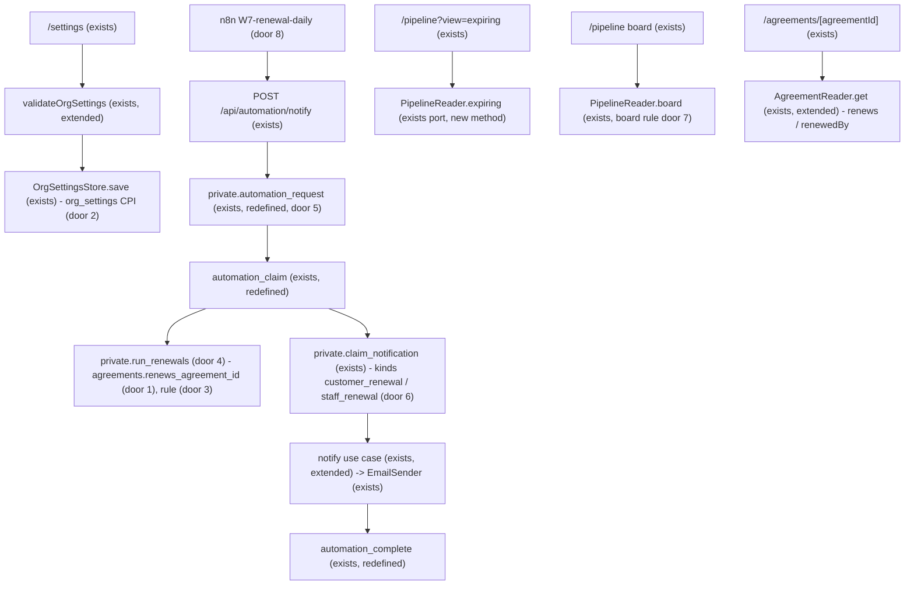
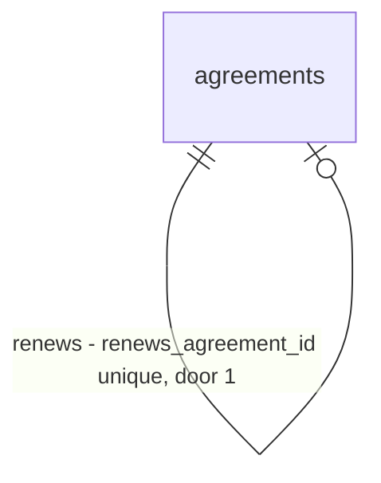

# Renewal

## Problem

An accepted agreement has a term (term-dates), but nothing happens when the term runs out. ROADMAP's "Term and renewal" section sets the rule: "CPI below the renegotiation threshold (5% by default, a tenant setting): the contract renews for another term with the CPI increase applied, never above the CPI cap. The customer is notified 30 days before the end date. Nobody signs again." And: "CPI at or above the threshold: the contract does not renew on its own. 30 days before the end date the app creates a renewal draft and flags it for staff." It also says: "A renewal is a new agreement linked to the one it renews (AG-1012 renews AG-1004), not another version of it." Today the app holds no CPI figure to compare, nothing runs at the notice date, and staff cannot see which agreements are about to end. The source gives no usage figures.

When this ships:
- Company settings holds the CPI for renewals and the date it was published.
- W7 runs daily. Each accepted agreement whose notice date has come gets exactly one renewal. Below the threshold, that is an accepted agreement with CPI-raised prices. At or above it, or with no fresh CPI, it is a draft for staff.
- The customer gets one email for an auto-renewal. Owners and admins get one for a renewal draft.
- Pipeline has an "Expiring soon" view, and an agreement page shows `Renewal of AG-x` or `Renewed by AG-y`.

## Flow

This reuses what exists instead of adding a second version of it:
- the settings form, `validateOrgSettings` (exists) and `OrgSettingsStore` (exists)
- the W5 path: n8n Schedule → signed `POST /api/automation/notify` → `automation_claim` → `EmailSender` → `automation_complete` (AD-075, AD-076, AD-079)
- `private.claim_notification`, `private.org_managers` and `private.enqueue_outbox_for_system` (AD-069)
- the AD-051 agreement number
- `PipelineReader` (exists) and `AgreementReader.get` (exists)

1. `/settings` posts to `saveSettingsAction` (exists). `validateOrgSettings` (exists, extended) passes the CPI and its date to `OrgSettingsStore.save` (exists), which writes the `org_settings` columns (door 2).
2. n8n `W7-renewal-daily.json` (door 8) runs at 08:00 America/Vancouver. It calls `POST /api/automation/notify` (exists) with `kind: renewal_daily` and `idempotencyKey: w7:<yyyy-mm-dd>`, signed per AD-074.
3. `private.automation_request` (exists, redefined) accepts the kind and checks the key's date (door 5). `automation_claim` (exists, redefined) first calls `private.run_renewals(<key date>)` (door 4). That function applies the rule (door 3) to each due agreement and creates its renewal, linked through `renews_agreement_id` (door 1), with one event and one outbox row.
4. In the same call, `automation_claim` claims one notification per renewal that has not been sent yet, through `private.claim_notification` (exists): `w7:<renewalId>:customer` or `w7:<renewalId>:staff` (door 6). The messages go back to the route. The notify use case (exists, extended) renders them and sends them through `EmailSender` (exists), and `automation_complete` (exists, redefined) records each outcome.
5. `/pipeline?view=expiring` (exists page, new view) reads `PipelineReader.expiring` (exists port, new method). It returns the accepted agreements ending within 90 days, with their renewal state.
6. The board read (exists) leaves out an accepted agreement whose renewal is not withdrawn (door 7), and marks a renewal draft's card. `AgreementReader.get` (exists, extended) returns `renews` and `renewedBy` for the agreement page.

## Impact

| Front | What changes |
| --- | --- |
| domain | New term `renewal`: an agreement created by W7 from an accepted one. It is either `auto` (accepted, prices raised by the applied %) or `renegotiate` (draft, prices unchanged). Its rule lives in SQL (door 3). The app reads the outcome from the agreement's status and the event payload. |
| domain | New term `renewal CPI`: the tenant's CPI % and its as-of date. Lives in `web/domain/org-settings`. |
| domain | Existing term `OrgSettingsValue` / `OrgSettingsInput` gain `renewalCpiPct` and `renewalCpiAsOf`. Who reads them today: the settings form and state, `settings.ts`, `getOrgSettings` callers and their fixtures. |
| domain | Existing term `AgreementDetail` gains `renews` and `renewedBy` (`{ id, number } \| null`). The pipeline card gains `isRenewal`. Who reads them: the agreement page, `agreement-view.tsx`, the pipeline page and their fixtures. |
| behaviour | An agreement can now reach `accepted` with no `sent` before it. W7 creates it as a draft and sets it accepted in the same transaction. `AGREEMENT_STATUSES` and `applyAgreementCommand` are unchanged, because a renewal is a creation, not a command. An accepted agreement that has a renewal that is not withdrawn leaves the board. |
| behaviour | The automation endpoints gain a kind. `notify` keeps its codes for every existing kind. |
| stored data | Existing agreements get `renews_agreement_id` null. `org_settings` rows get both CPI fields null, so the first W7 run sends every due agreement to renegotiation until a tenant sets the CPI. Only demo data exists. `seed.sql` is unchanged: term-dates' C1158 pins every demo start to the first of the month after creation, so the live run sets one demo agreement's start date instead (Assumptions, Demo data). |
| SQL functions | New: `private.run_renewals`. Redefined: `private.automation_request`, `public.automation_claim`, `public.automation_complete`. Widened: the `notifications.kind` check. |
| automation | New `automation/n8n/W7-renewal-daily.json`. `web/n8n-workflows.test.ts` asserts it. |
| docs | CONTEXT.md (renewal, pipeline, settings), ROADMAP tick, STATE.md rows for the doors, `database.types.ts` regenerated. |

## Relations

One-way constraints:
- An agreement renews at most one agreement and is renewed by at most one. The link is unique, same-org (door 1).
- The link is written once, by `private.run_renewals` only, and never changes.

## Surface

| Route | In | Out | Status |
| --- | --- | --- | --- |
| `POST /api/automation/notify` (signature unchanged) | adds `kind: renewal_daily` with `idempotencyKey` `w7:<yyyy-mm-dd>` and `executionId` | `{ outcome, reason? }`, `outcome` in `sent`, `skipped`, `duplicate` | `200`; `400` malformed body or a W7 date more than 1 day from the database date; `401` bad or stale signature; `409` in flight; `503` provider or database failure |
| `rpc public.automation_claim` (signature unchanged) | a `renewal_daily` body | `{ decision, messages }`, messages of kind `customer_renewal` or `staff_renewal` | `200` jsonb; `42501` bad signature; `22023` bad W7 key or date |
| `GET /pipeline?view=expiring` (screen) | `view=expiring` | the agreements ending within 90 days | `200`; any other `view` value shows the board |

## Landing

| One-way door | Literal shape | Alternative rejected |
| --- | --- | --- |
| 1. renewal link | `agreements.renews_agreement_id uuid null unique`, `foreign key (renews_agreement_id, org_id) references public.agreements (id, org_id)`, `check (renews_agreement_id is distinct from id)` | A version n + 1 of the same agreement: ROADMAP says a renewal is a new agreement, so each term keeps its own history. A unique index that leaves out withdrawn renewals: the next day's W7 would draft the renewal again. |
| 2. renewal CPI | `org_settings.renewal_cpi_pct numeric(5,2) null check (renewal_cpi_pct between -20 and 100)`, `renewal_cpi_as_of date null check (renewal_cpi_as_of between '2000-01-01' and '2099-12-31')`, `check ((renewal_cpi_pct is null) = (renewal_cpi_as_of is null))` | CPI entered per renewal: staff would type the same number once per agreement. A platform CPI table: someone would have to load it every month. Statistics Canada fetch: an external dependency and a second source to verify. The user chose the tenant setting on 2026-11-02. |
| 3. the decision rule | `cap` = the renewed version's frozen `terms.cpiCapPct`. `threshold` = frozen `terms.cpiRenegotiationThresholdPct`, else the org's current `cpi_renegotiation_threshold_pct`. `notice` = frozen `terms.renewalNoticeDays`, else the org's `renewal_notice_days`. **Renegotiate** when `renewal_cpi_pct` is null (`cpi_unset`), when `renewal_cpi_as_of < run_date - interval '13 months'` (`cpi_stale`), when `renewal_cpi_pct >= threshold` (`at_threshold`), or when `cap` is null (`cpi_unset`). **Otherwise auto**, with `applied = greatest(0, least(renewal_cpi_pct, cap))`; each `cost_per_visit_cents` becomes `round(cost_per_visit_cents * (1 + applied / 100))` (numeric `round`, half away from zero). | The live cap: Company settings could change a price limit the customer already accepted (term-dates door 5). Rounding the annual total instead of each visit: the lines would no longer equal visits × cost per visit (AD-080). |
| 4. renewal writer | `private.run_renewals(p_run_date date) returns setof uuid`: security definer, `search_path = ''`, `execute` revoked from `public, anon, authenticated`, called only by `automation_claim`. It takes `pg_advisory_xact_lock(hashtext('renewals'))` first. An agreement is due when its status is `accepted`, its latest version's `term_end` is not null, `term_end - notice <= p_run_date`, and no agreement renews it. For each due agreement, in a subtransaction: insert the agreement as `draft` with the AD-051 number under the same per-org lock and `renews_agreement_id`; insert version 1 with `term_start = old term_end + 1` and `term_months` = the old version's; copy the lines and their coverage, raised for auto. **Auto:** set version 1's snapshot to a copy of the old version's, set the status to `accepted`, and write event `agreement.renewed` with payload `{renewsAgreementId, cpiPct, appliedPct, cpiAsOf}`. **Renegotiate:** keep `draft` with snapshot `{}` and write event `agreement.renewal_drafted` with payload `{renewsAgreementId, cpiPct, cpiAsOf, reason}`. Each event is enqueued through `private.enqueue_outbox_for_system`. A `23505` on `agreements_one_live_per_site` rolls back that agreement only, so it gets no row and no event. Amends AD-060: this function also writes a snapshot, as a copy. | The app creating renewals: it would need a cross-org service-role key (AD-073's reason). Inserting as `accepted` directly: `service_lines_frozen` (AD-054) refuses lines on an agreement that is not `draft`, and a bypass would weaken that guard for everyone. A separate pg_cron job: ROADMAP puts W7 in n8n, and the claim is already the signed entry point. |
| 5. W7 request | `kind: renewal_daily`, `idempotencyKey ~ '^w7:[0-9]{4}-[0-9]{2}-[0-9]{2}$'`, a valid date, and `abs(key date - current_date) <= 1`, else `22023` | Any date: a replayed or hand-written body could renew a year early. |
| 6. renewal notifications | `notifications.kind` adds `customer_renewal` and `staff_renewal`. Keys are `w7:<renewalAgreementId>:customer` and `w7:<renewalAgreementId>:staff`. Each claim call claims every renewal notification of that tenant that is not yet `sent` or `skipped`. `customer_renewal` goes to the recipient W1 uses for the renewed agreement, with `tenant`, `agreement {id, number}`, `renews {number}`, `site {name}`, `oldAnnualCents`, `annualCents`, `appliedPct`, `term {start, end, months}`. `staff_renewal` goes to `private.org_managers`, with `agreement {id, number}`, `renews {number, termEnd}`, `site {name}`, `customer {name}`, `reason`, `cpiPct`. | A day-keyed digest like W5: a send that failed on day D would never be retried. |
| 7. board rule | `pipelineStage` is unchanged. The board query leaves out an accepted agreement that some agreement renews, unless that renewal is `withdrawn`. | Showing both cards: one site would show two "Accepted" deals for one service relationship. |
| 8. W7 export | `automation/n8n/W7-renewal-daily.json`: Schedule 08:00 → Set (`timestamp`, `body`) → Crypto HMAC → HTTP Request to `__SA_APP_BASE_URL__/api/automation/notify`, raw body, Never Error, full response, with AD-079's retry loop (`$runIndex < 6`, 10-minute Wait) and secret `__SA_HMAC_SECRET__`. No credentials inside, no `$env`. | A workflow only in the instance: no review or test can read it (AD-079). |

- Nothing else in this change is hard to reverse. The settings labels, the Expiring soon layout, the email wording and the marker copy are settled in the diff.

## Criteria

### S1: tenant CPI for renewals (P1)

Owners and admins record the CPI that W7 uses.

**Acceptance Criteria**

1. WHEN the migration runs THEN every `org_settings` row SHALL hold `renewal_cpi_pct` null and `renewal_cpi_as_of` null.
2. IF an `org_settings` write sets `renewal_cpi_pct` outside −20 to 100, sets `renewal_cpi_as_of` outside 2000–2099, or sets only one of the two, THEN the database SHALL refuse it with `23514`.
3. WHEN an owner or admin saves `/settings` with `CPI for renewals` 3.2 and `As of` 2027-10-15 THEN the system SHALL store both, and `/settings` SHALL show them after a reload.
4. IF the CPI is invalid on save THEN `/settings` SHALL show `CPI must be a number from -20 to 100 with at most two decimals` and store nothing.
5. IF the as-of date is not a date from 2000 to 2099 THEN `/settings` SHALL show `Enter the date this CPI was published` and store nothing.
6. IF exactly one of the two fields is filled THEN `/settings` SHALL show `Set both CPI and its date, or neither` and store nothing.
7. WHILE the member is an estimator or viewer, `/settings` SHALL show both CPI fields read-only.

**Independent test:** set the CPI to 3.2 as of Oct 15, 2027, reload, and see both. Clear the date only, and see the pairing error.

### S2: auto-renewal below the threshold (P1)

An agreement whose CPI is below the threshold renews without anyone signing.

**Acceptance Criteria**

8. WHEN `run_renewals` runs on a date on or after `term_end − notice` of an accepted agreement, with a CPI below the threshold and as-of within 13 months, THEN the system SHALL create exactly one agreement with status `accepted` and `renews_agreement_id` = that agreement.
9. WHEN an auto-renewal is created THEN its version 1 SHALL have `term_start` = the old `term_end` + 1 day and the old `term_months`. Example: old 2027-01-01 – 2027-12-31, 12 months, gives 2028-01-01, 12 months.
10. WHEN an auto-renewal is created THEN each copied line SHALL keep its description, visit months, position and coverage, with `cost_per_visit_cents` = round(old × (1 + applied/100)) and `applied` = max(0, min(CPI, cap)). Examples: CPI 3.2, cap 5, 25000 → 25800; CPI 4.0, cap 2.5, 19999 → 20499; CPI −1.0 → unchanged.
11. WHEN an auto-renewal is created THEN its version 1 `snapshot` SHALL equal the renewed version's `snapshot`.
12. WHEN an auto-renewal is created THEN the system SHALL write exactly one event `agreement.renewed` on it, with payload `renewsAgreementId`, `cpiPct`, `appliedPct` and `cpiAsOf`, and one outbox row for that event.
13. IF `run_renewals` runs on a date before `term_end − notice` THEN it SHALL create nothing for that agreement. Example: end 2027-12-31, notice 30: nothing on 2027-11-30, and a renewal on 2027-12-01.
14. WHEN `run_renewals` runs again on the same or a later date THEN it SHALL create no second renewal for an agreement already renewed.
15. WHEN two `run_renewals` calls run at the same time THEN each due agreement SHALL still have exactly one renewal.
16. The system SHALL take `cap`, `threshold` and `notice` from the renewed version's frozen `terms`, so a later change to Company settings SHALL NOT change the outcome for an agreement that froze them.
17. IF an agreement is not `accepted`, or its latest version has no `term_end`, THEN `run_renewals` SHALL never renew it.

**Independent test:** give an accepted agreement a term ending in 20 days and a CPI of 3.2. Run W7, and see a new accepted AG with prices raised 3.2% starting the day after the end. Run W7 again, and see nothing new.

### S3: renewal draft at or above the threshold (P1)

Staff get a draft to negotiate when CPI is too high or unknown.

**Acceptance Criteria**

18. IF the CPI is at or above the threshold (5.00 with threshold 5.00), THEN `run_renewals` SHALL create one `draft` agreement renewing it, at the old prices, with snapshot `{}`, and event `agreement.renewal_drafted` with `reason` `at_threshold`.
19. IF the tenant has no CPI set THEN `run_renewals` SHALL create the renewal draft with `reason` `cpi_unset`.
20. IF `renewal_cpi_as_of` is earlier than the run date minus 13 months (2026-10-31 on a 2027-12-01 run) THEN `run_renewals` SHALL create the renewal draft with `reason` `cpi_stale`, and on 2026-11-01 it SHALL auto-renew.
21. IF the renewed agreement's site already has an agreement in `draft`, `sent` or `changes_requested` THEN `run_renewals` SHALL create no renewal, no event and no notification for it, and SHALL still renew the other due agreements in that run.
22. WHEN a renewal draft is created THEN its version 1 SHALL carry the term of AC 9.
23. The system SHALL let a renewal draft be edited, sent and decided like any other draft.

**Independent test:** with no CPI set, run W7 on a due agreement, and see a draft renewal at the old prices, with reason `cpi_unset`.

### S4: renewal emails (P1)

The customer hears about an auto-renewal, and staff hear about a draft.

**Acceptance Criteria**

24. WHEN W7 creates an auto-renewal THEN the claim SHALL return one `customer_renewal` message to the renewed agreement's W1 recipient. The email subject SHALL be `Your service agreement renews on <Jan 1, 2028>`, and its body SHALL give the old and new annual totals, the applied % and the new term.
25. WHEN W7 creates a renewal draft THEN the claim SHALL return one `staff_renewal` message to the org's owners and admins, with subject `<AG-y> needs renegotiation before <Dec 31, 2027>`, the reason in words and a link to `/agreements/<id>`.
26. IF a renewal email's send failed THEN the next W7 run SHALL claim it again.
27. IF a renewal email was sent THEN no later run SHALL send it again.
28. IF the customer recipient is missing or on a reserved domain THEN the notification SHALL be `skipped` with `no_recipient` or `reserved_domain`, and nothing SHALL be sent.
29. IF a `renewal_daily` key is not `w7:<yyyy-mm-dd>`, or its date is more than 1 day from the database date, THEN `automation_claim` SHALL refuse with `22023`, `notify` SHALL answer `400`, and nothing SHALL be renewed.
30. IF the signature is bad or stale THEN `notify` SHALL answer `401` and nothing SHALL be renewed.

**Independent test:** run W7 with a demo agreement due, and see one email in Resend for the auto-renewal, and a `sent` notification row. Run it again, and see `duplicate`.

### S5: links and the board (P2)

Staff can follow a renewal both ways, and the board shows one deal per relationship.

**Acceptance Criteria**

31. WHEN `/agreements/[agreementId]` shows a renewal THEN it SHALL show `Renewal of AG-x`, linked to that agreement.
32. WHEN `/agreements/[agreementId]` shows an agreement that has a renewal THEN it SHALL show `Renewed by AG-y`, linked to it.
33. WHILE an accepted agreement has a renewal that is not `withdrawn`, the pipeline board SHALL NOT show its card, and SHALL show the renewal's.
34. WHEN the board shows a renewal draft's card THEN the card SHALL show the marker `Renewal`.
35. The system SHALL keep members of one org from reading another org's renewals through `renews_agreement_id`.

**Independent test:** after an auto-renewal, the board shows one Accepted card for the site, and the old agreement's page reads `Renewed by AG-y`.

### S6: Expiring soon (P2)

Staff see which agreements end soon and what will happen to each.

**Acceptance Criteria**

36. WHEN a member opens `/pipeline?view=expiring` THEN the page SHALL list the accepted agreements whose latest version's `term_end` falls from today to today + 90 days, earliest first. Each row SHALL show site, customer, number, end date and annual total.
37. WHILE a listed agreement has no renewal and its notice date is in the future, its row SHALL show `Renews on <notice date>: automatic or renegotiated by CPI`.
38. WHILE a listed agreement has an accepted renewal, its row SHALL show `Auto-renewed as AG-y`.
39. WHILE a listed agreement has a draft renewal, its row SHALL show `Renewal draft AG-y`.
40. WHILE a listed agreement is past its notice date with no renewal because its site has a live agreement, its row SHALL show `Renewal blocked: AG-x is open`.
41. IF no agreement ends in the next 90 days THEN the page SHALL show `No agreements end in the next 90 days.`
42. WHEN the board is shown THEN the page SHALL offer a link to `Expiring soon`, and the Expiring soon view SHALL offer one back to the board.

**Independent test:** with the seed's soon-ending agreement, open Expiring soon and see it with `Renews on <date>`. After W7, see `Auto-renewed as AG-y`.

## Out of scope

| Excluded | Why |
| --- | --- |
| Cancellation, the customer objecting to an auto-renewal, the cancellation notice period | ROADMAP Phase 6 |
| Moving the term and renewal to the contract | ROADMAP Phase 4 |
| The annual mid-term CPI adjustment (W6) | ROADMAP Phase 6 |
| Proposal validity date and W8 | ROADMAP Phase 3.5 item 6 |
| Version comparison between an agreement and its renewal | ROADMAP Phase 3.5 item 9 (versioning) |
| An Agreements list with an "expiring" filter | ROADMAP Phase 3.5 item 10 |
| A timeline of renewal events on the agreement page | ROADMAP Phase 3.5 item 15 |

## Assumptions

| Assumption | Chosen default | Rationale | Confirmed? |
| --- | --- | --- | --- |
| CPI source | tenant setting with an as-of date (door 2) | user chose it on 2026-11-02 | y |
| When the renewal is created | at the notice date, by W7, in one step (door 4) | user chose it on 2026-11-02 | y |
| A fresh CPI | as-of no older than 13 months before the run date | a yearly figure published a little late still counts; older than a year and a month means nobody updated it | n |
| Negative CPI | the increase is floored at 0, so prices never drop | ROADMAP speaks only of an increase; a decrease is a negotiation | n |
| Draft prices | the old prices; staff negotiate from there | the draft exists because the CPI rule did not apply | n |
| Auto-renewal scope and terms | copied from the renewed version | the customer agreed to nothing new | n |
| Expiring soon window | 90 days | three times the default notice, so the view shows agreements before W7 acts | n |
| Open agreement on the site | blocks both kinds of renewal, retried by each daily run, shown on Expiring soon, no email | a definer writer still meets AD-054 and AD-052; staff resolving the open one unblocks it | n |
| Run date | the W7 key's date, within 1 day of the database date | n8n's 08:00 Vancouver and the database's UTC date can differ by one | n |
| One renewal per agreement, ever | a withdrawn renewal draft is not recreated; staff start an agreement for the site by hand | otherwise W7 would recreate what staff withdrew | n |
| Staff email for an auto-renewal | none | ROADMAP notifies only the customer; Expiring soon shows it | n |
| Demo data | `seed.sql` is unchanged; the live W7 run (C1218) first sets AG-1035's `term_start` on the demo org so its term ends 20 days out | a seed change broke term-dates' C1158 (every demo start is the first of the month after creation); the live run is already an approved write on the demo org | n |

**Open questions:** none. Everything is resolved or logged above.

## Observable

| Surface | Decision | Landing |
| --- | --- | --- |
| screen `/settings` CPI fields | error state | AC 4, AC 5, AC 6 |
| screen `/settings` CPI fields | unauthorised (read-only) | AC 7 |
| screen `/settings` | empty, loading | existing - the settings page's no-row and `loading.tsx` states |
| screen `/pipeline?view=expiring` | empty state | AC 41 |
| screen `/pipeline?view=expiring` | loading | existing - `pipeline/loading.tsx` |
| screen `/pipeline?view=expiring` | error state | existing - `(app)/error.tsx` |
| screen `/pipeline?view=expiring` | unauthorised | existing - the `(app)` member gate; every role reads the pipeline |
| screen `/agreements/[id]` renewal link | empty state | AC 31, AC 32 - no link when neither applies |
| screen any | destructive action confirms | n/a - nothing a member triggers here is irreversible; W7 is a machine |
| email `customer_renewal`, `staff_renewal` | no recipient, reserved domain | AC 28 |
| API `POST /api/automation/notify` | error shape and codes | AC 29, AC 30 |
| API `rpc automation_claim` | versioning | n/a - a new kind; existing kinds are unchanged |
| API `POST /api/automation/notify` | rate limits | n/a - signed machine endpoint; rate limiting is carried as the outbox-dispatch open question |

## Sources

- ROADMAP.md, "Term and renewal", W7 row and Phase 3.5 item 5: the two renewal outcomes, notice before the end, the cap, the linked new agreement, and "Expiring soon".
- `.specs/STATE.md` AD-051, AD-052, AD-054, AD-060, AD-069, AD-073 to AD-079: the number, the one-live-per-site index, the line guard, the snapshot writer, the system enqueue, and the W5 automation path this reuses.
- `.specs/features/term-dates/plan.md` doors 1, 2 and 5: `term_end`, the renewal settings and their frozen copy.
- User decisions, 2026-11-02: the CPI source and the timing.
