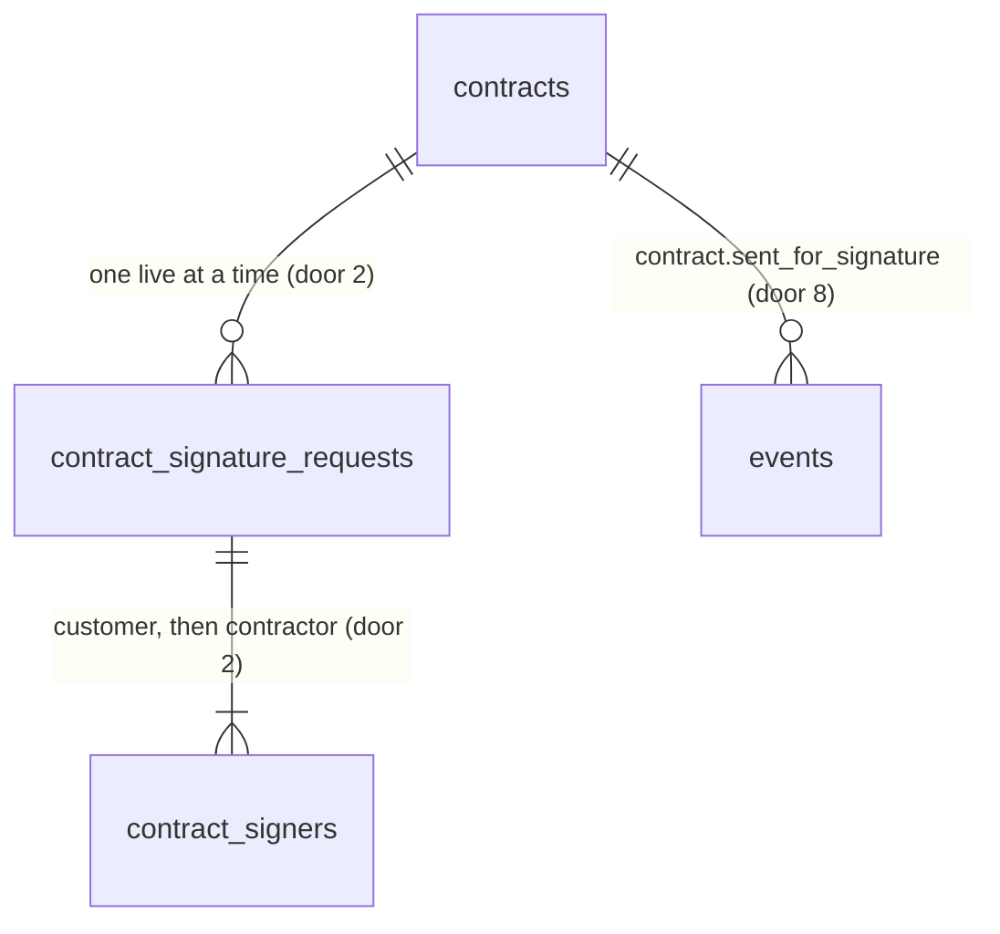

# Signature provider (ROADMAP Phase 4 item 2)

## Problem

An accepted agreement becomes a contract with parties frozen (item 1), a PDF with two blank signature blocks, and the status `pending_signature`. Nothing in the app can get that PDF signed. Staff print or email it and chase signatures by hand outside the app, and the status never moves. ROADMAP M10: "client signs then the tenant countersigns", through DocuSeal behind `SignatureProvider`, with embedded signing. The source gives no volume or time figures.

When this ships:
- An owner or admin presses **Send for signature** on a `pending_signature` contract.
- The customer's signer opens a tenant-branded `/sign/<token>` page and signs inside it, with no account.
- Once the customer has signed, an owner or admin countersigns inside the contract page.
- DocuSeal holds the signatures. **The contract status still does not move**: the webhook that moves it is item 3.

## Flow

This reuses the frozen `parties` and accepted version, `ContractReader`, `ContractRenderer` and the contract PDF (item 1), the 32-byte token, SHA-256 hash and sealed copy of the portal link (AD-070, AD-077, `PortalTokens`), the anonymous-RPC and public-prefix pattern of `/review/[token]` (AD-068, AD-072, `portalGate`), the fetch-only adapter style of `EmailSender` (AD-078), and the writer-RPC pattern (AD-090, AD-135), instead of a second token scheme, a second PDF or an SDK.

1. `/contracts/[contractId]` (exists) shows `Send for signature` on a `pending_signature` contract to owners and admins, with a confirm step. It calls `sendForSignatureAction` (new, placement per conventions).
2. `public.begin_signature_request` (door 3): role check, contract `for update`, guards, inserts the request `creating` and its two signers, with the customer's token hash (door 2). It returns the request id.
3. `makeSendForSignature` (new use case, placement) reads `ContractReader` (exists), renders `ContractRenderer` (exists), calls `SignatureProvider.createRequest` (door 1) through the DocuSeal adapter (door 1).
4. `public.complete_signature_request` (door 3) stores the submission and each signer's sealed `embed_src`, sets `open`, writes the event `contract.sent_for_signature` (door 8). If anything after the provider call fails, the use case calls `SignatureProvider.void` and `public.fail_signature_request`.
5. The page shows the customer's link (door 7) once (rebuilt from the sealed token afterwards).
6. Customer: `GET /sign/[token]` (door 7) -> `portalGate`-style gate (exists, extended) -> `public.signature_view` (door 3, anon) -> the page unseals the customer's `embed_src` (`PortalTokens`-style sealing, key from door 4) -> the embedded form (door 6). The browser never writes a status.
7. Staff countersign: the contract page, while `client_signed`, calls `public.contractor_signing_source` (door 3), unseals it and embeds the form.

## Impact

| Front | What changes |
| --- | --- |
| domain | New term `signature request`: one attempt to get one contract signed, with a customer signer then a contractor signer. Lives in `contract_signature_requests` and `web/domain/contract`. |
| domain | New term `contractor signer`: the owner or admin who presses Send, named in the confirm step. `parties` has no contractor signer and stays as frozen. Who branches on `parties.signer` today: the contract page, the PDF and `create_contract`; none change. |
| domain | Existing term `contract status`: unchanged. `pending_signature` and `client_signed` now have a request attached, but only item 3's webhook moves them. Who branches on it: `pipelineStage`, `assert_site_deactivatable`, `apply_contract_transition`; none change. |
| contract PDF | The two signature blocks gain DocuSeal field tags (door 5). The text is hidden by DocuSeal's `remove_tags`; the existing PDF text tests (`contract-pdf.test.ts`, `composition/contract-pdf.test.ts`, C1639 and the clause pins) must still pass, and a new proof shows the tags survive the PDF's 20-character word cut (`registerHyphenationCallback`, AD-066). |
| proxy and headers | `/sign/` joins `PUBLIC_PREFIXES` (amends AD-072), `portalGate` answers a malformed or unknown token with a real `404`, and `next.config.ts` adds the three portal headers for `/sign/:path*`. |
| stored data | Two new tables, nothing to migrate. The three demo contracts (AG-1031 `client_signed`, AG-1022 and AG-1019 `completed`) have **no request**; their pages must show that honestly (AC 21), and `staff_screens.sql` C120 is untouched. |
| config | `DOCUSEAL_API_KEY`, `DOCUSEAL_API_URL` and `SIGNING_LINK_KEY` are read only in `web/composition` (never `NEXT_PUBLIC_`). Railway `web` needs all three before Send works. Nothing is deployed in this plan. |
| dependency | `@docuseal/react`, exact (door 6). |

## Relations

One-way constraints: at most one `creating` or `open` request per contract; one signer per role per request; a customer token hash is unique; every reference is composite on `(id, org_id)` (AD-003). No columns and no types here.

## Surface

| Route | In | Out | Status |
| --- | --- | --- | --- |
| `rpc begin_signature_request` | `p_contract_id`, `p_contractor_name`, `p_customer_token_hash` | the request id | `200`; `P0002` (missing or other org), `42501` (not owner or admin), `23514` / `invalid_name`, `55000` with hint `not_pending`, `parties_missing`, `already_open` |
| `rpc complete_signature_request` | `p_request_id`, `p_submission_id`, `p_signers jsonb`, `p_customer_link_sealed`, `p_document_sha256` | nothing | `200`; `P0002`, `42501`, `55000` unless `creating`, `22023` (malformed signers) |
| `rpc fail_signature_request` | `p_request_id` | nothing | `200` (a repeat is a no-op); `P0002`, `42501` |
| `rpc signature_view` (anon) | `p_token_hash` | `{tenant, agreement, signer, contractStatus, requestStatus, embedSealed}` or null | `200` |
| `rpc contractor_signing_source` | `p_contract_id` | the sealed `embed_src` | `200`; `P0002`, `42501`, `55000` with hint `not_client_signed`, `no_request` |
| `rpc customer_signing_link` | `p_contract_id` | the sealed token | `200`; `P0002`, `42501`, `55000` with hint `no_request` |
| `GET /sign/[token]` | the token | the signing page | `200` (open, signed or closed state), `404` (malformed or unknown), no redirect to `/login` |
| DocuSeal `POST {url}/submissions/pdf`, `DELETE {url}/submissions/{id}` (consumed, not served) | see AC 2, 5 | `submission id`, each submitter's `id` and `embed_src` | `2xx`; `4xx`, `429`, `5xx` mapped by AC 3 |

## Landing

| One-way door | Literal shape | Alternative rejected |
| --- | --- | --- |
| 1. The port and the adapter | `SignatureProvider { createRequest({contractId, number, pdf, signers: [{role: "customer" \| "contractor", name, email}]}): Promise<{ok: true, submissionId, signers: [{role, submitterId, embedSrc}]} \| {ok: false, code: "rejected" \| "unavailable" \| "not_configured"}>; void(submissionId): Promise<{ok: true} \| {ok: false, code}> }` in `web/application/ports`; adapter `web/infrastructure/docuseal` on `fetch` (no SDK), header `X-Auth-Token`, `order: "preserved"`, `send_email: false`, `external_id` = `<contractId>:<role>`; ESLint keeps the host out of every other layer. | `@docuseal/api` SDK: a second dependency for two calls, against AD-078's precedent. One `send` that returns only a URL: cannot carry a per-signer embed link, so item 3 could not map a webhook to a signer. |
| 2. What is stored | `contract_signature_requests (id, org_id, contract_id, status text check in ('creating','open','failed','voided'), provider, provider_submission_id, document_sha256, created_by, created_at)` with `unique (contract_id) where status in ('creating','open')`; `contract_signers (request_id, org_id, role check in ('customer','contractor'), name, email, provider_submitter_id, embed_sealed, token_hash text null unique check (~ '^[0-9a-f]{64}$'), link_sealed text null)`, PK `(request_id, role)`. Members get `select` on every column except `embed_sealed`, `token_hash`, `link_sealed`; `anon` nothing; item 3 extends `status` and adds `completed_at`. | Columns on `contracts`: one request per contract forever, and `contracts` is a narrow-grant table (AD-135); a void or resend (later) needs history. A plain `embed_src`: a database read, or a member, could then sign as the customer (AD-070's reason). |
| 3. The writers and the anonymous reader | The six RPCs of Surface, `security definer`, `search_path = ''`, `revoke from public`, `execute` to `authenticated` (`signature_view`: `anon` too). Write order: begin -> provider -> complete or fail. `signature_view` is the second `anon` read; the advisors grow by exactly its two lints (AD-068). | Security invoker with RLS inserts: a member could PATCH a request `open` or write any `embed_sealed` (AD-060, AD-090, AD-135). Creating the request after the provider call: two clicks create two legal submissions, and nothing claims the contract first. |
| 4. The signing token and the key | The customer link is `/sign/<43 base64url chars>`, made by the existing `PortalTokens` shape; the database stores the lowercase hex SHA-256 and `link_sealed`; `embed_sealed` and `link_sealed` are sealed with `SIGNING_LINK_KEY` (`v1.<iv>.<ct>`, as AD-077). The key is read only in `web/composition`. | Reuse `PORTAL_LINK_KEY`: one leak would expose both review and signing links. Plain storage: see door 2. |
| 5. Where the signature fields go | The contract PDF writes DocuSeal text tags in its two signature blocks (`{{Sig;role=Customer;type=signature}}`, `{{Sig;role=Contractor;type=signature}}`, plus a date tag each), sent with `remove_tags`. **Spike 2026-11-06 (owner's key, global cloud): both tag spellings, `{{Sig;role=...}}` and `{{Sig; role=...}}`, were found after the PDF's word cut; each response held one `signature` field per role and a `submitters[].embed_src` for both.** | Pixel coordinates in `documents[].fields`: the blocks flow after a variable number of clauses and lines, so a coordinate is wrong for most contracts; the docs read give no unit. |
| 6. The embed | `@docuseal/react` 1.0.76 pinned exact, imported only in `web/components/signing/*` (ESLint); `<DocusealForm src={embedSrc} onComplete={...} />` (`src` and `onComplete` read from the package's `form.d.ts`, npm registry 2026-11-06). | The CDN script: a third-party script run unpinned on a legal page. |
| 7. The signing URL | `/sign/[token]`, flat (AD-024), public prefix `/sign/` (amends AD-072), `portalGate` 404 for a malformed or unknown token, headers `Cache-Control: private, no-store`, `Referrer-Policy: no-referrer`, `X-Robots-Tag: noindex`. | Reusing `/review/[token]`: its token is in an email already, the agreement can be `accepted` for months, and signing needs its own revocation. |
| 8. The send event | `events` row `entity_type = 'contract'`, `type = 'contract.sent_for_signature'`, payload `{requestId, provider: "docuseal", versionNo}`, `actor_id = auth.uid()`, no `outbox` row (not a status change, as `agreement.viewed`, AD-069). | `contract.pending_signature` again: breaks the `<entity>.<to-status>` rule (AD-011). Enqueueing it: W2 keys on `agreement.accepted`, and nothing consumes it. |
| 9. Found while building: the parent key (S2) | `contracts` gains `constraint contracts_id_org_id_key unique (id, org_id)`, so `contract_signature_requests (contract_id, org_id)` can be a composite FK (AD-003). `begin_signature_request` also refuses a contract whose `parties` has no signer with `55000` / `parties_missing`, and `complete_signature_request` refuses a request that is not `creating` with `55000` / `not_creating`; both are new hints on routes the Surface already lists. | A single-column FK to `contracts (id)`: a request could name a contract of another org when RLS is bypassed (AD-003's reason). |
| 10. Found in the live run: the form is created in the browser only | `SigningForm` renders a placeholder box until `useSyncExternalStore(subscribe, () => true, () => false)` says the tree is mounted, then `SigningFormEmbed` (`DocusealForm src onComplete={router.refresh}`); server HTML never holds the DocuSeal element. | The element in server HTML (door 6 as first written): DocuSeal's custom element attaches a shadow root when it connects, React's streaming reveal moves the server-rendered node, it connects twice and throws `attachShadow`, leaving a blank box on a reload (reproduced, then four of four reloads rendered after the fix). |

- Nothing else in this change is hard to reverse.

## Criteria

### S1: Any provider can be asked for a signed request (P1)

The port and the DocuSeal adapter, proven with a fake `fetch`.

**Acceptance Criteria**

1. The system SHALL expose `SignatureProvider.createRequest` and `void` as in door 1, and `web/application` SHALL import no provider code.
2. WHEN `createRequest` is called THEN the adapter SHALL send `POST {DOCUSEAL_API_URL}/submissions/pdf` with `X-Auth-Token`, `order: "preserved"`, `send_email: false`, `remove_tags: true`, one document named `<number>-contract.pdf` carrying the PDF as base64, and two submitters, customer first, each with `role`, `name`, `email` and `external_id` `<contractId>:<role>`.
3. IF DocuSeal answers `4xx` other than `429` THEN the adapter SHALL return `rejected`; IF `429`, `5xx`, a network error or no answer in 30 s THEN `unavailable`; neither SHALL log the key or the PDF.
4. IF `DOCUSEAL_API_KEY` or `DOCUSEAL_API_URL` is unset THEN the adapter SHALL return `not_configured` before any request.
5. WHEN `void(submissionId)` is called THEN the adapter SHALL send `DELETE {url}/submissions/<id>` and return `ok`, or a code by AC 3, and never throw.
6. IF the response lacks the submission id or a submitter's `id` or `embed_src` for either role THEN the adapter SHALL return `unavailable`.

**Independent test:** run the adapter against a fake `fetch` for the success, each error class and a malformed answer.

### S2: Staff send a contract for signature (P1)

**Acceptance Criteria**

7. WHILE a contract is `pending_signature` with no live request and the member is an owner or admin, the contract page SHALL show `Send for signature`; estimators and viewers SHALL see none.
8. WHEN the button is pressed THEN the page SHALL show a confirm step naming the customer signer (`Name · email`), the contractor signer's email (the member's) and a required `Your name` field (1 to 120 characters), and SHALL create nothing until confirmed.
9. WHEN sending is confirmed THEN the system SHALL render the contract PDF, call `createRequest` with the customer signer from `parties.signer` then the contractor, and store one request `open` with its two signers, each submitter's id and sealed `embed_src`, the sealed customer token and the SHA-256 of the PDF sent.
10. WHEN a request becomes `open` THEN the system SHALL write one `contract.sent_for_signature` event with payload `{requestId, provider: "docuseal", versionNo}` and `actor_id` the caller, and no outbox row.
11. WHEN a request is `open` THEN the contract page SHALL show the customer's `/sign/<token>` link with a Copy button, to owners and admins, rebuilt from `link_sealed` through `customer_signing_link`, and no `Send for signature`.
12. IF `createRequest` fails THEN the system SHALL mark the request `failed` and show one message per code: `rejected` "DocuSeal rejected the document."; `unavailable` "DocuSeal could not be reached. Try again."; `not_configured` "E-signature is not set up for this workspace."; a `failed` request SHALL allow a new send.
13. IF `createRequest` succeeded and `complete_signature_request` fails THEN the system SHALL call `void` on the new submission, mark the request `failed` and report `unavailable`.
14. IF two sends reach the same contract at once THEN exactly one request SHALL be live and the other SHALL get `already_open` with no provider call.
15. IF the contract is not `pending_signature`, its `parties` is `{}`, the name is blank or over 120 characters, the caller is not an owner or admin, or the contract is missing THEN `begin_signature_request` SHALL refuse with `55000` / `not_pending`, `55000` / `parties_missing`, `23514` / `invalid_name`, `42501` or `P0002`, and write nothing.
16. IF a member inserts, updates or deletes `contract_signature_requests` or `contract_signers`, or selects `embed_sealed`, `token_hash` or `link_sealed`, through PostgREST THEN the system SHALL refuse it (`42501`).
17. The contract PDF SHALL carry the two signer tags of door 5 inside its signature blocks, readable in the PDF text, and the existing contract PDF assertions SHALL still hold.

**Independent test:** open the demo's `pending_signature` contract as the owner, send it, see the link, and see the submission in the DocuSeal sandbox with two fields.

### S3: The customer signs on our page (P1)

**Acceptance Criteria**

18. WHEN `/sign/<token>` opens for a live customer link on an `open` request of a `pending_signature` contract THEN the page SHALL show the tenant's name and accent, `Contract AG-1004`, the signer's name and the embedded DocuSeal form for the customer.
19. WHILE the contract is `client_signed` or `completed` the page SHALL show `You have signed this contract.` and no form.
20. WHILE the request is `failed` or `voided`, or the contract is `declined` or `voided`, the page SHALL show `This contract is no longer open for signature.` and no form.
21. WHILE a request or link is missing for a token that exists THEN `signature_view` SHALL return null and the route SHALL answer `404`; the same for a malformed or unknown token.
22. The system SHALL make `signature_view` write nothing, return only the requested contract's data, and be the only anonymous grant of this feature.
23. WHEN the form completes in the browser THEN the page SHALL only refresh itself; no status SHALL change from the browser.
24. The `/sign/*` response SHALL carry `Cache-Control: private, no-store`, `Referrer-Policy: no-referrer` and `X-Robots-Tag: noindex`.
25. The page SHALL not scroll horizontally at 375 px and its controls SHALL be at least 44 px tall on touch screens.

**Independent test:** open the printed link in a private window at 1440 and 375 px and sign in the sandbox.

### S4: The tenant countersigns inside the app (P2)

**Acceptance Criteria**

26. WHILE a contract is `client_signed`, has an `open` request and the member is an owner or admin, the contract page SHALL embed the contractor's DocuSeal form.
27. WHILE a contract is `pending_signature` with an `open` request, the page SHALL show `Waiting for the customer to sign.` and no contractor form.
28. WHILE a contract is `client_signed` or `completed` with no request (the demo's), the page SHALL show `No signature request was recorded for this contract.` and no form.
29. IF `contractor_signing_source` is called by a non-owner/admin, for a contract that is not `client_signed`, or with no request THEN it SHALL refuse with `42501`, `55000` / `not_client_signed` or `55000` / `no_request`.

**Independent test:** with the fake provider and a contract seeded `client_signed` with a request, open the page as the owner and see the embed. The live half waits for item 3's webhook.

## Out of scope

| Excluded | Why |
| --- | --- |
| DocuSeal webhook, status moves `pending_signature` -> `client_signed` -> `completed`, signed PDF and audit log storage | ROADMAP Phase 4 item 3 |
| n8n W2 and W4, emailing the signing link | ROADMAP Phase 4 item 4; until then staff copy the link |
| Declining, voiding or regenerating a contract, cancelling an `open` request | no screen drives them; regeneration needs the unique index relaxed |
| Request expiry and reminders | W5 and a later slice |
| A tenant countersigner other than the member pressing Send | one signer per side |
| SMS or 2FA for signers, DocuSeal templates, merged documents | not in ROADMAP |
| Self-hosted DocuSeal and the EU region | the roadmap names the cloud API |
| A Contracts list and tenant logo on the PDF | not in ROADMAP |

## Assumptions

| Assumption | Chosen default | Rationale | Confirmed? |
| --- | --- | --- | --- |
| Customer signs on our page | embedded at `/sign/<token>` | user chose it 2026-11-06 | y |
| DocuSeal access | the owner's cloud API key, kept in `web/.env.local` (gitignored) and never committed; it answers `200` on `https://api.docuseal.com` and `401` on the EU host | user gave it 2026-11-06; the spike confirmed the host | y |
| Provider response facts (spike 2026-11-06) | `POST /submissions/pdf` answers an object with `id` and `submitters[]` (`id`, `role`, `external_id`, `embed_src`); `GET /submissions/<id>` does **not** return `embed_src`, so it is stored sealed (door 4); `DELETE /submissions/<id>` answers `200` (the docs call it archive) | read from the live answers | y |
| Spike residue | the two spike submissions were archived by `DELETE`; they may still show in the DocuSeal account's archive | cleanup is the owner's | n |
| Who signs for the contractor | the owner or admin who presses Send, named by a `Your name` field and their sign-in email; estimators generate but do not send or countersign | the company's authority is the owner's or an admin's; no table holds member names (AD-118) | n |
| Customer signer | `parties.signer`, as frozen at generation | AD-134, AD-138 | n |
| Signing order | customer, then contractor (`order: "preserved"`); our page also gates the contractor form on `client_signed` | the contract machine is `client_sign` then `countersign`; the docs do not say a second `embed_src` is blocked before the first completes | n |
| DocuSeal emails | off (`send_email: false`); we hand the customer the link | one branded surface; W2 will email it | n |
| Countersign is unprovable live in this item | proven with the fake provider and a seeded `client_signed` contract; the live run waits for item 3 | without the webhook nothing sets `client_signed` | n |
| Sealing key | `SIGNING_LINK_KEY` is a new Railway variable, 32 random bytes in base64url like `PORTAL_LINK_KEY` | door 4 | n |
| Request timeout | 30 s per DocuSeal call | `maxDuration` of the action is 60 s (AD-065) | n |
| Region and data | DocuSeal cloud global API (`https://api.docuseal.com`); the PDF leaves the app for DocuSeal | docs list the EU host as an alternative, ROADMAP names the cloud | n |

**Open questions:** two stay open, below. Questions 1 and 2 were settled by the spike of 2026-11-06 and are kept for the record.

| # | Kind | Question | Until answered |
| --- | --- | --- | --- |
| 1 | resolved | Do the text tags survive the PDF's 20-character word cut, and does DocuSeal place both fields? | Yes, both spellings: two `signature` fields, one per role (door 5). Not yet shown: that `remove_tags` strips the tag text from the signed copy; the live run looks at it. |
| 2 | resolved | Is `@docuseal/react` the right package and does it have `onComplete`? | Yes, 1.0.76, `DocusealForm` with `src` and `onComplete` (door 6). The live run confirms it renders our `embed_src`. |
| 3 | open | How does DocuSeal authenticate its webhook, and does its free tier include a sandbox? The pages I could read do not say | item 3, not this one; recorded so item 3 starts there |
| 4 | blocks go-live | Has the tenant's counsel read the six generated clauses and the e-signature flow for BC and the Electronic Transactions Act? | no real customer should be asked to sign |

## Observable

| Surface | Decision | Landing |
| --- | --- | --- |
| screen `/contracts/[id]` Send for signature | unauthorised (estimator, viewer) | AC 7 |
| screen `/contracts/[id]` Send for signature | destructive action confirms | AC 8 |
| screen `/contracts/[id]` Send for signature | error state | AC 12, AC 13 |
| screen `/contracts/[id]` Send for signature | loading | existing - the pending state of the other confirm buttons |
| screen `/contracts/[id]` signing area | empty | AC 28 |
| screen `/contracts/[id]` signing area | density, ordering | AC 11, AC 26, AC 27 |
| screen `/sign/[token]` | empty | n/a - a missing link is the `404` of AC 21 |
| screen `/sign/[token]` | error and closed states | AC 19, AC 20, AC 21 |
| screen `/sign/[token]` | loading | existing - `loading.tsx` beside `/review/[token]` |
| screen `/sign/[token]` | density and touch | AC 25 |
| screen `/sign/[token]` | destructive action confirms | n/a - signing is DocuSeal's own flow |
| API `rpc begin_signature_request` and the other writers | error shape, who may call | Surface, AC 15, AC 29; versioning n/a - new functions; rate limit n/a - session-bound writes behind a unique index |
| API `rpc signature_view` | error shape, who may call, rate limit | AC 21, AC 22; rate limit n/a - a read of a 256-bit secret, as `portal_view` |
| API `GET /sign/[token]` | response shape, errors, headers | AC 18 to AC 21, AC 24 |
| API DocuSeal (consumed) | error shape, retries, rate limit | AC 3 (a retry is the staff pressing Send again; 429 is `unavailable`) |
| document contract PDF | structure | AC 17 |

## Sources

- ROADMAP.md: M10, Phase 4 item 2, the contract status model, the stack table (DocuSeal behind `SignatureProvider`, React embed).
- `.specs/STATE.md`: AD-003, AD-005, AD-011, AD-014, AD-015, AD-024, AD-042, AD-060, AD-063 to AD-066, AD-068 to AD-072, AD-077, AD-078, AD-090, AD-113, AD-134 to AD-139; handoff "Next".
- DocuSeal API pages (read 2026-11-06): `/docs/api/create-a-submission-from-pdf.md` (`order`, `send_email`, `remove_tags`, `external_id`, `embed_src`), `/docs/api/archive-a-submission.md` (`DELETE /submissions/{id}`), `/docs/api/form-webhook.md` (item 3's payload), the JavaScript embed guide. Not stated there: webhook authentication, a sandbox, the React package.
- User decisions, 2026-11-06: customer signs on our page; a DocuSeal key exists.
