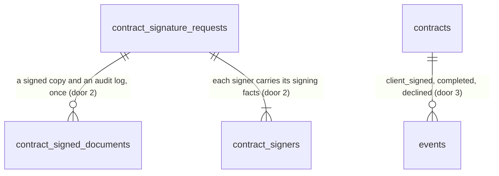

# Signature webhook (ROADMAP Phase 4 item 3)

## Problem

A contract can be sent for signature and signed in DocuSeal (item 2), but the app never learns of it. The contract stays `pending_signature` forever, so the countersign form never appears (it waits for `client_signed`), the pipeline never shows the deal as Completed, and the signed PDF and DocuSeal's audit log exist only inside the DocuSeal account: if that account lapses, the evidence of who signed what goes with it. Staff have to open DocuSeal and download by hand. Today the only way a status moves is by hand: any owner, admin or estimator can set `contracts.status` through PostgREST or `apply_contract_transition` with no signature behind it, so "Completed" does not yet mean "signed".

ROADMAP decision 21: "Nobody can be sold a contract that cannot complete (the DocuSeal webhook, signed PDF and audit log are still open)". The source gives no volume or time figures.

When this ships:
- The customer signs on `/sign/<token>` and the contract moves to **Client signed** within seconds; the contractor's form appears in the contract page.
- The owner or admin countersigns, the contract moves to **Completed**, and the page offers the signed PDF and the audit log for download, with who signed, when, and from which address.
- Nobody on staff can mark a contract signed by hand any more.

## Flow

This reuses the database-side HMAC check and anonymous-RPC pattern of n8n's callbacks (AD-074, AD-075), the public-prefix pattern of `/api/automation/` (AD-072), the system outbox writer for a non-member actor (AD-069), the contract events and their names (AD-011, AD-136), the fetch-only adapter style and the `docuseal` adapter of item 2 (AD-078, AD-140), and the contract reader and page (AD-137), instead of verifying in the app with a service-role key, a second transition writer, or an SDK.

1. DocuSeal -> `POST /api/webhooks/docuseal` (door 4): `proxy.ts` (exists) lets the prefix through; the route checks the header shape, reads the raw body text and hands both, unchanged, to `makeReceiveSignatureEvent` (new use case, placement per conventions).
2. `makeReceiveSignatureEvent` calls `public.signature_webhook` (door 1, anon) with no documents. The database verifies the HMAC against the Vault secret, finds the request and the signer, and either applies the event at once (`form.completed`, `form.declined`), ignores it, or, for `submission.completed`, answers `documents_needed` with the two file URLs and writes nothing.
3. For `documents_needed`: `SignedDocuments.fetch` (door 5, adapter in `web/infrastructure/docuseal`, exists as a folder) downloads the signed PDF and the audit log from DocuSeal.
4. `makeReceiveSignatureEvent` calls `public.signature_webhook` again with both files. In one transaction the database stores them (door 2), completes the request, moves the contract (door 3) through `client_signed` if it is still `pending_signature` and then to `completed`, writes the events and the outbox rows (`private.enqueue_outbox_for_system`, exists).
5. out: `200 {outcome}`; a failure after a valid signature is `503`, which DocuSeal retries (4xx and 5xx for 48 hours, per its docs).
6. Staff: `/contracts/[contractId]` (exists) reads the signed copy through `ContractReader` (exists, extended) and links the two downloads (door 6); the signed contract arrives as the pipeline's Completed stage through `pipelineStage` (exists, unchanged).

## Impact

| Front | What changes |
| --- | --- |
| domain | Existing term `contract status`: `client_signed`, `completed` and `declined` become reachable in production. Who branches on them today: `pipelineStage` (Completed), `assert_site_deactivatable` (blocks `pending_signature`, `client_signed`, `completed`; `declined` frees the site), `signingState` and the contract page, the `/sign/<token>` page (AC 19, 20 of item 2). None change; the live run is their first real input. |
| domain | Existing term `request status` gains `completed` and `declined`. Who branches on it: `isLiveRequest`, `signingState`, `signature_view` (passes it to the page), `contractor_signing_source`, the one-live unique index (only `creating` and `open` are live, so both new values free the contract). The `signingState` table gets two rows. |
| domain | New term `signed copy`: the signed contract PDF as DocuSeal produced it, with its audit log, stored unchanged. New term `signer facts`: when, from which address and with which browser each party signed. Both live in `web/domain/contract` and the new tables. |
| permissions | `contracts.status` stops being writable by members and `apply_contract_transition` stops being callable by them (door 3). The staff app calls neither (`transitionContract` is built in the container and no action uses it), but `transitions.sql` calls both as `authenticated` (C1597 to C1618 and the grant pins), and those rows must change to expect `42501`. |
| events | New `events.type` values `contract.client_signed`, `contract.completed`, `contract.declined`, each with an outbox row. The events n8n workflow ignores types it does not route, so nothing reacts until item 4's W2/W4. |
| stored data | One new table, three new columns on `contract_signers`, a new `completed_at` and two new status values on `contract_signature_requests`. Nothing to migrate: the demo's three contracts have no request and stay as they are. |
| personal data | The signer's IP address and browser string are stored with the contract. Members of the org read them; nothing else does. No deletion path before the org's cascade. |
| config | Vault secret `docuseal_webhook_secret` (the `whsec_...` value from the webhook's HMAC tab), set by the owner. In DocuSeal: one webhook for the account with `form.completed`, `form.declined` and `submission.completed`. It reaches the app only at a public URL: production needs a redeploy (owner's go-ahead), a local run needs a tunnel. Nothing is deployed or configured by this plan. |
| docs | The DocuSeal facts learned (HMAC scheme, retry rule, payload shapes) go into `CONTEXT.md`. |

## Relations

One-way constraints: a request holds at most one document of each kind (primary key on request and kind); a stored document is never updated or deleted; a request is `completed` only together with its completion time; every reference is composite on `(id, org_id)` (AD-003). No columns and no types here.

## Surface

| Route | In | Out | Status |
| --- | --- | --- | --- |
| `POST /api/webhooks/docuseal` | raw body; header `X-Docuseal-Signature: <unix seconds>.<hex>` | `{outcome, reason?}` where outcome is applied, duplicate or ignored · `{error}` where error is unauthorized, malformed or unavailable | `200`, `400`, `401`, `503` |
| `rpc signature_webhook` (anon) | `p_body`, `p_signature`, `p_documents` (null on the first call) | `{outcome, reason?, documents?}` where outcome is applied, duplicate, ignored or documents_needed | `200`; `42501` (bad, stale or unconfigured signature), `22023` (malformed body or documents) |
| `GET /contracts/[contractId]/signed-pdf` | the id | the stored signed PDF, attachment `<number>-signed.pdf` | `200`, empty `404`, signed-out redirected to `/login` |
| `GET /contracts/[contractId]/audit-log-pdf` | the id | the stored audit log, attachment `<number>-audit-log.pdf` | `200`, empty `404`, signed-out redirected to `/login` |
| DocuSeal file URLs (consumed, not served) | the two URLs of the body | PDF bytes | `2xx`; anything else is `503` for us |

## Landing

| One-way door | Literal shape | Alternative rejected |
| --- | --- | --- |
| 1. The webhook is verified, and applied, in the database | `public.signature_webhook(p_body text, p_signature text, p_documents jsonb default null) returns jsonb`, `security definer`, `search_path = ''`, `revoke from public`, `execute` to `anon, authenticated`. It reads Vault `docuseal_webhook_secret` and raises `42501` unless `p_signature ~ '^[0-9]{1,12}\.[0-9a-f]{64}$'`, the timestamp is within 300 s of `now()` and the hex equals `encode(extensions.hmac(ts \|\| '.' \|\| p_body, secret, 'sha256'), 'hex')` (AD-074's shape, DocuSeal's header). It is the third `anon` write path and the advisors grow by its two lints. Handled: `form.completed`, `form.declined`, `submission.completed`; the rest answer `ignored`. The request is found by the submission id, the signer by the submitter id (`external_id` `<contractId>:<role>` is cross-checked when present). | Verify in the app and write with a service-role key: that key reads every tenant (AD-037, AD-073). Verify in the app, then call an `anon` RPC that trusts the caller: anyone with the publishable key could mark a contract signed. |
| 2. What is stored | `contract_signed_documents (request_id, org_id, kind text check in ('signed','audit_log'), content bytea not null, size_bytes integer check between 1 and 10485760, sha256 text check ~ '^[0-9a-f]{64}$', stored_at timestamptz default now())`, primary key `(request_id, kind)`, composite FK `(request_id, org_id)`; `sha256` is computed by the database from `content`. Members `select` it; `anon` and `authenticated` have no write and a trigger refuses update and delete. `contract_signature_requests.status` check gains `'completed'` and `'declined'` and the table gains `completed_at timestamptz null`, set exactly when `completed`. `contract_signers` gains `signed_at timestamptz null`, `signed_ip text null`, `signed_ua text null` (first write wins), readable by members. | A Storage bucket (AD-032 to AD-034): a webhook has no user, so an upload needs either the service-role key (rejected, door 1) or an `anon` insert policy gated by a capability slot (a second table, a second call, orphan files). Bytes in the row make completion one transaction: a contract is never `completed` without its signed copy. **This closes the 10 MiB cap and the database growth on the next file-bearing slice (invoices, amendments, attachments), which will have to choose Storage or copy this.** |
| 3. Who may write a contract status | `revoke update (status) on public.contracts from authenticated` and `revoke execute on function public.apply_contract_transition(uuid, text, text, text, jsonb) from authenticated`. `signature_webhook` moves a contract only `pending_signature -> client_signed`, `client_signed -> completed` and `pending_signature \| client_signed -> declined`, compare-and-set on the status read `for update`. Each move writes `events` `contract.<to>` with payload `{from, to, versionNo, via: "docuseal", requestId}` (`reason` on `declined`), `actor_id` null, and `private.enqueue_outbox_for_system` (extends AD-011, AD-069, AD-136). A SQL test pins the three moves equal to `applyContractCommand`. | Leave the grant: an estimator could mark a contract `completed` with no signature, and the audit trail would then say a signed contract exists. Keep `apply_contract_transition` for staff and add the webhook beside it: two writers whose rules can drift. |
| 4. The route and its public prefix | `POST /api/webhooks/docuseal`, flat; `/api/webhooks/` joins `PUBLIC_PREFIXES` beside `/api/automation/` (amends AD-072); every answer carries `Cache-Control: no-store`. | `/api/automation/docuseal`: that prefix means "n8n's callbacks" in the proxy, the docs and the tests; a second sender under it blurs who may call what. |
| 5. The document fetch | Port `SignedDocuments { fetch(urls: {kind: "signed" \| "audit_log", url}[]): Promise<{ok: true, files: {kind, bytes}[]} \| {ok: false, code: "rejected" \| "unavailable"}> }` in `web/application/ports`, adapter in `web/infrastructure/docuseal` on `fetch`: https only, host `docuseal.com` or `*.docuseal.com`, no `X-Auth-Token` and no cookies, `redirect: "manual"` (a redirect off the allowlist is refused), 30 s, a 10 MiB cap read while streaming, bytes must begin `%PDF-`. | Fetching any URL in the body: a leaked secret would turn the app into a request forwarder. Sending the API key to the file host: the links are signed, the key buys nothing and could leak. A method on `SignatureProvider`: widens the port every fake implements (ISP). |
| 6. The download URLs | `GET /contracts/[contractId]/signed-pdf` and `GET /contracts/[contractId]/audit-log-pdf`, flat by uuid (extends AD-137), attachment names `<number>-signed.pdf` and `<number>-audit-log.pdf`, any member of the org. Item 4's emails will link to them. | One route with a `?kind=` parameter: the name in a link says what it opens, and each route has one statuses table. |

- Nothing else in this change is hard to reverse.

## Criteria

### S1: The webhook is believed only when DocuSeal signed it (P1)

The route, the header, the signature check and the answers that do not depend on what the event says.

**Acceptance Criteria**

1. WHEN `POST /api/webhooks/docuseal` receives an `X-Docuseal-Signature` header of the form `<1 to 12 digits>.<64 lowercase hex>` THEN the route SHALL pass the exact raw body text and the header, unchanged, to `signature_webhook`.
2. IF the header is missing or not of that form THEN the route SHALL answer `401 {"error":"unauthorized"}` and call nothing.
3. IF the hex differs from `HMAC-SHA256(secret, timestamp + "." + raw body)` or the timestamp is more than 300 s from the database clock THEN `signature_webhook` SHALL raise `42501`, write nothing, and the route SHALL answer `401 {"error":"unauthorized"}`.
4. IF the Vault secret `docuseal_webhook_secret` is unset THEN `signature_webhook` SHALL raise `42501` for every call.
5. IF the signature is valid but the body is not a JSON object with a string `event_type` THEN `signature_webhook` SHALL raise `22023` and the route SHALL answer `400 {"error":"malformed"}`.
6. WHEN the `event_type` is not `form.completed`, `form.declined` or `submission.completed` THEN the system SHALL answer `200 {"outcome":"ignored","reason":"event_not_handled"}` and write nothing.
7. IF the submission id of a handled event (`data.submission.id` for `form.*`, `data.id` for `submission.completed`) names no signature request THEN the system SHALL answer `200 {"outcome":"ignored","reason":"unknown_submission"}` and write nothing.
8. IF the database or the network fails after a valid signature THEN the route SHALL answer `503 {"error":"unavailable"}`, log the failure without the body, and leave nothing partly written.
9. The proxy SHALL let `/api/webhooks/` through without a session, and every answer of the route SHALL carry `Cache-Control: no-store`.

**Independent test:** post a signed body, an unsigned one and a stale one to the route with a fake database and read the answers; then send a real `form.viewed` from DocuSeal's webhook page and see `ignored`.

### S2: The customer signs and the contract moves (P1)

**Acceptance Criteria**

10. WHEN `form.completed` names the customer signer of an `open` request whose contract is `pending_signature` THEN the system SHALL move the contract to `client_signed`, write one `contract.client_signed` event with payload `{from, to, versionNo, via: "docuseal", requestId}` and `actor_id` null, and enqueue one outbox row, in one transaction.
11. WHEN `form.completed` names a signer of an `open` request THEN the system SHALL store that signer's `signed_at` from `data.completed_at`, `signed_ip` from `data.ip` and `signed_ua` from `data.ua`, and a value already stored SHALL not be replaced.
12. WHEN `form.completed` names the contractor signer THEN the system SHALL leave the contract status unchanged.
13. IF the submitter id of a handled event matches neither signer of the request, or `data.external_id` is present and is not `<contractId>:<role>` of the signer it names, THEN the system SHALL answer `ignored` with reason `signer_mismatch` and write nothing.
14. WHEN a handled event is delivered again THEN the system SHALL answer `200 {"outcome":"duplicate"}`, write no second event or outbox row and replace no stored value.
15. IF two deliveries of one event reach `signature_webhook` at once THEN exactly one SHALL apply and the other SHALL answer `duplicate`.

**Independent test:** sign as the customer on `/sign/<token>` in the sandbox, see the contract page change to Client signed and the contractor's form appear; replay the same delivery and see nothing change.

### S3: Both parties signed: the contract is completed with its signed copy (P1)

**Acceptance Criteria**

16. WHEN `submission.completed` names an `open` request and no documents are passed THEN `signature_webhook` SHALL answer `{"outcome":"documents_needed","documents":[{"kind":"signed","url":<combined_document_url>},{"kind":"audit_log","url":<audit_log_url>}]}` and write nothing.
17. IF `combined_document_url` or `audit_log_url` is missing or not a string THEN `signature_webhook` SHALL raise `22023`.
18. WHEN the app fetches the two files THEN the adapter SHALL request each URL with no credentials, over https, from host `docuseal.com` or a subdomain of it, without following a redirect, within 30 s and 10 MiB, and SHALL accept only bytes that begin `%PDF-`.
19. IF a fetch fails for any reason (host outside the allowlist, redirect, non-`2xx`, timeout, over the cap, not a PDF) THEN the route SHALL answer `503 {"error":"unavailable"}`, log the host and the status only, store nothing and leave the contract status unchanged.
20. WHEN `signature_webhook` receives both files for an `open` request THEN the system SHALL, in one transaction, store the two documents, set the request `completed` with `completed_at`, move the contract to `completed` (first to `client_signed`, with its own event and outbox row, when it is still `pending_signature`), and write the `contract.completed` event and one outbox row.
21. IF the documents passed are not exactly one `signed` and one `audit_log` entry, each valid base64 of 1 to 10,485,760 bytes beginning `%PDF-` THEN `signature_webhook` SHALL raise `22023` and write nothing.
22. WHEN `submission.completed` names a request that is already `completed` THEN the system SHALL answer `duplicate` and leave the stored documents as they are.
23. IF a handled event names a request that is not `open` (and not the `completed` of AC 22), or whose contract is `declined` or `voided`, THEN the system SHALL answer `ignored` with reason `request_closed` and write nothing.

**Independent test:** with the fake database and fake fetch, deliver `form.completed` then `submission.completed` and see `completed` with two documents; deliver them in the other order and see the same end state with both events.

### S4: The customer declines inside the signing form (P2)

**Acceptance Criteria**

24. WHEN `form.declined` names a signer of an `open` request whose contract is `pending_signature` or `client_signed` THEN the system SHALL set the request `declined`, move the contract to `declined`, write one `contract.declined` event whose payload carries `reason` (`data.decline_reason` trimmed to 500 characters, or null), and enqueue one outbox row, in one transaction.

**Independent test:** decline in the DocuSeal form on the sandbox and see the contract page say it was declined.

### S5: Staff see the result and download the signed copy (P1)

**Acceptance Criteria**

25. WHILE a contract is `completed` with a stored signed copy the contract page SHALL show `Signed contract` and `Audit log` download links to every member, and for each signer the name, the signing time in America/Vancouver and the IP address.
26. WHEN a member opens `GET /contracts/[contractId]/signed-pdf` (or `audit-log-pdf`) for a contract of their org with that document THEN the route SHALL answer `200` with `Content-Type: application/pdf`, `Content-Disposition: attachment; filename="<number>-signed.pdf"` (or `<number>-audit-log.pdf`) and exactly the stored bytes.
27. IF the id is malformed, the contract is missing or belongs to another org, or it has no such document THEN the route SHALL answer an empty `404`.
28. WHILE a contract is `declined` the contract page SHALL show `This contract was declined.` and no signing form and no Send button.

**Independent test:** after the S3 run, open the contract as the owner and as the viewer, download both files and compare their SHA-256 with the page's stored values.

### S6: Nobody on staff can mark a contract signed by hand (P1)

**Acceptance Criteria**

29. IF a member updates `contracts.status` through PostgREST or calls `apply_contract_transition` THEN the system SHALL refuse it with `42501` and leave the status as it was.
30. The system SHALL let `signature_webhook` move a contract only `pending_signature -> client_signed`, `client_signed -> completed` and `pending_signature` or `client_signed -> declined`, each compare-and-set on the status read under a row lock.

**Independent test:** as the owner, `PATCH` a contract's status through PostgREST and call the RPC, and see both refused.

## Out of scope

| Excluded | Why |
| --- | --- |
| n8n W2 and W4, emailing the signing link or the signed copy | ROADMAP Phase 4 item 4 |
| A staff button to fetch a signed copy again after DocuSeal's 48-hour retries are spent | recovery is DocuSeal's redelivery from its console; a button needs the API key and a new action, and no failure has been seen |
| Staff void, decline or regenerate, and a Contracts list | no screen drives them (item 2's out of scope) |
| Showing the decline reason, and a contract activity timeline | the reason is kept in the event; no timeline exists for contracts |
| Files over 10 MiB and a Storage bucket for contracts | door 2; revisit with the next file-bearing slice |
| Checking the cryptographic signature inside the PDF | we store DocuSeal's bytes and their SHA-256; validating PDF signatures is a separate piece of work |
| Rate limiting for `/api/webhooks/*` | shared with `/api/automation/*`, already listed under "Not yet" in `CONTEXT.md` |
| A webhook per tenant, self-hosted DocuSeal and the EU host | one account-level webhook and one secret; the roadmap names the global cloud |
| Deleting signer IPs on request | no deletion path exists for any record yet |

## Assumptions

| Assumption | Chosen default | Rationale | Confirmed? |
| --- | --- | --- | --- |
| One webhook serves every tenant | a single DocuSeal account-level webhook; the request is found by submission id | the app uses one DocuSeal key (item 2), so DocuSeal has no tenant notion | n |
| Which events are subscribed | `form.completed`, `form.declined`, `submission.completed`; others are answered `ignored` if sent | `form.completed` carries `ip` and `ua`; `submission.completed` carries the final files | n |
| Which id names the signer | the submitter id (`data.id` of `form.*`) against the stored `provider_submitter_id`, with `external_id` cross-checked only when present | the docs' example shows `external_id` null; the submitter id is stored by item 2 | n |
| Where the file URLs are | `combined_document_url` and `audit_log_url` at the top of `submission.completed`'s `data`, filled once completed | read from the docs' example (which shows them null on a created submission); the live run confirms | n |
| The links need no credentials | a plain `GET` of the signed link works | the docs' links are `docuseal.com/file/<signed id>/...`; the live run confirms | n |
| Order of events | `submission.completed` first moves a `pending_signature` contract through `client_signed` | `form.completed` of the customer may be retried after the final event | n |
| Retries | a `4xx` or `5xx` is retried by DocuSeal for 48 hours "for all production accounts"; a developer sandbox may not retry | docs text; a failed sandbox delivery is resent by hand from the DocuSeal console | n |
| Size cap | 10 MiB per file, so a request body is about 28 MB of base64 at worst | a text contract with 2,000 equipment lines measured 22 s to render, not megabytes; the live run measures a real one | n |
| Display time zone | America/Vancouver, as reports and expiry | one house rule | n |
| Reaching the endpoint for the live run | the owner either authorises a redeploy of Railway `web` or opens a tunnel to the dev server | nothing is deployed or pushed by this plan (blast radius) | n |

**Open questions:**

| # | Kind | Question | Until answered |
| --- | --- | --- | --- |
| 1 | resolved | How does DocuSeal authenticate its webhook? | `X-Docuseal-Signature: <timestamp>.<hex>`, HMAC-SHA256 of `<timestamp>.<raw body>` with the `whsec_...` secret, 5-minute tolerance (docs read 2026-11-07); a plain secret header is an extra option we do not use |
| 2 | blocks | Will the owner create the DocuSeal webhook, set the Vault secret `docuseal_webhook_secret` and give a public URL (redeploy or tunnel)? | the live halves of AC 10, 11, 20 and 24 cannot run; everything else is proven with fakes |
| 3 | blocks go-live | Has the tenant's counsel read the generated clauses and the e-signature flow for BC and the Electronic Transactions Act? (carried from item 2) | no real customer should be asked to sign |
| 4 | open | Does a developer sandbox retry failed deliveries? | AC 8 and 19 lean on a retry; written as "DocuSeal retries" for production and a manual resend meanwhile |

## Observable

| Surface | Decision | Landing |
| --- | --- | --- |
| API `POST /api/webhooks/docuseal` | response shape and error codes | AC 2, 3, 5, 6, 7, 8, Surface |
| API `POST /api/webhooks/docuseal` | who may call | AC 1, 3, 4 |
| API `POST /api/webhooks/docuseal` | versioning | n/a - DocuSeal's payload is the contract; unknown events are ignored (AC 6) |
| API `POST /api/webhooks/docuseal` | rate limit | n/a - a forged call costs one HMAC in the database and writes nothing; the shared gap with `/api/automation/*` is listed under Out of scope |
| API `rpc signature_webhook` | error shape and who may call | AC 3, 4, 5, 17, 21, Surface |
| API DocuSeal file URLs (consumed) | error shape, timeout, retry | AC 18, 19 (a retry is DocuSeal redelivering the webhook) |
| API `GET /contracts/[contractId]/signed-pdf` and `audit-log-pdf` | response shape, errors, who may call | AC 26, 27 (any member, as the contract PDF; signed-out by the proxy) |
| API `GET /contracts/[contractId]/signed-pdf` and `audit-log-pdf` | versioning, rate limit | n/a - same-origin links to stored files behind a session |
| screen `/contracts/[contractId]` | completed state and ordering | AC 25 |
| screen `/contracts/[contractId]` | declined state | AC 28 |
| screen `/contracts/[contractId]` | empty (a completed demo contract with no request) | existing - item 2 AC 28, "No signature request was recorded for this contract." |
| screen `/contracts/[contractId]` | loading | existing - `loading.tsx` beside the page |
| screen `/contracts/[contractId]` | error state | n/a - a missing contract is the existing not-found page; a download failure is the `404` of AC 27 |
| screen `/contracts/[contractId]` | unauthorised | AC 25, 26 - every member reads, nobody writes |
| screen `/contracts/[contractId]` | destructive action confirms | n/a - nothing on this page deletes or voids |
| document signed contract and audit log | structure | n/a - DocuSeal produces both and we store the bytes unchanged |

## Sources

- ROADMAP.md: M10, Phase 4 item 3, decision 21, the contract status model.
- `.specs/features/signature-provider/plan.md`: door 1, 2 and 3 (what item 3 extends), open question 3 (how DocuSeal authenticates its webhook).
- `.specs/STATE.md`: AD-003, AD-011, AD-015, AD-037, AD-060, AD-069, AD-072, AD-073 to AD-075, AD-135 to AD-137, AD-140 to AD-147.
- DocuSeal pages read 2026-11-07: `/resources/use-webhooks` (HMAC header `X-Docuseal-Signature`, format `[timestamp].[signature]`, signed content `[timestamp].[raw_body]`, 5-minute tolerance, `whsec_...` secret), `/docs/api/form-webhook.md` (four `form.*` events, payload with `ip`, `ua`, `completed_at`, `decline_reason`, `documents`, retry rule), `/docs/api/submission-webhook.md` (four `submission.*` events, `audit_log_url`, `combined_document_url`).
