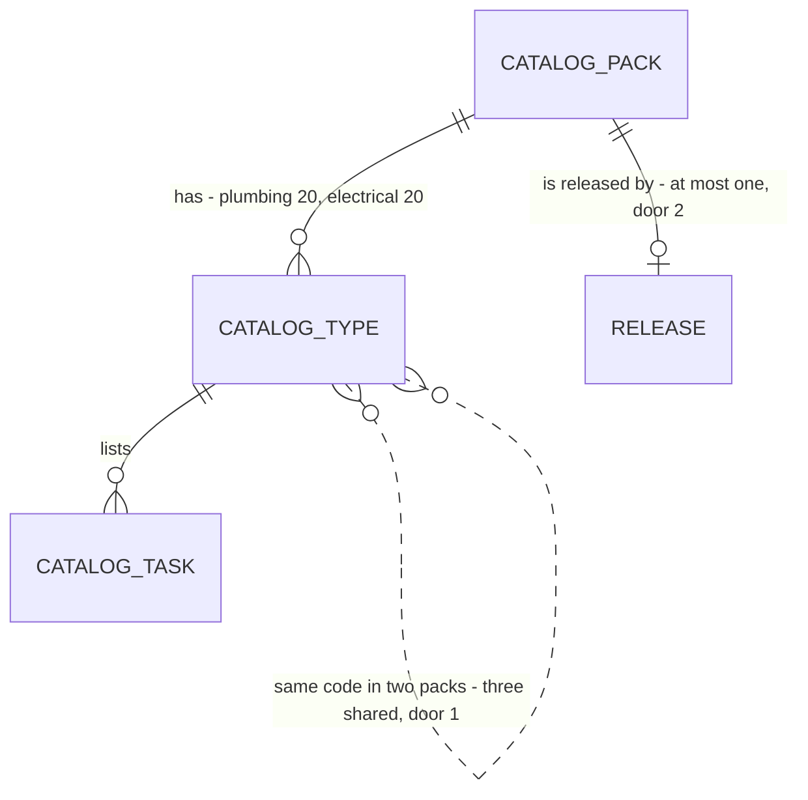

# Plumbing and electrical starter packs

Roadmap Phase 4.5 item 5: "Plumbing and electrical starter packs, reviewed by a practitioner". Item 6 (trade-neutral copy) is a separate feature and does not depend on this one.

## Problem

`seed_org_catalog(org, pack)` and the pack registry exist (AD-154, AD-161), but the only pack is `hvac`. A plumbing or electrical contractor who signs up in Phase 5 would get a 40-type HVAC catalog full of rooftop units and chillers, and an extraction prompt that names HVAC, so their customers' lists import untyped. They would have to build a catalog by hand in the Task library before the first agreement. The roadmap gives no figure and no pilot customer yet (decision 2 is open), so the size of the loss is not measured.

There is a second problem, and it is about safety. The roadmap says safety-critical checklists must not ship unreviewed (decision 5), and a backflow preventer, an eyewash station, a transfer switch or an emergency light is that kind of item. Nothing in the database stops an unreviewed pack from being seeded into a paying tenant's catalog, where the tenant's customers would read it as the contractor's own scope.

When this ships, the template holds a drafted `plumbing` pack and a drafted `electrical` pack of 20 types each, an org can be seeded with either or both, and the database refuses to seed a pack until the practitioner's review has released it. The draft ships unreleased: no tenant can receive it until the reviewer signs and a later migration releases it.

## Flow

Reuses `private.seed_org_catalog`, `private.catalog_packs` and `reset_task_library_type`: a pack is rows in the existing template tables, and the one function that copies it gains one guard instead of a second seeding path.

1. migration (new, door 1) -> `private.catalog_packs` (exists) registers `plumbing` and `electrical` unreleased, with their trade phrases
2. same migration -> `private.catalog_asset_types` (exists) and `private.catalog_asset_type_tasks` (exists) receive the 40 types with default months, spellings and tasks
3. `private.seed_org_catalog(org, pack)` (exists) refuses a pack whose release is empty (door 2), otherwise copies the pack as it does today and appends the trade phrase
4. `public.reset_task_library_type` (exists) restores a type from its own pack, unchanged
5. `matchAssetType` (exists) and `systemPromptFor` (exists) read the org's copy and trade phrase, unchanged
6. out of band: the practitioner reads a review sheet rendered from the template by a saved query (door 3), signs, and a later migration sets the pack's release

## Impact

| Front | What changes |
| --- | --- |
| domain | new term: `released pack` - a pack a named reviewer has signed off, so it may be seeded into an org. `hvac` is released by this migration (its source is the owner's own proposal template, accepted when the catalog shipped). Who branches on it: `seed_org_catalog` only |
| domain | existing term: `seed_org_catalog` "copies one pack, skips on any conflict, raises `22023` for an unknown pack" (AD-154) now also raises `55000` for an unreleased one. Callers today: `supabase/seed.sql` (hvac) and four SQL test files; Phase 5 provisioning will be the first real caller |
| domain | existing behaviour kept, now stated: when two packs hold the same code, the first pack seeded keeps its checklist and the second skips that type (AD-154's conflict rule). Three types are shared on purpose |
| stored data | nothing to migrate: no org holds a plumbing or electrical type today. `hvac` gets its release stamped in the same migration; no org row changes |
| tests | The two recipes that register their own test packs (`synonyms_as_data.sql`, `type_editor.sql`) release them in setup. Found while building: `catalog_seed.sql` (C1 to C3, C7), `cadence.sql` (C1076, C1078) and `demo_seed.sql` (C14) read the whole private template and pin it at 40 types and 174 tasks, which is the `hvac` pack; they gain `where pack = 'hvac'` with the same expected values, and the runner's pinned recipe and file counts move from 26 and 28 to 27 and 29. Written from the new checks, not edited to pass |
| docs | `CONTEXT.md`, `ROADMAP.md` item 5 (annotated, ticked only when the reviewer has signed and the packs are released), `STATE.md` AD-163 to AD-165. `PRODUCT.md` wording stays with roadmap item 6 |

## Relations

One-way constraints: a pack's id and trade phrase (door 1) and its release (door 2) are persisted. No columns and no types here beyond the doors.

## Surface

None - nothing consumed outside. `seed_org_catalog` stays closed to `anon` and `authenticated`; its new refusal is read only by the service role that Phase 5 provisioning will use.

## Landing

| One-way door | Literal shape | Alternative rejected |
| --- | --- | --- |
| 1. Pack ids and trade phrases | pack ids `plumbing` and `electrical`, trade phrases `plumbing` and `electrical`; rows in `private.catalog_packs`. The ids are what an org type's `pack` stores and what Phase 5's Checkout metadata will carry. Type codes are frozen in an org's copy at first seed (AD-155), so they are free to change until Phase 5 seeds the first tenant and fixed after | `plumbing_commercial` or a trade-plus-region id: Canada outside Quebec is a launch limit, not a pack property. One broad `trades` pack: an org that wants one trade would get both |
| 2. Release gate | `released_at timestamptz` on `private.catalog_packs`, null by default (nothing releases a pack unless a migration says so); `seed_org_catalog` raises `55000` when the pack's value is null; `hvac` set to the migration's time; the two new packs null. The migration that later sets it names the reviewer and the date in its header | A process-only gate (a Phase 5 checklist line "reviewer signed"): decision 5 says unreviewed checklists must not ship, and a checklist line cannot stop provisioning at 3 a.m. on a webhook retry. A default of `now()`: the safe direction is unreleased, so a pack someone registers in a hurry cannot seed by accident |
| 3. The review sheet is a saved query | `supabase/packs/sheet.sql`: one row per task with pack, code, name, default months, spellings, task position and description, for a pack name given as the only parameter | A hand-written markdown sheet: it goes stale the moment a migration changes a task, and the reviewer signs a document the database no longer matches. A JSON or TS source file that generates the migration: a build step and a second source of truth for content that is data |

| 4. The sheet is also a function (added while writing the checks) | `private.pack_review_sheet(p_pack text)` returns the sheet rows, ordered by code then position, executable by the table owner only; `supabase/packs/sheet.sql` is the approved saved query and calls it for each pack | Putting the select only in the loose file: the SQL runner cannot run a file outside `supabase/tests`, so a broken or stale sheet would reach the reviewer unproven. Changing the test runner to include `supabase/packs`: a runner change for one query |

- Nothing else in this change is hard to reverse

## Criteria

### S1: The template holds the two packs (P1)

The drafted content, in the template and not yet seedable.

**Acceptance Criteria**

1. The `plumbing` pack SHALL hold exactly the 20 types listed in `.specs/features/starter-packs/types-draft.md`, and the `electrical` pack exactly the 20 listed there, each with that list's code, name and default visit months
2. The system SHALL register the trade phrases `plumbing` and `electrical` for the two packs, each valid under the existing phrase rule (1 to 200 characters of letters, digits, spaces and `, & / ' -`)
3. The system SHALL give every type in the two packs at least 1 and at most 8 tasks, numbered from 1 with no gap, each description 1 to 120 characters after trimming
4. IF a type code in the two packs equals a type code in the `hvac` pack THEN that type SHALL carry the same name as the `hvac` type, and the codes shared that way SHALL be exactly `BACKFLOW_PREVENTER`, `PRESSURE_REGULATING_VALVE` and `EXPANSION_TANK`
5. IF two types in different packs carry the same name ignoring case THEN they SHALL carry the same code
6. The system SHALL hold no spelling in a new pack that equals, after lowercasing and collapsing every run of non-alphanumerics to one space, the spelling or the name of a type with a different code in any of the three packs
7. The system SHALL give every type in the two packs at least 1 spelling, with no spelling repeated within one type

**Independent test:** run the review-sheet query for each pack; count 20 types and read the three shared codes and their notes.

### S2: A pack seeds only once it is released (P1)

The database enforces decision 5, not a checklist.

**Acceptance Criteria**

8. The system SHALL record a release time for the `hvac` pack and none for `plumbing` or `electrical` after the migration
9. IF `seed_org_catalog` is called for a pack with no release time THEN it SHALL raise `55000`, insert no type, task or setting change, and leave the org's trade context as it was
10. IF `seed_org_catalog` is called for an unregistered pack THEN it SHALL raise `22023`, as today
11. WHEN `seed_org_catalog(org)` is called with no pack THEN it SHALL behave as today for `hvac`
12. The system SHALL let neither `anon` nor `authenticated` read or write a pack's release time or execute the seed
13. WHEN a released pack is seeded THEN the system SHALL return the number of types inserted

**Independent test:** `seed_org_catalog(org, 'plumbing')` raises `55000`; set its release time in a rolled-back transaction and the same call returns 20.

### S3: Released packs seed, combine and reset correctly (P1)

What the first plumbing or electrical tenant will get, proven with a test release.

**Acceptance Criteria**

14. WHEN a released `plumbing` pack is seeded into an org with a settings row THEN the org SHALL hold its 20 types with their tasks, months and spellings, each stamped with the pack, and its trade context SHALL read `plumbing`
15. WHEN a released `electrical` pack is seeded THEN the org SHALL hold its 20 types likewise and a trade context of `electrical`
16. WHEN an org that holds the `hvac` types is seeded with `plumbing` THEN the call SHALL return 17, the three shared types SHALL keep the `hvac` checklist, and the context SHALL read `HVAC and mechanical, plumbing`
17. WHEN an org seeded with `plumbing` is then seeded with `hvac` THEN the call SHALL return 37, the three shared types SHALL keep the `plumbing` checklist, and the context SHALL read `plumbing, HVAC and mechanical`
18. WHEN all three packs seed one org THEN it SHALL hold 77 types and the context SHALL list the three phrases once each, and seeding any pack again SHALL return 0 and change nothing
19. WHEN `reset_task_library_type` runs on a plumbing or electrical type THEN the type's name, months, spellings and tasks SHALL equal its own pack's, even where another pack holds the same code
20. WHEN an org holding all three packs imports a row worded as a spelling of a type THEN extraction SHALL type the row to that one type

**Independent test:** seed one empty org with the three packs in two different orders and compare the two catalogs for the three shared types.

### S4: The reviewer can read what they sign (P2)

The review sheet matches the database at all times.

**Acceptance Criteria**

21. WHEN the review-sheet query runs for a pack THEN it SHALL return one row per task with pack, type code, type name, default months, spellings, position and description, ordered by code then position
22. WHEN the query runs for `plumbing` THEN the number of rows SHALL equal the number of tasks in that pack, and for an unregistered pack it SHALL return no rows
23. The system SHALL NOT release a pack in this feature: the migration that sets a release time for `plumbing` or `electrical` is a later change that names the reviewer and the date

**Independent test:** run the query in the SQL editor and read it as the reviewer would.

## Out of scope

| Excluded | Why |
| --- | --- |
| Releasing the packs | Needs the reviewer (decision 5); AC 23. The roadmap item stays unticked until then |
| A screen to pick a pack or to show unreleased ones | Phase 5 onboarding owns trade selection |
| Fire alarm, sprinkler, elevator, gas and medical-gas packs | Safety-critical and licence-bound, wait for their reviewers (decision 5) |
| Weekly and every-N-weeks tasks | A 12-month grid cannot say them (Phase 6) |
| Province-specific code or standard citations in the checklists | Not verified for Canada; the reviewer decides what a checklist may cite |
| Starter agreement and contract wording per pack | Phase 5.5 |
| Trade-neutral product copy | Roadmap item 6, a separate feature |

## Assumptions

| Assumption | Chosen default | Rationale | Confirmed? |
| --- | --- | --- | --- |
| Pack size | 20 types per pack, the list in `types-draft.md` | Half the HVAC catalog: enough for a commercial contractor's common equipment and few enough for one reviewer to read in a sitting | n |
| Shared types | Three types (backflow preventer, pressure regulating valve, expansion tank) sit in both hvac and plumbing with one code, and the first pack seeded wins | AD-154 already skips on conflict; a plumber-only org still gets a complete catalog | n |
| Tasks and spellings | Drafted during the build from the type list, generic wording with no standard, interval or code citation | The reviewer adds citations if the province needs them; an invented citation is worse than none | n |
| Task cap | At most 8 per type, 120 characters each (AC 3) | The HVAC pack's longest list is shorter than this; the cap keeps a draft reviewable | n |
| Who is the reviewer | Not named yet | Decision 5 marks this as needing the owner | n |
| Seasonal tasks | None in the new packs; every task applies to every visit | A seasonal task needs a reviewer's call per task | n |
| `hvac` release | Stamped at the migration's time with no reviewer name | Its content came from the owner's own proposal template; the migration header says so | n |
| Release time vs reviewer name column | Only the time is stored; the later migration's header names the reviewer | One column is enough for the gate; the name is audit text, and git holds it | n |

**Open questions:**

| # | Kind | Question | Until answered |
| --- | --- | --- | --- |
| 1 | blocks go-live | Who reviews the plumbing pack and who the electrical pack (decision 5, "needs you")? | AC 23: the packs cannot be released, so no tenant can be seeded with them |
| 2 | open | Is the draft type list right for the pilot trade (decision 2, also open)? | The lists in `types-draft.md` stay a draft; AC 1 pins whatever the owner approves |

## Observable

| Surface | Decision | Landing |
| --- | --- | --- |
| rpc `seed_org_catalog` (service role only) | error shape and codes | AC 9, AC 10 |
| rpc `seed_org_catalog` (service role only) | who may call | AC 12 |
| rpc `seed_org_catalog` (service role only) | response shape | AC 13 |
| rpc `reset_task_library_type` | error shape, who may call | existing - unchanged (`42501`, `P0002`, `55000`, `23505`); AC 19 adds what it restores |
| document: review sheet query output | structure, order, the reader's next step | AC 21, AC 22; the reader signs, then a later migration releases (AC 23) |
| document: review sheet query output | empty state | AC 22 |
| collection: the two packs | grouping, naming, ordering, duplicates, the exception | AC 1, AC 4, AC 5, AC 6, AC 7 (grouping by pack, codes upper snake, shared types stated) |
| screen `/task-library` | empty, error, unauthorised states | n/a - no screen changes; an org's copy shows like any type |
| all new rows | versioning, rate limits | n/a - no endpoint is added |

## Sources

- `ROADMAP.md` Phase 4.5 item 5, "Trades and packs", decisions 5 and 14 - scope and the reviewer rule
- `.specs/STATE.md` AD-154, AD-155, AD-160 to AD-162 - the pack, code, spelling and trade-phrase shapes this extends
- `.specs/features/starter-packs/types-draft.md` - the type lists the criteria count against
