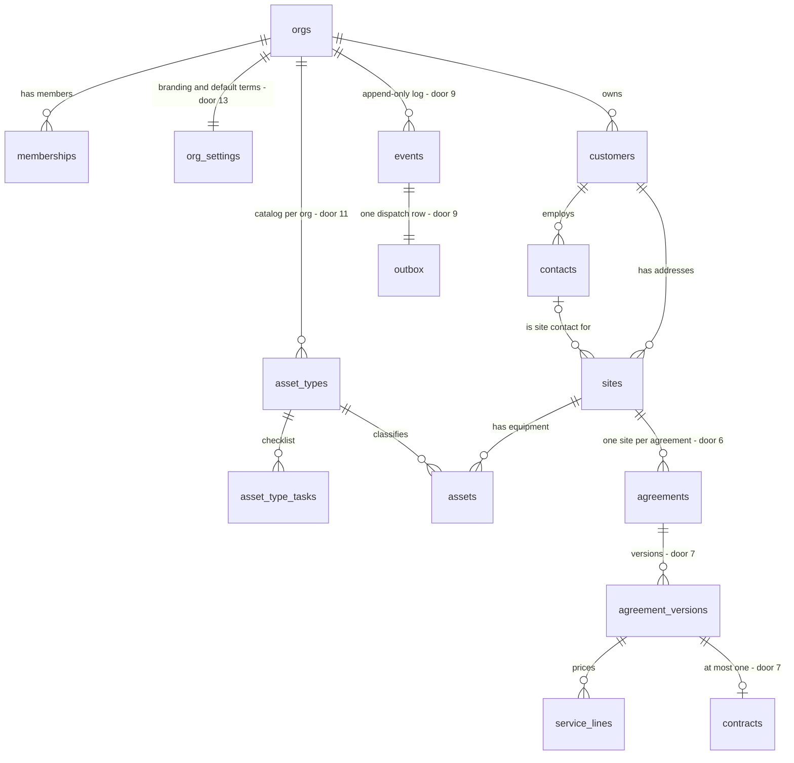

# Supabase init: tenant schema with RLS

## Problem

The app has no database. Every Phase 1 screen (dashboard, customers, site asset register, company settings), the domain layer and auth needs somewhere to persist tenant data. Isolation between contractor companies has to be enforced where the data lives. Without that, the first query written without an `org_id` filter shows one contractor's customers and prices to another, and in this market that ends the product.

Every later table copies three choices: the tenancy pattern, the key types and how statuses are stored. So the first migration sets precedent for all of them. The source gives no user evidence: this is foundation work that the rest of Phase 1 depends on.

When this ships, a dedicated Supabase project holds the full Phase 1 schema. A signed-in member can read and write only their own org's rows, as their role allows. An anonymous request reads nothing. Committed SQL tests prove all of this.

## Flow

This builds on Supabase's own primitives: `auth.users`, `auth.uid()`, the `authenticated` and `anon` roles and PostgREST's RLS enforcement. It does not add a tenancy layer of its own.

1. `supabase/migrations/<version>_init.sql` (door 10). Tables, constraints, grants, the `private` helper functions (door 2) and policies, applied with Supabase MCP `apply_migration` to the new project (door 12).
2. Postgres + RLS (exists, Supabase platform). Every request from `anon` or `authenticated` is filtered by policies that call `private.is_org_member` / `private.has_org_role`, which read `memberships` (door 5).
3. `supabase/tests/*.sql` (new, no door, placement). Each script is a transaction that sets `role authenticated` and `request.jwt.claims` for a fixture user, asserts with `raise exception` and ends in `rollback`. They run through MCP `execute_sql`.
4. Out: the security advisor (`get_advisors`) runs over the applied schema. CONTEXT.md, ROADMAP.md and STATE.md record the project ref and the tenancy decisions.

## Impact

| Front | What changes |
| --- | --- |
| domain | new term: `Org`, the tenant (a contractor company). Every tenant row carries `org_id` |
| domain | new term: `Membership`, a user's single role in one org (`owner`, `admin`, `estimator`, `viewer`) |
| domain | new term: `AgreementVersion`, the immutable unit a customer reviews. Service lines and the contract hang off a version, not off the agreement |
| domain | existing term: `PipelineStage` (AD-001) is unchanged. It stays derived in code from agreement and contract status, and is never stored |
| infra | a new Supabase project in `ca-central-1`; the existing project is untouched |
| repo | new `supabase/migrations/` and `supabase/tests/` at the repo root. No change to `web/` |
| docs | CONTEXT.md entries M1–M4, M6, M7, M10 and M11 get *What we built*, plus a Build log line. The ROADMAP Phase 1 item 1 is ticked. STATE.md gets decisions for doors 1, 2 and 4 |
| stored data | nothing to migrate: the project is new and empty |

## Relations

One-way constraints:
- `org_id` is not null on every tenant table, and every child-to-parent reference stays in the same org through a composite foreign key (door 1).
- `memberships` is unique on (org, user) (door 5).
- `agreement_versions` is unique on (agreement, version number) (door 7).
- `contracts` is unique on agreement version (door 7).
- `outbox` is unique on event (door 9).
- `asset_types` is unique on (org, code) (door 11).
- A site contact belongs to the site's customer (door 1).

## Surface

None. No app route is added. The tables reach the Supabase Data API only through the RLS in S1 and S2. The first route that consumes them is the Phase 1 auth/screens work.

## Landing

| One-way door | Literal shape | Alternative rejected |
| --- | --- | --- |
| 1. tenant key and same-org references | `org_id uuid not null references public.orgs(id) on delete cascade` on every tenant table. Parents add `unique (id, org_id)`. Children use `foreign key (customer_id, org_id) references public.customers (id, org_id)`. The site contact uses `foreign key (site_contact_id, customer_id) references public.contacts (id, customer_id)` | single-column FKs plus a per-table trigger that compares `org_id`: one forgotten trigger lets a site in org A point at org B's customer, and nothing declarative catches it |
| 2. RLS helpers every future policy calls | `private.is_org_member(p_org uuid) returns boolean` and `private.has_org_role(p_org uuid, p_roles text[]) returns boolean`, both `language sql stable security definer set search_path = ''`, in a `private` schema PostgREST does not expose. Policies call them as `(select private.is_org_member(org_id))` | org id and role in custom JWT claims: they stay stale until the token refreshes after a role change or removal, and they need an auth hook before any of this works |
| 3. primary keys | `id uuid primary key default gen_random_uuid()` | `bigint generated always as identity`: sequential ids are enumerable in the Phase 3 portal links, and they collide across orgs when rows are imported or merged |
| 4. status storage | `status text not null default 'draft' check (status in ('draft','sent','accepted','refused','changes_requested','expired','withdrawn'))`. Contracts: `default 'pending_signature' check (status in ('pending_signature','client_signed','completed','declined','voided'))` | Postgres `enum` types: a value cannot be removed or renamed without rewriting the type, and the TS state machine (Phase 1 item 3) owns transitions anyway |
| 5. membership roles | `memberships (org_id, user_id references auth.users(id) on delete cascade, role text not null check (role in ('owner','admin','estimator','viewer')))` with `unique (org_id, user_id)` | a role array per member: "can this member write" then becomes ambiguous, and M1 defines one role per member |
| 6. agreement scope | `agreements.site_id uuid not null`, with no `customer_id` column (the customer comes through the site) | an `agreement_sites` join (you chose one site); a redundant `customer_id`, which can disagree with the site's customer |
| 7. versions own priced content | `agreement_versions` with `unique (agreement_id, version_no)` and `check (version_no >= 1)`. `service_lines.agreement_version_id not null`. `contracts.agreement_version_id unique not null` | lines on the agreement itself: editing after `sent` would silently change what the customer reviewed, and a contract could not name the exact version that was accepted |
| 8. money | `bigint not null check (<col> >= 0)`, names suffixed `_cents`, CAD implied (for example `cost_per_visit_cents`) | `numeric` dollars: the JS side round-trips through floats, and the web already formats from integer cents (`web/lib/money.ts`) |
| 9. event log and outbox | `events` gets `revoke update, delete on public.events from anon, authenticated`. `outbox` gets `revoke all on public.outbox from anon, authenticated` (the service role dispatches) and `event_id uuid not null unique references public.events(id)` | an outbox members can read: it exposes dispatch state and attempts, nothing in the UI needs it, and `unique (event_id)` is what lets a retried dispatch not double-send |
| 10. migration file naming | `supabase/migrations/<version>_init.sql`, where `<version>` is the exact timestamp `apply_migration` records (read back with `list_migrations`) | a literal `0001_init.sql`: its version `0001` would not match the remote history, so a later `supabase db push` would try to apply it again |
| 11. equipment catalog per org | `asset_types.org_id not null`, `unique (org_id, code)`. `asset_type_tasks` reference their type with the same-org composite FK | global template rows with `org_id null`: that mixes "read all, write none" policies into every query, `unique` with nulls needs special handling, and a tenant edit would need override rows |
| 12. project region | new project `service-agreement` in `ca-central-1` | `us-west-2` like the existing project: tenants and their customers are Canadian, and a project's region cannot be changed after creation |
| 13. settings cardinality | `org_settings.org_id uuid primary key references public.orgs(id) on delete cascade` | settings columns on `orgs`: branding and terms change for different reasons and get different write rules (owner/admin only) |

- Nothing else in this change is hard to reverse

## Criteria

Fixture vocabulary used below: users `uA` (owner of org A), `uB` (owner of org B), `uV` (viewer in A) and `uE` (estimator in A). "Tenant tables" means every `public` table that has `org_id`.

### S1: Tenant isolation (P1)

A member sees and writes only their own org's rows, and an anonymous request sees nothing.

**Acceptance Criteria**

1. The system SHALL have row level security enabled on every table in schema `public`, with 0 rows from `select 1 from pg_tables where schemaname = 'public' and not rowsecurity`
2. WHILE the request runs as `uA`, a select on each tenant table except `outbox` (AC 30) SHALL return 0 rows whose `org_id` is org B
3. IF `uA` inserts a row with `org_id` = org B into any tenant table THEN the system SHALL reject it with SQLSTATE `42501`
4. IF `uA` updates a row of org A to set `org_id` = org B THEN the system SHALL reject it with SQLSTATE `42501`
5. IF a row in org A references a parent row of org B (a site with org B's `customer_id`) THEN the system SHALL reject it with SQLSTATE `23503`
6. IF a site's `site_contact_id` names a contact of a different customer THEN the system SHALL reject it with SQLSTATE `23503`
7. WHILE the request runs as `anon`, a select on each `public` table except `outbox` (AC 30) SHALL return 0 rows, and an insert into any `public` table SHALL fail with SQLSTATE `42501`

**Independent test:** run `supabase/tests/rls_isolation.sql` via `execute_sql`. It ends `rollback` and raises on the first failing assertion.

### S2: Roles (P1)

What a member can change depends on their role.

**Acceptance Criteria**

8. IF a membership is written with a role outside `owner`, `admin`, `estimator`, `viewer` THEN the system SHALL reject it with SQLSTATE `23514`
9. IF a second membership is written for the same user in the same org THEN the system SHALL reject it with SQLSTATE `23505`
10. WHILE the request runs as `uV`, a select on each tenant table except `outbox` SHALL return org A's rows
11. IF `uV` inserts into any tenant data table THEN the system SHALL reject it with SQLSTATE `42501`
12. IF `uV` updates or deletes a row of org A in any tenant data table THEN the system SHALL affect 0 rows
13. WHILE the request runs as `uE`, inserts into `customers`, `contacts`, `sites`, `assets`, `agreements`, `agreement_versions` and `service_lines` SHALL succeed
14. IF `uE` updates `org_settings` or inserts, updates or deletes `memberships` THEN the system SHALL reject the insert with SQLSTATE `42501` and affect 0 rows on update or delete
15. WHILE the request runs as `uA` (owner), updates to org A's `org_settings` and inserts into org A's `memberships` SHALL succeed

**Independent test:** run `supabase/tests/rls_roles.sql` via `execute_sql`.

### S3: Domain shape (P1)

The schema rejects data the domain says cannot exist.

**Acceptance Criteria**

16. IF `agreements.status` is written outside `draft`, `sent`, `accepted`, `refused`, `changes_requested`, `expired`, `withdrawn` THEN the system SHALL reject it with SQLSTATE `23514`, and an agreement inserted with no status SHALL have `draft`
17. IF `contracts.status` is written outside `pending_signature`, `client_signed`, `completed`, `declined`, `voided` THEN the system SHALL reject it with SQLSTATE `23514`, and a contract inserted with no status SHALL have `pending_signature`
18. IF an agreement is inserted without a `site_id` THEN the system SHALL reject it with SQLSTATE `23502`
19. IF a second `agreement_versions` row is written with the same `(agreement_id, version_no)` THEN the system SHALL reject it with SQLSTATE `23505`, and a `version_no` below 1 SHALL fail with `23514`
20. IF a second contract is written for the same `agreement_version_id` THEN the system SHALL reject it with SQLSTATE `23505`
21. IF any `_cents` column is written with a negative value, or `service_lines.visits_per_year` with a value below 1 THEN the system SHALL reject it with SQLSTATE `23514`
22. The system SHALL store every `_cents` column as `bigint`, with 0 rows from `information_schema.columns` where `column_name like '%\_cents'` and `data_type <> 'bigint'`
23. IF a second `asset_types` row is written with the same `(org_id, code)` THEN the system SHALL reject it with SQLSTATE `23505`
24. IF `assets.source` is written outside `manual`, `import` THEN the system SHALL reject it with SQLSTATE `23514`
25. IF `org_settings.repair_discount_pct` or `cpi_cap_pct` is written outside 0–100 THEN the system SHALL reject it with SQLSTATE `23514`
26. IF a site that has an agreement is deleted THEN the system SHALL reject it with SQLSTATE `23503`
27. WHEN an org is deleted (as service role) THEN the system SHALL leave 0 rows with that `org_id` in every tenant table

**Independent test:** run `supabase/tests/domain_constraints.sql` via `execute_sql`.

### S4: Event log and outbox (P1)

Events cannot be rewritten, and the outbox is for the dispatcher only.

**Acceptance Criteria**

28. IF an `authenticated` request updates or deletes an `events` row THEN the system SHALL reject it with SQLSTATE `42501`
29. WHILE the request runs as `uA`, an insert into `events` for org A SHALL succeed and a select SHALL return it
30. IF an `authenticated` or `anon` request selects, inserts, updates or deletes on `outbox` THEN the system SHALL reject it with SQLSTATE `42501`
31. IF a second `outbox` row is written for the same `event_id` THEN the system SHALL reject it with SQLSTATE `23505`

**Independent test:** run `supabase/tests/events_outbox.sql` via `execute_sql`.

### S5: Project applied and clean (P1)

The schema runs on a dedicated project, and the repo matches it.

**Acceptance Criteria**

32. The system SHALL run on a Supabase project named `service-agreement` in region `ca-central-1` with status `ACTIVE_HEALTHY`
33. WHEN the migration is applied THEN `list_migrations` SHALL return exactly one migration named `init`, and the repo SHALL contain exactly one file in `supabase/migrations/`, named `<that version>_init.sql`
34. WHEN the migration is applied THEN `get_advisors` (type `security`) SHALL return 0 lints at level `ERROR` or `WARN` whose metadata names schema `public` or `private`
35. The system SHALL contain these 15 tables in `public` and no others: `orgs`, `memberships`, `org_settings`, `customers`, `contacts`, `sites`, `asset_types`, `asset_type_tasks`, `assets`, `agreements`, `agreement_versions`, `service_lines`, `contracts`, `events`, `outbox`

**Independent test:** `list_projects`, `list_migrations`, `get_advisors` and `list_tables` against the new project, and `ls supabase/migrations`.

## Out of scope

| Excluded | Why |
| --- | --- |
| Equipment catalog, task library seed and the demo org | the next ROADMAP item. This feature creates the tables empty |
| Org creation, onboarding and a last-owner guard | onboarding is Phase 5. Orgs are created by the service role (the seed) until then |
| A transition function that writes the status, the event and the outbox row atomically | Phase 1 item 4 (ports and Supabase adapters) owns the write path. This feature only makes the shape and grants allow it |
| Storage buckets (logos, imports) and their policies | M15 storage arrives with the first upload: the settings logo or the Phase 2 import |
| `import_jobs`, portal tokens, signature audit tables | Phases 2, 3 and 4 add them with the features that write them |
| Generated TypeScript types and the env wiring in `web/` | Phase 1 items 4 and 5 (adapters, auth) |
| Visit frequency and equipment-per-version snapshots as structured tables | the Phase 3 agreement builder decides their shape. `agreement_versions` carries a `snapshot jsonb` placeholder until then |

## Assumptions

| Assumption | Chosen default | Rationale | Confirmed? |
| --- | --- | --- | --- |
| Verification profile | `light` (no declaration in AGENTS..md) | skill default. **I recommend raising it to `standard` for this feature**: it adds a recomputed coverage join and fault injection (for example, drop one policy and require a test to fail). That is exactly what catches an RLS test that passes for the wrong reason | y |
| How proofs run without the CLI or Docker | committed SQL scripts in `supabase/tests/`, each one transaction that ends `rollback`, run through MCP `execute_sql` and failing by `raise exception` | no `supabase`, `docker` or `psql` on this machine. This keeps the proofs in git, and the later "RLS isolation check" roadmap item extends them | y |
| Tests touch the real project | yes: fixture users are inserted into `auth.users` inside the rolled-back transaction, so nothing persists | the project is new and holds no customer data. Project creation and `apply_migration` still get your go-ahead at Build | y |
| Viewer read scope | a viewer reads every tenant table except `outbox`, settings and memberships included | M1 gives viewers read-only access, and the settings page shows branding to everyone | y |
| Estimator write scope | an estimator writes customer, site, asset and agreement data. Only owner and admin write `org_settings`, `memberships`, `asset_types` and `asset_type_tasks` | estimators build agreements. The catalog and terms are company policy | y |
| Percent storage | `numeric(5,2)` with `check (x between 0 and 100)` | a percent is not money. Two decimals cover a "2.5% CPI cap" | y |
| Deletes inside an org | `on delete no action` (the default) between domain tables, `on delete cascade` only from `orgs` (and from `auth.users` to `memberships`) | deleting a customer must not silently delete signed contracts. Deleting a tenant removes all of its rows. `no action` is checked at the end of the statement, so the org cascade can remove parent and child together, which `restrict` (checked per row) would block | y |
| Free-plan cost of a second project | create on the free plan; the cost is confirmed with `get_cost` / `confirm_cost` before `create_project` | the MCP requires a cost confirmation, and you approve it at Build | y |

**Open questions:**

| # | Kind | Question | Until answered |
| --- | --- | --- | --- |
| 1 | blocks go-live | Which Supabase organization should own the new project, if not `sdyznsizpwjsbpsfdzgp` (the only one listed)? | AC 32 uses the existing org by default (plan approved 2026-10-19 with this default) |

## Observable

| Surface | Decision | Landing |
| --- | --- | --- |
| Supabase Data API over the new tables | who may call it | AC 2–4, AC 7, AC 10–15, AC 30 |
| Supabase Data API over the new tables | error shape and codes | existing: PostgREST maps the SQLSTATE codes in S1–S4 to its standard error body. Nothing app-specific is added |
| Supabase Data API over the new tables | versioning | n/a: no external consumer exists yet. The schema itself is versioned by migrations (door 10) |
| Supabase Data API over the new tables | rate limits | n/a: platform defaults. Portal rate limits come with the Phase 3 portal (M15) |
| collection `memberships` roles | grouping and the exception that does not fit | AC 8, AC 9: one role per member per org; a user in two orgs has two rows |

## Sources

- ROADMAP.md, Phase 1 item 1, and the status model: fixes the table list and both status enums
- CONTEXT.md, domain glossary M1–M11: fixes roles, money in integer cents, versions and the site contact
- AGENTS..md: every change updates CONTEXT.md and ticks ROADMAP.md

