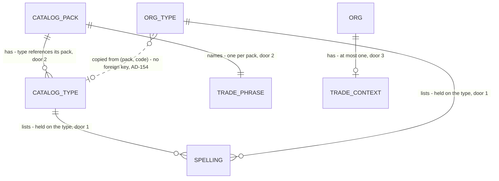

# Synonyms as data and the trade context

Roadmap Phase 4.5 item 4: "Synonyms as data (per pack and per org) and a trade context in the extraction prompt". Items 5 (plumbing and electrical packs) and 6 (trade-neutral copy) are separate features.

## Problem

The spellings that map a customer's list to an equipment type are a TypeScript constant, `SYNONYMS` in `web/domain/imports/index.ts`, keyed by the HVAC catalog's codes. An org cannot add or change one, a plumbing or electrical pack has nowhere to put its own, and a hand-made type whose derived code happens to equal an HVAC code (a new "RTU") silently inherits that code's spellings (noted in the type-editor plan, Impact). The extraction prompt is equally fixed: `SYSTEM_PROMPT` says "for an HVAC and mechanical service contractor" for every tenant, so Claude reads a plumber's list as HVAC. The roadmap gives no figure, miss rate or customer request; the pilot trade (decision 2) is still open.

When this ships, each catalog pack and each org type carries its own list of spellings, import matching reads the org's own lists, and the extraction prompt names the trades the org was seeded with. An HVAC org sees no change in matching.

## Flow

Reuses `matchAssetType`, the `AssetTypeCatalog` reader and `private.seed_org_catalog` / `reset_task_library_type` instead of a second lookup: the pack template is copied into the org once and the org's copy is what matching reads.

1. `extractImport` (exists) -> `AssetTypeCatalog` (exists) reads the org's types with their spellings (door 1) and the org's trade context (door 3)
2. `extractImport` -> `AssetExtractor` -> `claudeAssetExtractor` (exists) builds the system prompt with the trade context and sends the chunk
3. `matchAssetType` (exists) matches a row's wording by code or name, then by the spellings held by the org's own types; `ImportJobStore.recordExtraction` (exists) persists the rows
4. separate path: `private.seed_org_catalog(org, pack)` (exists) copies each pack type's spellings onto the org type it inserts and appends the pack's trade phrase (door 2) to the org's trade context
5. separate path: `reset_task_library_type` (exists) restores the type's spellings from its pack, as it already restores name, months and tasks

## Impact

| Front | What changes |
| --- | --- |
| domain | new term: `synonym` - another way a list writes a type, held by the org type that owns it. Replaces the code-keyed `SYNONYMS` constant, which is removed. Who branches on it today: `matchAssetType`, called only by `extractImport` |
| domain | new term: `trade context` - a short phrase naming the trades an org services ("HVAC and mechanical"), one per org, one per pack. Replaces the fixed sentence in `SYSTEM_PROMPT` |
| domain | existing behaviour: an org type no longer inherits spellings from a pack code by sharing the code. A hand-made "RTU" matches "rooftop unit" only if it holds that spelling |
| domain | existing term: the extraction request was "a function of the chunk and nothing else" (comment on `SYSTEM_PROMPT`). It becomes a function of the chunk and the org's trade context; the context is a trade phrase, never the company name |
| stored data | backfill: every `asset_types` row with pack `hvac` gets the spellings its code has in `SYNONYMS` today; every org holding such a type gets trade context "HVAC and mechanical"; hand-made types get none and an org with no pack type keeps a null context. Rows already extracted keep their type, because matching runs once at extraction |
| function | `private.seed_org_catalog(uuid, text)` and `public.reset_task_library_type(text)` are replaced in place with the same signatures; the demo seed and `catalog_seed.sql` keep calling them as before. `private.backfill_pack_synonyms()` is new and shared by the migration and its tests |
| tests | `extract.test.ts` C520 reads `SYNONYMS` and the 2026-10-19 migration; `extractor.test.ts` pins `SYSTEM_PROMPT` and its HVAC sentence. Both are rewritten from the new checks, not edited to pass. A pack must now be registered before its template rows, so `type_editor.sql` registers its `tl_plumb` pack in its setup; the port change reaches C508, C509, C518, C519, C551 and the runner's pinned counts (listed in the checks) |

## Relations

One-way constraints: a spelling belongs to exactly one type, never to a code (door 1); a pack is a registered row and its types must reference it (door 2); an org has at most one trade context and it may be absent (door 3). No columns and no types here beyond the doors.

## Surface

None - nothing consumed outside. `reset_task_library_type` keeps its signature and its SQLSTATEs (`42501`, `P0002`, `55000`, `23505`); only what it restores grows (AC 8).

## Landing

| One-way door | Literal shape | Alternative rejected |
| --- | --- | --- |
| 1. Spellings live on the type | `synonyms text[] not null default '{}'` on `private.catalog_asset_types` and on `public.asset_types`; a check that each element is lowercase, trimmed, 1 to 60 characters and holds a letter or digit | A row per spelling in its own table: no screen or check needs a spelling to have an identity yet, and the table would add an RLS policy, a composite foreign key and a cascade for no reader. Reverses by one migration if a "remembered from review" feature needs provenance |
| 2. Packs are registered rows | `private.catalog_packs (pack text primary key, trade_context text not null)`; `private.catalog_asset_types.pack` references it; the `hvac` row holds "HVAC and mechanical" | `trade_context` repeated on every template row: 40 copies of one fact that can disagree, and a pack with no types could not carry one |
| 3. The org owns its trade context | `public.org_settings.trade_context text` (null allowed, no default), a check that it is 1 to 200 characters of letters, digits, spaces and `, & / ' -` | Deriving it from the packs of the org's types at read time: it needs a definer read of the private template on every extraction, a hand-made-only org would have none, and the owner could never own the sentence ("from then on the org owns its copy") |

- Nothing else in this change is hard to reverse

## Criteria

### S1: Import matching reads the org's own spellings (P1)

A list's wording finds its type through spellings stored on the org's types, not through a constant.

**Acceptance Criteria**

1. WHEN no code or name of the org's types matches a row's wording and exactly one org type holds a spelling equal to it after `normalized` THEN extraction SHALL set that row's type to that type
2. IF two or more distinct org types hold the same spelling THEN extraction SHALL leave the row untyped
3. WHEN a code or name matches THEN extraction SHALL use it before any spelling
4. IF an org type has no spelling equal to the wording THEN extraction SHALL NOT type the row from another org's type or from a pack, even when the type's code equals a pack code
5. IF the org's types and spellings cannot be read THEN extraction SHALL return `unavailable` and record no rows
6. The system SHALL have one source of spellings, the database; `SYNONYMS` SHALL no longer exist in `web/domain/imports`

**Independent test:** import a list worded "Rooftop unit" and "Air handler" into the demo org; both rows arrive typed. Add a hand-made "RTU" type to an org that has none and import the same wording: the row stays untyped.

### S2: Packs and orgs carry the spellings (P1)

The pack template holds the spellings and every path that copies or restores a type carries them.

**Acceptance Criteria**

7. The `hvac` pack SHALL hold, for each code that has an entry in `SYNONYMS` today, exactly that entry's spellings
8. WHEN `seed_org_catalog(org, pack)` inserts a type THEN it SHALL set that org type's spellings to the pack type's; a type skipped by conflict SHALL keep its own
9. WHEN `reset_task_library_type` restores a type with a pack THEN the type's spellings SHALL equal its pack type's
10. WHEN a type is removed THEN its spellings SHALL go with it
11. WHEN the migration runs THEN every `asset_types` row with pack `hvac` SHALL hold the spellings its code has in the `hvac` pack
12. IF a spelling is not lowercase and trimmed, is empty, longer than 60 characters, or has no letter or digit THEN the database SHALL refuse the write with `23514`
13. The system SHALL let any member of the org read its types' spellings and only an owner or admin write them, as it already does for the type's other fields

**Independent test:** `seed_org_catalog(org)` on a new org, read its `RTU` type: spellings equal the pack's. Rename the spellings by hand, reset the type, read again: back to the pack's.

### S3: The extraction prompt names the org's trades (P1)

Claude is told which trades the list belongs to, from the org's data.

**Acceptance Criteria**

14. The `hvac` pack SHALL register the trade phrase "HVAC and mechanical"
15. WHEN `seed_org_catalog(org, pack)` runs for an org with a settings row THEN the org's trade context SHALL contain the pack's phrase exactly once, however often the call repeats; a second pack's phrase SHALL be added after the first, separated by ", "
16. WHEN the migration runs THEN every org holding a type with pack `hvac` SHALL have trade context "HVAC and mechanical" and every other org SHALL keep it null
17. WHEN the extractor builds a request THEN the system prompt SHALL contain the org's trade context verbatim and every other sentence it has today, unchanged
18. IF the org's trade context is null THEN the system prompt SHALL name no trade
19. IF a trade context is empty, longer than 200 characters or holds a character outside letters, digits, spaces and `, & / ' -` THEN the database SHALL refuse the write with `23514`
20. The request SHALL carry no org name, address or other identity beyond the trade context

**Independent test:** extract a chunk for the demo org and for an org with a null context; compare the two system prompts.

## Out of scope

| Excluded | Why |
| --- | --- |
| A screen to edit an org's spellings or trade context | The roadmap item is the data and the prompt. Owner/admin can write the rows (AC 13) but no UI writes them; the Phase 5 setup screen or a later Task library field is the writer |
| Saving a spelling when the estimator maps an unknown type in the review grid | A silent write with no screen to undo it; it needs the editor above first |
| Plumbing and electrical spellings and phrases | Item 5 ships those packs; this adds the table that holds them |
| The prompt using the org's item word ("areas", "stations") instead of "equipment" | Vocabulary reaches the prompt with item 6 and the non-HVAC packs, once there is a list that needs it |
| Fuzzy or similarity matching | Matching stays exact after `normalized`; a guess hides a row the review must see |
| Claude drafting spellings for the "Other" trade | Phase 5, with the catalog draft |

## Assumptions

| Assumption | Chosen default | Rationale | Confirmed? |
| --- | --- | --- | --- |
| Who writes spellings and the context after seeding | Nobody through the app in this feature; only seed, reset and backfill | Writing without a screen to review or undo is the part the roadmap does not ask for | n |
| `seed_org_catalog` when the org has no settings row | The types seed and the context stays null | Phase 5 creates `org_settings` before it seeds; failing the seed would block a catalog over a missing sentence | n |
| Two packs share a spelling for different codes in one org | Both org types keep it and a row with that wording stays untyped (AC 2) | Same rule as today: a guess hides a row the review must see | n |
| Trades joined for several packs | ", " in seed order | A list is enough for Claude; ordering carries no meaning | n |
| "Letters" in the trade phrase (door 3, AC 19) | ASCII letters and digits only, so an accented phrase is refused | Every pack and phrase in scope is English and the app is English-only; widening is one migration | y (owner, 2026-11-09) |
| Spellings of an `hvac` type the owner already changed by hand before this ships | Replaced by the backfill | None can exist: no screen or function writes this column today | n |

**Open questions:** none - all resolved or logged above.

## Observable

| Surface | Decision | Landing |
| --- | --- | --- |
| rpc `reset_task_library_type` | response and error shape, codes | existing - unchanged; AC 9 adds what it restores |
| rpc `reset_task_library_type` | who may call | existing - owner/admin of the type's org (`42501` otherwise) |
| extraction prompt (read by Claude) | structure, tone, what Claude does next | AC 17, AC 18 |
| extraction prompt (read by Claude) | empty state: no trade context | AC 18 |
| extraction prompt (read by Claude) | nothing identifying the tenant is sent | AC 20 |
| screen `/imports` review grid | empty, error and unauthorised states | n/a - no screen changes; a row that no spelling matches already shows `needs_type` (AC 2, AC 4) |
| all new rows and columns | versioning, rate limits | n/a - no endpoint is added |

## Sources

- `ROADMAP.md` Phase 4.5 item 4 and "Trades and packs" (per-org synonyms as data; the prompt takes the trade's context instead of the fixed sentence) - settles scope
- `.specs/STATE.md` AD-154 (catalog template keyed by `(pack, code)`, org type records its pack) - the shape this extends
- `.specs/features/type-editor/plan.md` Impact (a hand-made type inherits a code's synonyms) - the behaviour AC 4 closes
