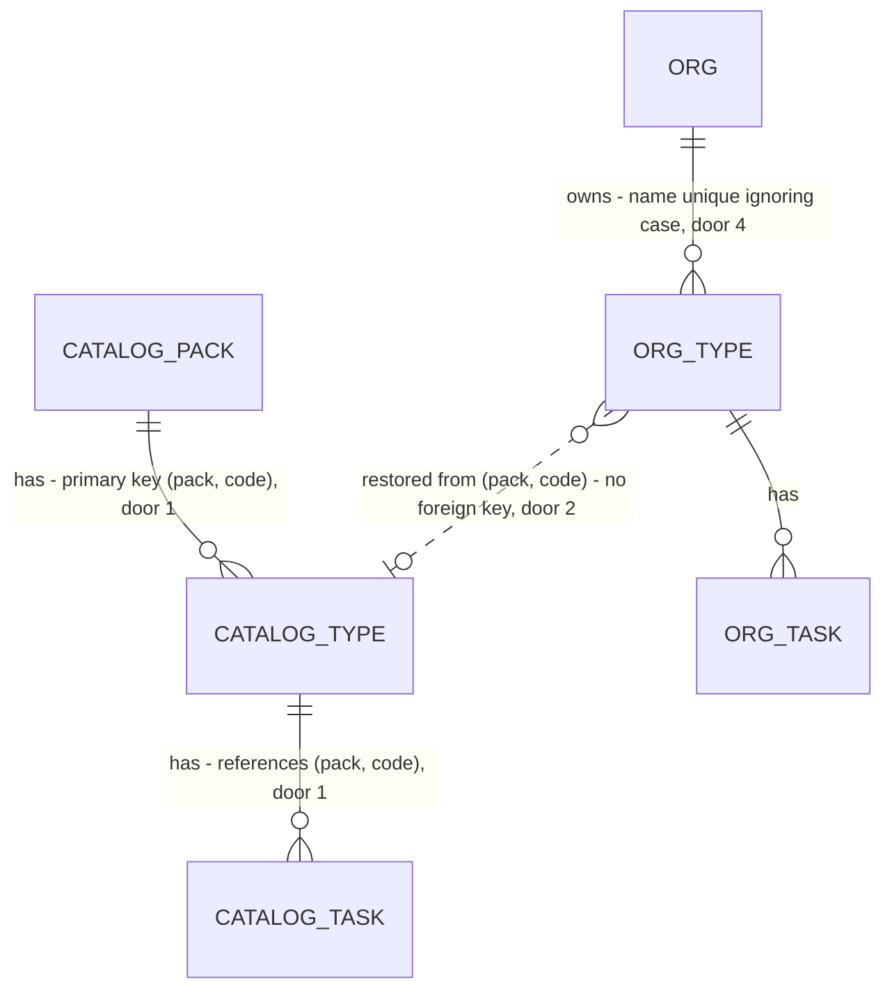

# Type editor and catalog packs

Roadmap Phase 4.5 items 1 and 2 (decision 22: "starting with the type editor and `seed_org_catalog(pack)`"). Items 3 to 6 are separate features.

## Problem

An org's equipment types are fixed at the 40 the HVAC template seeded. A contractor who services something that is not in the list (a "Sump pump", a "Grease trap") cannot add it, so an import row for it stays unmatched in the review grid and a site cannot carry it in an agreement. A type that is wrong for the business cannot be renamed or removed either; the only way is SQL. The task library page that edits checklists was taken out of the app on 2026-11-06, so even the checklist edit has no screen today. The roadmap gives no figure or customer request; the pilot trade (decision 2) is still open.

The catalog template also has no notion of a trade: `private.catalog_asset_types` is one flat list, so plumbing and electrical packs (item 5) and workspace provisioning (Phase 5) have nothing to select.

When this ships, an owner or admin opens the Task library, adds "Sump pump", renames it, removes it while nothing uses it, or resets a seeded type to what its pack says. A new org can be seeded from a named pack.

## Flow

Reuses `save_task_library_type`'s shape (security-invoker function, owner/admin check, per-type advisory lock, SQLSTATEs mapped to `WriteFailure`) and the `TaskLibraryReader` / `TaskLibraryStore` ports, so no second write path appears.

1. Task library screen (new route, restored from git history) -> server actions (new, placement per conventions) - validate the name, call the store, revalidate
2. `TaskLibraryStore` (exists) gains `create`, `rename`, `remove`, `reset` -> `public.create_task_library_type`, `rename_task_library_type`, `remove_task_library_type`, `reset_task_library_type` (door 3, 4, 5)
3. those functions persist `asset_types` and `asset_type_tasks` (exists); `asset_types_code_frozen` trigger (door 5) guards `code`; `asset_types_org_name_key` (door 4) guards names
4. out: `{ok: true}` or a `WriteFailure`; `TaskLibraryReader` (exists) lists the types on the next request
5. separate path: `private.seed_org_catalog(org, pack)` (exists, door 2) reads `private.catalog_asset_types` (exists, door 1) and stamps `pack` on each org type it inserts; called by `supabase/seed.sql` and, in Phase 5, by provisioning

## Impact

| Front | What changes |
| --- | --- |
| domain | new term: `pack` - a named set of catalog types and tasks; lives in the template tables and on each org type |
| domain | existing term: type `code` meant "the template's code"; it now also means "made from the name when a type is added, then frozen". Who branches on it today: import normalization (`SYNONYMS` in `web/domain/imports` is keyed by code and read through the org's own types), `?type=` links, and `site_service_scope`. A hand-made type whose derived code equals a synonym key (for example a new "RTU") inherits that code's synonyms |
| domain | existing term: removing a type. Nothing deletes a type today. Frozen snapshots in sent versions carry names and codes, not foreign keys, so removal cannot reach them (AD-060) |
| stored data | backfill: every `asset_types` row whose code is in the template gets pack `hvac`, the rest stay null. New unique index on name ignoring case: the template's 40 names are distinct ignoring case (read from the migration) and no screen or function can add a type today, so every live org holds only seeded names; the migration still fails loudly rather than deduplicate |
| function | `private.seed_org_catalog(uuid)` is replaced by a two-argument form with a default, so the demo seed and `catalog_seed.sql` keep calling it with one argument |
| screen | `/task-library` returns. The sidebar does not get its link back (owner's 2026-11-06 review); Company settings links to it |

## Relations

One-way constraints: template type identity is `(pack, code)` (door 1); an org type's pack is nullable, null meaning made by hand, with no foreign key to the template (door 2); `(org, lower(name))` unique (door 4); an org type's code never changes after insert (door 5). No columns and no types here beyond the doors.

## Surface

Four functions callable by any signed-in user; the app is their only caller today, but they are reachable through PostgREST. HTTP codes are PostgREST's mapping (403 for `42501`, 409 for `23503` and `23505`, 400 for the rest); the SQLSTATE is what the checks assert.

| Route | In | Out | Status |
| --- | --- | --- | --- |
| `rpc create_task_library_type` | `p_org_id`, `p_name` | the new type's `code` | 403 `42501` not owner/admin, 400 `23514` invalid name, 409 `23505` name taken |
| `rpc rename_task_library_type` | `p_type_code`, `p_name` | nothing | 403 `42501`, 400 `P0002` no such type, 400 `23514`, 409 `23505` |
| `rpc remove_task_library_type` | `p_type_code` | nothing | 403 `42501`, 400 `P0002`, 409 `23503` still in use |
| `rpc reset_task_library_type` | `p_type_code` | nothing | 403 `42501`, 400 `P0002`, 400 `55000` no pack or template row, 409 `23505` restored name taken |

`create` takes the org because a member of two orgs would otherwise have no way to say where the type goes (`save_task_library_type` picks the writable one by code; a new type has no code yet).

## Landing

| One-way door | Literal shape | Alternative rejected |
| --- | --- | --- |
| 1 Template packs | `private.catalog_asset_types` gains `pack text not null default 'hvac'`, primary key `(pack, code)`; `private.catalog_asset_type_tasks` gains `pack` and references `(pack, code)` | a table per pack: a new trade would need new DDL instead of rows. A jsonb blob per pack: cannot be joined by the seed function or tested row by row |
| 2 Org type remembers its pack | `public.asset_types.pack text null`, check `pack ~ '^[a-z][a-z0-9_]*$'`; null for a hand-made type; reset restores from `(pack, code)` | a foreign key to the template: the template is private and migration-owned, and a null for hand-made types would need a second table. Storing a template row id: breaks when a migration rewrites the template |
| 3 Seed signature | `private.seed_org_catalog(p_org uuid, p_pack text default 'hvac') returns integer`, `security invoker`, execute revoked from `public, anon, authenticated`; unknown pack raises `22023` | a separate `seed_org_pack` function: two entry points to keep in step. Making the pack argument required: breaks the demo seed and tests that call it with one argument |
| 4 Names are unique per org | `create unique index asset_types_org_name_key on public.asset_types (org_id, lower(name))` | checking inside the function only: two admins adding the same name at once would both pass |
| 5 Code is made from the name, then frozen | code = `upper(btrim(regexp_replace(name, '[^A-Za-z0-9]+', '_', 'g'), '_'))`, prefixed `T_` when it starts with a digit, cut to 40 characters, with `_2`, `_3`... appended to the first free one; a `before update` trigger `private.asset_types_code_frozen` raises `23514` when `code` or `org_id` changes | a random or uuid code: `?type=` links and synonym lookup by code lose meaning. Relying on the functions alone: the update policy lets an owner change `code` through PostgREST, which breaks frozen snapshots and import matching |
| 6 Reset reads the private template through a definer function (found while building) | `public.reset_task_library_type` is `security definer`, `search_path = ''`, `execute` to `authenticated` only; it finds the type with `private.is_org_member` and checks `private.has_org_role(org, array['owner','admin'])` itself, since RLS no longer applies; create, rename and remove stay `security invoker` | `security invoker` like the other three: `authenticated` has no right to read `private.catalog_asset_types`, so reset could never see the template. Copying the template into a public table: a second copy of the packs to keep in step |

- Nothing else in this change is hard to reverse

Door 1 and 3 reach past this feature: Phase 4.5 item 5 (plumbing and electrical packs) adds rows under them, and Phase 5 provisioning calls door 3. Door 5 reaches into the snapshots, `?type=` links and import matching, which all key on code.

## Criteria

### S1: Add a type (P1)

An owner or admin adds an equipment type the org does not have.

**Acceptance Criteria**

1. WHEN an owner or admin adds a type named "Sump pump" THEN the system SHALL create an org type with the trimmed name, code `SUMP_PUMP`, pack null, default visit months `{3,6,9,12}` and no tasks
2. WHEN the derived code is already taken in the org THEN the system SHALL use the first free of `<code>_2`, `<code>_3` and so on
3. WHEN a name starts with a digit THEN the system SHALL prefix its code with `T_` (for "2-pipe fan coil", `T_2_PIPE_FAN_COIL`)
4. IF the trimmed name is empty, longer than 60 characters, or has no letter or digit THEN the system SHALL refuse with `23514` and the page SHALL show "Name the type in 1 to 60 characters, with at least one letter or number"
5. IF an org type already has the name ignoring case THEN the system SHALL refuse with `23505` and the page SHALL show "A type with that name already exists"
6. IF the caller is not an owner or admin of the org THEN the system SHALL refuse with `42501`

### S2: Rename a type (P1)

**Acceptance Criteria**

7. WHEN an owner or admin renames a type THEN the system SHALL change its name only, leaving id, code, pack, default months and tasks as they were
8. IF the new name equals another type's name ignoring case THEN the system SHALL refuse with `23505`; a name that differs from the type's own only by case SHALL be accepted
9. IF the new name is invalid by criterion 4 THEN the system SHALL refuse with `23514`
10. WHEN a type is renamed THEN versions already sent SHALL keep the name they were frozen with

### S3: Remove a type (P1)

**Acceptance Criteria**

11. WHEN the user chooses Remove THEN the page SHALL ask for confirmation naming the type before sending anything
12. WHEN an owner or admin removes a type that no asset, service line or import row uses THEN the system SHALL delete the type and its tasks in one transaction
13. IF an asset, a service line or an import row uses the type THEN the system SHALL refuse with `23503`, delete nothing, and the page SHALL show "This type is still used by assets, service lines or import rows"
14. WHEN a type is removed THEN agreement versions and contracts already sent SHALL read unchanged
15. IF a removal is refused or fails THEN the type and its tasks SHALL be exactly as before

### S4: Seed from a named pack (P1)

**Acceptance Criteria**

16. WHEN `seed_org_catalog(org, pack)` runs THEN the system SHALL insert that pack's types and tasks for the org, stamp each inserted type with the pack, and return the number of types inserted
17. WHEN `seed_org_catalog(org)` runs with one argument THEN the system SHALL behave as pack `hvac`: 40 types, 174 tasks
18. IF the pack has no template rows THEN the system SHALL raise `22023` and insert nothing
19. WHEN `seed_org_catalog` runs again for an org that already has the pack THEN the system SHALL insert nothing and return 0
20. WHEN the migration applies THEN the system SHALL set pack `hvac` on every existing org type whose code is in the template and leave the others null
21. IF the caller is `anon` or `authenticated` THEN `seed_org_catalog` SHALL refuse with `42501`

### S5: Reset a type to its pack (P2)

**Acceptance Criteria**

22. WHEN an owner or admin resets a type whose pack and template row exist THEN the system SHALL restore its name, default visit months and whole checklist (descriptions, order, task months) from the template, keeping id and code
23. IF the type has no pack, or the template no longer has its row THEN the system SHALL refuse with `55000` and change nothing
24. IF restoring the name collides with another type's name ignoring case THEN the system SHALL refuse with `23505` and change nothing
25. WHERE a type has no pack the page SHALL NOT show Reset for it

### S6: The Task library screen (P1)

**Acceptance Criteria**

26. The system SHALL serve `/task-library` for every signed-in member, listing types by name with the selected one (`?type=<code>`) showing its default months and checklist, and the page SHALL edit them as it did before it was removed (months, up to 40 tasks of 1 to 200 characters, `save_task_library_type`)
27. WHILE the signed-in role is estimator or viewer the page SHALL be read-only with no Add, Rename, Remove, Reset or Save control
28. WHEN the org has no types THEN the page SHALL show "No equipment types yet" and, to an owner or admin, the Add form
29. The Company settings page SHALL link to `/task-library`
30. The system SHALL reject a direct update of an org type's `code` or `org_id` with `23514`

**Independent test:** sign in as the demo owner, add "Sump pump", rename it "Sump pump (duplex)", remove it; reset RTU after deleting one of its tasks and see the 6 template tasks back.

## Out of scope

| Excluded | Why |
| --- | --- |
| Plumbing and electrical pack content | roadmap item 5, needs a practitioner (decision 5) |
| Vocabulary label, synonyms as data, trade context in extraction | roadmap items 3 and 4 |
| Deactivating a type instead of deleting | the roadmap says remove only while unused; deactivation can follow if a contractor asks |
| Showing which assets or lines block a removal | a message is enough for v1 |
| Reordering types, moving a type between packs, changing a code | the code is frozen by design; ordering is by name |
| Picking a pack in the UI, "update to latest pack" | Phase 5 onboarding owns pack choice |
| Sidebar link | the owner removed it on 2026-11-06 |

## Assumptions

| Assumption | Chosen default | Rationale | Confirmed? |
| --- | --- | --- | --- |
| Where the page is reached | Restore `/task-library` from the commit before b765d12, linked from Company settings, not the sidebar | The owner removed the page from the sidebar after a reference review; an editor with no screen is useless | n |
| Name length | 1 to 60 characters | Longest seeded name is 42; the code is cut at 40 | n |
| New type's default months | `{3,6,9,12}` (the column default), edited afterwards on the page | The add form stays one field | n |
| Code starting with a digit | Prefix `T_` rather than refuse the name | A contractor naming "2-pipe fan coil" should not be turned away; the code is internal | n |
| One code in two packs | The first pack seeded wins, the second skips it (`on conflict do nothing`); reset uses the recorded pack | Codes are unique per org | n |
| Reset restores the name too | Yes | "Reset a type to its pack" in the roadmap; an unrenamed type is the usual case | n |
| Pack name format | lower-case snake, matching the check in door 2 | Plumbing, electrical, hvac | n |

**Open questions:** none - all resolved or logged above.

## Observable

| Surface | Decision | Landing |
| --- | --- | --- |
| screen `/task-library` | empty state | AC 28 |
| screen `/task-library` | loading state | existing - a route `loading.tsx` like the neighbouring pages |
| screen `/task-library` | error state | AC 4, 5, 13 and existing - `app/(app)/error.tsx` for anything unexpected |
| screen `/task-library` | unauthorised | AC 27 |
| screen `/task-library` | density and ordering | existing - types by name, as `TaskLibraryReader.list` already orders |
| screen `/task-library` | destructive action confirms | AC 11 |
| API `rpc` the four functions | error shape and codes | Surface table, AC 4-6, 8-9, 13, 23-24 |
| API `rpc` the four functions | who may call | AC 6, 27 |
| API `rpc` the four functions | versioning, rate limits | n/a - internal functions of this app, no external client and no version to negotiate |
| scheduled task | seed function output | AC 16-19 |

## Sources

- ROADMAP.md Phase 4.5 items 1 and 2, decision 22 - the scope, the code and uniqueness rules, and "remove only while unused"
- `.specs/features/task-library-page/plan.md` Out of scope - deferred exactly this, and AD-124 - the write pattern to follow
