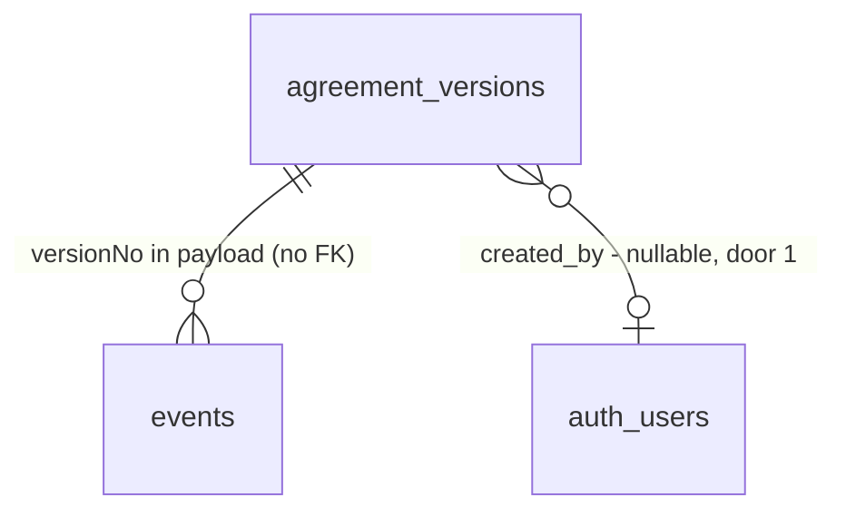

# Versioning

## Problem

A staff member who gets a customer's change request creates version 2 and has no way to see what changed. `agreement.revised` copies version n into n+1 and the page lists versions only as "created date" links (`agreement-view.tsx:190-200`). Nothing shows why a version exists, who made it, when it was sent, viewed or decided, or which version the customer was sent and which one they accepted. The only evidence is scattered across `events` rows that no screen reads (the sole `events` read in `web/` is the latest `agreement.sent` lookup, `infrastructure/supabase/agreements.ts:137`). The roadmap gives no figure; the cost is staff re-reading two PDFs side by side to find a price change, and not being able to prove which version was accepted.

When this ships, on the agreement page a staff member picks two versions and sees lines, prices, months, equipment and the annual total change. Each version shows its reason, author and sent/viewed/decided history, with "Sent" and "Accepted" markers.

## Flow

Reuses the `?version=` selector (`versionOf`, `page.tsx:26-38`), the `AgreementReader` port and the `events` rows already written; adds no new write path for history.

1. `GET /agreements/[agreementId]?version=n&compare=m` -> `agreements/[agreementId]/page.tsx` (exists) - parses both params, invalid falls back (AD-056).
2. `AgreementReader` (exists, `ports/index.ts`) + Supabase adapter (`infrastructure/supabase/agreements.ts`, exists) - now also returns per-version `reason`, `createdBy`, history from `events`, sent/accepted version markers, and lines (with months and equipment) for the compared version.
3. `domain/agreement` (exists, pure) - new pure function that diffs two versions' lines and annual totals (door 2).
4. `components/agreements/agreement-view.tsx` (exists) - renders the version list with markers, the history, and the comparison.
5. Write side: `public.create_agreement` and `apply_agreement_transition` (exist) record `created_by` and `reason` on the version they create (door 1).

## Impact

| Front | What changes |
| --- | --- |
| domain | new term: `VersionDiff` - per-line added / removed / changed (price, visits, months, equipment) plus annual total delta, lives in `domain/agreement` |
| domain | existing term: version "history" was nothing; now derived from `events` by `versionNo` in payload. Callers branching on it: none today |
| stored data | existing versions get `created_by` / `reason` backfilled from `events` (`agreement.revised` actor; reason from the preceding `agreement.changes_requested` payload, or null); version 1 has no creation event (AD-053), so its `created_by` stays null where unrecoverable |
| RLS / grants | `authenticated` has no update on `agreement_versions` (AD-060); new columns are written only by the definer RPCs, grants unchanged |
| deactivation | the page for an inactive site must still render the comparison (history stays readable) |

## Relations

One-way constraints: `reason` nullable text on `agreement_versions` (door 1); `created_by` nullable (door 1, old rows). No columns/types beyond that decision.

## Surface

| Route | In | Out | Status |
| --- | --- | --- | --- |
| `GET /agreements/[agreementId]` | `?version=<n>`, `?compare=<m>` | version list with markers and history, comparison panel | 200, 404 (unknown or other-org agreement) |

No new API route or Server Action. PDF route and portal unchanged.

## Landing

| One-way door | Literal shape | Alternative rejected |
| --- | --- | --- |
| 1. Who/why of a version | `agreement_versions.created_by uuid null` + `reason text null`, written by the definer RPCs at creation (`revise` copies the customer's `changes_requested` reason; staff note is optional) | Derive both from `events` at read: version 1 has no event (AD-053) and a staff note has no event to live on, so the data cannot be expressed |
| 2. Diff is a pure domain function | `diffVersions(a, b): VersionDiff` in `domain/agreement`, lines matched by `position`... see assumption A1 | Diff in SQL: cannot be unit-tested in the pure layer (purity.test.ts) and splits the money rules |
| 3. Sent/accepted markers | Derived from `events.payload.versionNo` of `agreement.sent` / `agreement.accepted` | A `sent_at`/`accepted` column on the version: duplicates `events`, the source of truth (AD-017) and can drift |
| 5. Which version an event belongs to (added mid-build, found in the live run: `send_agreement` writes `agreement.sent` with `{from, to}` and no `versionNo`) | The payload's `versionNo` when present, else the highest `version_no` whose `created_at <= event.created_at` | Write `versionNo` into the sent payload and backfill: `events` is append-only (update revoked), so old sent events could never be fixed and the history would stay wrong for every agreement already sent |
| 4. Author is stamped by the database (added mid-build) | `before insert` trigger on `agreement_versions` sets `created_by := auth.uid()` whenever a user is signed in | Each RPC passes `created_by`: a direct insert by a member could then name someone else as author |

- Door 1 reaches past this feature (audit data); record in `.specs/STATE.md` as a new AD.

## Criteria

### S1: See why a version exists and who made it (P1)

**Acceptance Criteria**

1. WHEN a staff member revises an agreement from `changes_requested` THEN the system SHALL store the customer's reason and the staff member's id on the new version.
2. WHEN a staff member creates version 1 THEN the system SHALL store their id on it and a null reason.
3. WHERE a version has a reason the page SHALL show it next to the version number; WHERE it has none it SHALL show nothing (no placeholder text).
4. WHEN a staff member edits the note on a draft version THEN the system SHALL save it (max 500 chars); IF it exceeds 500 THEN the system SHALL reject it with a field error. *(see A2)*
5. The system SHALL backfill `created_by` and `reason` for existing versions from `events`, leaving null where unrecoverable.

**Independent test:** revise a changes_requested agreement and read the reason and author on version 2

### S2: Per-version history and markers (P1)

**Acceptance Criteria**

6. The system SHALL list, per version, its sent, viewed and decided events (type, time, actor or "customer") read from `events` by `versionNo`.
7. The system SHALL mark the version whose number is in the latest `agreement.sent` payload as "Sent" and the one in `agreement.accepted` as "Accepted".
8. WHEN a version has no events THEN the page SHALL show "Not sent yet" in the history.
9. IF the viewer is not in the agreement's org THEN the system SHALL return 404 (RLS, existing).

**Independent test:** open an agreement that was sent, viewed and accepted and read the markers and history

### S3: Compare two versions (P1)

**Acceptance Criteria**

10. WHEN `?compare=<m>` names a different existing version THEN the page SHALL show, for each service line, added / removed / changed with old and new values for price per visit, visits per year, visit months and covered equipment types.
11. The system SHALL show the annual total of each version and the signed change in cents-exact dollars.
12. IF `compare` equals the shown version, is missing, unknown or not a number THEN the page SHALL show no comparison (and no error).
13. WHEN two versions have identical lines THEN the page SHALL say "No differences".
14. WHILE the agreement's site is inactive the comparison SHALL still render, read-only.
15. WHILE the viewport is 375 px the system SHALL stack the comparison without horizontal page scroll.

**Independent test:** open `?version=2&compare=1` and read the line diff and the annual change

## Out of scope

| Excluded | Why |
| --- | --- |
| Diffing term dates / valid-until / seasonal tasks | Roadmap names lines, prices, months, equipment, annual total only |
| Restoring/reverting to an older version | Not asked; revise already copies forward |
| Full agreement activity timeline | Separate roadmap item ("Agreement activity timeline from events") |
| Comparison in the customer portal or PDF | Staff-facing only |
| Free-text diff of "Service included" snapshot | Derived from asset types, not edited |

## Assumptions

| Assumption | Chosen default | Rationale | Confirmed? |
| --- | --- | --- | --- |
| A1 line matching | match lines by `position`, shown as "changed" when description differs | Lines have no stable id across versions (copied on revise) | n |
| A2 staff note | optional note editable on a draft version | Roadmap says "customer's change request or a staff note" | n |
| A3 compare UI | `?compare=` query on the existing detail page with a "Compare with" select, not a new route | Matches AD-056 pattern; shareable URL | n |
| A4 history source | `events` only; viewed shown once (first view, as recorded) | `portal_record_view` writes first view only | n |
| A5 test ids | next free check id C1319+ | Deactivation ended at C1318 | n |

**Open questions:** none blocking.

## Observable

| Surface | Decision | Landing |
| --- | --- | --- |
| screen agreement detail | empty state (one version, no events) | AC 8, 12 |
| screen agreement detail | loading state | existing `loading.tsx` |
| screen agreement detail | error / invalid params | AC 12 |
| screen agreement detail | unauthorised / other org | AC 9 |
| screen agreement detail | density and ordering | newest version first, oldest event first within a version (A4) |
| screen agreement detail | destructive action confirms | n/a - no destructive action added |
| screen agreement detail | mobile | AC 15 |

## Sources

- `ROADMAP.md:154` - the item's scope.
- `.specs/STATE.md` AD-017, AD-053, AD-056, AD-060 - event payload, version 1 without event, `?version=` fallback, no update grant.
