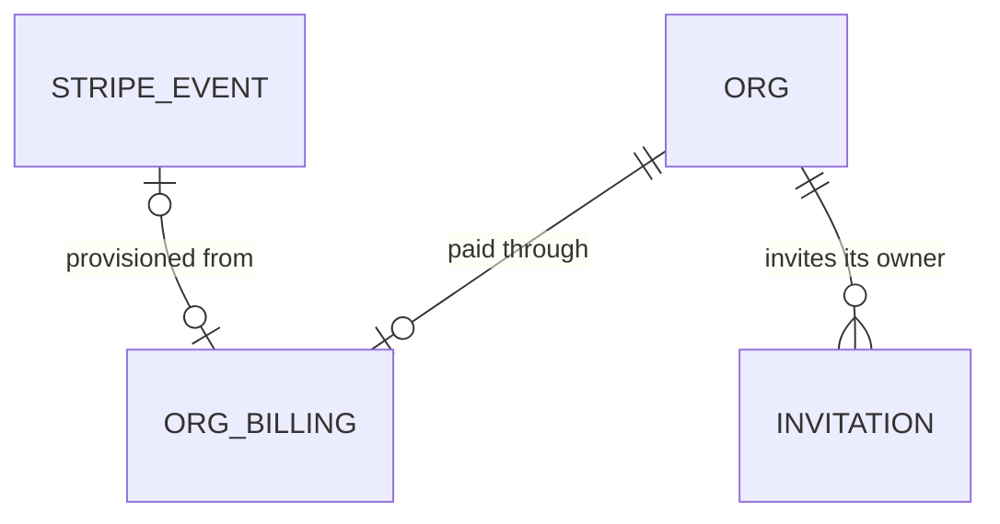

# Workspace provisioning

Roadmap Phase 5 item "Workspace provisioning from the webhook: org, settings, seeded packs, the chosen trades stored on the org, vocabulary, Stripe ids, owner invitation". It is the first reader of the Stripe ledger that billing-checkout built (AD-170). One feature at a time (decision 22). The Customer Portal, the first-login setup screen, the "Setting up your workspace" state and the duplicate-email refusal at Checkout stay separate items (Out of scope).

## Problem

A visitor can already pay for a trial (billing-checkout, register-seats), and Stripe's `checkout.session.completed` is stored once in `private.stripe_events`. Nothing reads it. So the visitor has paid (card collected up front) and has no workspace, no owner login and no email: billing-checkout go-live question 3 forbids setting `STRIPE_SECRET_KEY` in production for exactly this reason. The owner's pilot contractors can still be put on a plan only by hand-seeding (AD-021). The roadmap gives no sign-up volume or conversion figure and there are no customers yet, so none is claimed here.

When this ships, a completed Checkout turns, in the same database transaction that stores the event, into one org with its settings, the starter catalog of the trades the visitor ticked, the Stripe ids and an owner invitation for the checkout email; the owner then receives a sign-in link and lands in an empty, ready workspace. A redelivered event, or a second event for the same subscription, creates nothing twice. A checkout that cannot be provisioned (bad metadata, an email that already belongs to an org) leaves a visible reason on the stored event instead of a half-built tenant.

## Flow

Reuses `stripe_receive_event` and `private.stripe_events` (AD-170), `private.seed_org_catalog(org, pack)` with its release gate (AD-154, AD-163), the invitation table with `accept_invitations` and the Before User Created hook (AD-131), and the cookie-less `signInWithOtp` call the members page uses to deliver an invitation link (AD-131), instead of a second webhook, a service-role key (AD-037, AD-073) or a job queue.

1. Stripe -> `POST /api/webhooks/stripe` (exists) -> `receiveStripe` (exists) - verified and stored exactly as today
2. `public.stripe_receive_event` (exists, changed, door 2) - after storing a `checkout.session.completed` row it calls `private.process_checkout_event` (new, door 2), which locks the row and, when it is not yet processed, runs the provisioner inside a subtransaction and stamps the row `processed_at` or `process_error`
3. `private.provision_workspace(p_event_id)` (new, door 2) - reads `plan`, `trades`, `seats`, `company`, `phone` from the stored body's metadata (AD-169, AD-172) and the email, then creates the org, `org_settings`, `org_billing` (door 1), calls `private.seed_org_catalog` per released trade pack, and inserts the owner invitation
4. out of the RPC: `{ outcome, provisioned? }` where `provisioned` holds the owner email only when this call created the org (door 3)
5. `receiveStripe` use case (exists, changed) - when `provisioned` is present, asks the existing `InvitationLinkSender` (members page, door 3) to email the sign-in link, best effort; the route still answers `200 { outcome }`
6. later, unchanged: the owner opens the link, `/auth/confirm` calls `accept_invitations` (exists) and the owner becomes a member of the new org

## Impact

| Front | What changes |
| --- | --- |
| domain | new term: provisioned org - an org created from one Stripe subscription, keyed by `stripe_subscription_id`; lives in `public.org_billing` and `private.provision_workspace` |
| domain | new term: process state of an event - `processed_at` set (done), `process_error` set (refused, with a code), both null (not yet tried); lives on `private.stripe_events` |
| domain | existing term: `recorded` (a `stripe_receive_event` outcome) meant "stored"; it still means that and now does not imply a workspace exists. Branches on it today: the route and `makeReceiveStripeEvent`. A refused provisioning is still `recorded` |
| domain | existing term: `Webhook outcome` gains an optional `provisioned` value on the application port; `supabaseStripeEvents` and `makeReceiveStripeEvent` branch on the result shape |
| stored data | one new tenant table (`org_billing`) and two columns on the platform ledger. Events stored before this ships have both columns null and are not provisioned by the migration; a Stripe-dashboard resend of one is provisioned by the retry rule (AC 8). The demo org and any hand-seeded org have no `org_billing` row and nothing may require one |
| secrets / env | none new. The sign-in link uses the publishable key client the members page already builds |
| tests | `supabase/tests/stripe_events.sql` and the webhook wiring tests assert `recorded` and the RPC's JSON; they keep passing because `provisioned` is absent unless an org was created. No approved check is rewritten |
| not changed | `/register`, `/register/success`, the Checkout request, the six stored event types, every other route, RLS on every existing table, the members page |

## Relations

One-way constraints: at most one `org_billing` row per org, per Stripe customer and per Stripe subscription (door 1). `STRIPE_EVENT` stays a platform table with no foreign key to a tenant table; the link to `org_billing` is the subscription id both carry.

## Surface

| Route | In | Out | Status |
| --- | --- | --- | --- |
| `POST /api/webhooks/stripe` | unchanged | unchanged: `{ outcome }` · `{ error }`. A refused or failed provisioning is still `200 { outcome: "recorded" }` | `200`, `401`, `400`, `503` |

No new route. The database function `public.stripe_receive_event(p_body, p_signature)` keeps its signature and its errors (`42501`, `55000`, `22023`); its answer gains one optional key, `provisioned: { email }`, present only when this call created the org, which only the adapter reads.

## Landing

| One-way door | Literal shape | Alternative rejected |
| --- | --- | --- |
| 1. Where Stripe ids, plan, seats and trades live | `public.org_billing (org_id uuid primary key references public.orgs on delete cascade, stripe_customer_id text not null unique, stripe_subscription_id text not null unique, plan text not null, seats integer not null, trades text[] not null, other_trade boolean not null, created_at timestamptz not null default now())`; a tenant table under AD-003 (RLS on, `select` for `owner` and `admin` through `private.has_org_role`, no insert, update or delete privilege for `anon` or `authenticated`), written only by the provisioner. `plan` and `trades` hold the `PLAN_KEYS` and `TRADE_CODES` strings, which are never renamed (AD-166) | columns on `public.orgs`: that table is the tenancy root every policy joins, and billing fields would be readable by every member through `orgs` policies. A JSON blob on `org_settings`: cannot carry the two unique constraints that make provisioning idempotent |
| 2. Provisioning runs inside the webhook's transaction, as a subtransaction | `private.stripe_events` gains `processed_at timestamptz null` and `process_error text null`; `stripe_receive_event` calls `private.provision_workspace(event_id)` in a `begin ... exception when others` block, so a failure rolls back every row it wrote and stamps `process_error = <code>` (`invalid_metadata`, `email_in_use`, `already_provisioned`, `no_pack`, `not_a_subscription`, `failed`), while the event row stays; success stamps `processed_at`. A duplicate delivery whose row has `processed_at is null` is processed again under `select ... for update` | letting the error propagate: the whole event rolls back, Stripe retries for days, and a deterministic refusal (an email already in use) never settles. An async queue or `pg_cron` reader: a second moving part and a window where a paid org does not exist, for work that is a few inserts. Provisioning in the Next.js route with a service-role key: refused by AD-037 and AD-073 |
| 3. How the owner gets the sign-in link | new port `OwnerSignInLink.send(email)` in `application/ports`, adapter calls `signInWithOtp({ email, options: { shouldCreateUser: true } })` on a cookie-less publishable-key client (the members-page call, AD-131); invoked by the `receiveStripe` use case only when the RPC answered `provisioned`, once per org creation, failure logged as a code and never fatal | sending from the database (`pg_net` or an outbox row to n8n): the outbox is tenant-scoped and n8n would need the owner's address and a template for a one-off; the invitation email path already exists in the app. Sending on every `recorded`: a redelivery would send a second link |

- Door 2, as built, keeps the stamping `update` and the row lock in a private helper `private.process_checkout_event(event_id)` instead of inside `stripe_receive_event`, so the public function's one write stays `insert ... on conflict (id) do nothing` (billing-checkout C2528). The shape of the columns, the codes and the subtransaction is unchanged.
- Door 3, as built, reuses the existing `InvitationLinkSender` port and `supabaseInvitationLinkSender` adapter (members page) instead of a new `OwnerSignInLink` port: the same one call, so a second port would duplicate it. The call, the cookie-less client and the "only when `provisioned`" rule are unchanged.
- Nothing else in this change is hard to reverse: the seed order, the invitation lifetime, error-code spelling beyond the six, and placement of the provisioner functions are edits.
- Doors 1 and 2 reach past this feature: the Customer Portal reads `org_billing`, plan limits (item 8) read `plan` and `seats`, and the first-login setup screen reads `other_trade`. They belong in `STATE.md` as ADs at the end of the build.

## Criteria

### S1: A completed Checkout becomes a ready workspace (P1)

**Acceptance Criteria**

1. WHEN a `checkout.session.completed` event with `mode` `subscription`, a customer id, a subscription id, an email, and metadata `plan`, `trades`, `seats`, `company`, `phone` all valid is recorded THEN the system SHALL, in the same transaction, create exactly one org named `company`, one `org_settings` row with `legal_name` `company` and `phone` `phone`, and one `org_billing` row holding the customer id, subscription id, plan, seats and trades
2. WHEN `trades` names `hvac`, `plumbing` or `electrical` THEN the system SHALL seed that pack's types into the new org through `seed_org_catalog`, and `org_settings.trade_context` SHALL hold the phrases of the seeded packs
3. WHEN `trades` is `other` alone THEN the system SHALL seed no types and set `org_billing.other_trade` true; WHEN `trades` mixes `other` with a pack THEN the system SHALL seed the pack and set `other_trade` true
4. WHEN an org is created THEN the system SHALL insert one invitation for the lower-cased, trimmed checkout email with role `owner`, no inviter and an expiry 30 days out
5. WHEN an org is created THEN the system SHALL stamp the event's `processed_at` and leave `process_error` null
6. WHEN the owner signs in with the checkout address THEN `accept_invitations` SHALL make them the `owner` member of the new org
7. WHEN an event of any of the other five stored types is recorded THEN the system SHALL create no org and leave `processed_at` and `process_error` null

**Independent test:** with a signed `curl` (or `stripe trigger checkout.session.completed` with the metadata set), post the event, then read the org, its types and its invitation; sign in with the address and open Pipeline.

### S2: Nothing is created twice (P1)

**Acceptance Criteria**

8. WHEN an event id that is already stored arrives again and its `processed_at` is set THEN the system SHALL answer `200 { outcome: "duplicate" }` and create no org and no invitation
9. WHEN an event id that is already stored arrives again with `processed_at` null and `process_error` set or null THEN the system SHALL try to provision it again, and on success SHALL stamp `processed_at` and clear `process_error`
10. IF a second `checkout.session.completed` event with a different event id carries a subscription id that already has an `org_billing` row THEN the system SHALL create no org and stamp `process_error` `already_provisioned`
11. WHEN two deliveries of one event id are processed at the same moment THEN exactly one org SHALL exist afterwards and both calls SHALL answer `200`
12. WHEN a second delivery after a successful provisioning arrives THEN the system SHALL NOT request a second sign-in link

**Independent test:** post the same signed event three times, then the same subscription under a new event id; count orgs.

### S3: A checkout that cannot be provisioned leaves a reason, not a half-built tenant (P1)

**Acceptance Criteria**

13. IF `plan` is not a `PLAN_KEYS` value, `trades` holds no valid code, `seats` is not an integer from the plan's included seats to `MAX_SEATS`, `company` is empty or over 120 characters, or the email is missing THEN the system SHALL create no org and stamp `process_error` `invalid_metadata`
14. IF the checkout email already has a membership in any org, or a live invitation in any org THEN the system SHALL create no org and stamp `process_error` `email_in_use`
15. IF any step after the org insert fails, including `seed_org_catalog` raising for an unreleased pack, THEN the system SHALL leave no `orgs`, `org_settings`, `org_billing`, `asset_types` or `invitations` row from that attempt and stamp `process_error` `failed` or `no_pack`
16. IF the event's `mode` is not `subscription`, or the customer or subscription id is missing THEN the system SHALL create no org and stamp `process_error` `not_a_subscription`
17. WHEN provisioning is refused or fails THEN the system SHALL still store the event and answer `200 { outcome: "recorded" }`, with the error code on the stored event
18. The system SHALL never put the email, company or phone into `process_error`

**Independent test:** post a signed event with `plan=gold`; the response is `200 recorded`, no org exists, and the event row shows `invalid_metadata`.

### S4: The owner receives a sign-in link (P1)

**Acceptance Criteria**

19. WHEN the RPC answers `provisioned` THEN the system SHALL call `InvitationLinkSender.send` once with that email, from a client holding no session and no service-role key
20. IF the link request fails or throws THEN the system SHALL still answer `200 { outcome: "recorded" }`, log once the error name only, and keep the org and invitation, so the owner can request a link at `/login`
21. WHEN the outcome is `duplicate`, `ignored` or `recorded` without `provisioned` THEN the system SHALL NOT call `InvitationLinkSender.send`
22. The system SHALL NOT include `provisioned` or the email in the route's response body

**Independent test:** with a fake `InvitationLinkSender`, deliver the event twice and count calls.

### S5: Billing details are private to the tenant's managers (P1)

**Acceptance Criteria**

23. WHERE a signed-in user is an `owner` or `admin` of an org THEN the system SHALL let them select that org's `org_billing` row and no other org's
24. IF the user is an `estimator` or `viewer`, or `anon` THEN the system SHALL return no `org_billing` rows
25. The system SHALL give `anon` and `authenticated` no insert, update or delete privilege on `org_billing`
26. The system SHALL NOT require an `org_billing` row for any existing feature, so the demo org and hand-seeded orgs behave as today

**Independent test:** as the demo owner and as a second org's viewer, select from `org_billing`.

## Out of scope

| Excluded | Why |
| --- | --- |
| Stripe Customer Portal and a "Manage billing" button | Next roadmap item; it reads `org_billing.stripe_customer_id` once this lands |
| First-login setup screen, catalog review, template preview | Phase 5 item "First-login setup screen"; it reads `other_trade` |
| "Other" trade draft by Claude | Own item; this feature only records `other_trade` |
| "Setting up your workspace" polling and rewording `/register/success` | Own item; the page keeps its current static wording, which this feature now makes true |
| Refusing an already-used email at Checkout | Own item; here the collision is only caught after payment (AC 14) |
| Acting on `customer.subscription.updated/deleted` and `invoice.payment_failed` (suspend, downgrade, update plan or seats) | Needs plan limits (item 8); the ledger still records them |
| Refunds or notifying the owner of a refused provisioning | A person reads `process_error` for now; no admin screen or alert is built |
| Per-pack vocabulary | Packs carry no word for the serviced item; every new org reads "equipment" until the setup screen lets the owner change it |
| Quebec, other currencies | Decision 3 |

## Assumptions

| Assumption | Chosen default | Rationale | Confirmed? |
| --- | --- | --- | --- |
| Where the owner email comes from | `data.object.customer_details.email`, else `data.object.customer_email` | AD-172 sends `customer_email`; Stripe also echoes the buyer under `customer_details`. Neither field's presence in `checkout.session.completed` was read on a Stripe page for the plan, so the build confirms it from Stripe's docs before the test fixtures are fixed | n |
| The owner gets the link by an app-side request after the webhook, not by a promise to "send one later" | Door 3 | The success page already says an email will arrive and go-live question 3 blocks real keys until it is true. The alternative is to drop that line and tell the visitor to enter their address at `/login`, which the Before User Created hook already allows | n |
| Invitation lifetime | 30 days | The members page uses 14 and the owner can Resend; a brand-new owner has no member to resend for them, and a trial is 14 days | n |
| Provisioning gate | Any `checkout.session.completed` that is a complete subscription session, whatever `payment_status` says | A trial with a card up front reports no payment due; a failed charge later is a subscription event handled by item 8 | n |
| Several trades | Every ticked pack is seeded; vocabulary stays the default "equipment" | Decision 6; there is no per-pack word to take | n |
| Seats stored as bought | `seats` is the total from metadata, validated against the plan's included seats and `MAX_SEATS` | Matches AD-172; enforcement at invite time is a later item | n |
| Org name | The `company` metadata value, 1 to 120 characters, as typed | It is the buyer's own legal-name guess; the setup screen lets them correct it | n |
| Applying the migration | Waits for the owner's go-ahead, like billing-checkout's | Production data change; Stripe live keys stay unset until this and the SMTP sender are done | n |

**Open questions:** four. Two block go-live.

| # | Kind | Question | Until answered |
| --- | --- | --- | --- |
| 1 | blocks go-live | Supabase Auth SMTP sender on the verified Resend domain (roadmap item, decision 11) | The sign-in link reaches only the Supabase account owner until it is done; the build and tests run against fakes |
| 2 | blocks go-live | The owner runs one live test-mode checkout end to end and applies the migration | Everything is proven on rolled-back SQL and fakes first |
| 3 | open | What the owner does when a paying customer's event shows `email_in_use` or `invalid_metadata` | A person reads the column and refunds or fixes by hand; no alert exists |
| 4 | open | Does `checkout.session.completed` carry `customer_details.email` for a session created with `customer_email` | Resolved from Stripe's docs while building; the fallback in the assumptions covers either |

## Observable

| Surface | Decision | Landing |
| --- | --- | --- |
| API `POST /api/webhooks/stripe` | response shape and error shape with codes | existing - billing-checkout AC 11 to 20; AC 17 and AC 22 here keep it unchanged |
| API `POST /api/webhooks/stripe` | who may call it | existing - billing-checkout AC 11, 15, 16; provisioning runs only after the signature passes |
| API `POST /api/webhooks/stripe` | versioning, rate limit | n/a - the contract is Stripe's and unsigned calls stop before any write, as in billing-checkout |
| RPC `stripe_receive_event` | duplicates and retries | AC 8, 9, 10, 11, 12 |
| RPC `stripe_receive_event` | partial failure | AC 15, 17 |
| outbound sign-in link request | failure, secret handling, duplicates | AC 19, 20, 21 |
| table `org_billing` | who may read and write | AC 23, 24, 25 |
| table `org_billing` | empty state | AC 26 (absent for existing orgs and nothing requires it) |
| collection of orgs | duplicates | AC 8, 10, 11 |
| screen | any | n/a - no screen is added or changed; `/register/success` keeps its text |

## Sources

- `ROADMAP.md` Phase 5 provisioning item, Onboarding steps 2 and 3, Decisions 6, 9 and 22 - the item, several trades, one feature at a time
- `.specs/features/billing-checkout/plan.md` doors 2 and 3 and `.specs/STATE.md` AD-169, AD-170, AD-172 - the metadata keys and the ledger this reads
- `.specs/STATE.md` AD-131 (invitations, cookie-less link), AD-154 and AD-163 (`seed_org_catalog` and the pack release gate), AD-003, AD-037, AD-073
- `AGENTS..md` "Test that stay in the repo" - Stripe: applying it twice gives the result of once
